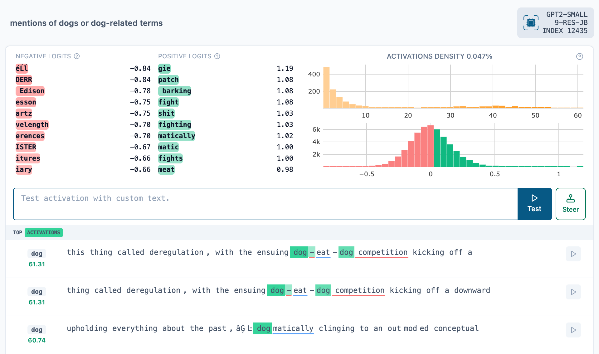

## Looking inside a language model

Before reading week we met two kinds of autoencoder:

:::{.incremental}
* An **autoencoder** compresses an image to a short latent vector $z$, then reconstructs it.
* A **variational autoencoder** tidies that latent space so that we can sample from it.
:::

. . .

Today we use the same architecture for a different purpose. We won't generate anything. Instead, we will ask what a language model is representing as it reads.

. . .

A **sparse autoencoder** makes $z$ much *longer* than its input but mostly zero, in the hope that each of its numbers means one thing.

# What's inside?

## Where we look

```{=html}
<!-- generated by pics/lec13_14_svgs.py: l13-tap -->
<svg viewBox="0 0 1100 276" width="100%" xmlns="http://www.w3.org/2000/svg" font-family="IBM Plex Sans, sans-serif" role="img" aria-label="GPT-2 small with a tap on the residual stream at the input to block 9">
<defs><marker id="l13t-k" viewBox="0 0 10 10" refX="9" refY="5" markerWidth="5" markerHeight="5" orient="auto"><path d="M0 0 L10 5 L0 10 z" fill="#222"/></marker><marker id="l13t-a" viewBox="0 0 10 10" refX="9" refY="5" markerWidth="5" markerHeight="5" orient="auto"><path d="M0 0 L10 5 L0 10 z" fill="#d9480f"/></marker></defs>
<path d="M150 78 H930" stroke="#e08a2e" stroke-width="7"/>
<rect x="20" y="44" width="130" height="68" rx="7" fill="#f2f2f2" stroke="#222" stroke-width="2.4"/>
<text x="85" y="75" text-anchor="middle" font-size="21.8" font-weight="600" fill="#000">tokens</text>
<text x="85" y="94" text-anchor="middle" font-size="16.6" font-weight="500" fill="#444">“The dog …”</text>
<rect x="180" y="44" width="120" height="68" rx="7" fill="#fadadd" stroke="#222" stroke-width="2.4"/>
<text x="240" y="84" text-anchor="middle" font-size="21.8" font-weight="600" fill="#000">Embed</text>
<rect x="335" y="44" width="190" height="68" rx="7" fill="#fde0b9" stroke="#222" stroke-width="2.4"/>
<text x="430" y="84" text-anchor="middle" font-size="21.8" font-weight="600" fill="#000">Blocks 0–8</text>
<rect x="655" y="44" width="190" height="68" rx="7" fill="#fde0b9" stroke="#222" stroke-width="2.4"/>
<text x="750" y="84" text-anchor="middle" font-size="21.8" font-weight="600" fill="#000">Blocks 9–11</text>
<rect x="930" y="44" width="150" height="68" rx="7" fill="#dcdcf0" stroke="#222" stroke-width="2.4"/>
<text x="1005" y="84" text-anchor="middle" font-size="21.8" font-weight="600" fill="#000">Next token</text>
<text x="590" y="56" text-anchor="middle" font-size="16.6" font-weight="600" fill="#e08a2e">residual</text>
<circle cx="590" cy="78" r="9" fill="#d9480f" stroke="#222" stroke-width="2"/>
<path d="M590 88 L590 172" fill="none" stroke="#d9480f" stroke-width="2.6" stroke-linejoin="round" marker-end="url(#l13t-a)"/>
<g>
<rect x="350" y="178" width="10" height="34" fill="#e47d55" stroke="#fff" stroke-width="0.6"/>
<rect x="360" y="178" width="10" height="34" fill="#f4caba" stroke="#fff" stroke-width="0.6"/>
<rect x="370" y="178" width="10" height="34" fill="#eb9f81" stroke="#fff" stroke-width="0.6"/>
<rect x="380" y="178" width="10" height="34" fill="#e06a3c" stroke="#fff" stroke-width="0.6"/>
<rect x="390" y="178" width="10" height="34" fill="#e6855e" stroke="#fff" stroke-width="0.6"/>
<rect x="400" y="178" width="10" height="34" fill="#e2764b" stroke="#fff" stroke-width="0.6"/>
<rect x="410" y="178" width="10" height="34" fill="#e8916f" stroke="#fff" stroke-width="0.6"/>
<rect x="420" y="178" width="10" height="34" fill="#e06b3c" stroke="#fff" stroke-width="0.6"/>
<rect x="430" y="178" width="10" height="34" fill="#f1baa4" stroke="#fff" stroke-width="0.6"/>
<rect x="440" y="178" width="10" height="34" fill="#efb29a" stroke="#fff" stroke-width="0.6"/>
<rect x="450" y="178" width="10" height="34" fill="#f5cdbd" stroke="#fff" stroke-width="0.6"/>
<rect x="460" y="178" width="10" height="34" fill="#ea9c7d" stroke="#fff" stroke-width="0.6"/>
<rect x="470" y="178" width="10" height="34" fill="#eb9d7f" stroke="#fff" stroke-width="0.6"/>
<rect x="480" y="178" width="10" height="34" fill="#f1bda9" stroke="#fff" stroke-width="0.6"/>
<rect x="490" y="178" width="10" height="34" fill="#e27247" stroke="#fff" stroke-width="0.6"/>
<rect x="500" y="178" width="10" height="34" fill="#e06c3e" stroke="#fff" stroke-width="0.6"/>
<rect x="510" y="178" width="10" height="34" fill="#dc5824" stroke="#fff" stroke-width="0.6"/>
<rect x="520" y="178" width="10" height="34" fill="#f3c3b1" stroke="#fff" stroke-width="0.6"/>
<rect x="530" y="178" width="10" height="34" fill="#e99676" stroke="#fff" stroke-width="0.6"/>
<rect x="540" y="178" width="10" height="34" fill="#da4c14" stroke="#fff" stroke-width="0.6"/>
<rect x="550" y="178" width="10" height="34" fill="#e88e6b" stroke="#fff" stroke-width="0.6"/>
<rect x="560" y="178" width="10" height="34" fill="#e06b3d" stroke="#fff" stroke-width="0.6"/>
<rect x="570" y="178" width="10" height="34" fill="#dc5520" stroke="#fff" stroke-width="0.6"/>
<rect x="580" y="178" width="10" height="34" fill="#e99776" stroke="#fff" stroke-width="0.6"/>
<rect x="590" y="178" width="10" height="34" fill="#e27347" stroke="#fff" stroke-width="0.6"/>
<rect x="600" y="178" width="10" height="34" fill="#e0693b" stroke="#fff" stroke-width="0.6"/>
<rect x="610" y="178" width="10" height="34" fill="#eeae95" stroke="#fff" stroke-width="0.6"/>
<rect x="620" y="178" width="10" height="34" fill="#f4ccbb" stroke="#fff" stroke-width="0.6"/>
<rect x="630" y="178" width="10" height="34" fill="#e99777" stroke="#fff" stroke-width="0.6"/>
<rect x="640" y="178" width="10" height="34" fill="#da4f18" stroke="#fff" stroke-width="0.6"/>
<rect x="650" y="178" width="10" height="34" fill="#dc5824" stroke="#fff" stroke-width="0.6"/>
<rect x="660" y="178" width="10" height="34" fill="#da4c14" stroke="#fff" stroke-width="0.6"/>
<rect x="670" y="178" width="10" height="34" fill="#eeae94" stroke="#fff" stroke-width="0.6"/>
<rect x="680" y="178" width="10" height="34" fill="#eca488" stroke="#fff" stroke-width="0.6"/>
<rect x="690" y="178" width="10" height="34" fill="#eeac92" stroke="#fff" stroke-width="0.6"/>
<rect x="700" y="178" width="10" height="34" fill="#df6535" stroke="#fff" stroke-width="0.6"/>
<rect x="710" y="178" width="10" height="34" fill="#f1bda9" stroke="#fff" stroke-width="0.6"/>
<rect x="720" y="178" width="10" height="34" fill="#eeac92" stroke="#fff" stroke-width="0.6"/>
<rect x="730" y="178" width="10" height="34" fill="#e47c53" stroke="#fff" stroke-width="0.6"/>
<rect x="740" y="178" width="10" height="34" fill="#e99371" stroke="#fff" stroke-width="0.6"/>
<rect x="750" y="178" width="10" height="34" fill="#e78e6a" stroke="#fff" stroke-width="0.6"/>
<rect x="760" y="178" width="10" height="34" fill="#dc5722" stroke="#fff" stroke-width="0.6"/>
<rect x="770" y="178" width="10" height="34" fill="#dd5b28" stroke="#fff" stroke-width="0.6"/>
<rect x="780" y="178" width="10" height="34" fill="#db511a" stroke="#fff" stroke-width="0.6"/>
<rect x="790" y="178" width="10" height="34" fill="#e06839" stroke="#fff" stroke-width="0.6"/>
<rect x="800" y="178" width="10" height="34" fill="#d94a12" stroke="#fff" stroke-width="0.6"/>
<rect x="810" y="178" width="10" height="34" fill="#e17044" stroke="#fff" stroke-width="0.6"/>
<rect x="820" y="178" width="10" height="34" fill="#e17144" stroke="#fff" stroke-width="0.6"/>
<rect x="350" y="178" width="480" height="34" fill="none" stroke="#555" stroke-width="1"/>
</g>
<text x="590" y="238" text-anchor="middle" font-size="20.5" font-weight="600" fill="#000">x: 768 numbers for each token</text>
<text x="590" y="262" text-anchor="middle" font-size="17.9" font-weight="500" fill="#444" font-family="SFMono-Regular, Menlo, Consolas, monospace">blocks.9.hook_resid_pre</text>
<path d="M835 195 L905 195" fill="none" stroke="#222" stroke-width="2.2" stroke-linejoin="round" marker-end="url(#l13t-k)"/>
<rect x="910" y="160" width="170" height="72" rx="7" fill="#c0ffd4" stroke="#222" stroke-width="2.4"/>
<text x="995" y="193" text-anchor="middle" font-size="21.8" font-weight="600" fill="#000">SAE</text>
<text x="995" y="212" text-anchor="middle" font-size="16.6" font-weight="500" fill="#444">reads a copy of x</text>
</svg>
```

:::{.incremental}
* Remember the **residual connections** in a transformer block: each sublayer adds its output to a running total, which we call the **residual stream**.
* GPT-2 small has 12 blocks and $d = 768$, so at any point in the stream each token is a vector $x$ of 768 numbers.
* The SAE we'll use in the lab is called `9-res-jb`: **9** for the input to block 9, **res** for the residual stream, **jb** for its author, Joseph Bloom.
:::

## What does one coordinate mean?

When GPT-2 small reads "The dog barked", here is the start of $x$ for the token `" dog"`:

$$x = (2.56,\ -1.03,\ 2.09,\ 2.46,\ -1.59,\ 3.72,\ \dots)$$

:::{.incremental}
* Essentially all 768 numbers are non-zero, and the same goes for every token.
* So which one means "dog"? In general, none of them. The concept is spread across many coordinates, and each coordinate takes part in many concepts.
* A single coordinate is usually **polysemantic**: it responds to several unrelated things.
:::

## More concepts than dimensions {.slightly-smaller}

```{=html}
<!-- generated by pics/lec13_14_svgs.py: l13-super -->
<svg viewBox="0 0 1100 330" width="100%" xmlns="http://www.w3.org/2000/svg" font-family="IBM Plex Sans, sans-serif" role="img" aria-label="Two concepts fit in two dimensions at right angles; five concepts in two dimensions must overlap">
<defs><marker id="l13s-k" viewBox="0 0 10 10" refX="9" refY="5" markerWidth="5" markerHeight="5" orient="auto"><path d="M0 0 L10 5 L0 10 z" fill="#222"/></marker><marker id="l13s-a" viewBox="0 0 10 10" refX="9" refY="5" markerWidth="5" markerHeight="5" orient="auto"><path d="M0 0 L10 5 L0 10 z" fill="#d9480f"/></marker><marker id="l13s-b" viewBox="0 0 10 10" refX="9" refY="5" markerWidth="5" markerHeight="5" orient="auto"><path d="M0 0 L10 5 L0 10 z" fill="#2c6fb7"/></marker></defs>
<path d="M270 165 L390 165" fill="none" stroke="#d9480f" stroke-width="2.6" stroke-linejoin="round" marker-end="url(#l13s-a)"/>
<text x="420" y="171" text-anchor="middle" font-size="21.8" font-weight="600" fill="#d9480f">dog</text>
<path d="M270 165 L270 45" fill="none" stroke="#2c6fb7" stroke-width="2.6" stroke-linejoin="round" marker-end="url(#l13s-b)"/>
<text x="270" y="35" text-anchor="middle" font-size="21.8" font-weight="600" fill="#2c6fb7">football</text>
<text x="290" y="318" text-anchor="middle" font-size="21.8" font-weight="600" fill="#000">2 concepts in 2 dimensions: no overlap</text>
<path d="M800 165 L916.3 135.3" fill="none" stroke="#d9480f" stroke-width="2.6" stroke-linejoin="round" marker-end="url(#l13s-a)"/>
<text x="959.6" y="135.9" text-anchor="middle" font-size="21.8" font-weight="600" fill="#d9480f">dog</text>
<path d="M800 165 L807.7 45.2" fill="none" stroke="#2c6fb7" stroke-width="2.6" stroke-linejoin="round" marker-end="url(#l13s-b)"/>
<text x="809.1" y="29.3" text-anchor="middle" font-size="21.8" font-weight="600" fill="#2c6fb7">football</text>
<path d="M800 165 L688.5 120.7" fill="none" stroke="#222" stroke-width="2.6" stroke-linejoin="round" marker-end="url(#l13s-k)"/>
<text x="646" y="118.6" text-anchor="middle" font-size="21.8" font-weight="600" fill="#000">butter</text>
<path d="M800 165 L723.4 257.4" fill="none" stroke="#222" stroke-width="2.6" stroke-linejoin="round" marker-end="url(#l13s-k)"/>
<text x="687.3" y="280.3" text-anchor="middle" font-size="21.8" font-weight="600" fill="#000">code</text>
<path d="M800 165 L864.2 266.4" fill="none" stroke="#222" stroke-width="2.6" stroke-linejoin="round" marker-end="url(#l13s-k)"/>
<text x="897.9" y="291" text-anchor="middle" font-size="21.8" font-weight="600" fill="#000">garden</text>
<g class="fragment" data-fragment-index="1">
<path d="M916.3 135.3 L802.4 128" stroke="#d9480f" stroke-width="1.8" stroke-dasharray="5 4"/>
<path d="M800 165 L802.4 128" stroke="#d9480f" stroke-width="6" opacity="0.55"/>
</g>
<text x="800" y="318" text-anchor="middle" font-size="21.8" font-weight="600" fill="#000">5 concepts in 2 dimensions: overlap</text>
</svg>
```

:::{.incremental}
* A model needs to represent far more than 768 concepts, so it can't give each its own axis. It seems instead to give each a *direction*, with directions overlapping. This is **superposition**.
* The cost is interference: reading off "football" also picks up a little "dog" (the orange shadow).
* The model can live with this because most concepts are rare, so few directions are in use at once.
:::

## High dimensions help

Two random directions in the plane usually overlap a lot. What about 768 dimensions?

```{python}
#| echo: true
#| output-location: fragment
import torch
torch.manual_seed(0)

def typical_overlap(dims, n=1000):
    v = torch.randn(n, dims)                 # n random directions...
    v = v / v.norm(dim=1, keepdim=True)      # ...as unit vectors
    overlaps = (v @ v.T).abs()               # |cosine similarity| of every pair
    return overlaps[~torch.eye(n, dtype=bool)].mean().item()

print(f"2 dimensions:   {typical_overlap(2):.3f}")
print(f"768 dimensions: {typical_overlap(768):.3f}")
```

. . .

In high dimensions, random directions are almost at right angles. So there's room for many more than 768 directions, each only slightly overlapping the others.

. . .

The job of a sparse autoencoder is to find them.

# Sparse autoencoders

## The same architecture, flipped

```{=html}
<!-- generated by pics/lec13_14_svgs.py: l13-flip -->
<svg viewBox="0 0 1100 348" width="100%" xmlns="http://www.w3.org/2000/svg" font-family="IBM Plex Sans, sans-serif" role="img" aria-label="An autoencoder narrows to a short dense latent; a sparse autoencoder widens to a long latent that is mostly zero">
<defs><marker id="l13f-k" viewBox="0 0 10 10" refX="9" refY="5" markerWidth="5" markerHeight="5" orient="auto"><path d="M0 0 L10 5 L0 10 z" fill="#222"/></marker></defs>
<text x="270" y="26" text-anchor="middle" font-size="24.3" font-weight="700" fill="#000">Autoencoder: squeeze</text>
<text x="830" y="26" text-anchor="middle" font-size="24.3" font-weight="700" fill="#000">Sparse autoencoder: spread out</text>
<rect x="75" y="95" width="22" height="6" fill="#b5cce6"/>
<rect x="75" y="101" width="22" height="6" fill="#83aad5"/>
<rect x="75" y="107" width="22" height="6" fill="#5f92c8"/>
<rect x="75" y="113" width="22" height="6" fill="#c0d4ea"/>
<rect x="75" y="119" width="22" height="6" fill="#b3cbe5"/>
<rect x="75" y="125" width="22" height="6" fill="#4c85c2"/>
<rect x="75" y="131" width="22" height="6" fill="#8aafd7"/>
<rect x="75" y="137" width="22" height="6" fill="#8db1d8"/>
<rect x="75" y="143" width="22" height="6" fill="#4c85c2"/>
<rect x="75" y="149" width="22" height="6" fill="#a3c0e0"/>
<rect x="75" y="155" width="22" height="6" fill="#6998cc"/>
<rect x="75" y="161" width="22" height="6" fill="#bfd3e9"/>
<rect x="75" y="167" width="22" height="6" fill="#78a3d1"/>
<rect x="75" y="173" width="22" height="6" fill="#5a8ec7"/>
<rect x="75" y="179" width="22" height="6" fill="#729fcf"/>
<rect x="75" y="185" width="22" height="6" fill="#8cb1d8"/>
<rect x="75" y="191" width="22" height="6" fill="#3172b9"/>
<rect x="75" y="197" width="22" height="6" fill="#4480bf"/>
<rect x="75" y="203" width="22" height="6" fill="#b4cce5"/>
<rect x="75" y="209" width="22" height="6" fill="#3c7abc"/>
<rect x="75" y="215" width="22" height="6" fill="#76a1d0"/>
<rect x="75" y="221" width="22" height="6" fill="#76a1d0"/>
<rect x="75" y="227" width="22" height="6" fill="#bed3e9"/>
<rect x="75" y="233" width="22" height="6" fill="#88aed7"/>
<rect x="75" y="239" width="22" height="6" fill="#3d7bbd"/>
<rect x="75" y="95" width="22" height="150" fill="none" stroke="#555" stroke-width="1"/>
<text x="86" y="272" text-anchor="middle" font-size="21.8" font-weight="600" fill="#000" font-style="italic">x</text>
<path d="M115 95 L235 148 L235 192 L115 245 Z" fill="#c0ffd4" stroke="#222" stroke-width="2.4" stroke-linejoin="round"/>
<text x="175" y="176" text-anchor="middle" font-size="21" font-weight="700" fill="#000">Enc</text>
<rect x="248" y="148" width="22" height="5.5" fill="#f2bfaa"/>
<rect x="248" y="153.5" width="22" height="5.5" fill="#e99372"/>
<rect x="248" y="159" width="22" height="5.5" fill="#e27449"/>
<rect x="248" y="164.5" width="22" height="5.5" fill="#f4c9b8"/>
<rect x="248" y="170" width="22" height="5.5" fill="#f1bda8"/>
<rect x="248" y="175.5" width="22" height="5.5" fill="#df6434"/>
<rect x="248" y="181" width="22" height="5.5" fill="#ea997a"/>
<rect x="248" y="186.5" width="22" height="5.5" fill="#eb9c7e"/>
<rect x="248" y="148" width="22" height="44" fill="none" stroke="#555" stroke-width="1"/>
<text x="259" y="216" text-anchor="middle" font-size="21.8" font-weight="600" fill="#000" font-style="italic">z</text>
<path d="M283 148 L403 95 L403 245 L283 192 Z" fill="#fed7ff" stroke="#222" stroke-width="2.4" stroke-linejoin="round"/>
<text x="343" y="176" text-anchor="middle" font-size="21" font-weight="700" fill="#000">Dec</text>
<rect x="416" y="95" width="22" height="6" fill="#b5cce6"/>
<rect x="416" y="101" width="22" height="6" fill="#83aad5"/>
<rect x="416" y="107" width="22" height="6" fill="#5f92c8"/>
<rect x="416" y="113" width="22" height="6" fill="#c0d4ea"/>
<rect x="416" y="119" width="22" height="6" fill="#b3cbe5"/>
<rect x="416" y="125" width="22" height="6" fill="#4c85c2"/>
<rect x="416" y="131" width="22" height="6" fill="#8aafd7"/>
<rect x="416" y="137" width="22" height="6" fill="#8db1d8"/>
<rect x="416" y="143" width="22" height="6" fill="#4c85c2"/>
<rect x="416" y="149" width="22" height="6" fill="#a3c0e0"/>
<rect x="416" y="155" width="22" height="6" fill="#6998cc"/>
<rect x="416" y="161" width="22" height="6" fill="#bfd3e9"/>
<rect x="416" y="167" width="22" height="6" fill="#78a3d1"/>
<rect x="416" y="173" width="22" height="6" fill="#5a8ec7"/>
<rect x="416" y="179" width="22" height="6" fill="#729fcf"/>
<rect x="416" y="185" width="22" height="6" fill="#8cb1d8"/>
<rect x="416" y="191" width="22" height="6" fill="#3172b9"/>
<rect x="416" y="197" width="22" height="6" fill="#4480bf"/>
<rect x="416" y="203" width="22" height="6" fill="#b4cce5"/>
<rect x="416" y="209" width="22" height="6" fill="#3c7abc"/>
<rect x="416" y="215" width="22" height="6" fill="#76a1d0"/>
<rect x="416" y="221" width="22" height="6" fill="#76a1d0"/>
<rect x="416" y="227" width="22" height="6" fill="#bed3e9"/>
<rect x="416" y="233" width="22" height="6" fill="#88aed7"/>
<rect x="416" y="239" width="22" height="6" fill="#3d7bbd"/>
<rect x="416" y="95" width="22" height="150" fill="none" stroke="#555" stroke-width="1"/>
<text x="427" y="272" text-anchor="middle" font-size="21.8" font-weight="600" fill="#000" font-style="italic">x̂</text>
<text x="270" y="306" text-anchor="middle" font-size="21.8" font-weight="600" fill="#000">784 → 16 → 784</text>
<text x="270" y="330" text-anchor="middle" font-size="19.2" font-weight="500" fill="#444">few numbers, all in use</text>
<rect x="635" y="120" width="22" height="4" fill="#b5cce6"/>
<rect x="635" y="124" width="22" height="4" fill="#83aad5"/>
<rect x="635" y="128" width="22" height="4" fill="#5f92c8"/>
<rect x="635" y="132" width="22" height="4" fill="#c0d4ea"/>
<rect x="635" y="136" width="22" height="4" fill="#b3cbe5"/>
<rect x="635" y="140" width="22" height="4" fill="#4c85c2"/>
<rect x="635" y="144" width="22" height="4" fill="#8aafd7"/>
<rect x="635" y="148" width="22" height="4" fill="#8db1d8"/>
<rect x="635" y="152" width="22" height="4" fill="#4c85c2"/>
<rect x="635" y="156" width="22" height="4" fill="#a3c0e0"/>
<rect x="635" y="160" width="22" height="4" fill="#6998cc"/>
<rect x="635" y="164" width="22" height="4" fill="#bfd3e9"/>
<rect x="635" y="168" width="22" height="4" fill="#78a3d1"/>
<rect x="635" y="172" width="22" height="4" fill="#5a8ec7"/>
<rect x="635" y="176" width="22" height="4" fill="#729fcf"/>
<rect x="635" y="180" width="22" height="4" fill="#8cb1d8"/>
<rect x="635" y="184" width="22" height="4" fill="#3172b9"/>
<rect x="635" y="188" width="22" height="4" fill="#4480bf"/>
<rect x="635" y="192" width="22" height="4" fill="#b4cce5"/>
<rect x="635" y="196" width="22" height="4" fill="#3c7abc"/>
<rect x="635" y="200" width="22" height="4" fill="#76a1d0"/>
<rect x="635" y="204" width="22" height="4" fill="#76a1d0"/>
<rect x="635" y="208" width="22" height="4" fill="#bed3e9"/>
<rect x="635" y="212" width="22" height="4" fill="#88aed7"/>
<rect x="635" y="216" width="22" height="4" fill="#3d7bbd"/>
<rect x="635" y="120" width="22" height="100" fill="none" stroke="#555" stroke-width="1"/>
<text x="646" y="246" text-anchor="middle" font-size="21.8" font-weight="600" fill="#000" font-style="italic">x</text>
<path d="M675 120 L795 45 L795 295 L675 220 Z" fill="#c0ffd4" stroke="#222" stroke-width="2.4" stroke-linejoin="round"/>
<text x="735" y="176" text-anchor="middle" font-size="21" font-weight="700" fill="#000">Enc</text>
<rect x="808" y="45" width="22" height="5" fill="#fff"/>
<rect x="808" y="50" width="22" height="5" fill="#fff"/>
<rect x="808" y="55" width="22" height="5" fill="#fff"/>
<rect x="808" y="60" width="22" height="5" fill="#fff"/>
<rect x="808" y="65" width="22" height="5" fill="#fff"/>
<rect x="808" y="70" width="22" height="5" fill="#fff"/>
<rect x="808" y="75" width="22" height="5" fill="#d9480f"/>
<rect x="808" y="80" width="22" height="5" fill="#fff"/>
<rect x="808" y="85" width="22" height="5" fill="#fff"/>
<rect x="808" y="90" width="22" height="5" fill="#fff"/>
<rect x="808" y="95" width="22" height="5" fill="#fff"/>
<rect x="808" y="100" width="22" height="5" fill="#fff"/>
<rect x="808" y="105" width="22" height="5" fill="#fff"/>
<rect x="808" y="110" width="22" height="5" fill="#fff"/>
<rect x="808" y="115" width="22" height="5" fill="#fff"/>
<rect x="808" y="120" width="22" height="5" fill="#fff"/>
<rect x="808" y="125" width="22" height="5" fill="#fff"/>
<rect x="808" y="130" width="22" height="5" fill="#fff"/>
<rect x="808" y="135" width="22" height="5" fill="#fff"/>
<rect x="808" y="140" width="22" height="5" fill="#fff"/>
<rect x="808" y="145" width="22" height="5" fill="#fff"/>
<rect x="808" y="150" width="22" height="5" fill="#d9480f"/>
<rect x="808" y="155" width="22" height="5" fill="#d9480f"/>
<rect x="808" y="160" width="22" height="5" fill="#fff"/>
<rect x="808" y="165" width="22" height="5" fill="#fff"/>
<rect x="808" y="170" width="22" height="5" fill="#fff"/>
<rect x="808" y="175" width="22" height="5" fill="#fff"/>
<rect x="808" y="180" width="22" height="5" fill="#fff"/>
<rect x="808" y="185" width="22" height="5" fill="#fff"/>
<rect x="808" y="190" width="22" height="5" fill="#fff"/>
<rect x="808" y="195" width="22" height="5" fill="#fff"/>
<rect x="808" y="200" width="22" height="5" fill="#fff"/>
<rect x="808" y="205" width="22" height="5" fill="#fff"/>
<rect x="808" y="210" width="22" height="5" fill="#fff"/>
<rect x="808" y="215" width="22" height="5" fill="#fff"/>
<rect x="808" y="220" width="22" height="5" fill="#fff"/>
<rect x="808" y="225" width="22" height="5" fill="#fff"/>
<rect x="808" y="230" width="22" height="5" fill="#d9480f"/>
<rect x="808" y="235" width="22" height="5" fill="#fff"/>
<rect x="808" y="240" width="22" height="5" fill="#fff"/>
<rect x="808" y="245" width="22" height="5" fill="#fff"/>
<rect x="808" y="250" width="22" height="5" fill="#fff"/>
<rect x="808" y="255" width="22" height="5" fill="#fff"/>
<rect x="808" y="260" width="22" height="5" fill="#fff"/>
<rect x="808" y="265" width="22" height="5" fill="#fff"/>
<rect x="808" y="270" width="22" height="5" fill="#fff"/>
<rect x="808" y="275" width="22" height="5" fill="#fff"/>
<rect x="808" y="280" width="22" height="5" fill="#fff"/>
<rect x="808" y="285" width="22" height="5" fill="#fff"/>
<rect x="808" y="290" width="22" height="5" fill="#fff"/>
<rect x="808" y="45" width="22" height="250" fill="none" stroke="#555" stroke-width="1"/>
<text x="819" y="316" text-anchor="middle" font-size="21.8" font-weight="600" fill="#000" font-style="italic">z</text>
<path d="M843 45 L963 120 L963 220 L843 295 Z" fill="#fed7ff" stroke="#222" stroke-width="2.4" stroke-linejoin="round"/>
<text x="903" y="176" text-anchor="middle" font-size="21" font-weight="700" fill="#000">Dec</text>
<rect x="976" y="120" width="22" height="4" fill="#b5cce6"/>
<rect x="976" y="124" width="22" height="4" fill="#83aad5"/>
<rect x="976" y="128" width="22" height="4" fill="#5f92c8"/>
<rect x="976" y="132" width="22" height="4" fill="#c0d4ea"/>
<rect x="976" y="136" width="22" height="4" fill="#b3cbe5"/>
<rect x="976" y="140" width="22" height="4" fill="#4c85c2"/>
<rect x="976" y="144" width="22" height="4" fill="#8aafd7"/>
<rect x="976" y="148" width="22" height="4" fill="#8db1d8"/>
<rect x="976" y="152" width="22" height="4" fill="#4c85c2"/>
<rect x="976" y="156" width="22" height="4" fill="#a3c0e0"/>
<rect x="976" y="160" width="22" height="4" fill="#6998cc"/>
<rect x="976" y="164" width="22" height="4" fill="#bfd3e9"/>
<rect x="976" y="168" width="22" height="4" fill="#78a3d1"/>
<rect x="976" y="172" width="22" height="4" fill="#5a8ec7"/>
<rect x="976" y="176" width="22" height="4" fill="#729fcf"/>
<rect x="976" y="180" width="22" height="4" fill="#8cb1d8"/>
<rect x="976" y="184" width="22" height="4" fill="#3172b9"/>
<rect x="976" y="188" width="22" height="4" fill="#4480bf"/>
<rect x="976" y="192" width="22" height="4" fill="#b4cce5"/>
<rect x="976" y="196" width="22" height="4" fill="#3c7abc"/>
<rect x="976" y="200" width="22" height="4" fill="#76a1d0"/>
<rect x="976" y="204" width="22" height="4" fill="#76a1d0"/>
<rect x="976" y="208" width="22" height="4" fill="#bed3e9"/>
<rect x="976" y="212" width="22" height="4" fill="#88aed7"/>
<rect x="976" y="216" width="22" height="4" fill="#3d7bbd"/>
<rect x="976" y="120" width="22" height="100" fill="none" stroke="#555" stroke-width="1"/>
<text x="987" y="246" text-anchor="middle" font-size="21.8" font-weight="600" fill="#000" font-style="italic">x̂</text>
<text x="1040" y="162" text-anchor="middle" font-size="19.2" font-weight="600" fill="#444">768</text>
<text x="590" y="176" text-anchor="middle" font-size="19.2" font-weight="600" fill="#444">768</text>
<text x="830" y="338" text-anchor="middle" font-size="21.8" font-weight="600" fill="#000">768 → 24,576 → 768: many numbers, nearly all zero</text>
</svg>
```

The input is no longer an image, but one token's activation vector $x$, collected from a *frozen* language model. The language model itself never changes.

## The equations

Both halves are a single linear layer, with one ReLU:

$$z = \mathrm{ReLU}\big(W_\mathrm{enc}(x - b_\mathrm{dec}) + b_\mathrm{enc}\big)$$

$$\hat x = W_\mathrm{dec}\, z + b_\mathrm{dec}$$

:::{.incremental}
* $W_\mathrm{enc}$ is $24{,}576 \times 768$, and $W_\mathrm{dec}$ is $768 \times 24{,}576$.
* $b_\mathrm{dec}$ is a learned "typical activation", subtracted going in and added back coming out.
* **ReLU** matters here: it gives *exact* zeros, and makes each $z_i$ a non-negative amount. A feature is absent, or present to some degree.
:::

## The decoder is a dictionary

Write $w_i$ for column $i$ of $W_\mathrm{dec}$. Then the decoder says:

$$\hat x = b_\mathrm{dec} + \sum_i z_i\, w_i$$

:::{.incremental}
* Each $w_i$ is a direction in the residual stream: one "dictionary entry", with 768 numbers.
* $z_i$ says *how much* of it this token contains; $w_i$ says *which way* it points.
* We call this pair a **feature**. Most $z_i$ are zero, so the sum really has only a few terms.
* This is **sparse dictionary learning**: describe every vector using a few entries from a large dictionary.
:::

# Sparsity penalties

## What stops the network copying?

When we first met autoencoders, we asked what would happen if $z$ were as big as $x$. Take a tiny example with $x$ in 2 dimensions and a 3-entry dictionary:

$$w_1 = (1, 0) \qquad w_2 = (0, 1) \qquad w_3 = (0.6, 0.8)$$

. . .

To reconstruct $x = (1.8,\ 2.4)$, here are two perfect answers:

| $z$             | Reconstruction                               | Non-zero |
|-----------------|----------------------------------------------|:----:|
| $(1.8, 2.4, 0)$ | $1.8\,w_1 + 2.4\,w_2 = (1.8, 2.4)$           | 2    |
| $(0, 0, 3)$     | $3\,w_3 = (1.8, 2.4)$                        | 1    |

. . .

With a wide $z$, reconstruction alone can't choose: there are infinitely many answers. So we add a preference for few non-zero entries. The second answer describes $x$ as *one thing*.

## Measuring sparsity {.slightly-smaller}

Three candidate penalties: **L0** counts the non-zero entries, **L1** adds up their sizes, $\sum_i \lvert z_i\rvert$, and **L2 squared** adds up their squares, $\sum_i z_i^2$.

| $z$              | L0  | L1   | L2 squared |
|------------------|:---:|:----:|:------:|
| $(2, 0, 0, 0)$   | 1   | 2    | 4      |
| $(1, 1, 1, 1)$   | 4   | 4    | 4      |
| $(2, 0.01, 0, 0)$ | 2  | 2.01 | 4.0001 |

:::{.incremental}
* **L0** is what we want, but we can't train with it. It jumps in whole steps, so it has no useful gradient.
* **L2** can't tell the first two rows apart. It doesn't care about sparsity, only about large values.
* **L1** prefers the sparse vector, and changes smoothly as an entry grows from zero.
:::

## Why L1 reaches zero

```{=html}
<!-- generated by pics/lec13_14_svgs.py: l13-penalty -->
<svg viewBox="0 0 1100 312" width="100%" xmlns="http://www.w3.org/2000/svg" font-family="IBM Plex Sans, sans-serif" role="img" aria-label="Left, the L1 and L2 penalties plotted against z. Right, z shrinking under each penalty alone">
<defs></defs>
<path d="M90 260 H490 M290 40 V260" fill="none" stroke="#222" stroke-width="1.8"/>
<text x="290" y="290" text-anchor="middle" font-size="20.5" font-weight="600" fill="#000" font-style="italic">z</text>
<text x="290" y="28" text-anchor="middle" font-size="19.2" font-weight="600" fill="#000">penalty</text>
<text x="90" y="280" text-anchor="middle" font-size="16.6" font-weight="500" fill="#444">−2</text>
<text x="190" y="280" text-anchor="middle" font-size="16.6" font-weight="500" fill="#444">−1</text>
<text x="390" y="280" text-anchor="middle" font-size="16.6" font-weight="500" fill="#444">1</text>
<text x="490" y="280" text-anchor="middle" font-size="16.6" font-weight="500" fill="#444">2</text>
<path d="M142 41 L144 46.8 L146 52.6 L148 58.4 L150 64 L152 69.6 L154 75 L156 80.4 L158 85.8 L160 91 L162 96.2 L164 101.2 L166 106.2 L168 111.2 L170 116 L172 120.8 L174 125.4 L176 130 L178 134.6 L180 139 L182 143.4 L184 147.6 L186 151.8 L188 156 L190 160 L192 164 L194 167.8 L196 171.6 L198 175.4 L200 179 L202 182.6 L204 186 L206 189.4 L208 192.8 L210 196 L212 199.2 L214 202.2 L216 205.2 L218 208.2 L220 211 L222 213.8 L224 216.4 L226 219 L228 221.6 L230 224 L232 226.4 L234 228.6 L236 230.8 L238 233 L240 235 L242 237 L244 238.8 L246 240.6 L248 242.4 L250 244 L252 245.6 L254 247 L256 248.4 L258 249.8 L260 251 L262 252.2 L264 253.2 L266 254.2 L268 255.2 L270 256 L272 256.8 L274 257.4 L276 258 L278 258.6 L280 259 L282 259.4 L284 259.6 L286 259.8 L288 260 L290 260 L292 260 L294 259.8 L296 259.6 L298 259.4 L300 259 L302 258.6 L304 258 L306 257.4 L308 256.8 L310 256 L312 255.2 L314 254.2 L316 253.2 L318 252.2 L320 251 L322 249.8 L324 248.4 L326 247 L328 245.6 L330 244 L332 242.4 L334 240.6 L336 238.8 L338 237 L340 235 L342 233 L344 230.8 L346 228.6 L348 226.4 L350 224 L352 221.6 L354 219 L356 216.4 L358 213.8 L360 211 L362 208.2 L364 205.2 L366 202.2 L368 199.2 L370 196 L372 192.8 L374 189.4 L376 186 L378 182.6 L380 179 L382 175.4 L384 171.6 L386 167.8 L388 164 L390 160 L392 156 L394 151.8 L396 147.6 L398 143.4 L400 139 L402 134.6 L404 130 L406 125.4 L408 120.8 L410 116 L412 111.2 L414 106.2 L416 101.2 L418 96.2 L420 91 L422 85.8 L424 80.4 L426 75 L428 69.6 L430 64 L432 58.4 L434 52.6 L436 46.8 L438 41" fill="none" stroke="#2c6fb7" stroke-width="3" stroke-linejoin="round"/>
<path d="M90 60 L290 260 L490 60" fill="none" stroke="#d9480f" stroke-width="3" stroke-linejoin="round"/>
<text x="498" y="68" text-anchor="start" font-size="21.8" font-weight="700" fill="#d9480f">|z|</text>
<text x="446" y="53" text-anchor="start" font-size="21.8" font-weight="700" fill="#2c6fb7">z<tspan dy="-8.7" font-size="15.7">2</tspan></text>
<path d="M650 40 V260 H1050" fill="none" stroke="#222" stroke-width="1.8"/>
<text x="850" y="304" text-anchor="middle" font-size="19.2" font-weight="600" fill="#000">steps</text>
<text x="636" y="30" text-anchor="start" font-size="19.2" font-weight="600" fill="#000">z</text>
<text x="750" y="278" text-anchor="middle" font-size="16.6" font-weight="500" fill="#444">5</text>
<text x="850" y="278" text-anchor="middle" font-size="16.6" font-weight="500" fill="#444">10</text>
<text x="950" y="278" text-anchor="middle" font-size="16.6" font-weight="500" fill="#444">15</text>
<text x="1050" y="278" text-anchor="middle" font-size="16.6" font-weight="500" fill="#444">20</text>
<text x="642" y="55.5" text-anchor="end" font-size="16.6" font-weight="500" fill="#444">1</text>
<path d="M650 50.5 L670 71.4 L690 90.3 L710 107.3 L730 122.5 L750 136.3 L770 148.7 L790 159.8 L810 169.8 L830 178.8 L850 186.9 L870 194.2 L890 200.8 L910 206.7 L930 212.1 L950 216.9 L970 221.2 L990 225.1 L1010 228.6 L1030 231.7 L1050 234.5" fill="none" stroke="#2c6fb7" stroke-width="3" stroke-linejoin="round"/>
<path d="M650 50.5 L670 71.4 L690 92.4 L710 113.3 L730 134.3 L750 155.2 L770 176.2 L790 197.1 L810 218.1 L830 239 L850 260 L870 260 L890 260 L910 260 L930 260 L950 260 L970 260 L990 260 L1010 260 L1030 260 L1050 260" fill="none" stroke="#d9480f" stroke-width="3" stroke-linejoin="round"/>
<text x="664" y="239" text-anchor="start" font-size="20.5" font-weight="700" fill="#d9480f">L1: hits 0</text>
<text x="780" y="109.1" text-anchor="start" font-size="20.5" font-weight="700" fill="#2c6fb7">L2: never quite gets there</text>
</svg>
```

Suppose only the penalty acts on a positive $z$, starting at 1:

:::{.incremental}
* L1: the slope is constant, so each step subtracts the same amount: $z \leftarrow z - 0.1$. We reach 0 after 10 steps, and the ReLU keeps it there: a step that overshoots just gives $z = 0$.
* L2: the slope shrinks along with $z$, so each step removes a fraction: $z \leftarrow 0.9\,z$. This is the weight decay we met when fine-tuning, and after 10 steps $z = 0.35$.
:::

## The SAE loss

$$\mathcal{L} = \underbrace{\lVert x - \hat x \rVert^2}_{\text{reconstruct the activation}} + \underbrace{\lambda \lVert z \rVert_1}_{\text{using few features}}$$

The same pattern as the VAE: a reconstruction term and a second term that shapes the latent space, with a weight $\lambda$ to balance them.

:::{.incremental}
* $\lambda$ too small: many features fire on every token, and $z$ is no easier to read than $x$.
* $\lambda$ too large: too few features fire, reconstruction suffers, and some features never fire at all (“dead features”).
:::

## A worked example

Take one feature with a unit-length direction, where the best fit without any penalty would be $a$. The loss is then:

$$\mathcal{L}(z) = (a - z)^2 + \lambda z$$

. . .

Setting the derivative to zero gives $z = a - \lambda/2$, or $z = 0$ if that would be negative. With $\lambda = 2$:

| Best fit $a$ | Result $z$ | Effect |
|:---:|:---:|-----|
| 5   | 4   | kept, but **shrunk** by 1 |
| 3   | 2   | kept, but **shrunk** by 1 |
| 0.8 | 0   | switched off completely |

. . .

So L1 acts as a threshold: weak features vanish, which is what we want. But strong features are shrunk too, which is a side effect.

## Top-k: a hard limit

Instead of penalising, we could simply keep the $k$ largest values in $z$ and set the rest to zero. There's no $\lambda$, and the loss is just reconstruction.

```{=html}
<!-- generated by pics/lec13_14_svgs.py: l13-topk -->
<svg viewBox="0 0 1100 244" width="100%" xmlns="http://www.w3.org/2000/svg" font-family="IBM Plex Sans, sans-serif" role="img" aria-label="One latent vector after ReLU, after an L1-style shrink, and after keeping the top two values">
<defs></defs>
<text x="177" y="26" text-anchor="middle" font-size="21.8" font-weight="700" fill="#000">After ReLU</text>
<path d="M8 232 H350" stroke="#222" stroke-width="1.8"/>
<rect x="14" y="224.6" width="46" height="7.4" fill="#999999"/>
<text x="37" y="217.6" text-anchor="middle" font-size="17.9" font-weight="600" fill="#000">0.1</text>
<rect x="70" y="61.8" width="46" height="170.2" fill="#999999"/>
<text x="93" y="54.8" text-anchor="middle" font-size="17.9" font-weight="600" fill="#000">2.3</text>
<text x="149" y="225" text-anchor="middle" font-size="17.9" font-weight="500" fill="#555">0</text>
<rect x="182" y="165.4" width="46" height="66.6" fill="#999999"/>
<text x="205" y="158.4" text-anchor="middle" font-size="17.9" font-weight="600" fill="#000">0.9</text>
<rect x="238" y="202.4" width="46" height="29.6" fill="#999999"/>
<text x="261" y="195.4" text-anchor="middle" font-size="17.9" font-weight="600" fill="#000">0.4</text>
<rect x="294" y="106.2" width="46" height="125.8" fill="#999999"/>
<text x="317" y="99.2" text-anchor="middle" font-size="17.9" font-weight="600" fill="#000">1.7</text>
<g class="fragment" data-fragment-index="1">
<text x="549" y="26" text-anchor="middle" font-size="21.8" font-weight="700" fill="#000">L1: everything shrinks</text>
<path d="M380 232 H722" stroke="#222" stroke-width="1.8"/>
<text x="409" y="225" text-anchor="middle" font-size="17.9" font-weight="500" fill="#555">0</text>
<rect x="442" y="98.8" width="46" height="133.2" fill="#d9480f"/>
<text x="465" y="91.8" text-anchor="middle" font-size="17.9" font-weight="600" fill="#000">1.8</text>
<text x="521" y="225" text-anchor="middle" font-size="17.9" font-weight="500" fill="#555">0</text>
<rect x="554" y="202.4" width="46" height="29.6" fill="#d9480f"/>
<text x="577" y="195.4" text-anchor="middle" font-size="17.9" font-weight="600" fill="#000">0.4</text>
<text x="633" y="225" text-anchor="middle" font-size="17.9" font-weight="500" fill="#555">0</text>
<rect x="666" y="143.2" width="46" height="88.8" fill="#d9480f"/>
<text x="689" y="136.2" text-anchor="middle" font-size="17.9" font-weight="600" fill="#000">1.2</text>
</g>
<g class="fragment" data-fragment-index="2">
<text x="921" y="26" text-anchor="middle" font-size="21.8" font-weight="700" fill="#000">Top-k with k = 2</text>
<path d="M752 232 H1094" stroke="#222" stroke-width="1.8"/>
<text x="781" y="225" text-anchor="middle" font-size="17.9" font-weight="500" fill="#555">0</text>
<rect x="814" y="61.8" width="46" height="170.2" fill="#2c6fb7"/>
<text x="837" y="54.8" text-anchor="middle" font-size="17.9" font-weight="600" fill="#000">2.3</text>
<text x="893" y="225" text-anchor="middle" font-size="17.9" font-weight="500" fill="#555">0</text>
<text x="949" y="225" text-anchor="middle" font-size="17.9" font-weight="500" fill="#555">0</text>
<text x="1005" y="225" text-anchor="middle" font-size="17.9" font-weight="500" fill="#555">0</text>
<rect x="1038" y="106.2" width="46" height="125.8" fill="#2c6fb7"/>
<text x="1061" y="99.2" text-anchor="middle" font-size="17.9" font-weight="600" fill="#000">1.7</text>
</g>
</svg>
```

The middle panel subtracts 0.5 and stops at zero, like the worked example. Top-k leaves the survivors untouched, but it does drop the 0.9.

## Comparing the two

|                       | L1 penalty                  | Top-k                       |
|-----------------------|-----------------------------|-----------------------------|
| What you choose       | $\lambda$                   | $k$                         |
| Active features       | varies from token to token  | exactly $k$                 |
| Size of active values | shrunk                      | not shrunk                  |
| Used by               | the SAE in the lab          | OpenAI's SAEs for GPT-4     |

. . .

Neuronpedia also hosts SAEs with a third variant, **JumpReLU**, which learns a separate threshold for each feature.

# The SAE we'll use

## GPT-2 small, layer 9 {.slightly-smaller}

| | |
|---|---|
| Language model | GPT-2 small, frozen |
| Input $x$ | residual stream entering block 9, $d = 768$ |
| Size of $z$ | 24,576 features: 32 for every dimension of $x$ |
| Sparsity | L1 penalty |
| Training data | 300 million tokens of OpenWebText |
| Parameters | 38 million (GPT-2 small itself: 124 million) |
| Active features | typically 30 to 70 per token: about 0.2% |
| Reconstruction | error about a fifth of the length of $x$ |

. . .

The last two rows are from our own test on a few sentences of ordinary prose.

## One token, decomposed

For `" dog"` in "The dog barked at the cat in the garden":

```{=html}
<!-- generated by pics/lec13_14_svgs.py: l13-dict -->
<svg viewBox="0 0 1100 306" width="100%" xmlns="http://www.w3.org/2000/svg" font-family="IBM Plex Sans, sans-serif" role="img" aria-label="The dense residual vector for the token dog, and the few active SAE features it decomposes into">
<defs><marker id="l13d-k" viewBox="0 0 10 10" refX="9" refY="5" markerWidth="5" markerHeight="5" orient="auto"><path d="M0 0 L10 5 L0 10 z" fill="#222"/></marker></defs>
<text x="130" y="24" text-anchor="middle" font-size="21.8" font-weight="700" fill="#000">x: 768 numbers</text>
<text x="130" y="46" text-anchor="middle" font-size="19.2" font-weight="500" fill="#444">all non-zero</text>
<g>
<rect x="34" y="60" width="8" height="7.4" fill="#427ebe" stroke="#fff" stroke-width="0.6"/>
<rect x="42" y="60" width="8" height="7.4" fill="#a7c3e1" stroke="#fff" stroke-width="0.6"/>
<rect x="50" y="60" width="8" height="7.4" fill="#7ca6d2" stroke="#fff" stroke-width="0.6"/>
<rect x="58" y="60" width="8" height="7.4" fill="#5289c4" stroke="#fff" stroke-width="0.6"/>
<rect x="66" y="60" width="8" height="7.4" fill="#417dbe" stroke="#fff" stroke-width="0.6"/>
<rect x="74" y="60" width="8" height="7.4" fill="#3575ba" stroke="#fff" stroke-width="0.6"/>
<rect x="82" y="60" width="8" height="7.4" fill="#6294c9" stroke="#fff" stroke-width="0.6"/>
<rect x="90" y="60" width="8" height="7.4" fill="#92b5da" stroke="#fff" stroke-width="0.6"/>
<rect x="98" y="60" width="8" height="7.4" fill="#4a83c1" stroke="#fff" stroke-width="0.6"/>
<rect x="106" y="60" width="8" height="7.4" fill="#6496ca" stroke="#fff" stroke-width="0.6"/>
<rect x="114" y="60" width="8" height="7.4" fill="#4480bf" stroke="#fff" stroke-width="0.6"/>
<rect x="122" y="60" width="8" height="7.4" fill="#719ecf" stroke="#fff" stroke-width="0.6"/>
<rect x="130" y="60" width="8" height="7.4" fill="#99b9dc" stroke="#fff" stroke-width="0.6"/>
<rect x="138" y="60" width="8" height="7.4" fill="#97b8db" stroke="#fff" stroke-width="0.6"/>
<rect x="146" y="60" width="8" height="7.4" fill="#a7c3e1" stroke="#fff" stroke-width="0.6"/>
<rect x="154" y="60" width="8" height="7.4" fill="#7da6d3" stroke="#fff" stroke-width="0.6"/>
<rect x="162" y="60" width="8" height="7.4" fill="#c8d9ec" stroke="#fff" stroke-width="0.6"/>
<rect x="170" y="60" width="8" height="7.4" fill="#588dc6" stroke="#fff" stroke-width="0.6"/>
<rect x="178" y="60" width="8" height="7.4" fill="#719ece" stroke="#fff" stroke-width="0.6"/>
<rect x="186" y="60" width="8" height="7.4" fill="#598dc6" stroke="#fff" stroke-width="0.6"/>
<rect x="194" y="60" width="8" height="7.4" fill="#6495ca" stroke="#fff" stroke-width="0.6"/>
<rect x="202" y="60" width="8" height="7.4" fill="#3978bb" stroke="#fff" stroke-width="0.6"/>
<rect x="210" y="60" width="8" height="7.4" fill="#2d70b7" stroke="#fff" stroke-width="0.6"/>
<rect x="218" y="60" width="8" height="7.4" fill="#558bc5" stroke="#fff" stroke-width="0.6"/>
<rect x="34" y="67.4" width="8" height="7.4" fill="#6193c9" stroke="#fff" stroke-width="0.6"/>
<rect x="42" y="67.4" width="8" height="7.4" fill="#6193c9" stroke="#fff" stroke-width="0.6"/>
<rect x="50" y="67.4" width="8" height="7.4" fill="#7ba5d2" stroke="#fff" stroke-width="0.6"/>
<rect x="58" y="67.4" width="8" height="7.4" fill="#a8c4e1" stroke="#fff" stroke-width="0.6"/>
<rect x="66" y="67.4" width="8" height="7.4" fill="#4c85c2" stroke="#fff" stroke-width="0.6"/>
<rect x="74" y="67.4" width="8" height="7.4" fill="#94b6db" stroke="#fff" stroke-width="0.6"/>
<rect x="82" y="67.4" width="8" height="7.4" fill="#568bc5" stroke="#fff" stroke-width="0.6"/>
<rect x="90" y="67.4" width="8" height="7.4" fill="#6a99cc" stroke="#fff" stroke-width="0.6"/>
<rect x="98" y="67.4" width="8" height="7.4" fill="#5c90c7" stroke="#fff" stroke-width="0.6"/>
<rect x="106" y="67.4" width="8" height="7.4" fill="#aac5e2" stroke="#fff" stroke-width="0.6"/>
<rect x="114" y="67.4" width="8" height="7.4" fill="#8eb2d9" stroke="#fff" stroke-width="0.6"/>
<rect x="122" y="67.4" width="8" height="7.4" fill="#437fbf" stroke="#fff" stroke-width="0.6"/>
<rect x="130" y="67.4" width="8" height="7.4" fill="#4a83c1" stroke="#fff" stroke-width="0.6"/>
<rect x="138" y="67.4" width="8" height="7.4" fill="#c1d5ea" stroke="#fff" stroke-width="0.6"/>
<rect x="146" y="67.4" width="8" height="7.4" fill="#c0d4ea" stroke="#fff" stroke-width="0.6"/>
<rect x="154" y="67.4" width="8" height="7.4" fill="#a8c4e1" stroke="#fff" stroke-width="0.6"/>
<rect x="162" y="67.4" width="8" height="7.4" fill="#7aa4d2" stroke="#fff" stroke-width="0.6"/>
<rect x="170" y="67.4" width="8" height="7.4" fill="#9fbede" stroke="#fff" stroke-width="0.6"/>
<rect x="178" y="67.4" width="8" height="7.4" fill="#7da6d3" stroke="#fff" stroke-width="0.6"/>
<rect x="186" y="67.4" width="8" height="7.4" fill="#4d85c2" stroke="#fff" stroke-width="0.6"/>
<rect x="194" y="67.4" width="8" height="7.4" fill="#5087c3" stroke="#fff" stroke-width="0.6"/>
<rect x="202" y="67.4" width="8" height="7.4" fill="#8db2d8" stroke="#fff" stroke-width="0.6"/>
<rect x="210" y="67.4" width="8" height="7.4" fill="#9dbcde" stroke="#fff" stroke-width="0.6"/>
<rect x="218" y="67.4" width="8" height="7.4" fill="#a6c2e1" stroke="#fff" stroke-width="0.6"/>
<rect x="34" y="74.8" width="8" height="7.4" fill="#4882c0" stroke="#fff" stroke-width="0.6"/>
<rect x="42" y="74.8" width="8" height="7.4" fill="#bdd2e8" stroke="#fff" stroke-width="0.6"/>
<rect x="50" y="74.8" width="8" height="7.4" fill="#578cc6" stroke="#fff" stroke-width="0.6"/>
<rect x="58" y="74.8" width="8" height="7.4" fill="#7fa8d3" stroke="#fff" stroke-width="0.6"/>
<rect x="66" y="74.8" width="8" height="7.4" fill="#98b9dc" stroke="#fff" stroke-width="0.6"/>
<rect x="74" y="74.8" width="8" height="7.4" fill="#b3cbe5" stroke="#fff" stroke-width="0.6"/>
<rect x="82" y="74.8" width="8" height="7.4" fill="#9abadd" stroke="#fff" stroke-width="0.6"/>
<rect x="90" y="74.8" width="8" height="7.4" fill="#b5cce6" stroke="#fff" stroke-width="0.6"/>
<rect x="98" y="74.8" width="8" height="7.4" fill="#abc6e2" stroke="#fff" stroke-width="0.6"/>
<rect x="106" y="74.8" width="8" height="7.4" fill="#6f9dce" stroke="#fff" stroke-width="0.6"/>
<rect x="114" y="74.8" width="8" height="7.4" fill="#a5c1e0" stroke="#fff" stroke-width="0.6"/>
<rect x="122" y="74.8" width="8" height="7.4" fill="#bed2e9" stroke="#fff" stroke-width="0.6"/>
<rect x="130" y="74.8" width="8" height="7.4" fill="#bdd2e9" stroke="#fff" stroke-width="0.6"/>
<rect x="138" y="74.8" width="8" height="7.4" fill="#3877bb" stroke="#fff" stroke-width="0.6"/>
<rect x="146" y="74.8" width="8" height="7.4" fill="#6e9ccd" stroke="#fff" stroke-width="0.6"/>
<rect x="154" y="74.8" width="8" height="7.4" fill="#b3cbe5" stroke="#fff" stroke-width="0.6"/>
<rect x="162" y="74.8" width="8" height="7.4" fill="#c2d5ea" stroke="#fff" stroke-width="0.6"/>
<rect x="170" y="74.8" width="8" height="7.4" fill="#4e86c3" stroke="#fff" stroke-width="0.6"/>
<rect x="178" y="74.8" width="8" height="7.4" fill="#6294ca" stroke="#fff" stroke-width="0.6"/>
<rect x="186" y="74.8" width="8" height="7.4" fill="#3374b9" stroke="#fff" stroke-width="0.6"/>
<rect x="194" y="74.8" width="8" height="7.4" fill="#4882c1" stroke="#fff" stroke-width="0.6"/>
<rect x="202" y="74.8" width="8" height="7.4" fill="#aac5e2" stroke="#fff" stroke-width="0.6"/>
<rect x="210" y="74.8" width="8" height="7.4" fill="#3475ba" stroke="#fff" stroke-width="0.6"/>
<rect x="218" y="74.8" width="8" height="7.4" fill="#b3cbe5" stroke="#fff" stroke-width="0.6"/>
<rect x="34" y="82.2" width="8" height="7.4" fill="#2e70b8" stroke="#fff" stroke-width="0.6"/>
<rect x="42" y="82.2" width="8" height="7.4" fill="#5c90c8" stroke="#fff" stroke-width="0.6"/>
<rect x="50" y="82.2" width="8" height="7.4" fill="#acc6e3" stroke="#fff" stroke-width="0.6"/>
<rect x="58" y="82.2" width="8" height="7.4" fill="#86add6" stroke="#fff" stroke-width="0.6"/>
<rect x="66" y="82.2" width="8" height="7.4" fill="#4d85c2" stroke="#fff" stroke-width="0.6"/>
<rect x="74" y="82.2" width="8" height="7.4" fill="#a7c3e1" stroke="#fff" stroke-width="0.6"/>
<rect x="82" y="82.2" width="8" height="7.4" fill="#437fbf" stroke="#fff" stroke-width="0.6"/>
<rect x="90" y="82.2" width="8" height="7.4" fill="#c9daed" stroke="#fff" stroke-width="0.6"/>
<rect x="98" y="82.2" width="8" height="7.4" fill="#a4c1e0" stroke="#fff" stroke-width="0.6"/>
<rect x="106" y="82.2" width="8" height="7.4" fill="#a3c0e0" stroke="#fff" stroke-width="0.6"/>
<rect x="114" y="82.2" width="8" height="7.4" fill="#6e9cce" stroke="#fff" stroke-width="0.6"/>
<rect x="122" y="82.2" width="8" height="7.4" fill="#76a2d0" stroke="#fff" stroke-width="0.6"/>
<rect x="130" y="82.2" width="8" height="7.4" fill="#bdd2e8" stroke="#fff" stroke-width="0.6"/>
<rect x="138" y="82.2" width="8" height="7.4" fill="#88aed6" stroke="#fff" stroke-width="0.6"/>
<rect x="146" y="82.2" width="8" height="7.4" fill="#74a0cf" stroke="#fff" stroke-width="0.6"/>
<rect x="154" y="82.2" width="8" height="7.4" fill="#4580c0" stroke="#fff" stroke-width="0.6"/>
<rect x="162" y="82.2" width="8" height="7.4" fill="#c2d5ea" stroke="#fff" stroke-width="0.6"/>
<rect x="170" y="82.2" width="8" height="7.4" fill="#6d9ccd" stroke="#fff" stroke-width="0.6"/>
<rect x="178" y="82.2" width="8" height="7.4" fill="#9ebdde" stroke="#fff" stroke-width="0.6"/>
<rect x="186" y="82.2" width="8" height="7.4" fill="#427ebe" stroke="#fff" stroke-width="0.6"/>
<rect x="194" y="82.2" width="8" height="7.4" fill="#6394ca" stroke="#fff" stroke-width="0.6"/>
<rect x="202" y="82.2" width="8" height="7.4" fill="#3172b9" stroke="#fff" stroke-width="0.6"/>
<rect x="210" y="82.2" width="8" height="7.4" fill="#83aad5" stroke="#fff" stroke-width="0.6"/>
<rect x="218" y="82.2" width="8" height="7.4" fill="#c7d9ec" stroke="#fff" stroke-width="0.6"/>
<rect x="34" y="89.6" width="8" height="7.4" fill="#4983c1" stroke="#fff" stroke-width="0.6"/>
<rect x="42" y="89.6" width="8" height="7.4" fill="#7fa8d3" stroke="#fff" stroke-width="0.6"/>
<rect x="50" y="89.6" width="8" height="7.4" fill="#98b9dc" stroke="#fff" stroke-width="0.6"/>
<rect x="58" y="89.6" width="8" height="7.4" fill="#7da6d3" stroke="#fff" stroke-width="0.6"/>
<rect x="66" y="89.6" width="8" height="7.4" fill="#91b4da" stroke="#fff" stroke-width="0.6"/>
<rect x="74" y="89.6" width="8" height="7.4" fill="#3575ba" stroke="#fff" stroke-width="0.6"/>
<rect x="82" y="89.6" width="8" height="7.4" fill="#6093c9" stroke="#fff" stroke-width="0.6"/>
<rect x="90" y="89.6" width="8" height="7.4" fill="#b0c9e4" stroke="#fff" stroke-width="0.6"/>
<rect x="98" y="89.6" width="8" height="7.4" fill="#3f7cbe" stroke="#fff" stroke-width="0.6"/>
<rect x="106" y="89.6" width="8" height="7.4" fill="#588dc6" stroke="#fff" stroke-width="0.6"/>
<rect x="114" y="89.6" width="8" height="7.4" fill="#719ecf" stroke="#fff" stroke-width="0.6"/>
<rect x="122" y="89.6" width="8" height="7.4" fill="#98b9dc" stroke="#fff" stroke-width="0.6"/>
<rect x="130" y="89.6" width="8" height="7.4" fill="#7fa7d3" stroke="#fff" stroke-width="0.6"/>
<rect x="138" y="89.6" width="8" height="7.4" fill="#c5d7eb" stroke="#fff" stroke-width="0.6"/>
<rect x="146" y="89.6" width="8" height="7.4" fill="#4a84c1" stroke="#fff" stroke-width="0.6"/>
<rect x="154" y="89.6" width="8" height="7.4" fill="#5c90c7" stroke="#fff" stroke-width="0.6"/>
<rect x="162" y="89.6" width="8" height="7.4" fill="#79a4d1" stroke="#fff" stroke-width="0.6"/>
<rect x="170" y="89.6" width="8" height="7.4" fill="#adc7e3" stroke="#fff" stroke-width="0.6"/>
<rect x="178" y="89.6" width="8" height="7.4" fill="#3172b9" stroke="#fff" stroke-width="0.6"/>
<rect x="186" y="89.6" width="8" height="7.4" fill="#3777bb" stroke="#fff" stroke-width="0.6"/>
<rect x="194" y="89.6" width="8" height="7.4" fill="#4a83c1" stroke="#fff" stroke-width="0.6"/>
<rect x="202" y="89.6" width="8" height="7.4" fill="#80a8d4" stroke="#fff" stroke-width="0.6"/>
<rect x="210" y="89.6" width="8" height="7.4" fill="#6c9bcd" stroke="#fff" stroke-width="0.6"/>
<rect x="218" y="89.6" width="8" height="7.4" fill="#84abd5" stroke="#fff" stroke-width="0.6"/>
<rect x="34" y="97" width="8" height="7.4" fill="#3877bb" stroke="#fff" stroke-width="0.6"/>
<rect x="42" y="97" width="8" height="7.4" fill="#95b7db" stroke="#fff" stroke-width="0.6"/>
<rect x="50" y="97" width="8" height="7.4" fill="#598ec6" stroke="#fff" stroke-width="0.6"/>
<rect x="58" y="97" width="8" height="7.4" fill="#cadbed" stroke="#fff" stroke-width="0.6"/>
<rect x="66" y="97" width="8" height="7.4" fill="#7aa4d2" stroke="#fff" stroke-width="0.6"/>
<rect x="74" y="97" width="8" height="7.4" fill="#99b9dc" stroke="#fff" stroke-width="0.6"/>
<rect x="82" y="97" width="8" height="7.4" fill="#3172b9" stroke="#fff" stroke-width="0.6"/>
<rect x="90" y="97" width="8" height="7.4" fill="#b3cbe5" stroke="#fff" stroke-width="0.6"/>
<rect x="98" y="97" width="8" height="7.4" fill="#b1cae4" stroke="#fff" stroke-width="0.6"/>
<rect x="106" y="97" width="8" height="7.4" fill="#3676bb" stroke="#fff" stroke-width="0.6"/>
<rect x="114" y="97" width="8" height="7.4" fill="#a5c1e0" stroke="#fff" stroke-width="0.6"/>
<rect x="122" y="97" width="8" height="7.4" fill="#3474ba" stroke="#fff" stroke-width="0.6"/>
<rect x="130" y="97" width="8" height="7.4" fill="#2d70b7" stroke="#fff" stroke-width="0.6"/>
<rect x="138" y="97" width="8" height="7.4" fill="#9fbdde" stroke="#fff" stroke-width="0.6"/>
<rect x="146" y="97" width="8" height="7.4" fill="#3c7abd" stroke="#fff" stroke-width="0.6"/>
<rect x="154" y="97" width="8" height="7.4" fill="#709ece" stroke="#fff" stroke-width="0.6"/>
<rect x="162" y="97" width="8" height="7.4" fill="#97b8dc" stroke="#fff" stroke-width="0.6"/>
<rect x="170" y="97" width="8" height="7.4" fill="#6e9ccd" stroke="#fff" stroke-width="0.6"/>
<rect x="178" y="97" width="8" height="7.4" fill="#92b4da" stroke="#fff" stroke-width="0.6"/>
<rect x="186" y="97" width="8" height="7.4" fill="#4781c0" stroke="#fff" stroke-width="0.6"/>
<rect x="194" y="97" width="8" height="7.4" fill="#3d7bbd" stroke="#fff" stroke-width="0.6"/>
<rect x="202" y="97" width="8" height="7.4" fill="#4781c0" stroke="#fff" stroke-width="0.6"/>
<rect x="210" y="97" width="8" height="7.4" fill="#3a78bc" stroke="#fff" stroke-width="0.6"/>
<rect x="218" y="97" width="8" height="7.4" fill="#3877bb" stroke="#fff" stroke-width="0.6"/>
<rect x="34" y="104.4" width="8" height="7.4" fill="#4a84c1" stroke="#fff" stroke-width="0.6"/>
<rect x="42" y="104.4" width="8" height="7.4" fill="#7ea7d3" stroke="#fff" stroke-width="0.6"/>
<rect x="50" y="104.4" width="8" height="7.4" fill="#5289c4" stroke="#fff" stroke-width="0.6"/>
<rect x="58" y="104.4" width="8" height="7.4" fill="#b5cce6" stroke="#fff" stroke-width="0.6"/>
<rect x="66" y="104.4" width="8" height="7.4" fill="#aec8e3" stroke="#fff" stroke-width="0.6"/>
<rect x="74" y="104.4" width="8" height="7.4" fill="#b2cbe5" stroke="#fff" stroke-width="0.6"/>
<rect x="82" y="104.4" width="8" height="7.4" fill="#c0d4ea" stroke="#fff" stroke-width="0.6"/>
<rect x="90" y="104.4" width="8" height="7.4" fill="#75a1d0" stroke="#fff" stroke-width="0.6"/>
<rect x="98" y="104.4" width="8" height="7.4" fill="#548bc5" stroke="#fff" stroke-width="0.6"/>
<rect x="106" y="104.4" width="8" height="7.4" fill="#74a0d0" stroke="#fff" stroke-width="0.6"/>
<rect x="114" y="104.4" width="8" height="7.4" fill="#6a99cc" stroke="#fff" stroke-width="0.6"/>
<rect x="122" y="104.4" width="8" height="7.4" fill="#c1d5ea" stroke="#fff" stroke-width="0.6"/>
<rect x="130" y="104.4" width="8" height="7.4" fill="#5b8fc7" stroke="#fff" stroke-width="0.6"/>
<rect x="138" y="104.4" width="8" height="7.4" fill="#6294ca" stroke="#fff" stroke-width="0.6"/>
<rect x="146" y="104.4" width="8" height="7.4" fill="#3071b8" stroke="#fff" stroke-width="0.6"/>
<rect x="154" y="104.4" width="8" height="7.4" fill="#81a9d4" stroke="#fff" stroke-width="0.6"/>
<rect x="162" y="104.4" width="8" height="7.4" fill="#4882c1" stroke="#fff" stroke-width="0.6"/>
<rect x="170" y="104.4" width="8" height="7.4" fill="#6495ca" stroke="#fff" stroke-width="0.6"/>
<rect x="178" y="104.4" width="8" height="7.4" fill="#a1bfdf" stroke="#fff" stroke-width="0.6"/>
<rect x="186" y="104.4" width="8" height="7.4" fill="#3072b9" stroke="#fff" stroke-width="0.6"/>
<rect x="194" y="104.4" width="8" height="7.4" fill="#b5cce6" stroke="#fff" stroke-width="0.6"/>
<rect x="202" y="104.4" width="8" height="7.4" fill="#3e7bbd" stroke="#fff" stroke-width="0.6"/>
<rect x="210" y="104.4" width="8" height="7.4" fill="#3c7abd" stroke="#fff" stroke-width="0.6"/>
<rect x="218" y="104.4" width="8" height="7.4" fill="#3e7bbd" stroke="#fff" stroke-width="0.6"/>
<rect x="34" y="111.8" width="8" height="7.4" fill="#8fb3d9" stroke="#fff" stroke-width="0.6"/>
<rect x="42" y="111.8" width="8" height="7.4" fill="#b0c9e4" stroke="#fff" stroke-width="0.6"/>
<rect x="50" y="111.8" width="8" height="7.4" fill="#92b4da" stroke="#fff" stroke-width="0.6"/>
<rect x="58" y="111.8" width="8" height="7.4" fill="#6797cb" stroke="#fff" stroke-width="0.6"/>
<rect x="66" y="111.8" width="8" height="7.4" fill="#98b9dc" stroke="#fff" stroke-width="0.6"/>
<rect x="74" y="111.8" width="8" height="7.4" fill="#558bc5" stroke="#fff" stroke-width="0.6"/>
<rect x="82" y="111.8" width="8" height="7.4" fill="#b0c9e4" stroke="#fff" stroke-width="0.6"/>
<rect x="90" y="111.8" width="8" height="7.4" fill="#6b9acc" stroke="#fff" stroke-width="0.6"/>
<rect x="98" y="111.8" width="8" height="7.4" fill="#5188c4" stroke="#fff" stroke-width="0.6"/>
<rect x="106" y="111.8" width="8" height="7.4" fill="#c1d5ea" stroke="#fff" stroke-width="0.6"/>
<rect x="114" y="111.8" width="8" height="7.4" fill="#4882c1" stroke="#fff" stroke-width="0.6"/>
<rect x="122" y="111.8" width="8" height="7.4" fill="#9dbcdd" stroke="#fff" stroke-width="0.6"/>
<rect x="130" y="111.8" width="8" height="7.4" fill="#3c7abd" stroke="#fff" stroke-width="0.6"/>
<rect x="138" y="111.8" width="8" height="7.4" fill="#a7c3e1" stroke="#fff" stroke-width="0.6"/>
<rect x="146" y="111.8" width="8" height="7.4" fill="#4b84c2" stroke="#fff" stroke-width="0.6"/>
<rect x="154" y="111.8" width="8" height="7.4" fill="#a2bfdf" stroke="#fff" stroke-width="0.6"/>
<rect x="162" y="111.8" width="8" height="7.4" fill="#3877bb" stroke="#fff" stroke-width="0.6"/>
<rect x="170" y="111.8" width="8" height="7.4" fill="#6f9dce" stroke="#fff" stroke-width="0.6"/>
<rect x="178" y="111.8" width="8" height="7.4" fill="#7ca6d2" stroke="#fff" stroke-width="0.6"/>
<rect x="186" y="111.8" width="8" height="7.4" fill="#80a8d4" stroke="#fff" stroke-width="0.6"/>
<rect x="194" y="111.8" width="8" height="7.4" fill="#84abd5" stroke="#fff" stroke-width="0.6"/>
<rect x="202" y="111.8" width="8" height="7.4" fill="#4580c0" stroke="#fff" stroke-width="0.6"/>
<rect x="210" y="111.8" width="8" height="7.4" fill="#437ebf" stroke="#fff" stroke-width="0.6"/>
<rect x="218" y="111.8" width="8" height="7.4" fill="#4e86c2" stroke="#fff" stroke-width="0.6"/>
<rect x="34" y="119.2" width="8" height="7.4" fill="#c7d9ec" stroke="#fff" stroke-width="0.6"/>
<rect x="42" y="119.2" width="8" height="7.4" fill="#cadbed" stroke="#fff" stroke-width="0.6"/>
<rect x="50" y="119.2" width="8" height="7.4" fill="#3978bb" stroke="#fff" stroke-width="0.6"/>
<rect x="58" y="119.2" width="8" height="7.4" fill="#4b84c2" stroke="#fff" stroke-width="0.6"/>
<rect x="66" y="119.2" width="8" height="7.4" fill="#5188c4" stroke="#fff" stroke-width="0.6"/>
<rect x="74" y="119.2" width="8" height="7.4" fill="#6d9ccd" stroke="#fff" stroke-width="0.6"/>
<rect x="82" y="119.2" width="8" height="7.4" fill="#6394ca" stroke="#fff" stroke-width="0.6"/>
<rect x="90" y="119.2" width="8" height="7.4" fill="#9ebdde" stroke="#fff" stroke-width="0.6"/>
<rect x="98" y="119.2" width="8" height="7.4" fill="#9abadd" stroke="#fff" stroke-width="0.6"/>
<rect x="106" y="119.2" width="8" height="7.4" fill="#2f71b8" stroke="#fff" stroke-width="0.6"/>
<rect x="114" y="119.2" width="8" height="7.4" fill="#c6d8ec" stroke="#fff" stroke-width="0.6"/>
<rect x="122" y="119.2" width="8" height="7.4" fill="#a0bedf" stroke="#fff" stroke-width="0.6"/>
<rect x="130" y="119.2" width="8" height="7.4" fill="#89aed7" stroke="#fff" stroke-width="0.6"/>
<rect x="138" y="119.2" width="8" height="7.4" fill="#709dce" stroke="#fff" stroke-width="0.6"/>
<rect x="146" y="119.2" width="8" height="7.4" fill="#c5d7eb" stroke="#fff" stroke-width="0.6"/>
<rect x="154" y="119.2" width="8" height="7.4" fill="#81a9d4" stroke="#fff" stroke-width="0.6"/>
<rect x="162" y="119.2" width="8" height="7.4" fill="#3c7abd" stroke="#fff" stroke-width="0.6"/>
<rect x="170" y="119.2" width="8" height="7.4" fill="#78a3d1" stroke="#fff" stroke-width="0.6"/>
<rect x="178" y="119.2" width="8" height="7.4" fill="#2d6fb7" stroke="#fff" stroke-width="0.6"/>
<rect x="186" y="119.2" width="8" height="7.4" fill="#92b5da" stroke="#fff" stroke-width="0.6"/>
<rect x="194" y="119.2" width="8" height="7.4" fill="#6999cc" stroke="#fff" stroke-width="0.6"/>
<rect x="202" y="119.2" width="8" height="7.4" fill="#6495ca" stroke="#fff" stroke-width="0.6"/>
<rect x="210" y="119.2" width="8" height="7.4" fill="#6395ca" stroke="#fff" stroke-width="0.6"/>
<rect x="218" y="119.2" width="8" height="7.4" fill="#3374ba" stroke="#fff" stroke-width="0.6"/>
<rect x="34" y="126.6" width="8" height="7.4" fill="#447fbf" stroke="#fff" stroke-width="0.6"/>
<rect x="42" y="126.6" width="8" height="7.4" fill="#99b9dc" stroke="#fff" stroke-width="0.6"/>
<rect x="50" y="126.6" width="8" height="7.4" fill="#bcd2e8" stroke="#fff" stroke-width="0.6"/>
<rect x="58" y="126.6" width="8" height="7.4" fill="#81a9d4" stroke="#fff" stroke-width="0.6"/>
<rect x="66" y="126.6" width="8" height="7.4" fill="#5289c4" stroke="#fff" stroke-width="0.6"/>
<rect x="74" y="126.6" width="8" height="7.4" fill="#a7c3e1" stroke="#fff" stroke-width="0.6"/>
<rect x="82" y="126.6" width="8" height="7.4" fill="#c6d8eb" stroke="#fff" stroke-width="0.6"/>
<rect x="90" y="126.6" width="8" height="7.4" fill="#88add6" stroke="#fff" stroke-width="0.6"/>
<rect x="98" y="126.6" width="8" height="7.4" fill="#b3cbe5" stroke="#fff" stroke-width="0.6"/>
<rect x="106" y="126.6" width="8" height="7.4" fill="#b0c9e4" stroke="#fff" stroke-width="0.6"/>
<rect x="114" y="126.6" width="8" height="7.4" fill="#568cc5" stroke="#fff" stroke-width="0.6"/>
<rect x="122" y="126.6" width="8" height="7.4" fill="#4a83c1" stroke="#fff" stroke-width="0.6"/>
<rect x="130" y="126.6" width="8" height="7.4" fill="#6c9acd" stroke="#fff" stroke-width="0.6"/>
<rect x="138" y="126.6" width="8" height="7.4" fill="#86acd6" stroke="#fff" stroke-width="0.6"/>
<rect x="146" y="126.6" width="8" height="7.4" fill="#b6cde6" stroke="#fff" stroke-width="0.6"/>
<rect x="154" y="126.6" width="8" height="7.4" fill="#3676ba" stroke="#fff" stroke-width="0.6"/>
<rect x="162" y="126.6" width="8" height="7.4" fill="#97b8db" stroke="#fff" stroke-width="0.6"/>
<rect x="170" y="126.6" width="8" height="7.4" fill="#bdd2e9" stroke="#fff" stroke-width="0.6"/>
<rect x="178" y="126.6" width="8" height="7.4" fill="#93b5da" stroke="#fff" stroke-width="0.6"/>
<rect x="186" y="126.6" width="8" height="7.4" fill="#558bc5" stroke="#fff" stroke-width="0.6"/>
<rect x="194" y="126.6" width="8" height="7.4" fill="#4e86c3" stroke="#fff" stroke-width="0.6"/>
<rect x="202" y="126.6" width="8" height="7.4" fill="#c7d9ec" stroke="#fff" stroke-width="0.6"/>
<rect x="210" y="126.6" width="8" height="7.4" fill="#9bbbdd" stroke="#fff" stroke-width="0.6"/>
<rect x="218" y="126.6" width="8" height="7.4" fill="#7aa4d2" stroke="#fff" stroke-width="0.6"/>
<rect x="34" y="134" width="8" height="7.4" fill="#437fbf" stroke="#fff" stroke-width="0.6"/>
<rect x="42" y="134" width="8" height="7.4" fill="#c5d7eb" stroke="#fff" stroke-width="0.6"/>
<rect x="50" y="134" width="8" height="7.4" fill="#9fbede" stroke="#fff" stroke-width="0.6"/>
<rect x="58" y="134" width="8" height="7.4" fill="#5f92c9" stroke="#fff" stroke-width="0.6"/>
<rect x="66" y="134" width="8" height="7.4" fill="#b6cde6" stroke="#fff" stroke-width="0.6"/>
<rect x="74" y="134" width="8" height="7.4" fill="#8cb1d8" stroke="#fff" stroke-width="0.6"/>
<rect x="82" y="134" width="8" height="7.4" fill="#b5cde6" stroke="#fff" stroke-width="0.6"/>
<rect x="90" y="134" width="8" height="7.4" fill="#538ac4" stroke="#fff" stroke-width="0.6"/>
<rect x="98" y="134" width="8" height="7.4" fill="#9bbbdd" stroke="#fff" stroke-width="0.6"/>
<rect x="106" y="134" width="8" height="7.4" fill="#acc6e3" stroke="#fff" stroke-width="0.6"/>
<rect x="114" y="134" width="8" height="7.4" fill="#7ea7d3" stroke="#fff" stroke-width="0.6"/>
<rect x="122" y="134" width="8" height="7.4" fill="#6999cc" stroke="#fff" stroke-width="0.6"/>
<rect x="130" y="134" width="8" height="7.4" fill="#b5cce6" stroke="#fff" stroke-width="0.6"/>
<rect x="138" y="134" width="8" height="7.4" fill="#93b5da" stroke="#fff" stroke-width="0.6"/>
<rect x="146" y="134" width="8" height="7.4" fill="#8db1d8" stroke="#fff" stroke-width="0.6"/>
<rect x="154" y="134" width="8" height="7.4" fill="#90b3d9" stroke="#fff" stroke-width="0.6"/>
<rect x="162" y="134" width="8" height="7.4" fill="#86acd6" stroke="#fff" stroke-width="0.6"/>
<rect x="170" y="134" width="8" height="7.4" fill="#4580bf" stroke="#fff" stroke-width="0.6"/>
<rect x="178" y="134" width="8" height="7.4" fill="#4f87c3" stroke="#fff" stroke-width="0.6"/>
<rect x="186" y="134" width="8" height="7.4" fill="#91b4d9" stroke="#fff" stroke-width="0.6"/>
<rect x="194" y="134" width="8" height="7.4" fill="#4681c0" stroke="#fff" stroke-width="0.6"/>
<rect x="202" y="134" width="8" height="7.4" fill="#4d85c2" stroke="#fff" stroke-width="0.6"/>
<rect x="210" y="134" width="8" height="7.4" fill="#6d9bcd" stroke="#fff" stroke-width="0.6"/>
<rect x="218" y="134" width="8" height="7.4" fill="#9cbbdd" stroke="#fff" stroke-width="0.6"/>
<rect x="34" y="141.4" width="8" height="7.4" fill="#7ea7d3" stroke="#fff" stroke-width="0.6"/>
<rect x="42" y="141.4" width="8" height="7.4" fill="#4882c0" stroke="#fff" stroke-width="0.6"/>
<rect x="50" y="141.4" width="8" height="7.4" fill="#afc9e4" stroke="#fff" stroke-width="0.6"/>
<rect x="58" y="141.4" width="8" height="7.4" fill="#75a1d0" stroke="#fff" stroke-width="0.6"/>
<rect x="66" y="141.4" width="8" height="7.4" fill="#719ecf" stroke="#fff" stroke-width="0.6"/>
<rect x="74" y="141.4" width="8" height="7.4" fill="#3273b9" stroke="#fff" stroke-width="0.6"/>
<rect x="82" y="141.4" width="8" height="7.4" fill="#a2c0df" stroke="#fff" stroke-width="0.6"/>
<rect x="90" y="141.4" width="8" height="7.4" fill="#548bc5" stroke="#fff" stroke-width="0.6"/>
<rect x="98" y="141.4" width="8" height="7.4" fill="#7ba5d2" stroke="#fff" stroke-width="0.6"/>
<rect x="106" y="141.4" width="8" height="7.4" fill="#75a1d0" stroke="#fff" stroke-width="0.6"/>
<rect x="114" y="141.4" width="8" height="7.4" fill="#6898cb" stroke="#fff" stroke-width="0.6"/>
<rect x="122" y="141.4" width="8" height="7.4" fill="#6395ca" stroke="#fff" stroke-width="0.6"/>
<rect x="130" y="141.4" width="8" height="7.4" fill="#c4d6eb" stroke="#fff" stroke-width="0.6"/>
<rect x="138" y="141.4" width="8" height="7.4" fill="#6898cc" stroke="#fff" stroke-width="0.6"/>
<rect x="146" y="141.4" width="8" height="7.4" fill="#6e9cce" stroke="#fff" stroke-width="0.6"/>
<rect x="154" y="141.4" width="8" height="7.4" fill="#3475ba" stroke="#fff" stroke-width="0.6"/>
<rect x="162" y="141.4" width="8" height="7.4" fill="#a1bfdf" stroke="#fff" stroke-width="0.6"/>
<rect x="170" y="141.4" width="8" height="7.4" fill="#8cb0d8" stroke="#fff" stroke-width="0.6"/>
<rect x="178" y="141.4" width="8" height="7.4" fill="#4882c0" stroke="#fff" stroke-width="0.6"/>
<rect x="186" y="141.4" width="8" height="7.4" fill="#79a3d1" stroke="#fff" stroke-width="0.6"/>
<rect x="194" y="141.4" width="8" height="7.4" fill="#3072b8" stroke="#fff" stroke-width="0.6"/>
<rect x="202" y="141.4" width="8" height="7.4" fill="#74a0d0" stroke="#fff" stroke-width="0.6"/>
<rect x="210" y="141.4" width="8" height="7.4" fill="#5f92c9" stroke="#fff" stroke-width="0.6"/>
<rect x="218" y="141.4" width="8" height="7.4" fill="#437fbf" stroke="#fff" stroke-width="0.6"/>
<rect x="34" y="148.8" width="8" height="7.4" fill="#3e7cbd" stroke="#fff" stroke-width="0.6"/>
<rect x="42" y="148.8" width="8" height="7.4" fill="#b1cae5" stroke="#fff" stroke-width="0.6"/>
<rect x="50" y="148.8" width="8" height="7.4" fill="#88aed6" stroke="#fff" stroke-width="0.6"/>
<rect x="58" y="148.8" width="8" height="7.4" fill="#82aad4" stroke="#fff" stroke-width="0.6"/>
<rect x="66" y="148.8" width="8" height="7.4" fill="#3072b8" stroke="#fff" stroke-width="0.6"/>
<rect x="74" y="148.8" width="8" height="7.4" fill="#b8cfe7" stroke="#fff" stroke-width="0.6"/>
<rect x="82" y="148.8" width="8" height="7.4" fill="#4c85c2" stroke="#fff" stroke-width="0.6"/>
<rect x="90" y="148.8" width="8" height="7.4" fill="#a6c2e1" stroke="#fff" stroke-width="0.6"/>
<rect x="98" y="148.8" width="8" height="7.4" fill="#82aad4" stroke="#fff" stroke-width="0.6"/>
<rect x="106" y="148.8" width="8" height="7.4" fill="#3a78bc" stroke="#fff" stroke-width="0.6"/>
<rect x="114" y="148.8" width="8" height="7.4" fill="#76a1d0" stroke="#fff" stroke-width="0.6"/>
<rect x="122" y="148.8" width="8" height="7.4" fill="#3072b8" stroke="#fff" stroke-width="0.6"/>
<rect x="130" y="148.8" width="8" height="7.4" fill="#3a79bc" stroke="#fff" stroke-width="0.6"/>
<rect x="138" y="148.8" width="8" height="7.4" fill="#85acd5" stroke="#fff" stroke-width="0.6"/>
<rect x="146" y="148.8" width="8" height="7.4" fill="#c5d7eb" stroke="#fff" stroke-width="0.6"/>
<rect x="154" y="148.8" width="8" height="7.4" fill="#adc7e3" stroke="#fff" stroke-width="0.6"/>
<rect x="162" y="148.8" width="8" height="7.4" fill="#6c9bcd" stroke="#fff" stroke-width="0.6"/>
<rect x="170" y="148.8" width="8" height="7.4" fill="#c8d9ec" stroke="#fff" stroke-width="0.6"/>
<rect x="178" y="148.8" width="8" height="7.4" fill="#3f7cbe" stroke="#fff" stroke-width="0.6"/>
<rect x="186" y="148.8" width="8" height="7.4" fill="#9fbdde" stroke="#fff" stroke-width="0.6"/>
<rect x="194" y="148.8" width="8" height="7.4" fill="#427ebe" stroke="#fff" stroke-width="0.6"/>
<rect x="202" y="148.8" width="8" height="7.4" fill="#3071b8" stroke="#fff" stroke-width="0.6"/>
<rect x="210" y="148.8" width="8" height="7.4" fill="#3d7abd" stroke="#fff" stroke-width="0.6"/>
<rect x="218" y="148.8" width="8" height="7.4" fill="#3072b8" stroke="#fff" stroke-width="0.6"/>
<rect x="34" y="156.2" width="8" height="7.4" fill="#3978bb" stroke="#fff" stroke-width="0.6"/>
<rect x="42" y="156.2" width="8" height="7.4" fill="#80a9d4" stroke="#fff" stroke-width="0.6"/>
<rect x="50" y="156.2" width="8" height="7.4" fill="#95b7db" stroke="#fff" stroke-width="0.6"/>
<rect x="58" y="156.2" width="8" height="7.4" fill="#407dbe" stroke="#fff" stroke-width="0.6"/>
<rect x="66" y="156.2" width="8" height="7.4" fill="#4a83c1" stroke="#fff" stroke-width="0.6"/>
<rect x="74" y="156.2" width="8" height="7.4" fill="#b8cfe7" stroke="#fff" stroke-width="0.6"/>
<rect x="82" y="156.2" width="8" height="7.4" fill="#5088c3" stroke="#fff" stroke-width="0.6"/>
<rect x="90" y="156.2" width="8" height="7.4" fill="#bcd1e8" stroke="#fff" stroke-width="0.6"/>
<rect x="98" y="156.2" width="8" height="7.4" fill="#3b7abc" stroke="#fff" stroke-width="0.6"/>
<rect x="106" y="156.2" width="8" height="7.4" fill="#a7c3e1" stroke="#fff" stroke-width="0.6"/>
<rect x="114" y="156.2" width="8" height="7.4" fill="#6596ca" stroke="#fff" stroke-width="0.6"/>
<rect x="122" y="156.2" width="8" height="7.4" fill="#6697cb" stroke="#fff" stroke-width="0.6"/>
<rect x="130" y="156.2" width="8" height="7.4" fill="#5f92c8" stroke="#fff" stroke-width="0.6"/>
<rect x="138" y="156.2" width="8" height="7.4" fill="#5188c4" stroke="#fff" stroke-width="0.6"/>
<rect x="146" y="156.2" width="8" height="7.4" fill="#4580bf" stroke="#fff" stroke-width="0.6"/>
<rect x="154" y="156.2" width="8" height="7.4" fill="#c7d9ec" stroke="#fff" stroke-width="0.6"/>
<rect x="162" y="156.2" width="8" height="7.4" fill="#447fbf" stroke="#fff" stroke-width="0.6"/>
<rect x="170" y="156.2" width="8" height="7.4" fill="#abc6e2" stroke="#fff" stroke-width="0.6"/>
<rect x="178" y="156.2" width="8" height="7.4" fill="#3676bb" stroke="#fff" stroke-width="0.6"/>
<rect x="186" y="156.2" width="8" height="7.4" fill="#6092c9" stroke="#fff" stroke-width="0.6"/>
<rect x="194" y="156.2" width="8" height="7.4" fill="#98b8dc" stroke="#fff" stroke-width="0.6"/>
<rect x="202" y="156.2" width="8" height="7.4" fill="#bed3e9" stroke="#fff" stroke-width="0.6"/>
<rect x="210" y="156.2" width="8" height="7.4" fill="#3f7cbe" stroke="#fff" stroke-width="0.6"/>
<rect x="218" y="156.2" width="8" height="7.4" fill="#5e91c8" stroke="#fff" stroke-width="0.6"/>
<rect x="34" y="163.6" width="8" height="7.4" fill="#4c85c2" stroke="#fff" stroke-width="0.6"/>
<rect x="42" y="163.6" width="8" height="7.4" fill="#95b7db" stroke="#fff" stroke-width="0.6"/>
<rect x="50" y="163.6" width="8" height="7.4" fill="#6b9acd" stroke="#fff" stroke-width="0.6"/>
<rect x="58" y="163.6" width="8" height="7.4" fill="#8cb1d8" stroke="#fff" stroke-width="0.6"/>
<rect x="66" y="163.6" width="8" height="7.4" fill="#3f7cbe" stroke="#fff" stroke-width="0.6"/>
<rect x="74" y="163.6" width="8" height="7.4" fill="#6092c9" stroke="#fff" stroke-width="0.6"/>
<rect x="82" y="163.6" width="8" height="7.4" fill="#6193c9" stroke="#fff" stroke-width="0.6"/>
<rect x="90" y="163.6" width="8" height="7.4" fill="#90b3d9" stroke="#fff" stroke-width="0.6"/>
<rect x="98" y="163.6" width="8" height="7.4" fill="#b3cbe5" stroke="#fff" stroke-width="0.6"/>
<rect x="106" y="163.6" width="8" height="7.4" fill="#3273b9" stroke="#fff" stroke-width="0.6"/>
<rect x="114" y="163.6" width="8" height="7.4" fill="#b1cae4" stroke="#fff" stroke-width="0.6"/>
<rect x="122" y="163.6" width="8" height="7.4" fill="#7ea7d3" stroke="#fff" stroke-width="0.6"/>
<rect x="130" y="163.6" width="8" height="7.4" fill="#5d91c8" stroke="#fff" stroke-width="0.6"/>
<rect x="138" y="163.6" width="8" height="7.4" fill="#b8cfe7" stroke="#fff" stroke-width="0.6"/>
<rect x="146" y="163.6" width="8" height="7.4" fill="#92b5da" stroke="#fff" stroke-width="0.6"/>
<rect x="154" y="163.6" width="8" height="7.4" fill="#91b4d9" stroke="#fff" stroke-width="0.6"/>
<rect x="162" y="163.6" width="8" height="7.4" fill="#6a99cc" stroke="#fff" stroke-width="0.6"/>
<rect x="170" y="163.6" width="8" height="7.4" fill="#739fcf" stroke="#fff" stroke-width="0.6"/>
<rect x="178" y="163.6" width="8" height="7.4" fill="#729fcf" stroke="#fff" stroke-width="0.6"/>
<rect x="186" y="163.6" width="8" height="7.4" fill="#adc7e3" stroke="#fff" stroke-width="0.6"/>
<rect x="194" y="163.6" width="8" height="7.4" fill="#7ba5d2" stroke="#fff" stroke-width="0.6"/>
<rect x="202" y="163.6" width="8" height="7.4" fill="#4f87c3" stroke="#fff" stroke-width="0.6"/>
<rect x="210" y="163.6" width="8" height="7.4" fill="#81a9d4" stroke="#fff" stroke-width="0.6"/>
<rect x="218" y="163.6" width="8" height="7.4" fill="#9fbdde" stroke="#fff" stroke-width="0.6"/>
<rect x="34" y="171" width="8" height="7.4" fill="#92b5da" stroke="#fff" stroke-width="0.6"/>
<rect x="42" y="171" width="8" height="7.4" fill="#5c90c7" stroke="#fff" stroke-width="0.6"/>
<rect x="50" y="171" width="8" height="7.4" fill="#82aad4" stroke="#fff" stroke-width="0.6"/>
<rect x="58" y="171" width="8" height="7.4" fill="#5d90c8" stroke="#fff" stroke-width="0.6"/>
<rect x="66" y="171" width="8" height="7.4" fill="#c3d6eb" stroke="#fff" stroke-width="0.6"/>
<rect x="74" y="171" width="8" height="7.4" fill="#447fbf" stroke="#fff" stroke-width="0.6"/>
<rect x="82" y="171" width="8" height="7.4" fill="#c8d9ec" stroke="#fff" stroke-width="0.6"/>
<rect x="90" y="171" width="8" height="7.4" fill="#3b79bc" stroke="#fff" stroke-width="0.6"/>
<rect x="98" y="171" width="8" height="7.4" fill="#427ebe" stroke="#fff" stroke-width="0.6"/>
<rect x="106" y="171" width="8" height="7.4" fill="#b3cbe5" stroke="#fff" stroke-width="0.6"/>
<rect x="114" y="171" width="8" height="7.4" fill="#6e9cce" stroke="#fff" stroke-width="0.6"/>
<rect x="122" y="171" width="8" height="7.4" fill="#bfd3e9" stroke="#fff" stroke-width="0.6"/>
<rect x="130" y="171" width="8" height="7.4" fill="#a2c0df" stroke="#fff" stroke-width="0.6"/>
<rect x="138" y="171" width="8" height="7.4" fill="#82aad4" stroke="#fff" stroke-width="0.6"/>
<rect x="146" y="171" width="8" height="7.4" fill="#9dbcde" stroke="#fff" stroke-width="0.6"/>
<rect x="154" y="171" width="8" height="7.4" fill="#6596cb" stroke="#fff" stroke-width="0.6"/>
<rect x="162" y="171" width="8" height="7.4" fill="#4a83c1" stroke="#fff" stroke-width="0.6"/>
<rect x="170" y="171" width="8" height="7.4" fill="#96b7db" stroke="#fff" stroke-width="0.6"/>
<rect x="178" y="171" width="8" height="7.4" fill="#588dc6" stroke="#fff" stroke-width="0.6"/>
<rect x="186" y="171" width="8" height="7.4" fill="#bfd4e9" stroke="#fff" stroke-width="0.6"/>
<rect x="194" y="171" width="8" height="7.4" fill="#c0d4e9" stroke="#fff" stroke-width="0.6"/>
<rect x="202" y="171" width="8" height="7.4" fill="#cadbed" stroke="#fff" stroke-width="0.6"/>
<rect x="210" y="171" width="8" height="7.4" fill="#8fb3d9" stroke="#fff" stroke-width="0.6"/>
<rect x="218" y="171" width="8" height="7.4" fill="#4882c0" stroke="#fff" stroke-width="0.6"/>
<rect x="34" y="178.4" width="8" height="7.4" fill="#bdd2e9" stroke="#fff" stroke-width="0.6"/>
<rect x="42" y="178.4" width="8" height="7.4" fill="#6f9dce" stroke="#fff" stroke-width="0.6"/>
<rect x="50" y="178.4" width="8" height="7.4" fill="#538ac4" stroke="#fff" stroke-width="0.6"/>
<rect x="58" y="178.4" width="8" height="7.4" fill="#6898cb" stroke="#fff" stroke-width="0.6"/>
<rect x="66" y="178.4" width="8" height="7.4" fill="#b0c9e4" stroke="#fff" stroke-width="0.6"/>
<rect x="74" y="178.4" width="8" height="7.4" fill="#5188c4" stroke="#fff" stroke-width="0.6"/>
<rect x="82" y="178.4" width="8" height="7.4" fill="#6c9acd" stroke="#fff" stroke-width="0.6"/>
<rect x="90" y="178.4" width="8" height="7.4" fill="#b1cae5" stroke="#fff" stroke-width="0.6"/>
<rect x="98" y="178.4" width="8" height="7.4" fill="#bdd2e9" stroke="#fff" stroke-width="0.6"/>
<rect x="106" y="178.4" width="8" height="7.4" fill="#a8c4e1" stroke="#fff" stroke-width="0.6"/>
<rect x="114" y="178.4" width="8" height="7.4" fill="#89aed7" stroke="#fff" stroke-width="0.6"/>
<rect x="122" y="178.4" width="8" height="7.4" fill="#acc6e3" stroke="#fff" stroke-width="0.6"/>
<rect x="130" y="178.4" width="8" height="7.4" fill="#76a1d0" stroke="#fff" stroke-width="0.6"/>
<rect x="138" y="178.4" width="8" height="7.4" fill="#b7cee6" stroke="#fff" stroke-width="0.6"/>
<rect x="146" y="178.4" width="8" height="7.4" fill="#3575ba" stroke="#fff" stroke-width="0.6"/>
<rect x="154" y="178.4" width="8" height="7.4" fill="#9abadd" stroke="#fff" stroke-width="0.6"/>
<rect x="162" y="178.4" width="8" height="7.4" fill="#bbd0e8" stroke="#fff" stroke-width="0.6"/>
<rect x="170" y="178.4" width="8" height="7.4" fill="#3a79bc" stroke="#fff" stroke-width="0.6"/>
<rect x="178" y="178.4" width="8" height="7.4" fill="#81a9d4" stroke="#fff" stroke-width="0.6"/>
<rect x="186" y="178.4" width="8" height="7.4" fill="#84abd5" stroke="#fff" stroke-width="0.6"/>
<rect x="194" y="178.4" width="8" height="7.4" fill="#6797cb" stroke="#fff" stroke-width="0.6"/>
<rect x="202" y="178.4" width="8" height="7.4" fill="#85acd5" stroke="#fff" stroke-width="0.6"/>
<rect x="210" y="178.4" width="8" height="7.4" fill="#80a8d4" stroke="#fff" stroke-width="0.6"/>
<rect x="218" y="178.4" width="8" height="7.4" fill="#437ebf" stroke="#fff" stroke-width="0.6"/>
<rect x="34" y="185.8" width="8" height="7.4" fill="#a7c3e1" stroke="#fff" stroke-width="0.6"/>
<rect x="42" y="185.8" width="8" height="7.4" fill="#acc6e3" stroke="#fff" stroke-width="0.6"/>
<rect x="50" y="185.8" width="8" height="7.4" fill="#568bc5" stroke="#fff" stroke-width="0.6"/>
<rect x="58" y="185.8" width="8" height="7.4" fill="#90b3d9" stroke="#fff" stroke-width="0.6"/>
<rect x="66" y="185.8" width="8" height="7.4" fill="#79a3d1" stroke="#fff" stroke-width="0.6"/>
<rect x="74" y="185.8" width="8" height="7.4" fill="#5c90c8" stroke="#fff" stroke-width="0.6"/>
<rect x="82" y="185.8" width="8" height="7.4" fill="#b1cae4" stroke="#fff" stroke-width="0.6"/>
<rect x="90" y="185.8" width="8" height="7.4" fill="#6395ca" stroke="#fff" stroke-width="0.6"/>
<rect x="98" y="185.8" width="8" height="7.4" fill="#4e86c2" stroke="#fff" stroke-width="0.6"/>
<rect x="106" y="185.8" width="8" height="7.4" fill="#9abadc" stroke="#fff" stroke-width="0.6"/>
<rect x="114" y="185.8" width="8" height="7.4" fill="#3a78bc" stroke="#fff" stroke-width="0.6"/>
<rect x="122" y="185.8" width="8" height="7.4" fill="#9cbcdd" stroke="#fff" stroke-width="0.6"/>
<rect x="130" y="185.8" width="8" height="7.4" fill="#bfd4e9" stroke="#fff" stroke-width="0.6"/>
<rect x="138" y="185.8" width="8" height="7.4" fill="#6596ca" stroke="#fff" stroke-width="0.6"/>
<rect x="146" y="185.8" width="8" height="7.4" fill="#bed3e9" stroke="#fff" stroke-width="0.6"/>
<rect x="154" y="185.8" width="8" height="7.4" fill="#6193c9" stroke="#fff" stroke-width="0.6"/>
<rect x="162" y="185.8" width="8" height="7.4" fill="#a4c1e0" stroke="#fff" stroke-width="0.6"/>
<rect x="170" y="185.8" width="8" height="7.4" fill="#6495ca" stroke="#fff" stroke-width="0.6"/>
<rect x="178" y="185.8" width="8" height="7.4" fill="#5087c3" stroke="#fff" stroke-width="0.6"/>
<rect x="186" y="185.8" width="8" height="7.4" fill="#437ebf" stroke="#fff" stroke-width="0.6"/>
<rect x="194" y="185.8" width="8" height="7.4" fill="#3978bc" stroke="#fff" stroke-width="0.6"/>
<rect x="202" y="185.8" width="8" height="7.4" fill="#4c85c2" stroke="#fff" stroke-width="0.6"/>
<rect x="210" y="185.8" width="8" height="7.4" fill="#8db1d8" stroke="#fff" stroke-width="0.6"/>
<rect x="218" y="185.8" width="8" height="7.4" fill="#80a8d4" stroke="#fff" stroke-width="0.6"/>
<rect x="34" y="193.2" width="8" height="7.4" fill="#427ebe" stroke="#fff" stroke-width="0.6"/>
<rect x="42" y="193.2" width="8" height="7.4" fill="#c1d4ea" stroke="#fff" stroke-width="0.6"/>
<rect x="50" y="193.2" width="8" height="7.4" fill="#b1cae4" stroke="#fff" stroke-width="0.6"/>
<rect x="58" y="193.2" width="8" height="7.4" fill="#9abadd" stroke="#fff" stroke-width="0.6"/>
<rect x="66" y="193.2" width="8" height="7.4" fill="#3172b9" stroke="#fff" stroke-width="0.6"/>
<rect x="74" y="193.2" width="8" height="7.4" fill="#a2bfdf" stroke="#fff" stroke-width="0.6"/>
<rect x="82" y="193.2" width="8" height="7.4" fill="#3877bb" stroke="#fff" stroke-width="0.6"/>
<rect x="90" y="193.2" width="8" height="7.4" fill="#b7cee6" stroke="#fff" stroke-width="0.6"/>
<rect x="98" y="193.2" width="8" height="7.4" fill="#5188c4" stroke="#fff" stroke-width="0.6"/>
<rect x="106" y="193.2" width="8" height="7.4" fill="#548bc5" stroke="#fff" stroke-width="0.6"/>
<rect x="114" y="193.2" width="8" height="7.4" fill="#adc7e3" stroke="#fff" stroke-width="0.6"/>
<rect x="122" y="193.2" width="8" height="7.4" fill="#4580c0" stroke="#fff" stroke-width="0.6"/>
<rect x="130" y="193.2" width="8" height="7.4" fill="#427ebf" stroke="#fff" stroke-width="0.6"/>
<rect x="138" y="193.2" width="8" height="7.4" fill="#3173b9" stroke="#fff" stroke-width="0.6"/>
<rect x="146" y="193.2" width="8" height="7.4" fill="#5289c4" stroke="#fff" stroke-width="0.6"/>
<rect x="154" y="193.2" width="8" height="7.4" fill="#bcd1e8" stroke="#fff" stroke-width="0.6"/>
<rect x="162" y="193.2" width="8" height="7.4" fill="#a1bfdf" stroke="#fff" stroke-width="0.6"/>
<rect x="170" y="193.2" width="8" height="7.4" fill="#719ece" stroke="#fff" stroke-width="0.6"/>
<rect x="178" y="193.2" width="8" height="7.4" fill="#2e70b8" stroke="#fff" stroke-width="0.6"/>
<rect x="186" y="193.2" width="8" height="7.4" fill="#a3c0df" stroke="#fff" stroke-width="0.6"/>
<rect x="194" y="193.2" width="8" height="7.4" fill="#aec8e3" stroke="#fff" stroke-width="0.6"/>
<rect x="202" y="193.2" width="8" height="7.4" fill="#6797cb" stroke="#fff" stroke-width="0.6"/>
<rect x="210" y="193.2" width="8" height="7.4" fill="#7ba5d2" stroke="#fff" stroke-width="0.6"/>
<rect x="218" y="193.2" width="8" height="7.4" fill="#3072b8" stroke="#fff" stroke-width="0.6"/>
<rect x="34" y="200.6" width="8" height="7.4" fill="#7ba5d2" stroke="#fff" stroke-width="0.6"/>
<rect x="42" y="200.6" width="8" height="7.4" fill="#b0c9e4" stroke="#fff" stroke-width="0.6"/>
<rect x="50" y="200.6" width="8" height="7.4" fill="#9bbbdd" stroke="#fff" stroke-width="0.6"/>
<rect x="58" y="200.6" width="8" height="7.4" fill="#a6c2e1" stroke="#fff" stroke-width="0.6"/>
<rect x="66" y="200.6" width="8" height="7.4" fill="#c4d6eb" stroke="#fff" stroke-width="0.6"/>
<rect x="74" y="200.6" width="8" height="7.4" fill="#6394ca" stroke="#fff" stroke-width="0.6"/>
<rect x="82" y="200.6" width="8" height="7.4" fill="#6797cb" stroke="#fff" stroke-width="0.6"/>
<rect x="90" y="200.6" width="8" height="7.4" fill="#b6cde6" stroke="#fff" stroke-width="0.6"/>
<rect x="98" y="200.6" width="8" height="7.4" fill="#7ba5d2" stroke="#fff" stroke-width="0.6"/>
<rect x="106" y="200.6" width="8" height="7.4" fill="#c8d9ec" stroke="#fff" stroke-width="0.6"/>
<rect x="114" y="200.6" width="8" height="7.4" fill="#4f87c3" stroke="#fff" stroke-width="0.6"/>
<rect x="122" y="200.6" width="8" height="7.4" fill="#aec8e3" stroke="#fff" stroke-width="0.6"/>
<rect x="130" y="200.6" width="8" height="7.4" fill="#73a0cf" stroke="#fff" stroke-width="0.6"/>
<rect x="138" y="200.6" width="8" height="7.4" fill="#96b7db" stroke="#fff" stroke-width="0.6"/>
<rect x="146" y="200.6" width="8" height="7.4" fill="#97b8db" stroke="#fff" stroke-width="0.6"/>
<rect x="154" y="200.6" width="8" height="7.4" fill="#5b8fc7" stroke="#fff" stroke-width="0.6"/>
<rect x="162" y="200.6" width="8" height="7.4" fill="#9abadd" stroke="#fff" stroke-width="0.6"/>
<rect x="170" y="200.6" width="8" height="7.4" fill="#96b7db" stroke="#fff" stroke-width="0.6"/>
<rect x="178" y="200.6" width="8" height="7.4" fill="#a7c3e1" stroke="#fff" stroke-width="0.6"/>
<rect x="186" y="200.6" width="8" height="7.4" fill="#afc8e4" stroke="#fff" stroke-width="0.6"/>
<rect x="194" y="200.6" width="8" height="7.4" fill="#5d90c8" stroke="#fff" stroke-width="0.6"/>
<rect x="202" y="200.6" width="8" height="7.4" fill="#3877bb" stroke="#fff" stroke-width="0.6"/>
<rect x="210" y="200.6" width="8" height="7.4" fill="#81a9d4" stroke="#fff" stroke-width="0.6"/>
<rect x="218" y="200.6" width="8" height="7.4" fill="#6c9acd" stroke="#fff" stroke-width="0.6"/>
<rect x="34" y="208" width="8" height="7.4" fill="#4f87c3" stroke="#fff" stroke-width="0.6"/>
<rect x="42" y="208" width="8" height="7.4" fill="#9dbcde" stroke="#fff" stroke-width="0.6"/>
<rect x="50" y="208" width="8" height="7.4" fill="#6999cc" stroke="#fff" stroke-width="0.6"/>
<rect x="58" y="208" width="8" height="7.4" fill="#729ecf" stroke="#fff" stroke-width="0.6"/>
<rect x="66" y="208" width="8" height="7.4" fill="#709dce" stroke="#fff" stroke-width="0.6"/>
<rect x="74" y="208" width="8" height="7.4" fill="#6596cb" stroke="#fff" stroke-width="0.6"/>
<rect x="82" y="208" width="8" height="7.4" fill="#447fbf" stroke="#fff" stroke-width="0.6"/>
<rect x="90" y="208" width="8" height="7.4" fill="#6c9bcd" stroke="#fff" stroke-width="0.6"/>
<rect x="98" y="208" width="8" height="7.4" fill="#81a9d4" stroke="#fff" stroke-width="0.6"/>
<rect x="106" y="208" width="8" height="7.4" fill="#548ac5" stroke="#fff" stroke-width="0.6"/>
<rect x="114" y="208" width="8" height="7.4" fill="#89aed7" stroke="#fff" stroke-width="0.6"/>
<rect x="122" y="208" width="8" height="7.4" fill="#588dc6" stroke="#fff" stroke-width="0.6"/>
<rect x="130" y="208" width="8" height="7.4" fill="#79a4d1" stroke="#fff" stroke-width="0.6"/>
<rect x="138" y="208" width="8" height="7.4" fill="#8aafd7" stroke="#fff" stroke-width="0.6"/>
<rect x="146" y="208" width="8" height="7.4" fill="#abc6e2" stroke="#fff" stroke-width="0.6"/>
<rect x="154" y="208" width="8" height="7.4" fill="#447fbf" stroke="#fff" stroke-width="0.6"/>
<rect x="162" y="208" width="8" height="7.4" fill="#2d70b7" stroke="#fff" stroke-width="0.6"/>
<rect x="170" y="208" width="8" height="7.4" fill="#4b84c1" stroke="#fff" stroke-width="0.6"/>
<rect x="178" y="208" width="8" height="7.4" fill="#bed2e9" stroke="#fff" stroke-width="0.6"/>
<rect x="186" y="208" width="8" height="7.4" fill="#b4cce5" stroke="#fff" stroke-width="0.6"/>
<rect x="194" y="208" width="8" height="7.4" fill="#82aad4" stroke="#fff" stroke-width="0.6"/>
<rect x="202" y="208" width="8" height="7.4" fill="#79a4d1" stroke="#fff" stroke-width="0.6"/>
<rect x="210" y="208" width="8" height="7.4" fill="#76a2d0" stroke="#fff" stroke-width="0.6"/>
<rect x="218" y="208" width="8" height="7.4" fill="#2e70b8" stroke="#fff" stroke-width="0.6"/>
<rect x="34" y="215.4" width="8" height="7.4" fill="#85acd5" stroke="#fff" stroke-width="0.6"/>
<rect x="42" y="215.4" width="8" height="7.4" fill="#bfd3e9" stroke="#fff" stroke-width="0.6"/>
<rect x="50" y="215.4" width="8" height="7.4" fill="#3273b9" stroke="#fff" stroke-width="0.6"/>
<rect x="58" y="215.4" width="8" height="7.4" fill="#5c90c7" stroke="#fff" stroke-width="0.6"/>
<rect x="66" y="215.4" width="8" height="7.4" fill="#adc7e3" stroke="#fff" stroke-width="0.6"/>
<rect x="74" y="215.4" width="8" height="7.4" fill="#7ea7d3" stroke="#fff" stroke-width="0.6"/>
<rect x="82" y="215.4" width="8" height="7.4" fill="#5a8fc7" stroke="#fff" stroke-width="0.6"/>
<rect x="90" y="215.4" width="8" height="7.4" fill="#2e70b8" stroke="#fff" stroke-width="0.6"/>
<rect x="98" y="215.4" width="8" height="7.4" fill="#5a8ec7" stroke="#fff" stroke-width="0.6"/>
<rect x="106" y="215.4" width="8" height="7.4" fill="#4f87c3" stroke="#fff" stroke-width="0.6"/>
<rect x="114" y="215.4" width="8" height="7.4" fill="#3878bb" stroke="#fff" stroke-width="0.6"/>
<rect x="122" y="215.4" width="8" height="7.4" fill="#c8d9ec" stroke="#fff" stroke-width="0.6"/>
<rect x="130" y="215.4" width="8" height="7.4" fill="#739fcf" stroke="#fff" stroke-width="0.6"/>
<rect x="138" y="215.4" width="8" height="7.4" fill="#437fbf" stroke="#fff" stroke-width="0.6"/>
<rect x="146" y="215.4" width="8" height="7.4" fill="#5f92c8" stroke="#fff" stroke-width="0.6"/>
<rect x="154" y="215.4" width="8" height="7.4" fill="#6797cb" stroke="#fff" stroke-width="0.6"/>
<rect x="162" y="215.4" width="8" height="7.4" fill="#85acd5" stroke="#fff" stroke-width="0.6"/>
<rect x="170" y="215.4" width="8" height="7.4" fill="#8bb0d7" stroke="#fff" stroke-width="0.6"/>
<rect x="178" y="215.4" width="8" height="7.4" fill="#b5cde6" stroke="#fff" stroke-width="0.6"/>
<rect x="186" y="215.4" width="8" height="7.4" fill="#bcd1e8" stroke="#fff" stroke-width="0.6"/>
<rect x="194" y="215.4" width="8" height="7.4" fill="#bfd3e9" stroke="#fff" stroke-width="0.6"/>
<rect x="202" y="215.4" width="8" height="7.4" fill="#9fbdde" stroke="#fff" stroke-width="0.6"/>
<rect x="210" y="215.4" width="8" height="7.4" fill="#5e91c8" stroke="#fff" stroke-width="0.6"/>
<rect x="218" y="215.4" width="8" height="7.4" fill="#6f9dce" stroke="#fff" stroke-width="0.6"/>
<rect x="34" y="222.8" width="8" height="7.4" fill="#81a9d4" stroke="#fff" stroke-width="0.6"/>
<rect x="42" y="222.8" width="8" height="7.4" fill="#8fb2d9" stroke="#fff" stroke-width="0.6"/>
<rect x="50" y="222.8" width="8" height="7.4" fill="#3675ba" stroke="#fff" stroke-width="0.6"/>
<rect x="58" y="222.8" width="8" height="7.4" fill="#a0bedf" stroke="#fff" stroke-width="0.6"/>
<rect x="66" y="222.8" width="8" height="7.4" fill="#c7d9ec" stroke="#fff" stroke-width="0.6"/>
<rect x="74" y="222.8" width="8" height="7.4" fill="#417ebe" stroke="#fff" stroke-width="0.6"/>
<rect x="82" y="222.8" width="8" height="7.4" fill="#4e86c3" stroke="#fff" stroke-width="0.6"/>
<rect x="90" y="222.8" width="8" height="7.4" fill="#c1d5ea" stroke="#fff" stroke-width="0.6"/>
<rect x="98" y="222.8" width="8" height="7.4" fill="#abc6e2" stroke="#fff" stroke-width="0.6"/>
<rect x="106" y="222.8" width="8" height="7.4" fill="#3374b9" stroke="#fff" stroke-width="0.6"/>
<rect x="114" y="222.8" width="8" height="7.4" fill="#b7cee6" stroke="#fff" stroke-width="0.6"/>
<rect x="122" y="222.8" width="8" height="7.4" fill="#578dc6" stroke="#fff" stroke-width="0.6"/>
<rect x="130" y="222.8" width="8" height="7.4" fill="#c3d6ea" stroke="#fff" stroke-width="0.6"/>
<rect x="138" y="222.8" width="8" height="7.4" fill="#b9cfe7" stroke="#fff" stroke-width="0.6"/>
<rect x="146" y="222.8" width="8" height="7.4" fill="#aec7e3" stroke="#fff" stroke-width="0.6"/>
<rect x="154" y="222.8" width="8" height="7.4" fill="#5f92c9" stroke="#fff" stroke-width="0.6"/>
<rect x="162" y="222.8" width="8" height="7.4" fill="#aec8e3" stroke="#fff" stroke-width="0.6"/>
<rect x="170" y="222.8" width="8" height="7.4" fill="#bad0e8" stroke="#fff" stroke-width="0.6"/>
<rect x="178" y="222.8" width="8" height="7.4" fill="#437fbf" stroke="#fff" stroke-width="0.6"/>
<rect x="186" y="222.8" width="8" height="7.4" fill="#427ebe" stroke="#fff" stroke-width="0.6"/>
<rect x="194" y="222.8" width="8" height="7.4" fill="#b9cfe7" stroke="#fff" stroke-width="0.6"/>
<rect x="202" y="222.8" width="8" height="7.4" fill="#bdd2e9" stroke="#fff" stroke-width="0.6"/>
<rect x="210" y="222.8" width="8" height="7.4" fill="#3b79bc" stroke="#fff" stroke-width="0.6"/>
<rect x="218" y="222.8" width="8" height="7.4" fill="#5a8ec7" stroke="#fff" stroke-width="0.6"/>
<rect x="34" y="230.2" width="8" height="7.4" fill="#3676ba" stroke="#fff" stroke-width="0.6"/>
<rect x="42" y="230.2" width="8" height="7.4" fill="#4f87c3" stroke="#fff" stroke-width="0.6"/>
<rect x="50" y="230.2" width="8" height="7.4" fill="#5289c4" stroke="#fff" stroke-width="0.6"/>
<rect x="58" y="230.2" width="8" height="7.4" fill="#8aafd7" stroke="#fff" stroke-width="0.6"/>
<rect x="66" y="230.2" width="8" height="7.4" fill="#9abadd" stroke="#fff" stroke-width="0.6"/>
<rect x="74" y="230.2" width="8" height="7.4" fill="#c3d6ea" stroke="#fff" stroke-width="0.6"/>
<rect x="82" y="230.2" width="8" height="7.4" fill="#c4d7eb" stroke="#fff" stroke-width="0.6"/>
<rect x="90" y="230.2" width="8" height="7.4" fill="#c6d8eb" stroke="#fff" stroke-width="0.6"/>
<rect x="98" y="230.2" width="8" height="7.4" fill="#a7c3e1" stroke="#fff" stroke-width="0.6"/>
<rect x="106" y="230.2" width="8" height="7.4" fill="#2f71b8" stroke="#fff" stroke-width="0.6"/>
<rect x="114" y="230.2" width="8" height="7.4" fill="#3273b9" stroke="#fff" stroke-width="0.6"/>
<rect x="122" y="230.2" width="8" height="7.4" fill="#5c90c7" stroke="#fff" stroke-width="0.6"/>
<rect x="130" y="230.2" width="8" height="7.4" fill="#c1d5ea" stroke="#fff" stroke-width="0.6"/>
<rect x="138" y="230.2" width="8" height="7.4" fill="#4681c0" stroke="#fff" stroke-width="0.6"/>
<rect x="146" y="230.2" width="8" height="7.4" fill="#c4d7eb" stroke="#fff" stroke-width="0.6"/>
<rect x="154" y="230.2" width="8" height="7.4" fill="#437fbf" stroke="#fff" stroke-width="0.6"/>
<rect x="162" y="230.2" width="8" height="7.4" fill="#74a0d0" stroke="#fff" stroke-width="0.6"/>
<rect x="170" y="230.2" width="8" height="7.4" fill="#81a9d4" stroke="#fff" stroke-width="0.6"/>
<rect x="178" y="230.2" width="8" height="7.4" fill="#588dc6" stroke="#fff" stroke-width="0.6"/>
<rect x="186" y="230.2" width="8" height="7.4" fill="#88aed6" stroke="#fff" stroke-width="0.6"/>
<rect x="194" y="230.2" width="8" height="7.4" fill="#79a4d1" stroke="#fff" stroke-width="0.6"/>
<rect x="202" y="230.2" width="8" height="7.4" fill="#2d6fb7" stroke="#fff" stroke-width="0.6"/>
<rect x="210" y="230.2" width="8" height="7.4" fill="#6193c9" stroke="#fff" stroke-width="0.6"/>
<rect x="218" y="230.2" width="8" height="7.4" fill="#94b6da" stroke="#fff" stroke-width="0.6"/>
<rect x="34" y="237.6" width="8" height="7.4" fill="#558bc5" stroke="#fff" stroke-width="0.6"/>
<rect x="42" y="237.6" width="8" height="7.4" fill="#2f71b8" stroke="#fff" stroke-width="0.6"/>
<rect x="50" y="237.6" width="8" height="7.4" fill="#b4cce5" stroke="#fff" stroke-width="0.6"/>
<rect x="58" y="237.6" width="8" height="7.4" fill="#87add6" stroke="#fff" stroke-width="0.6"/>
<rect x="66" y="237.6" width="8" height="7.4" fill="#c4d7eb" stroke="#fff" stroke-width="0.6"/>
<rect x="74" y="237.6" width="8" height="7.4" fill="#5c90c7" stroke="#fff" stroke-width="0.6"/>
<rect x="82" y="237.6" width="8" height="7.4" fill="#5d91c8" stroke="#fff" stroke-width="0.6"/>
<rect x="90" y="237.6" width="8" height="7.4" fill="#74a0d0" stroke="#fff" stroke-width="0.6"/>
<rect x="98" y="237.6" width="8" height="7.4" fill="#9cbcdd" stroke="#fff" stroke-width="0.6"/>
<rect x="106" y="237.6" width="8" height="7.4" fill="#437fbf" stroke="#fff" stroke-width="0.6"/>
<rect x="114" y="237.6" width="8" height="7.4" fill="#a9c4e2" stroke="#fff" stroke-width="0.6"/>
<rect x="122" y="237.6" width="8" height="7.4" fill="#9fbdde" stroke="#fff" stroke-width="0.6"/>
<rect x="130" y="237.6" width="8" height="7.4" fill="#99b9dc" stroke="#fff" stroke-width="0.6"/>
<rect x="138" y="237.6" width="8" height="7.4" fill="#85acd6" stroke="#fff" stroke-width="0.6"/>
<rect x="146" y="237.6" width="8" height="7.4" fill="#7ea7d3" stroke="#fff" stroke-width="0.6"/>
<rect x="154" y="237.6" width="8" height="7.4" fill="#588dc6" stroke="#fff" stroke-width="0.6"/>
<rect x="162" y="237.6" width="8" height="7.4" fill="#3071b8" stroke="#fff" stroke-width="0.6"/>
<rect x="170" y="237.6" width="8" height="7.4" fill="#c1d5ea" stroke="#fff" stroke-width="0.6"/>
<rect x="178" y="237.6" width="8" height="7.4" fill="#a0bede" stroke="#fff" stroke-width="0.6"/>
<rect x="186" y="237.6" width="8" height="7.4" fill="#9fbdde" stroke="#fff" stroke-width="0.6"/>
<rect x="194" y="237.6" width="8" height="7.4" fill="#3475ba" stroke="#fff" stroke-width="0.6"/>
<rect x="202" y="237.6" width="8" height="7.4" fill="#a0bedf" stroke="#fff" stroke-width="0.6"/>
<rect x="210" y="237.6" width="8" height="7.4" fill="#acc6e3" stroke="#fff" stroke-width="0.6"/>
<rect x="218" y="237.6" width="8" height="7.4" fill="#8eb2d8" stroke="#fff" stroke-width="0.6"/>
<rect x="34" y="245" width="8" height="7.4" fill="#9fbdde" stroke="#fff" stroke-width="0.6"/>
<rect x="42" y="245" width="8" height="7.4" fill="#709ece" stroke="#fff" stroke-width="0.6"/>
<rect x="50" y="245" width="8" height="7.4" fill="#8db1d8" stroke="#fff" stroke-width="0.6"/>
<rect x="58" y="245" width="8" height="7.4" fill="#4681c0" stroke="#fff" stroke-width="0.6"/>
<rect x="66" y="245" width="8" height="7.4" fill="#558bc5" stroke="#fff" stroke-width="0.6"/>
<rect x="74" y="245" width="8" height="7.4" fill="#6898cc" stroke="#fff" stroke-width="0.6"/>
<rect x="82" y="245" width="8" height="7.4" fill="#a0bedf" stroke="#fff" stroke-width="0.6"/>
<rect x="90" y="245" width="8" height="7.4" fill="#a0bedf" stroke="#fff" stroke-width="0.6"/>
<rect x="98" y="245" width="8" height="7.4" fill="#588dc6" stroke="#fff" stroke-width="0.6"/>
<rect x="106" y="245" width="8" height="7.4" fill="#4781c0" stroke="#fff" stroke-width="0.6"/>
<rect x="114" y="245" width="8" height="7.4" fill="#6999cc" stroke="#fff" stroke-width="0.6"/>
<rect x="122" y="245" width="8" height="7.4" fill="#3173b9" stroke="#fff" stroke-width="0.6"/>
<rect x="130" y="245" width="8" height="7.4" fill="#4580bf" stroke="#fff" stroke-width="0.6"/>
<rect x="138" y="245" width="8" height="7.4" fill="#3b79bc" stroke="#fff" stroke-width="0.6"/>
<rect x="146" y="245" width="8" height="7.4" fill="#97b8dc" stroke="#fff" stroke-width="0.6"/>
<rect x="154" y="245" width="8" height="7.4" fill="#77a3d1" stroke="#fff" stroke-width="0.6"/>
<rect x="162" y="245" width="8" height="7.4" fill="#3474ba" stroke="#fff" stroke-width="0.6"/>
<rect x="170" y="245" width="8" height="7.4" fill="#729fcf" stroke="#fff" stroke-width="0.6"/>
<rect x="178" y="245" width="8" height="7.4" fill="#7ea7d3" stroke="#fff" stroke-width="0.6"/>
<rect x="186" y="245" width="8" height="7.4" fill="#8eb2d8" stroke="#fff" stroke-width="0.6"/>
<rect x="194" y="245" width="8" height="7.4" fill="#bbd0e8" stroke="#fff" stroke-width="0.6"/>
<rect x="202" y="245" width="8" height="7.4" fill="#3e7bbd" stroke="#fff" stroke-width="0.6"/>
<rect x="210" y="245" width="8" height="7.4" fill="#6c9bcd" stroke="#fff" stroke-width="0.6"/>
<rect x="218" y="245" width="8" height="7.4" fill="#b9cfe7" stroke="#fff" stroke-width="0.6"/>
<rect x="34" y="252.4" width="8" height="7.4" fill="#7aa4d2" stroke="#fff" stroke-width="0.6"/>
<rect x="42" y="252.4" width="8" height="7.4" fill="#9bbbdd" stroke="#fff" stroke-width="0.6"/>
<rect x="50" y="252.4" width="8" height="7.4" fill="#598ec6" stroke="#fff" stroke-width="0.6"/>
<rect x="58" y="252.4" width="8" height="7.4" fill="#b6cde6" stroke="#fff" stroke-width="0.6"/>
<rect x="66" y="252.4" width="8" height="7.4" fill="#a5c1e0" stroke="#fff" stroke-width="0.6"/>
<rect x="74" y="252.4" width="8" height="7.4" fill="#6a99cc" stroke="#fff" stroke-width="0.6"/>
<rect x="82" y="252.4" width="8" height="7.4" fill="#c6d8eb" stroke="#fff" stroke-width="0.6"/>
<rect x="90" y="252.4" width="8" height="7.4" fill="#578dc6" stroke="#fff" stroke-width="0.6"/>
<rect x="98" y="252.4" width="8" height="7.4" fill="#538ac4" stroke="#fff" stroke-width="0.6"/>
<rect x="106" y="252.4" width="8" height="7.4" fill="#7ea7d3" stroke="#fff" stroke-width="0.6"/>
<rect x="114" y="252.4" width="8" height="7.4" fill="#4b84c2" stroke="#fff" stroke-width="0.6"/>
<rect x="122" y="252.4" width="8" height="7.4" fill="#568bc5" stroke="#fff" stroke-width="0.6"/>
<rect x="130" y="252.4" width="8" height="7.4" fill="#5c90c8" stroke="#fff" stroke-width="0.6"/>
<rect x="138" y="252.4" width="8" height="7.4" fill="#c2d5ea" stroke="#fff" stroke-width="0.6"/>
<rect x="146" y="252.4" width="8" height="7.4" fill="#a9c4e2" stroke="#fff" stroke-width="0.6"/>
<rect x="154" y="252.4" width="8" height="7.4" fill="#79a4d1" stroke="#fff" stroke-width="0.6"/>
<rect x="162" y="252.4" width="8" height="7.4" fill="#5d90c8" stroke="#fff" stroke-width="0.6"/>
<rect x="170" y="252.4" width="8" height="7.4" fill="#2e70b8" stroke="#fff" stroke-width="0.6"/>
<rect x="178" y="252.4" width="8" height="7.4" fill="#b7cee6" stroke="#fff" stroke-width="0.6"/>
<rect x="186" y="252.4" width="8" height="7.4" fill="#5a8ec7" stroke="#fff" stroke-width="0.6"/>
<rect x="194" y="252.4" width="8" height="7.4" fill="#7aa5d2" stroke="#fff" stroke-width="0.6"/>
<rect x="202" y="252.4" width="8" height="7.4" fill="#6596ca" stroke="#fff" stroke-width="0.6"/>
<rect x="210" y="252.4" width="8" height="7.4" fill="#a1bfdf" stroke="#fff" stroke-width="0.6"/>
<rect x="218" y="252.4" width="8" height="7.4" fill="#2d6fb7" stroke="#fff" stroke-width="0.6"/>
<rect x="34" y="259.8" width="8" height="7.4" fill="#a9c5e2" stroke="#fff" stroke-width="0.6"/>
<rect x="42" y="259.8" width="8" height="7.4" fill="#96b8db" stroke="#fff" stroke-width="0.6"/>
<rect x="50" y="259.8" width="8" height="7.4" fill="#8db1d8" stroke="#fff" stroke-width="0.6"/>
<rect x="58" y="259.8" width="8" height="7.4" fill="#9abadd" stroke="#fff" stroke-width="0.6"/>
<rect x="66" y="259.8" width="8" height="7.4" fill="#2d70b7" stroke="#fff" stroke-width="0.6"/>
<rect x="74" y="259.8" width="8" height="7.4" fill="#c1d5ea" stroke="#fff" stroke-width="0.6"/>
<rect x="82" y="259.8" width="8" height="7.4" fill="#7aa4d2" stroke="#fff" stroke-width="0.6"/>
<rect x="90" y="259.8" width="8" height="7.4" fill="#86add6" stroke="#fff" stroke-width="0.6"/>
<rect x="98" y="259.8" width="8" height="7.4" fill="#407cbe" stroke="#fff" stroke-width="0.6"/>
<rect x="106" y="259.8" width="8" height="7.4" fill="#bcd1e8" stroke="#fff" stroke-width="0.6"/>
<rect x="114" y="259.8" width="8" height="7.4" fill="#4f87c3" stroke="#fff" stroke-width="0.6"/>
<rect x="122" y="259.8" width="8" height="7.4" fill="#97b8dc" stroke="#fff" stroke-width="0.6"/>
<rect x="130" y="259.8" width="8" height="7.4" fill="#bad0e8" stroke="#fff" stroke-width="0.6"/>
<rect x="138" y="259.8" width="8" height="7.4" fill="#adc7e3" stroke="#fff" stroke-width="0.6"/>
<rect x="146" y="259.8" width="8" height="7.4" fill="#9fbdde" stroke="#fff" stroke-width="0.6"/>
<rect x="154" y="259.8" width="8" height="7.4" fill="#3374b9" stroke="#fff" stroke-width="0.6"/>
<rect x="162" y="259.8" width="8" height="7.4" fill="#6495ca" stroke="#fff" stroke-width="0.6"/>
<rect x="170" y="259.8" width="8" height="7.4" fill="#a6c3e1" stroke="#fff" stroke-width="0.6"/>
<rect x="178" y="259.8" width="8" height="7.4" fill="#6d9bcd" stroke="#fff" stroke-width="0.6"/>
<rect x="186" y="259.8" width="8" height="7.4" fill="#89aed7" stroke="#fff" stroke-width="0.6"/>
<rect x="194" y="259.8" width="8" height="7.4" fill="#7ba5d2" stroke="#fff" stroke-width="0.6"/>
<rect x="202" y="259.8" width="8" height="7.4" fill="#407dbe" stroke="#fff" stroke-width="0.6"/>
<rect x="210" y="259.8" width="8" height="7.4" fill="#3c7abd" stroke="#fff" stroke-width="0.6"/>
<rect x="218" y="259.8" width="8" height="7.4" fill="#b2cbe5" stroke="#fff" stroke-width="0.6"/>
<rect x="34" y="267.2" width="8" height="7.4" fill="#447fbf" stroke="#fff" stroke-width="0.6"/>
<rect x="42" y="267.2" width="8" height="7.4" fill="#3776bb" stroke="#fff" stroke-width="0.6"/>
<rect x="50" y="267.2" width="8" height="7.4" fill="#acc6e3" stroke="#fff" stroke-width="0.6"/>
<rect x="58" y="267.2" width="8" height="7.4" fill="#3b79bc" stroke="#fff" stroke-width="0.6"/>
<rect x="66" y="267.2" width="8" height="7.4" fill="#6596ca" stroke="#fff" stroke-width="0.6"/>
<rect x="74" y="267.2" width="8" height="7.4" fill="#6797cb" stroke="#fff" stroke-width="0.6"/>
<rect x="82" y="267.2" width="8" height="7.4" fill="#4b84c2" stroke="#fff" stroke-width="0.6"/>
<rect x="90" y="267.2" width="8" height="7.4" fill="#3a79bc" stroke="#fff" stroke-width="0.6"/>
<rect x="98" y="267.2" width="8" height="7.4" fill="#c1d5ea" stroke="#fff" stroke-width="0.6"/>
<rect x="106" y="267.2" width="8" height="7.4" fill="#6092c9" stroke="#fff" stroke-width="0.6"/>
<rect x="114" y="267.2" width="8" height="7.4" fill="#6596ca" stroke="#fff" stroke-width="0.6"/>
<rect x="122" y="267.2" width="8" height="7.4" fill="#c1d4ea" stroke="#fff" stroke-width="0.6"/>
<rect x="130" y="267.2" width="8" height="7.4" fill="#a8c4e1" stroke="#fff" stroke-width="0.6"/>
<rect x="138" y="267.2" width="8" height="7.4" fill="#4681c0" stroke="#fff" stroke-width="0.6"/>
<rect x="146" y="267.2" width="8" height="7.4" fill="#3172b9" stroke="#fff" stroke-width="0.6"/>
<rect x="154" y="267.2" width="8" height="7.4" fill="#9fbdde" stroke="#fff" stroke-width="0.6"/>
<rect x="162" y="267.2" width="8" height="7.4" fill="#bfd3e9" stroke="#fff" stroke-width="0.6"/>
<rect x="170" y="267.2" width="8" height="7.4" fill="#7da6d3" stroke="#fff" stroke-width="0.6"/>
<rect x="178" y="267.2" width="8" height="7.4" fill="#a3c0e0" stroke="#fff" stroke-width="0.6"/>
<rect x="186" y="267.2" width="8" height="7.4" fill="#729fcf" stroke="#fff" stroke-width="0.6"/>
<rect x="194" y="267.2" width="8" height="7.4" fill="#3a79bc" stroke="#fff" stroke-width="0.6"/>
<rect x="202" y="267.2" width="8" height="7.4" fill="#3072b8" stroke="#fff" stroke-width="0.6"/>
<rect x="210" y="267.2" width="8" height="7.4" fill="#4d85c2" stroke="#fff" stroke-width="0.6"/>
<rect x="218" y="267.2" width="8" height="7.4" fill="#b2cae5" stroke="#fff" stroke-width="0.6"/>
<rect x="34" y="274.6" width="8" height="7.4" fill="#437fbf" stroke="#fff" stroke-width="0.6"/>
<rect x="42" y="274.6" width="8" height="7.4" fill="#578cc6" stroke="#fff" stroke-width="0.6"/>
<rect x="50" y="274.6" width="8" height="7.4" fill="#3c7abc" stroke="#fff" stroke-width="0.6"/>
<rect x="58" y="274.6" width="8" height="7.4" fill="#709dce" stroke="#fff" stroke-width="0.6"/>
<rect x="66" y="274.6" width="8" height="7.4" fill="#3877bb" stroke="#fff" stroke-width="0.6"/>
<rect x="74" y="274.6" width="8" height="7.4" fill="#91b4d9" stroke="#fff" stroke-width="0.6"/>
<rect x="82" y="274.6" width="8" height="7.4" fill="#4e86c2" stroke="#fff" stroke-width="0.6"/>
<rect x="90" y="274.6" width="8" height="7.4" fill="#729fcf" stroke="#fff" stroke-width="0.6"/>
<rect x="98" y="274.6" width="8" height="7.4" fill="#a6c2e1" stroke="#fff" stroke-width="0.6"/>
<rect x="106" y="274.6" width="8" height="7.4" fill="#739fcf" stroke="#fff" stroke-width="0.6"/>
<rect x="114" y="274.6" width="8" height="7.4" fill="#5f92c8" stroke="#fff" stroke-width="0.6"/>
<rect x="122" y="274.6" width="8" height="7.4" fill="#c1d5ea" stroke="#fff" stroke-width="0.6"/>
<rect x="130" y="274.6" width="8" height="7.4" fill="#88add6" stroke="#fff" stroke-width="0.6"/>
<rect x="138" y="274.6" width="8" height="7.4" fill="#568cc5" stroke="#fff" stroke-width="0.6"/>
<rect x="146" y="274.6" width="8" height="7.4" fill="#a3c0e0" stroke="#fff" stroke-width="0.6"/>
<rect x="154" y="274.6" width="8" height="7.4" fill="#7da7d3" stroke="#fff" stroke-width="0.6"/>
<rect x="162" y="274.6" width="8" height="7.4" fill="#a5c1e0" stroke="#fff" stroke-width="0.6"/>
<rect x="170" y="274.6" width="8" height="7.4" fill="#4983c1" stroke="#fff" stroke-width="0.6"/>
<rect x="178" y="274.6" width="8" height="7.4" fill="#417ebe" stroke="#fff" stroke-width="0.6"/>
<rect x="186" y="274.6" width="8" height="7.4" fill="#c8d9ec" stroke="#fff" stroke-width="0.6"/>
<rect x="194" y="274.6" width="8" height="7.4" fill="#88aed6" stroke="#fff" stroke-width="0.6"/>
<rect x="202" y="274.6" width="8" height="7.4" fill="#3978bb" stroke="#fff" stroke-width="0.6"/>
<rect x="210" y="274.6" width="8" height="7.4" fill="#7ea7d3" stroke="#fff" stroke-width="0.6"/>
<rect x="218" y="274.6" width="8" height="7.4" fill="#3575ba" stroke="#fff" stroke-width="0.6"/>
<rect x="34" y="282" width="8" height="7.4" fill="#b7cee6" stroke="#fff" stroke-width="0.6"/>
<rect x="42" y="282" width="8" height="7.4" fill="#acc6e3" stroke="#fff" stroke-width="0.6"/>
<rect x="50" y="282" width="8" height="7.4" fill="#4681c0" stroke="#fff" stroke-width="0.6"/>
<rect x="58" y="282" width="8" height="7.4" fill="#86acd6" stroke="#fff" stroke-width="0.6"/>
<rect x="66" y="282" width="8" height="7.4" fill="#2f71b8" stroke="#fff" stroke-width="0.6"/>
<rect x="74" y="282" width="8" height="7.4" fill="#3e7bbd" stroke="#fff" stroke-width="0.6"/>
<rect x="82" y="282" width="8" height="7.4" fill="#8db1d8" stroke="#fff" stroke-width="0.6"/>
<rect x="90" y="282" width="8" height="7.4" fill="#78a3d1" stroke="#fff" stroke-width="0.6"/>
<rect x="98" y="282" width="8" height="7.4" fill="#719ecf" stroke="#fff" stroke-width="0.6"/>
<rect x="106" y="282" width="8" height="7.4" fill="#b5cce6" stroke="#fff" stroke-width="0.6"/>
<rect x="114" y="282" width="8" height="7.4" fill="#6193c9" stroke="#fff" stroke-width="0.6"/>
<rect x="122" y="282" width="8" height="7.4" fill="#9fbdde" stroke="#fff" stroke-width="0.6"/>
<rect x="130" y="282" width="8" height="7.4" fill="#86add6" stroke="#fff" stroke-width="0.6"/>
<rect x="138" y="282" width="8" height="7.4" fill="#4e87c3" stroke="#fff" stroke-width="0.6"/>
<rect x="146" y="282" width="8" height="7.4" fill="#a8c3e1" stroke="#fff" stroke-width="0.6"/>
<rect x="154" y="282" width="8" height="7.4" fill="#3b79bc" stroke="#fff" stroke-width="0.6"/>
<rect x="162" y="282" width="8" height="7.4" fill="#c8daec" stroke="#fff" stroke-width="0.6"/>
<rect x="170" y="282" width="8" height="7.4" fill="#3a78bc" stroke="#fff" stroke-width="0.6"/>
<rect x="178" y="282" width="8" height="7.4" fill="#8fb3d9" stroke="#fff" stroke-width="0.6"/>
<rect x="186" y="282" width="8" height="7.4" fill="#5e91c8" stroke="#fff" stroke-width="0.6"/>
<rect x="194" y="282" width="8" height="7.4" fill="#6c9bcd" stroke="#fff" stroke-width="0.6"/>
<rect x="202" y="282" width="8" height="7.4" fill="#74a0d0" stroke="#fff" stroke-width="0.6"/>
<rect x="210" y="282" width="8" height="7.4" fill="#3776bb" stroke="#fff" stroke-width="0.6"/>
<rect x="218" y="282" width="8" height="7.4" fill="#b0c9e4" stroke="#fff" stroke-width="0.6"/>
<rect x="34" y="289.4" width="8" height="7.4" fill="#c5d7eb" stroke="#fff" stroke-width="0.6"/>
<rect x="42" y="289.4" width="8" height="7.4" fill="#538ac4" stroke="#fff" stroke-width="0.6"/>
<rect x="50" y="289.4" width="8" height="7.4" fill="#9fbdde" stroke="#fff" stroke-width="0.6"/>
<rect x="58" y="289.4" width="8" height="7.4" fill="#568cc5" stroke="#fff" stroke-width="0.6"/>
<rect x="66" y="289.4" width="8" height="7.4" fill="#4781c0" stroke="#fff" stroke-width="0.6"/>
<rect x="74" y="289.4" width="8" height="7.4" fill="#3978bb" stroke="#fff" stroke-width="0.6"/>
<rect x="82" y="289.4" width="8" height="7.4" fill="#a6c2e1" stroke="#fff" stroke-width="0.6"/>
<rect x="90" y="289.4" width="8" height="7.4" fill="#bfd3e9" stroke="#fff" stroke-width="0.6"/>
<rect x="98" y="289.4" width="8" height="7.4" fill="#9bbbdd" stroke="#fff" stroke-width="0.6"/>
<rect x="106" y="289.4" width="8" height="7.4" fill="#79a3d1" stroke="#fff" stroke-width="0.6"/>
<rect x="114" y="289.4" width="8" height="7.4" fill="#5d90c8" stroke="#fff" stroke-width="0.6"/>
<rect x="122" y="289.4" width="8" height="7.4" fill="#6395ca" stroke="#fff" stroke-width="0.6"/>
<rect x="130" y="289.4" width="8" height="7.4" fill="#2e70b8" stroke="#fff" stroke-width="0.6"/>
<rect x="138" y="289.4" width="8" height="7.4" fill="#91b4da" stroke="#fff" stroke-width="0.6"/>
<rect x="146" y="289.4" width="8" height="7.4" fill="#90b3d9" stroke="#fff" stroke-width="0.6"/>
<rect x="154" y="289.4" width="8" height="7.4" fill="#598dc6" stroke="#fff" stroke-width="0.6"/>
<rect x="162" y="289.4" width="8" height="7.4" fill="#c1d5ea" stroke="#fff" stroke-width="0.6"/>
<rect x="170" y="289.4" width="8" height="7.4" fill="#92b5da" stroke="#fff" stroke-width="0.6"/>
<rect x="178" y="289.4" width="8" height="7.4" fill="#b6cde6" stroke="#fff" stroke-width="0.6"/>
<rect x="186" y="289.4" width="8" height="7.4" fill="#417ebe" stroke="#fff" stroke-width="0.6"/>
<rect x="194" y="289.4" width="8" height="7.4" fill="#588dc6" stroke="#fff" stroke-width="0.6"/>
<rect x="202" y="289.4" width="8" height="7.4" fill="#6e9ccd" stroke="#fff" stroke-width="0.6"/>
<rect x="210" y="289.4" width="8" height="7.4" fill="#3877bb" stroke="#fff" stroke-width="0.6"/>
<rect x="218" y="289.4" width="8" height="7.4" fill="#bed3e9" stroke="#fff" stroke-width="0.6"/>
<rect x="34" y="60" width="192" height="236.8" fill="none" stroke="#555" stroke-width="1"/>
</g>
<path d="M240 180 L306 180" fill="none" stroke="#222" stroke-width="2.2" stroke-linejoin="round" marker-end="url(#l13d-k)"/>
<text x="272" y="166" text-anchor="middle" font-size="19.2" font-weight="600" fill="#000">SAE</text>
<text x="690" y="24" text-anchor="middle" font-size="21.8" font-weight="700" fill="#000">z: 24,576 numbers, 47 non-zero</text>
<rect x="320" y="46" width="300" height="24" fill="#d9480f"/>
<text x="628" y="64" text-anchor="start" font-size="19.2" font-weight="600" fill="#000">55.1</text>
<text x="690" y="64" text-anchor="start" font-size="19.2" font-weight="500" fill="#000">mentions of dogs or dog-related terms</text>
<rect x="320" y="82" width="59.9" height="24" fill="#ea9a7b"/>
<text x="387.9" y="100" text-anchor="start" font-size="19.2" font-weight="600" fill="#000">11.0</text>
<text x="450" y="100" text-anchor="start" font-size="19.2" font-weight="500" fill="#444">animals, particularly large mammals and reptiles</text>
<rect x="320" y="118" width="55.5" height="24" fill="#ea9a7b"/>
<text x="383.5" y="136" text-anchor="start" font-size="19.2" font-weight="600" fill="#000">10.2</text>
<text x="450" y="136" text-anchor="start" font-size="19.2" font-weight="500" fill="#444">written materials or documents</text>
<rect x="320" y="154" width="49.5" height="24" fill="#ea9a7b"/>
<text x="377.5" y="172" text-anchor="start" font-size="19.2" font-weight="600" fill="#000">9.1</text>
<text x="450" y="172" text-anchor="start" font-size="19.2" font-weight="500" fill="#444">cute animals, especially kittens and puppies</text>
<rect x="320" y="190" width="42.5" height="24" fill="#ea9a7b"/>
<text x="370.5" y="208" text-anchor="start" font-size="19.2" font-weight="600" fill="#000">7.8</text>
<text x="450" y="208" text-anchor="start" font-size="19.2" font-weight="500" fill="#444">economics and business</text>
<rect x="320" y="226" width="26.7" height="24" fill="#ea9a7b"/>
<text x="354.7" y="244" text-anchor="start" font-size="19.2" font-weight="600" fill="#000">4.9</text>
<text x="450" y="244" text-anchor="start" font-size="19.2" font-weight="500" fill="#444">roles in a conversation or situation</text>
<text x="320" y="280" text-anchor="start" font-size="19.2" font-weight="600" fill="#444">+ 41 more, each 4.6 or less. The other 24,529 are exactly zero.</text>
</svg>
```

The labels are Neuronpedia's. One feature dominates, and it says what we'd hope. Others don't obviously fit. We shouldn't expect every feature to be neat.

## One feature, many tokens

Feature 12435 ("mentions of dogs or dog-related terms"), across sentences:

```{=html}
<!-- generated by pics/lec13_14_svgs.py: l13-strip -->
<svg viewBox="0 0 1100 356" width="100%" xmlns="http://www.w3.org/2000/svg" font-family="IBM Plex Sans, sans-serif" role="img" aria-label="Five sentences with each token shaded by how strongly feature 12435 fires on it">
<defs></defs>
<rect x="20" y="8" width="68.5" height="42" rx="4" fill="#f4f4f4" stroke="#bbb" stroke-width="1"/>
<text x="54.2" y="38" text-anchor="middle" font-size="25.6" font-weight="400" fill="#444">The</text>
<rect x="94.5" y="8" width="68.5" height="42" rx="4" fill="#dc5723" stroke="#bbb" stroke-width="1"/>
<text x="128.8" y="38" text-anchor="middle" font-size="25.6" font-weight="600" fill="#000">dog</text>
<text x="128.8" y="68" text-anchor="middle" font-size="16.6" font-weight="700" fill="#d9480f">55.1</text>
<rect x="169" y="8" width="84" height="42" rx="4" fill="#fbebe5" stroke="#bbb" stroke-width="1"/>
<text x="211" y="38" text-anchor="middle" font-size="25.6" font-weight="600" fill="#000">bark</text>
<text x="211" y="68" text-anchor="middle" font-size="16.6" font-weight="700" fill="#d9480f">6.4</text>
<rect x="259" y="8" width="53" height="42" rx="4" fill="#f4f4f4" stroke="#bbb" stroke-width="1"/>
<text x="285.5" y="38" text-anchor="middle" font-size="25.6" font-weight="400" fill="#444">ed</text>
<rect x="318" y="8" width="53" height="42" rx="4" fill="#f4f4f4" stroke="#bbb" stroke-width="1"/>
<text x="344.5" y="38" text-anchor="middle" font-size="25.6" font-weight="400" fill="#444">at</text>
<rect x="377" y="8" width="68.5" height="42" rx="4" fill="#f4f4f4" stroke="#bbb" stroke-width="1"/>
<text x="411.2" y="38" text-anchor="middle" font-size="25.6" font-weight="400" fill="#444">the</text>
<rect x="451.5" y="8" width="68.5" height="42" rx="4" fill="#f4f4f4" stroke="#bbb" stroke-width="1"/>
<text x="485.8" y="38" text-anchor="middle" font-size="25.6" font-weight="400" fill="#444">cat</text>
<rect x="526" y="8" width="53" height="42" rx="4" fill="#f4f4f4" stroke="#bbb" stroke-width="1"/>
<text x="552.5" y="38" text-anchor="middle" font-size="25.6" font-weight="400" fill="#444">in</text>
<rect x="585" y="8" width="68.5" height="42" rx="4" fill="#f4f4f4" stroke="#bbb" stroke-width="1"/>
<text x="619.2" y="38" text-anchor="middle" font-size="25.6" font-weight="400" fill="#444">the</text>
<rect x="659.5" y="8" width="115" height="42" rx="4" fill="#f4f4f4" stroke="#bbb" stroke-width="1"/>
<text x="717" y="38" text-anchor="middle" font-size="25.6" font-weight="400" fill="#444">garden</text>
<rect x="20" y="78" width="53" height="42" rx="4" fill="#f4f4f4" stroke="#bbb" stroke-width="1"/>
<text x="46.5" y="108" text-anchor="middle" font-size="25.6" font-weight="400" fill="#444">My</text>
<rect x="79" y="78" width="84" height="42" rx="4" fill="#e78c68" stroke="#bbb" stroke-width="1"/>
<text x="121" y="108" text-anchor="middle" font-size="25.6" font-weight="600" fill="#000">dogs</text>
<text x="121" y="138" text-anchor="middle" font-size="16.6" font-weight="700" fill="#d9480f">37.7</text>
<rect x="169" y="78" width="84" height="42" rx="4" fill="#f4f4f4" stroke="#bbb" stroke-width="1"/>
<text x="211" y="108" text-anchor="middle" font-size="25.6" font-weight="400" fill="#444">love</text>
<rect x="259" y="78" width="84" height="42" rx="4" fill="#f4f4f4" stroke="#bbb" stroke-width="1"/>
<text x="301" y="108" text-anchor="middle" font-size="25.6" font-weight="400" fill="#444">long</text>
<rect x="349" y="78" width="99.5" height="42" rx="4" fill="#f4f4f4" stroke="#bbb" stroke-width="1"/>
<text x="398.8" y="108" text-anchor="middle" font-size="25.6" font-weight="400" fill="#444">walks</text>
<rect x="454.5" y="78" width="53" height="42" rx="4" fill="#f4f4f4" stroke="#bbb" stroke-width="1"/>
<text x="481" y="108" text-anchor="middle" font-size="25.6" font-weight="400" fill="#444">on</text>
<rect x="513.5" y="78" width="68.5" height="42" rx="4" fill="#f4f4f4" stroke="#bbb" stroke-width="1"/>
<text x="547.8" y="108" text-anchor="middle" font-size="25.6" font-weight="400" fill="#444">the</text>
<rect x="588" y="78" width="99.5" height="42" rx="4" fill="#f4f4f4" stroke="#bbb" stroke-width="1"/>
<text x="637.8" y="108" text-anchor="middle" font-size="25.6" font-weight="400" fill="#444">beach</text>
<rect x="20" y="148" width="53" height="42" rx="4" fill="#f4f4f4" stroke="#bbb" stroke-width="1"/>
<text x="46.5" y="178" text-anchor="middle" font-size="25.6" font-weight="400" fill="#444">He</text>
<rect x="79" y="148" width="68.5" height="42" rx="4" fill="#f4f4f4" stroke="#bbb" stroke-width="1"/>
<text x="113.2" y="178" text-anchor="middle" font-size="25.6" font-weight="400" fill="#444">ate</text>
<rect x="153.5" y="148" width="37.5" height="42" rx="4" fill="#f4f4f4" stroke="#bbb" stroke-width="1"/>
<text x="172.2" y="178" text-anchor="middle" font-size="25.6" font-weight="400" fill="#444">a</text>
<rect x="197" y="148" width="68.5" height="42" rx="4" fill="#f4f4f4" stroke="#bbb" stroke-width="1"/>
<text x="231.2" y="178" text-anchor="middle" font-size="25.6" font-weight="400" fill="#444">hot</text>
<rect x="271.5" y="148" width="68.5" height="42" rx="4" fill="#f0b69f" stroke="#bbb" stroke-width="1"/>
<text x="305.8" y="178" text-anchor="middle" font-size="25.6" font-weight="600" fill="#000">dog</text>
<text x="305.8" y="208" text-anchor="middle" font-size="16.6" font-weight="700" fill="#d9480f">23.9</text>
<rect x="346" y="148" width="53" height="42" rx="4" fill="#f4f4f4" stroke="#bbb" stroke-width="1"/>
<text x="372.5" y="178" text-anchor="middle" font-size="25.6" font-weight="400" fill="#444">at</text>
<rect x="405" y="148" width="68.5" height="42" rx="4" fill="#f4f4f4" stroke="#bbb" stroke-width="1"/>
<text x="439.2" y="178" text-anchor="middle" font-size="25.6" font-weight="400" fill="#444">the</text>
<rect x="479.5" y="148" width="84" height="42" rx="4" fill="#f4f4f4" stroke="#bbb" stroke-width="1"/>
<text x="521.5" y="178" text-anchor="middle" font-size="25.6" font-weight="400" fill="#444">game</text>
<rect x="20" y="218" width="68.5" height="42" rx="4" fill="#f4f4f4" stroke="#bbb" stroke-width="1"/>
<text x="54.2" y="248" text-anchor="middle" font-size="25.6" font-weight="400" fill="#444">The</text>
<rect x="94.5" y="218" width="99.5" height="42" rx="4" fill="#f0b69f" stroke="#bbb" stroke-width="1"/>
<text x="144.2" y="248" text-anchor="middle" font-size="25.6" font-weight="600" fill="#000">puppy</text>
<text x="144.2" y="278" text-anchor="middle" font-size="16.6" font-weight="700" fill="#d9480f">23.9</text>
<rect x="200" y="218" width="115" height="42" rx="4" fill="#f4f4f4" stroke="#bbb" stroke-width="1"/>
<text x="257.5" y="248" text-anchor="middle" font-size="25.6" font-weight="400" fill="#444">chased</text>
<rect x="321" y="218" width="68.5" height="42" rx="4" fill="#f4f4f4" stroke="#bbb" stroke-width="1"/>
<text x="355.2" y="248" text-anchor="middle" font-size="25.6" font-weight="400" fill="#444">the</text>
<rect x="395.5" y="218" width="84" height="42" rx="4" fill="#f4f4f4" stroke="#bbb" stroke-width="1"/>
<text x="437.5" y="248" text-anchor="middle" font-size="25.6" font-weight="400" fill="#444">ball</text>
<rect x="20" y="288" width="68.5" height="42" rx="4" fill="#f4f4f4" stroke="#bbb" stroke-width="1"/>
<text x="54.2" y="318" text-anchor="middle" font-size="25.6" font-weight="400" fill="#444">The</text>
<rect x="94.5" y="288" width="99.5" height="42" rx="4" fill="#f4f4f4" stroke="#bbb" stroke-width="1"/>
<text x="144.2" y="318" text-anchor="middle" font-size="25.6" font-weight="400" fill="#444">stock</text>
<rect x="200" y="288" width="115" height="42" rx="4" fill="#f4f4f4" stroke="#bbb" stroke-width="1"/>
<text x="257.5" y="318" text-anchor="middle" font-size="25.6" font-weight="400" fill="#444">market</text>
<rect x="321" y="288" width="84" height="42" rx="4" fill="#f4f4f4" stroke="#bbb" stroke-width="1"/>
<text x="363" y="318" text-anchor="middle" font-size="25.6" font-weight="400" fill="#444">fell</text>
<rect x="411" y="288" width="130.5" height="42" rx="4" fill="#f4f4f4" stroke="#bbb" stroke-width="1"/>
<text x="476.2" y="318" text-anchor="middle" font-size="25.6" font-weight="400" fill="#444">sharply</text>
<rect x="547.5" y="288" width="53" height="42" rx="4" fill="#f4f4f4" stroke="#bbb" stroke-width="1"/>
<text x="574" y="318" text-anchor="middle" font-size="25.6" font-weight="400" fill="#444">on</text>
<rect x="606.5" y="288" width="115" height="42" rx="4" fill="#f4f4f4" stroke="#bbb" stroke-width="1"/>
<text x="664" y="318" text-anchor="middle" font-size="25.6" font-weight="400" fill="#444">Monday</text>
</svg>
```

It fires on about 0.05% of tokens in the corpus. Why might it fire on "hot dog", and more weakly than on the animal?

## A feature dashboard

{fig-alt="Neuronpedia's dashboard for feature 12435 of the 9-res-jb SAE, showing its explanation, logits, activation histograms and top activations" width="950"}

[Feature 12435 on Neuronpedia. You'll see dashboards like this one in the lab.]{style="font-size: 60%;"}

## Reading a feature dashboard {.slightly-smaller}

:::{.incremental}
* **Explanation** (top left): a language model reads the top activations and writes a one-line summary.
* **Top activations**: the text snippets where it fires hardest. Here, *dog*-eat-dog, and also *dog*matically.
* **Activations density** (top right): how often it fires, and how strongly. Here on 0.047% of tokens.
* **Positive logits**: which next tokens it pushes up, using the direction $w_i$. Here `gie`, `patch` and `" barking"`.
:::

. . .

Treat the explanation as a hypothesis. On `" cat"` above, the strongest feature is 13974, explained as "references to catastrophic events": it fires on *cat*aclysm and *cat*atonic, so it may be about the token rather than the meaning.

# Correlation vs. causation

## What can we do with features?

:::{.incremental}
* **Interpretation** (correlational): what kind of text makes this feature fire?
* **Steering** (causal): if we *manually* add this feature's direction into the forward pass, does generation shift the way the interpretation predicts?
:::

. . .

Everything on a dashboard answers the first question. A feature firing alongside a concept doesn't prove that it *causes* the model's behaviour. It might only reflect the concept, or something else that happens to go with it.

. . .

Steering is the direct test of that causal claim, and the thread running through the lab. This is the idea behind Anthropic's "Golden Gate Claude".

## How steering works

```{=html}
<!-- generated by pics/lec13_14_svgs.py: l13-steer -->
<svg viewBox="0 0 1100 240" width="100%" xmlns="http://www.w3.org/2000/svg" font-family="IBM Plex Sans, sans-serif" role="img" aria-label="A scaled feature direction is added to the residual stream between blocks 8 and 9; drawn to scale, strength 16 is about half the length of x">
<defs><marker id="l13e-k" viewBox="0 0 10 10" refX="9" refY="5" markerWidth="5" markerHeight="5" orient="auto"><path d="M0 0 L10 5 L0 10 z" fill="#222"/></marker><marker id="l13e-a" viewBox="0 0 10 10" refX="9" refY="5" markerWidth="5" markerHeight="5" orient="auto"><path d="M0 0 L10 5 L0 10 z" fill="#d9480f"/></marker><marker id="l13e-b" viewBox="0 0 10 10" refX="9" refY="5" markerWidth="5" markerHeight="5" orient="auto"><path d="M0 0 L10 5 L0 10 z" fill="#2c6fb7"/></marker></defs>
<path d="M170 130 H560" stroke="#e08a2e" stroke-width="7"/>
<rect x="20" y="96" width="150" height="68" rx="7" fill="#fde0b9" stroke="#222" stroke-width="2.4"/>
<text x="95" y="136" text-anchor="middle" font-size="21.8" font-weight="600" fill="#000">Blocks 0–8</text>
<rect x="420" y="96" width="150" height="68" rx="7" fill="#fde0b9" stroke="#222" stroke-width="2.4"/>
<text x="495" y="136" text-anchor="middle" font-size="21.8" font-weight="600" fill="#000">Blocks 9–11</text>
<path d="M570 130 L612 130" fill="none" stroke="#222" stroke-width="2.2" stroke-linejoin="round" marker-end="url(#l13e-k)"/>
<text x="618" y="126" text-anchor="start" font-size="19.2" font-weight="600" fill="#000">steered</text>
<text x="618" y="145" text-anchor="start" font-size="19.2" font-weight="600" fill="#000">text</text>
<circle cx="300" cy="130" r="13" fill="#fff" stroke="#222" stroke-width="2"/><path d="M287 130 H313 M300 117 V143" stroke="#222" stroke-width="2"/>
<path d="M300 56 L300 115" fill="none" stroke="#d9480f" stroke-width="2.8" stroke-linejoin="round" marker-end="url(#l13e-a)"/>
<text x="300" y="42" text-anchor="middle" font-size="20.5" font-weight="600" fill="#d9480f">the feature’s direction, scaled</text>
<text x="235" y="160" text-anchor="middle" font-size="21.8" font-weight="600" fill="#000" font-style="italic">x</text>
<path d="M690 215 L873.7 126.3" fill="none" stroke="#2c6fb7" stroke-width="3" stroke-linejoin="round" marker-end="url(#l13e-b)"/>
<path d="M873.7 126.3 L838.5 23.3" fill="none" stroke="#d9480f" stroke-width="3" stroke-linejoin="round" marker-end="url(#l13e-a)"/>
<path d="M690 215 L838.5 23.3" fill="none" stroke="#222" stroke-width="2" stroke-linejoin="round" stroke-dasharray="6 4" marker-end="url(#l13e-k)"/>
<text x="807.8" y="194.6" text-anchor="start" font-size="19.2" font-weight="600" fill="#2c6fb7">x: length about 120</text>
<text x="872.1" y="84.8" text-anchor="start" font-size="19.2" font-weight="600" fill="#d9480f">strength 16: length 64</text>
</svg>
```

At the point where the SAE reads $x$, add a multiple of the feature's direction, then let the model carry on as usual:

$$x \leftarrow x + s\, w_i$$

Here $s$ is `strength` × `strength_multiplier`, and $w_i$ is the feature's column of $W_\mathrm{dec}$.

. . .

Since $\lVert w_i \rVert = 1$, a `strength` of 16 with a multiplier of 4 adds a vector of length 64, to an $x$ of length about 120. This is not a small nudge.

## A steering experiment {.slightly-smaller}

"At the weekend, I like to", steering feature 12435. 

| Strength | GPT-2 small continues |
|:---:|-------------|
| 0 | get my hair done. I'm not a big fan of only putting my hair on top of my face |
| 8 | do my homework and try to figure out what I'm doing wrong |
| 16 | keep my **puppy** and his crate under my bed. He's only 9 weeks, but he's been **barking**, **barking**, |

. . .

The prediction holds at strength 16. Feature 8491 ("words related to gardens") on the same prompt gives "do my own **gardening**". This is evidence of a causal role.


## Using the steering API

```python
payload = {
    "prompt": prompt,
    "modelId": "gpt2-small",
    "features": [{"modelId": "gpt2-small", "layer": "9-res-jb",
                  "index": 12435, "strength": 16}],
    "temperature": 0.5, "n_tokens": 32, "seed": 16,
    "strength_multiplier": 4,
    "steer_method": "SIMPLE_ADDITIVE",   # x + s * w_i
}
requests.post("https://www.neuronpedia.org/api/steer", json=payload)
```

:::{.incremental}
* `layer` and `index` pick out one column of one SAE's $W_\mathrm{dec}$.
* The reply contains both `DEFAULT` and `STEERED` text, for the same prompt and seed.
:::

## A practical note

The lab uses a hosted third-party tool, **Neuronpedia**, rather than training anything locally.

:::{.incremental}
* Training a good SAE needs a large model's activations over huge amounts of text: well beyond a laptop in an hour.
* Neuronpedia has already done this, and offers a website and a JSON API. No GPU, no download and no account are needed.
* It's a shared service, so requests are rate-limited.
:::

## Weaknesses of SAEs

:::{.incremental}
* **The reconstruction isn't perfect.** Whatever is in the error term isn't explained by any feature.
* **Features aren't unique.** A wider SAE tends to split one feature into several narrower ones. Feature 12435 already has near neighbours: "cute animals", "animals".
* **Explanations are summaries**, of the strongest activations only. Weak activations can mean something else, and some features resist any description.
* **Steering is blunt.** A feature may do more than its one-line explanation, so look for side effects as well as the effect you predicted.
:::

## Summary

:::{.incremental}
* A language model's activations are dense, and hold many more concepts than dimensions, in superposition.
* A sparse autoencoder expands them into a wide latent vector $z$, trained to reconstruct $x$ with few active features.
* Sparsity comes from an L1 penalty or a hard top-$k$ limit.
* Each feature has an activation $z_i$ and a direction $w_i$. Neuronpedia dashboards show us when it fires (correlation).
* Steering adds $w_i$ to the residual stream and watches what changes (causality).
:::

. . .

We’ll see the approach of finding a relevant direction in parameter space, then increasing its contribution, again when we edit images with diffusion models.
