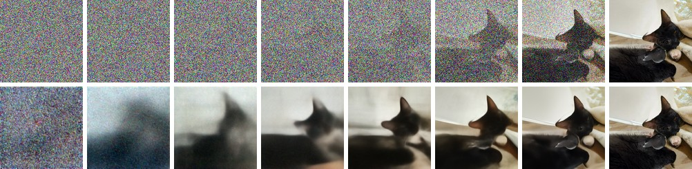
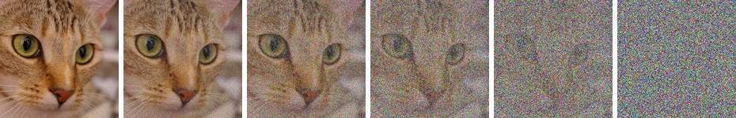
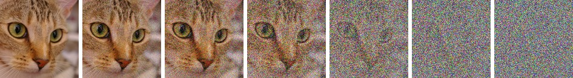
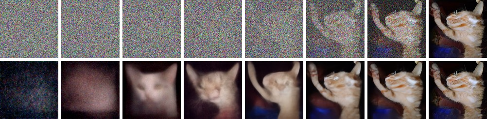
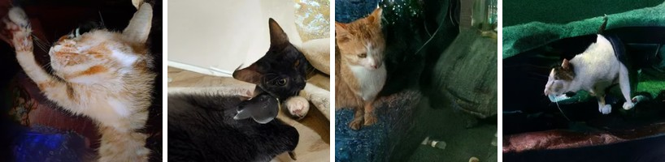

## Generating images, so far

A VAE generates an image in **one shot**: sample $z \sim \mathcal{N}(0, I)$, decode it, done.

:::{.incremental}
* That works, but the images are blurry. A decoder trained with mean squared error hedges its bets by averaging.
* Language models do something different: they build their output in **many small steps**, each one conditioned on what's there so far.
:::

. . .

**Diffusion models** also take many small steps. But every step works on the *whole image*: it starts as pure noise, and is refined a little at a time until a picture emerges.

## Noise to cat, in 1,000 steps

{width="100%"}

::: {.note-text}
Top row: the image at steps $t = 999, 900, 800, 700, 600, 400, 200, 0$ of generation. We'll come back to the bottom row. Model: `google/ddpm-cat-256`, from the original DDPM authors.
:::

. . .

Today: how such a model is trained, what network it uses, and how it generates.

# The forward process

## Destroying an image is easy

The simplest recipe: mix the image $x_0$ with random noise, by an amount $a$ between 0 and 1.

$$x = (1 - a)\, x_0 + a \cdot \text{noise}$$

{width="100%"}

::: {.note-text}
$a = 0, 0.2, 0.4, 0.6, 0.8, 1$. Photo: scikit-image sample data, CC0.
:::

:::{.incremental}
* This needs no learning at all. It's a fixed recipe.
* For any noisy image we make, we know *exactly* which clean image and which noise went into it.
:::

## Gaussian noise

Real diffusion models use **Gaussian** noise $\epsilon \sim \mathcal{N}(0, I)$: one independent normal random number per pixel and colour channel.

:::{.incremental}
* Gaussian noise has mean zero, so we scale pixel values to $[-1, 1]$, centred on zero like the noise, rather than $[0, 1]$.
* Adding two independent Gaussians gives another Gaussian. So many small steps of noise add up to one big step of noise, which we can take directly.
* We met this same distribution in the VAE: there, the decoder learned to turn samples of $\mathcal{N}(0, I)$ into images in one go.
:::

## Many small steps

We add noise in $T$ small steps, usually $T = 1000$. Step $t$ does

$$x_t = \sqrt{1 - \beta_t}\; x_{t-1} + \sqrt{\beta_t}\; \epsilon$$

:::{.incremental}
* $\beta_t$ is a small number, the variance of the noise added at step $t$. The list $\beta_1, \dots, \beta_T$ is the **noise schedule**.
* The image is also shrunk slightly, by $\sqrt{1-\beta_t}$, so that the total variance stays at 1. Otherwise the values would grow at every step.
* The original DDPM paper (Ho *et al.*, 2020) increased $\beta_t$ linearly, from $0.0001$ to $0.02$.
:::

## Jumping straight to step $t$

Because Gaussians add up to Gaussians, we can skip the intermediate steps:

$$x_t = \sqrt{\bar\alpha_t}\; x_0 + \sqrt{1 - \bar\alpha_t}\; \epsilon, \qquad \bar\alpha_t = \prod_{s=1}^{t} (1 - \beta_s)$$

. . .

```{python}
#| echo: true
#| output-location: fragment
import torch
betas = torch.linspace(0.0001, 0.02, 1000)       # the DDPM schedule
alpha_bar = torch.cumprod(1 - betas, dim=0)      # running product
alpha_bar[[0, 250, 500, 750, 999]].sqrt()        # how much image is left
```

. . .

So training never has to simulate 1,000 steps: one line makes a noisy image at any $t$.

## What the schedule does to a photo

{width="100%"}

::: {.note-text}
$t = 0, 50, 100, 200, 400, 600, 999$, with the DDPM schedule.
:::

```{=html}
<!-- generated by pics/lec15_16_svgs.py: l15-signal -->
<svg viewBox="0 0 1100 330" width="100%" xmlns="http://www.w3.org/2000/svg" font-family="IBM Plex Sans, sans-serif" role="img" aria-label="The image coefficient falls from 1 to 0 and the noise coefficient rises from 0 to 1 over 1000 steps of the original DDPM schedule">
<defs></defs>
<path d="M120 30 V280 H760" fill="none" stroke="#222" stroke-width="1.8"/>
<text x="440" y="324" text-anchor="middle" font-size="19.2" font-weight="600" fill="#000">timestep t</text>
<text x="106" y="20" text-anchor="start" font-size="19.2" font-weight="600" fill="#000"></text>
<text x="120" y="302" text-anchor="middle" font-size="16.6" font-weight="500" fill="#444">0</text>
<text x="280" y="302" text-anchor="middle" font-size="16.6" font-weight="500" fill="#444">250</text>
<text x="440" y="302" text-anchor="middle" font-size="16.6" font-weight="500" fill="#444">500</text>
<text x="600" y="302" text-anchor="middle" font-size="16.6" font-weight="500" fill="#444">750</text>
<text x="760" y="302" text-anchor="middle" font-size="16.6" font-weight="500" fill="#444">1000</text>
<text x="110" y="285" text-anchor="end" font-size="16.6" font-weight="500" fill="#444">0</text>
<text x="110" y="160" text-anchor="end" font-size="16.6" font-weight="500" fill="#444">0.5</text>
<path d="M120 155 H760" stroke="#ddd" stroke-width="1"/>
<text x="110" y="35" text-anchor="end" font-size="16.6" font-weight="500" fill="#444">1</text>
<path d="M120 30 H760" stroke="#ddd" stroke-width="1"/>
<path d="M120 30 L126.4 30.3 L132.8 30.8 L139.2 31.5 L145.6 32.5 L152 33.8 L158.4 35.3 L164.8 37 L171.2 38.9 L177.6 41.1 L184 43.5 L190.4 46.1 L196.8 48.9 L203.2 51.8 L209.6 55 L216 58.4 L222.4 61.9 L228.8 65.6 L235.2 69.4 L241.6 73.4 L248 77.5 L254.4 81.7 L260.8 86 L267.2 90.4 L273.6 94.9 L280 99.5 L286.4 104.1 L292.8 108.8 L299.2 113.5 L305.6 118.3 L312 123.1 L318.4 127.9 L324.8 132.7 L331.2 137.4 L337.6 142.2 L344 147 L350.4 151.7 L356.8 156.3 L363.2 161 L369.6 165.5 L376 170 L382.4 174.4 L388.8 178.8 L395.2 183 L401.6 187.2 L408 191.3 L414.4 195.3 L420.8 199.2 L427.2 203 L433.6 206.7 L440 210.3 L446.4 213.7 L452.8 217.1 L459.2 220.4 L465.6 223.5 L472 226.5 L478.4 229.5 L484.8 232.3 L491.2 235 L497.6 237.5 L504 240 L510.4 242.4 L516.8 244.7 L523.2 246.8 L529.6 248.9 L536 250.9 L542.4 252.7 L548.8 254.5 L555.2 256.2 L561.6 257.8 L568 259.3 L574.4 260.7 L580.8 262.1 L587.2 263.3 L593.6 264.5 L600 265.6 L606.4 266.7 L612.8 267.7 L619.2 268.6 L625.6 269.5 L632 270.3 L638.4 271.1 L644.8 271.7 L651.2 272.4 L657.6 273 L664 273.6 L670.4 274.1 L676.8 274.6 L683.2 275.1 L689.6 275.5 L696 275.9 L702.4 276.2 L708.8 276.6 L715.2 276.8 L721.6 277.1 L728 277.4 L734.4 277.6 L740.8 277.9 L747.2 278.1 L753.6 278.2" fill="none" stroke="#d9480f" stroke-width="3.2" stroke-linejoin="round"/>
<path d="M120 277.5 L126.4 268.3 L132.8 260.2 L139.2 252.3 L145.6 244.4 L152 236.7 L158.4 229 L164.8 221.3 L171.2 213.8 L177.6 206.4 L184 199 L190.4 191.8 L196.8 184.7 L203.2 177.8 L209.6 171 L216 164.3 L222.4 157.8 L228.8 151.5 L235.2 145.3 L241.6 139.3 L248 133.4 L254.4 127.8 L260.8 122.3 L267.2 117 L273.6 112 L280 107.1 L286.4 102.3 L292.8 97.8 L299.2 93.5 L305.6 89.3 L312 85.4 L318.4 81.6 L324.8 78 L331.2 74.6 L337.6 71.4 L344 68.3 L350.4 65.4 L356.8 62.7 L363.2 60.2 L369.6 57.8 L376 55.5 L382.4 53.4 L388.8 51.4 L395.2 49.6 L401.6 47.9 L408 46.3 L414.4 44.8 L420.8 43.4 L427.2 42.2 L433.6 41 L440 39.9 L446.4 38.9 L452.8 38 L459.2 37.2 L465.6 36.5 L472 35.8 L478.4 35.2 L484.8 34.6 L491.2 34.1 L497.6 33.6 L504 33.2 L510.4 32.8 L516.8 32.5 L523.2 32.2 L529.6 31.9 L536 31.7 L542.4 31.5 L548.8 31.3 L555.2 31.1 L561.6 31 L568 30.9 L574.4 30.7 L580.8 30.6 L587.2 30.6 L593.6 30.5 L600 30.4 L606.4 30.4 L612.8 30.3 L619.2 30.3 L625.6 30.2 L632 30.2 L638.4 30.2 L644.8 30.1 L651.2 30.1 L657.6 30.1 L664 30.1 L670.4 30.1 L676.8 30.1 L683.2 30 L689.6 30 L696 30 L702.4 30 L708.8 30 L715.2 30 L721.6 30 L728 30 L734.4 30 L740.8 30 L747.2 30 L753.6 30" fill="none" stroke="#7a7a7a" stroke-width="3.2" stroke-linejoin="round" stroke-dasharray="9 6"/>
<text x="478.4" y="190" text-anchor="start" font-size="21.8" font-weight="700" fill="#d9480f">how much image is left</text>
<text x="478.4" y="80" text-anchor="start" font-size="21.8" font-weight="700" fill="#7a7a7a">how much noise is in</text>
</svg>
```

::: aside
Orange: $\sqrt{\bar\alpha_t}$, the multiplier on $x_0$. Grey: $\sqrt{1-\bar\alpha_t}$, the multiplier on $\epsilon$.
:::

## Try it: noising a photo

```{=html}
<script src="pics/lec15/demos-data.js" defer></script>
<script src="pics/lec15/demos.js" defer></script>
<div class="l15-demo" data-demo="noise">
  <div class="l15-row">
    <canvas data-role="img" class="l15-pix" style="width: 300px; height: 300px; image-rendering: auto;"></canvas>
    <canvas data-role="chart"></canvas>
  </div>
  <div class="l15-ctl">
    <input type="range" data-role="t" min="0" max="999" value="200" aria-label="timestep t">
    <span class="l15-out">t = <b data-role="tval">200</b></span>
    <button data-role="play">Play</button>
    <button data-role="new">New noise</button>
  </div>
</div>
```

$x_t = \sqrt{\bar\alpha_t}\, x_0 + \sqrt{1-\bar\alpha_t}\, \epsilon$, with $\sqrt{\bar\alpha_t} =$ [0.81]{.l15-sig .l15-num} and $\sqrt{1-\bar\alpha_t} =$ [0.59]{.l15-noi .l15-num}.

::: aside
Drag the slider or the chart. The noise $\epsilon$ stays the same until you ask for new noise.
:::

# Learning to go backwards

## Why not undo it in one step?

Suppose we train a network to look at $x_t$ and predict the clean image $x_0$.

:::{.incremental}
* At small $t$, that's easy: the image is all still there.
* At $t = 999$ the input is pure noise, so it carries no information about $x_0$ at all. The best guess under mean squared error is then the **average** of all training images.
* In between, the best guess is the average of every image that *could* have produced this $x_t$: sharp where the evidence is clear, blurry where it isn't.
:::

. . .

That's the VAE's blur problem again. Generating in one shot from pure noise gives the average cat, not a cat.

## The best guess, exactly

Suppose the only images in the world were these 1,000 cats. Then we can work out the best possible guess at $x_0$ exactly.

```{=html}
<div class="l15-demo" data-demo="average">
  <div class="l15-row">
    <div class="l15-col"><span class="l15-lab">the real image <span class="math inline">\(x_0\)</span></span>
      <canvas data-role="x0" class="l15-pix" style="width: 150px; height: 150px;"></canvas></div>
    <div class="l15-col"><span class="l15-lab">what the network sees, <span class="math inline">\(x_t\)</span></span>
      <canvas data-role="xt" class="l15-pix" style="width: 150px; height: 150px;"></canvas></div>
    <div class="l15-col"><span class="l15-lab" style="color: #d9480f;">best guess <span class="math inline">\(\hat x_0\)</span></span>
      <canvas data-role="xhat" class="l15-pix" style="width: 150px; height: 150px;"></canvas></div>
    <div class="l15-col"><span class="l15-lab">most likely sources</span>
      <div data-role="top" class="l15-top"></div></div>
  </div>
  <div class="l15-ctl">
    <input type="range" data-role="t" min="0" max="999" value="600" aria-label="timestep t">
    <span class="l15-out">t = <b data-role="tval">600</b></span>
    <button data-role="new">Another cat</button>
  </div>
</div>
```

::: {.small-text}
The best guess is an average of all 1,000 cats, weighted by how likely each one is to have produced $x_t$. Right now the weight is spread over about [18]{.l15-neff .l15-num} of them.
:::

::: aside
32 × 32 cat images from CIFAR-10 (Krizhevsky, 2009). DDPM schedule.
:::

## The model's best guesses

{width="100%"}

::: {.note-text}
Bottom row: the model's prediction of the clean image $\hat x_0$, made at each of the steps shown above it.
:::

:::{.incremental}
* At $t = 999$ the guess is little more than an average colour: the input says almost nothing about the cat.
* Each step commits to a little more: first the overall layout and colour, then shapes, and only near the end the fine detail.
:::

## Iterative refinement

So instead of jumping to the prediction, we take a small step towards it, then ask again.

:::{.incremental}
1. Start from pure noise.
2. Ask the network for its best guess at the clean image.
3. Move the current image a little way towards that guess, leaving it slightly less noisy than before.
4. Repeat until no noise is left.
:::

. . .

Each guess is made from a slightly cleaner input than the last, so the guesses sharpen as we go. Early steps settle *what* the picture is; later steps settle the details.

## Small steps, in two dimensions

:::: {.columns}
::: {.column width="52%"}
```{=html}
<div class="l15-demo" data-demo="spiral">
  <canvas data-role="plot"></canvas>
  <div data-role="status" style="text-align: center; margin-top: 6px;">the data: 500 points</div>
</div>
```
:::
::: {.column width="48%"}
::::: {.small-text}
Each "image" here is just two numbers: a point. The data (grey) lie on a spiral.

```{=html}
<div class="l15-demo" data-demo-part="spiral">
  <div class="l15-lab">Add noise:</div>
  <div class="l15-ctl" style="justify-content: flex-start; margin-top: 4px;">
    <input type="range" data-role="t" min="0" max="999" value="0" aria-label="timestep t" style="width: 100%;">
  </div>
  <div class="l15-lab" style="margin-top: 18px;">Generate from fresh noise, in</div>
  <div class="l15-ctl" style="justify-content: flex-start; margin-top: 4px;">
    <button data-steps="1">1</button><button data-steps="2">2</button><button data-steps="5">5</button>
    <button data-steps="20">20</button><button data-steps="100">100</button><button data-steps="1000">1,000</button>
    <span>steps</span>
  </div>
</div>
```

Every step uses the best possible guess for these 500 points, exactly as on the cats slide.
:::::
:::
::::

## Early guesses can change

{width="100%"}

::: {.note-text}
Another sample from the same model. Same steps as before: the image $x_t$ on top, the guess $\hat x_0$ below.
:::

. . .

At $t = 800$ the model was heading for a cat facing us. By $t = 600$ it had settled on a quite different pose. Small steps leave room to change course; a single jump would have committed to the blur.

## What should the network predict?

Two options, each from the noisy image $x_t$ and the step $t$:

:::{.incremental}
* **The clean image** $\hat x_0$. Simple to think about, and it works. You'll start with this in the lab.
* **The noise** $\hat\epsilon$ that was added. This is what DDPM, and most models since, actually do.
:::

. . .

Given $x_t$ and $t$, either one gives you the other:

$$x_0 = \frac{x_t - \sqrt{1 - \bar\alpha_t}\;\epsilon}{\sqrt{\bar\alpha_t}}$$

. . .

But the noise is always drawn from $\mathcal{N}(0, I)$, whatever the image and whatever $t$. That makes it a target of the same size and shape at every step, and in practice it trains more stably.

## The training objective

$$\mathcal{L} = \big\lVert \epsilon - \hat\epsilon_\theta(x_t, t) \big\rVert^2$$

For each training image:

:::{.incremental}
1. pick a random step $t$ between 1 and $T$, and random noise $\epsilon$;
2. make $x_t$ in one jump, using the formula above;
3. ask the network $\hat\epsilon_\theta$ to predict $\epsilon$ from $x_t$ and $t$;
4. compute the mean squared error, and backpropagate.
:::

. . .

No labels needed: like an autoencoder, the data supervise themselves. And the network practises every noise level, not just one.

## In code

With the `diffusers` library, which we'll use from now on:

```python
scheduler = DDPMScheduler(num_train_timesteps=1000)    # holds the betas

for clean_images in dataloader:
    noise = torch.randn_like(clean_images)
    t = torch.randint(0, 1000, (len(clean_images),))   # one random step per image
    noisy_images = scheduler.add_noise(clean_images, noise, t)

    noise_pred = model(noisy_images, t).sample
    loss = F.mse_loss(noise_pred, noise)
    loss.backward()
    optimizer.step()
    optimizer.zero_grad()
```

## Sampling

Generation runs the steps in reverse:

```python
x = torch.randn(n_images, 3, 256, 256)                 # pure noise
for t in scheduler.timesteps:                          # 999, 998, ..., 0
    noise_pred = model(x, t).sample
    x = scheduler.step(noise_pred, t, x).prev_sample   # one step less noisy
```

:::{.incremental}
* `scheduler.step` uses the noise prediction to make a guess at $x_0$, and moves part of the way towards it. It knows the schedule, so it knows how big a step to take at each $t$.
* DDPM also adds back a little *fresh* noise at each step (except the last). This lets later steps correct earlier mistakes.
* That's 1,000 calls to the network for every image, so generation is slow: the cats on the next slide took several minutes on a laptop. Later we'll meet samplers that need far fewer steps.
:::

## Four new cats

{width="100%"}

::: aside
Four samples from `google/ddpm-cat-256`, from four different starting noises. None of these is a photo.
:::

# The network: a UNet

## A network that outputs an image

We need a network whose output is the *same size* as its input: an image in, a prediction out. The usual choice is a **UNet**.

```{=html}
<!-- generated by pics/lec15_16_svgs.py: l15-unet -->
<svg viewBox="0 0 1100 412" width="100%" xmlns="http://www.w3.org/2000/svg" font-family="IBM Plex Sans, sans-serif" role="img" aria-label="A small UNet: the image is downsampled to 8 by 8 and upsampled back, with skip connections across">
<defs><marker id="l15u-k" viewBox="0 0 10 10" refX="9" refY="5" markerWidth="5" markerHeight="5" orient="auto"><path d="M0 0 L10 5 L0 10 z" fill="#222"/></marker><marker id="l15u-a" viewBox="0 0 10 10" refX="9" refY="5" markerWidth="5" markerHeight="5" orient="auto"><path d="M0 0 L10 5 L0 10 z" fill="#d9480f"/></marker></defs>
<path d="M155.2 92.4 L157.4 91.1 V206.3 L155.2 207.6 Z" fill="#e0e0e0" stroke="#222" stroke-width="1.2" stroke-linejoin="round"/>
<path d="M40 92.4 L42.2 91.1 H157.4 L155.2 92.4 Z" fill="#ffffff" stroke="#222" stroke-width="1.2" stroke-linejoin="round"/>
<rect x="40" y="92.4" width="115.2" height="115.2" fill="#ffffff" stroke="#222" stroke-width="1.2"/>
<text x="97.6" y="229.6" text-anchor="middle" font-size="16.6" font-weight="500" fill="#000" font-family="SFMono-Regular, Menlo, Consolas, monospace">1×32×32</text>
<path d="M315.2 92.4 L324.2 87 V202.2 L315.2 207.6 Z" fill="#a9e0bb" stroke="#222" stroke-width="1.2" stroke-linejoin="round"/>
<path d="M200 92.4 L209 87 H324.2 L315.2 92.4 Z" fill="#d6ffe3" stroke="#222" stroke-width="1.2" stroke-linejoin="round"/>
<rect x="200" y="92.4" width="115.2" height="115.2" fill="#c0ffd4" stroke="#222" stroke-width="1.2"/>
<text x="257.6" y="229.6" text-anchor="middle" font-size="16.6" font-weight="500" fill="#000" font-family="SFMono-Regular, Menlo, Consolas, monospace">32×32×32</text>
<path d="M427.6 239.2 L443.7 229.6 V287.2 L427.6 296.8 Z" fill="#a9e0bb" stroke="#222" stroke-width="1.2" stroke-linejoin="round"/>
<path d="M370 239.2 L386.1 229.6 H443.7 L427.6 239.2 Z" fill="#d6ffe3" stroke="#222" stroke-width="1.2" stroke-linejoin="round"/>
<rect x="370" y="239.2" width="57.6" height="57.6" fill="#c0ffd4" stroke="#222" stroke-width="1.2"/>
<text x="398.8" y="318.8" text-anchor="middle" font-size="16.6" font-weight="500" fill="#000" font-family="SFMono-Regular, Menlo, Consolas, monospace">64×16×16</text>
<path d="M538.8 337.6 L554.9 328 V356.8 L538.8 366.4 Z" fill="#a9e0bb" stroke="#222" stroke-width="1.2" stroke-linejoin="round"/>
<path d="M510 337.6 L526.1 328 H554.9 L538.8 337.6 Z" fill="#d6ffe3" stroke="#222" stroke-width="1.2" stroke-linejoin="round"/>
<rect x="510" y="337.6" width="28.8" height="28.8" fill="#c0ffd4" stroke="#222" stroke-width="1.2"/>
<text x="524.4" y="388.4" text-anchor="middle" font-size="16.6" font-weight="500" fill="#000" font-family="SFMono-Regular, Menlo, Consolas, monospace">64×8×8</text>
<path d="M697.6 239.2 L713.7 229.6 V287.2 L697.6 296.8 Z" fill="#e0bde0" stroke="#222" stroke-width="1.2" stroke-linejoin="round"/>
<path d="M640 239.2 L656.1 229.6 H713.7 L697.6 239.2 Z" fill="#fee5ff" stroke="#222" stroke-width="1.2" stroke-linejoin="round"/>
<rect x="640" y="239.2" width="57.6" height="57.6" fill="#fed7ff" stroke="#222" stroke-width="1.2"/>
<text x="668.8" y="318.8" text-anchor="middle" font-size="16.6" font-weight="500" fill="#000" font-family="SFMono-Regular, Menlo, Consolas, monospace">64×16×16</text>
<path d="M905.2 92.4 L914.2 87 V202.2 L905.2 207.6 Z" fill="#e0bde0" stroke="#222" stroke-width="1.2" stroke-linejoin="round"/>
<path d="M790 92.4 L799 87 H914.2 L905.2 92.4 Z" fill="#fee5ff" stroke="#222" stroke-width="1.2" stroke-linejoin="round"/>
<rect x="790" y="92.4" width="115.2" height="115.2" fill="#fed7ff" stroke="#222" stroke-width="1.2"/>
<text x="847.6" y="229.6" text-anchor="middle" font-size="16.6" font-weight="500" fill="#000" font-family="SFMono-Regular, Menlo, Consolas, monospace">32×32×32</text>
<path d="M1095.2 92.4 L1097.4 91.1 V206.3 L1095.2 207.6 Z" fill="#e0e0e0" stroke="#222" stroke-width="1.2" stroke-linejoin="round"/>
<path d="M980 92.4 L982.2 91.1 H1097.4 L1095.2 92.4 Z" fill="#ffffff" stroke="#222" stroke-width="1.2" stroke-linejoin="round"/>
<rect x="980" y="92.4" width="115.2" height="115.2" fill="#ffffff" stroke="#222" stroke-width="1.2"/>
<text x="1037.6" y="229.6" text-anchor="middle" font-size="16.6" font-weight="500" fill="#000" font-family="SFMono-Regular, Menlo, Consolas, monospace">1×32×32</text>
<text x="97.6" y="44" text-anchor="middle" font-size="20.5" font-weight="700" fill="#000">noisy image</text>
<text x="1037.6" y="44" text-anchor="middle" font-size="20.5" font-weight="700" fill="#d9480f">prediction</text>
<text x="1037.6" y="64" text-anchor="middle" font-size="17.9" font-weight="500" fill="#444">(same size)</text>
<path d="M161.4 150 L196 150" fill="none" stroke="#222" stroke-width="2.2" stroke-linejoin="round" marker-end="url(#l15u-k)"/>
<path d="M328.2 150 L366 268" fill="none" stroke="#222" stroke-width="2.2" stroke-linejoin="round" marker-end="url(#l15u-k)"/>
<path d="M447.7 268 L506 352" fill="none" stroke="#222" stroke-width="2.2" stroke-linejoin="round" marker-end="url(#l15u-k)"/>
<path d="M558.9 352 L636 268" fill="none" stroke="#222" stroke-width="2.2" stroke-linejoin="round" marker-end="url(#l15u-k)"/>
<path d="M717.7 268 L786 150" fill="none" stroke="#222" stroke-width="2.2" stroke-linejoin="round" marker-end="url(#l15u-k)"/>
<path d="M918.2 150 L976 150" fill="none" stroke="#222" stroke-width="2.2" stroke-linejoin="round" marker-end="url(#l15u-k)"/>
<text x="250" y="400" text-anchor="middle" font-size="19.2" font-weight="600" fill="#2f7d4a">downsample: coarser, more channels</text>
<text x="840" y="400" text-anchor="middle" font-size="19.2" font-weight="600" fill="#a23aa6">upsample back to full size</text>
<g class="fragment" data-fragment-index="0">
<path d="M257.6 81 L257.6 73 L847.6 73 L847.6 81" fill="none" stroke="#d9480f" stroke-width="2.4" stroke-linejoin="round" stroke-dasharray="8 5" marker-end="url(#l15u-a)"/>
<path d="M398.8 223.6 L398.8 215.6 L668.8 215.6 L668.8 223.6" fill="none" stroke="#d9480f" stroke-width="2.4" stroke-linejoin="round" stroke-dasharray="8 5" marker-end="url(#l15u-a)"/>
<text x="560" y="150" text-anchor="middle" font-size="20.5" font-weight="700" fill="#d9480f">skip connections carry</text>
<text x="560" y="172" text-anchor="middle" font-size="20.5" font-weight="700" fill="#d9480f">fine detail straight across</text>
</g>
</svg>
```

::: aside
Shapes are channels × height × width, for the small UNet you'll build in the lab.
:::

## Compared with an autoencoder

The UNet looks like our convolutional autoencoder, but it has a different job.

:::{.incremental}
* **Down**: convolutions and downsampling build a coarse summary of what's in the image, with more channels and fewer pixels.
* **Up**: upsampling builds back to full size.
* **Skip connections** copy each downsampling stage's output across to the matching upsampling stage, so fine detail never has to squeeze through the narrow middle.
* An autoencoder's bottleneck is the whole point: it forces compression. Here there's nothing to compress. At small $t$ the image is almost all there, and the skips pass its detail straight through.
:::

## Telling the network the time

The same noisy-looking pixel means different things at different steps: at $t = 50$ it is mostly image, at $t = 950$ mostly noise.

:::{.incremental}
* So a diffusion UNet takes $t$ as a second input, and every layer is told it. Next lecture: exactly how, and how the same trick lets us ask for a particular kind of image.
* Larger UNets also add **self-attention** at the coarsest resolutions, so distant parts of the image can be related: an ear on the left with an ear on the right.
* We'll treat the internals as a box that predicts noise well. Network design belongs to the neural-networks module.
:::

## How big?

| Model | Parameters |
|---|---:|
| A minimal UNet, no attention, no $t$ (lab) | 309,057 |
| `diffusers` `UNet2DModel`, with attention (lab) | 1,707,009 |
| `google/ddpm-cat-256`, 256 × 256 colour images | 113,673,219 |

. . .

For comparison, SmolLM2-135M, the language model we fine-tuned to generate text, has about 135 million.

# Noise schedules

## The schedule is a design choice

The schedule $\beta_1, \dots, \beta_T$ decides how fast the image disappears.

:::{.incremental}
* **Training**: steps $t$ are picked uniformly at random, so the schedule decides how much training effort goes on each level of noise.
* **Sampling**: we take one step per $t$, so the schedule also decides where generation spends its time.
* If the image is effectively gone long before $t = T$, the steps after that are spent turning noise into slightly different noise. They teach the model little, and add little when sampling.
:::

## Linear and cosine schedules

The DDPM schedule is **linear** in $\beta_t$. Nichol and Dhariwal (2021) proposed instead choosing $\bar\alpha_t$ directly, as a **cosine**:

$$\bar\alpha_t = \cos^2\!\left(\frac{t/T + s}{1 + s} \cdot \frac{\pi}{2}\right), \qquad s = 0.008$$

:::{.incremental}
* $\bar\alpha_t$ starts at (almost) 1 and ends at 0, and falls slowly at both ends, so that no steps are wasted at either extreme.
* `diffusers` calls this `beta_schedule="squaredcos_cap_v2"`.
* In the lab you'll see what the DDPM schedule does to a small image, and a project asks you to compare others.
:::

## Summary

:::{.incremental}
* The **forward process** adds Gaussian noise in $T$ small steps, following a fixed **noise schedule**. We can jump straight to any step $t$.
* Undoing it in one step gives a blurry average. Instead, **iterative refinement** takes many small steps, each from a slightly cleaner image.
* The network is trained to predict the **noise** that was added, from $x_t$ and $t$, with mean squared error. Predicting the clean image also works.
* The network is a **UNet**: same size out as in, with skip connections that carry detail across.
* The **schedule** decides where training and sampling spend their effort.
:::
