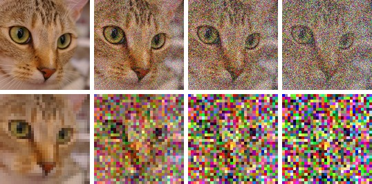
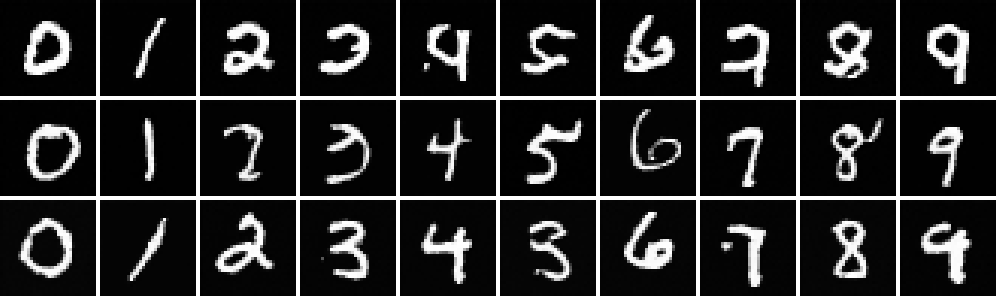

## Tuesday's lab

:::{.incremental}
* A tiny UNet, trained for a few minutes to predict the clean digit, gave smudgy blobs that only sometimes looked like digits.
* A `UNet2DModel` with attention, trained with the same data, epochs and loss, did noticeably better.
* With the DDPM scheduler, the digit was gone well before halfway through the 1,000 steps. Why?
:::

## Small images disappear sooner

The same schedule, the same noise level, two sizes of the same photo:

{width="62%"}

::: {.note-text}
$t = 0, 100, 200, 300$. Top: 256 × 256 pixels. Bottom: 32 × 32, the size of the lab's digits. Photo: scikit-image sample data, CC0.
:::

:::{.incremental}
* At 256 × 256, each feature covers many pixels, so the eye can average the noise away. At 32 × 32 there's much less to average over.
* So a schedule that suits large images wastes many of its steps on small ones.
:::

## The cosine schedule, revisited

How much of the image is left, $\sqrt{\bar\alpha_t}$, for the lab's linear schedule and for the cosine schedule:

```{=html}
<!-- generated by pics/lec15_16_svgs.py: l16-schedules -->
<svg viewBox="0 0 1100 320" width="100%" xmlns="http://www.w3.org/2000/svg" font-family="IBM Plex Sans, sans-serif" role="img" aria-label="The share of the image left at each timestep: the linear schedule falls to nearly zero by step 600, the cosine schedule falls gently until near the end">
<defs></defs>
<path d="M120 30 V270 H740" fill="none" stroke="#222" stroke-width="1.8"/>
<text x="430" y="314" text-anchor="middle" font-size="19.2" font-weight="600" fill="#000">timestep t</text>
<text x="106" y="20" text-anchor="start" font-size="19.2" font-weight="600" fill="#000">image left</text>
<text x="120" y="292" text-anchor="middle" font-size="16.6" font-weight="500" fill="#444">0</text>
<text x="275" y="292" text-anchor="middle" font-size="16.6" font-weight="500" fill="#444">250</text>
<text x="430" y="292" text-anchor="middle" font-size="16.6" font-weight="500" fill="#444">500</text>
<text x="585" y="292" text-anchor="middle" font-size="16.6" font-weight="500" fill="#444">750</text>
<text x="740" y="292" text-anchor="middle" font-size="16.6" font-weight="500" fill="#444">1000</text>
<text x="110" y="275" text-anchor="end" font-size="16.6" font-weight="500" fill="#444">0</text>
<text x="110" y="155" text-anchor="end" font-size="16.6" font-weight="500" fill="#444">0.5</text>
<path d="M120 150 H740" stroke="#ddd" stroke-width="1"/>
<text x="110" y="35" text-anchor="end" font-size="16.6" font-weight="500" fill="#444">1</text>
<path d="M120 30 H740" stroke="#ddd" stroke-width="1"/>
<path d="M120 30.1 L126.2 31.4 L132.4 33 L138.6 34.7 L144.8 36.7 L151 38.9 L157.2 41.2 L163.4 43.8 L169.6 46.5 L175.8 49.5 L182 52.5 L188.2 55.8 L194.4 59.2 L200.6 62.7 L206.8 66.4 L213 70.2 L219.2 74.1 L225.4 78.2 L231.6 82.3 L237.8 86.5 L244 90.8 L250.2 95.2 L256.4 99.6 L262.6 104 L268.8 108.5 L275 113 L281.2 117.6 L287.4 122.1 L293.6 126.7 L299.8 131.3 L306 135.8 L312.2 140.3 L318.4 144.8 L324.6 149.2 L330.8 153.6 L337 157.9 L343.2 162.2 L349.4 166.4 L355.6 170.6 L361.8 174.7 L368 178.7 L374.2 182.6 L380.4 186.4 L386.6 190.1 L392.8 193.8 L399 197.3 L405.2 200.7 L411.4 204.1 L417.6 207.3 L423.8 210.5 L430 213.5 L436.2 216.5 L442.4 219.3 L448.6 222 L454.8 224.6 L461 227.2 L467.2 229.6 L473.4 231.9 L479.6 234.1 L485.8 236.2 L492 238.3 L498.2 240.2 L504.4 242.1 L510.6 243.8 L516.8 245.5 L523 247.1 L529.2 248.6 L535.4 250 L541.6 251.3 L547.8 252.6 L554 253.8 L560.2 255 L566.4 256 L572.6 257 L578.8 258 L585 258.8 L591.2 259.7 L597.4 260.5 L603.6 261.2 L609.8 261.9 L616 262.5 L622.2 263.1 L628.4 263.7 L634.6 264.2 L640.8 264.6 L647 265.1 L653.2 265.5 L659.4 265.8 L665.6 266.2 L671.8 266.5 L678 266.9 L684.2 267.2 L690.4 267.4 L696.6 267.6 L702.8 267.9 L709 268 L715.2 268.1 L721.4 268.3 L727.6 268.5 L733.8 268.7" fill="none" stroke="#d9480f" stroke-width="3.2" stroke-linejoin="round"/>
<text x="275" y="198" text-anchor="start" font-size="21.8" font-weight="700" fill="#d9480f">linear</text>
<g class="fragment" data-fragment-index="0">
<path d="M120 30 L126.2 30.1 L132.4 30.2 L138.6 30.4 L144.8 30.7 L151 31 L157.2 31.4 L163.4 31.8 L169.6 32.3 L175.8 32.8 L182 33.4 L188.2 34.1 L194.4 34.8 L200.6 35.6 L206.8 36.4 L213 37.3 L219.2 38.3 L225.4 39.3 L231.6 40.3 L237.8 41.4 L244 42.6 L250.2 43.8 L256.4 45.1 L262.6 46.4 L268.8 47.8 L275 49.3 L281.2 50.8 L287.4 52.3 L293.6 53.9 L299.8 55.6 L306 57.3 L312.2 59 L318.4 60.8 L324.6 62.7 L330.8 64.6 L337 66.6 L343.2 68.6 L349.4 70.6 L355.6 72.7 L361.8 74.9 L368 77.1 L374.2 79.4 L380.4 81.6 L386.6 84 L392.8 86.4 L399 88.8 L405.2 91.3 L411.4 93.8 L417.6 96.4 L423.8 99 L430 101.6 L436.2 104.3 L442.4 107 L448.6 109.8 L454.8 112.6 L461 115.4 L467.2 118.3 L473.4 121.2 L479.6 124.2 L485.8 127.2 L492 130.2 L498.2 133.3 L504.4 136.3 L510.6 139.5 L516.8 142.6 L523 145.8 L529.2 149 L535.4 152.3 L541.6 155.5 L547.8 158.8 L554 162.2 L560.2 165.5 L566.4 168.9 L572.6 172.3 L578.8 175.7 L585 179.2 L591.2 182.7 L597.4 186.2 L603.6 189.7 L609.8 193.2 L616 196.8 L622.2 200.3 L628.4 203.9 L634.6 207.5 L640.8 211.1 L647 214.8 L653.2 218.4 L659.4 222.1 L665.6 225.7 L671.8 229.4 L678 233.1 L684.2 236.8 L690.4 240.5 L696.6 244.2 L702.8 248 L709 251.7 L715.2 255.4 L721.4 259.2 L727.6 262.9 L733.8 266.6" fill="none" stroke="#2c6fb7" stroke-width="3.2" stroke-linejoin="round"/>
<text x="566.4" y="121.2" text-anchor="start" font-size="21.8" font-weight="700" fill="#2c6fb7">cosine</text>
</g>
</svg>
```

. . .

With the linear schedule, less than 10% of the image is left by $t = 644$. With the cosine schedule, that happens only at $t = 935$.

## Try it: schedule and size

```{=html}
<script src="pics/lec16/demos-data.js" defer></script>
<script src="pics/lec16/demos.js" defer></script>
<div class="l16-demo" data-demo="sizes">
  <div class="l16-row">
    <div class="l16-col"><span class="l16-lab">256 × 256</span>
      <canvas data-role="big" class="l16-pix" style="width: 230px; height: 230px; image-rendering: auto;"></canvas></div>
    <div class="l16-col"><span class="l16-lab">32 × 32</span>
      <canvas data-role="small" class="l16-pix" style="width: 230px; height: 230px;"></canvas></div>
    <canvas data-role="chart"></canvas>
  </div>
  <div class="l16-ctl">
    <input type="range" data-role="t" min="0" max="999" value="300" aria-label="timestep t">
    <span class="l16-out">t = <b data-role="tval">300</b></span>
    <button data-sched="lin" class="on">linear (lab)</button>
    <button data-sched="cos">cosine</button>
  </div>
</div>
```

Image left: $\sqrt{\bar\alpha_t} =$ [0.56]{.l16-sig .l16-num}, the same for both sizes. Only how much you can still *see* differs.

::: aside
Drag the slider or the chart, and switch schedule. Each size has its own fixed noise.
:::

# Adding control

## Which image?

Last lecture's model generates *an* image: whatever comes out of the noise it started from.

:::{.incremental}
* In probability terms, it learned to sample from $p(x)$, the distribution of training images.
* Usually we want to say *which* image: a 7, a sneaker, "an astronaut riding a horse". We want to sample from $p(x \mid y)$, where $y$ is the **condition**.
* This is **conditional generation**. Today the condition is a class label. Next time it's a text prompt.
:::

## Try it: choosing the shape

:::: {.columns}
::: {.column width="52%"}
```{=html}
<div class="l16-demo" data-demo="classes">
  <canvas data-role="plot"></canvas>
  <div data-role="status" style="text-align: center; margin-top: 6px;">the data, coloured by label</div>
</div>
```
:::
::: {.column width="48%"}
::::: {.small-text}
Back to two-number "images". Now each point has a label: ring, line or blobs.

```{=html}
<div class="l16-demo" data-demo-part="classes">
  <div class="l16-lab">Add noise:</div>
  <div class="l16-ctl" style="justify-content: flex-start; margin-top: 4px;">
    <input type="range" data-role="t" min="0" max="999" value="0" aria-label="timestep t" style="width: 100%;">
  </div>
  <div class="l16-lab" style="margin-top: 16px;">Generate 300 points, in 100 steps:</div>
  <div class="l16-ctl" style="justify-content: flex-start; margin-top: 4px;">
    <button data-gen="any">any shape</button>
    <button data-gen="0" style="color: #d9480f;">ring</button>
    <button data-gen="1" style="color: #2f7d4a;">line</button>
    <button data-gen="2" style="color: #a23aa6;">blobs</button>
  </div>
</div>
```

"Any shape" uses the best guess over all the points: $p(x)$. A label restricts the best guess to that shape's points: $p(x \mid y)$.
:::::
:::
::::

## The idea

Give the network $y$ as one more input, during training *and* during sampling.

$$\hat\epsilon_\theta(x_t, t) \quad\longrightarrow\quad \hat\epsilon_\theta(x_t, t, y)$$

:::{.incremental}
* In training, $y$ is the label of the image that was noised. The network can use it to predict the noise better: knowing "this is a 7" helps to tell stroke from noise.
* In sampling, we choose $y$ ourselves, and keep it fixed for every step. Each step then nudges the image towards a 7.
:::

. . .

But how do we feed a label into a UNet? The same way we already feed it $t$.

# How the network hears $t$

## A timestep embedding

$t$ is a single integer, from 0 to 999. The network needs a vector.

:::{.incremental}
* First, sines and cosines of $t$ at a range of frequencies. This is exactly the **sinusoidal positional encoding** from the transformer, with the step $t$ in place of the token's position.
* Then a small two-layer network (an MLP), so the model can learn what to make of it.
* In the `UNet2DModel` you'll use in the lab, that's 32 sines and cosines, turned into a **time embedding** of 128 numbers.
:::

## Try it: what the network is told about $t$

```{=html}
<div class="l16-demo" data-demo="embed">
  <canvas data-role="bar" style="margin: 0 auto;"></canvas>
  <div class="l16-ctl" style="margin-top: 0;">
    <input type="range" data-role="t" min="0" max="999" value="250" aria-label="timestep t">
    <span class="l16-out">t = <b data-role="tval">250</b></span>
  </div>
  <canvas data-role="chart" style="margin: 6px auto 0;"></canvas>
</div>
```

::: {.smaller-text}
Top: the 32 numbers for step $t$, before the MLP (orange $+1$, grey $-1$). Below: the same for every step, one thin column each. Every step gets its own pattern, just as every token position does: the slow numbers say roughly when, the fast ones pin down exactly when.
:::

## Where it goes

```{=html}
<!-- generated by pics/lec15_16_svgs.py: l16-cond -->
<svg viewBox="0 0 1100 338" width="100%" xmlns="http://www.w3.org/2000/svg" font-family="IBM Plex Sans, sans-serif" role="img" aria-label="The timestep becomes 128 numbers via sines and cosines and an MLP; the class label picks a row of a 10 by 128 table; the two are added and fed to every block">
<defs><marker id="l16c-k" viewBox="0 0 10 10" refX="9" refY="5" markerWidth="5" markerHeight="5" orient="auto"><path d="M0 0 L10 5 L0 10 z" fill="#222"/></marker></defs>
<rect x="20" y="40" width="90" height="54" rx="7" fill="#fff" stroke="#4f86c6" stroke-width="2.4"/>
<text x="65" y="75" text-anchor="middle" font-size="21.8" font-weight="700" fill="#4f86c6">t = 500</text>
<path d="M114 67 L150 67" fill="none" stroke="#222" stroke-width="2.2" stroke-linejoin="round" marker-end="url(#l16c-k)"/>
<rect x="154" y="40" width="170" height="54" rx="7" fill="#f2f2f2" stroke="#222" stroke-width="2.4"/>
<text x="239" y="64" text-anchor="middle" font-size="19.2" font-weight="600" fill="#000">sines and</text>
<text x="239" y="84" text-anchor="middle" font-size="19.2" font-weight="600" fill="#000">cosines</text>
<text x="239" y="112" text-anchor="middle" font-size="16.6" font-weight="500" fill="#444">32 numbers</text>
<path d="M328 67 L364 67" fill="none" stroke="#222" stroke-width="2.2" stroke-linejoin="round" marker-end="url(#l16c-k)"/>
<rect x="368" y="40" width="130" height="54" rx="7" fill="#dcdcf0" stroke="#222" stroke-width="2.4"/>
<text x="433" y="64" text-anchor="middle" font-size="19.2" font-weight="600" fill="#000">small</text>
<text x="433" y="84" text-anchor="middle" font-size="19.2" font-weight="600" fill="#000">MLP</text>
<text x="433" y="112" text-anchor="middle" font-size="16.6" font-weight="500" fill="#444">128 numbers</text>
<path d="M502 67 L566 67 L566 128" fill="none" stroke="#222" stroke-width="2.2" stroke-linejoin="round" marker-end="url(#l16c-k)"/>
<g class="fragment" data-fragment-index="0">
<rect x="20" y="168" width="90" height="54" rx="7" fill="#fff" stroke="#8e44ad" stroke-width="2.4"/>
<text x="65" y="203" text-anchor="middle" font-size="21.8" font-weight="700" fill="#8e44ad">y = 7</text>
<path d="M114 195 L150 195" fill="none" stroke="#222" stroke-width="2.2" stroke-linejoin="round" marker-end="url(#l16c-k)"/>
<rect x="154" y="146" width="344" height="10" fill="#fff" stroke="#888" stroke-width="0.8"/>
<rect x="154" y="156" width="344" height="10" fill="#fff" stroke="#888" stroke-width="0.8"/>
<rect x="154" y="166" width="344" height="10" fill="#fff" stroke="#888" stroke-width="0.8"/>
<rect x="154" y="176" width="344" height="10" fill="#fff" stroke="#888" stroke-width="0.8"/>
<rect x="154" y="186" width="344" height="10" fill="#fff" stroke="#888" stroke-width="0.8"/>
<rect x="154" y="196" width="344" height="10" fill="#fff" stroke="#888" stroke-width="0.8"/>
<rect x="154" y="206" width="344" height="10" fill="#fff" stroke="#888" stroke-width="0.8"/>
<rect x="154" y="216" width="344" height="10" fill="#8e44ad" fill-opacity="0.55" stroke="#888" stroke-width="0.8"/>
<rect x="154" y="226" width="344" height="10" fill="#fff" stroke="#888" stroke-width="0.8"/>
<rect x="154" y="236" width="344" height="10" fill="#fff" stroke="#888" stroke-width="0.8"/>
<text x="326" y="264" text-anchor="middle" font-size="16.6" font-weight="500" fill="#444">lookup table: 10 rows × 128 numbers</text>
<path d="M502 195 L566 195 L566 160" fill="none" stroke="#222" stroke-width="2.2" stroke-linejoin="round" marker-end="url(#l16c-k)"/>
</g>
<circle cx="566" cy="144" r="14" fill="#fff" stroke="#222" stroke-width="2"/>
<path d="M552 144 H580 M566 130 V158" stroke="#222" stroke-width="2"/>
<path d="M582 144 L640 144" fill="none" stroke="#222" stroke-width="2.2" stroke-linejoin="round" marker-end="url(#l16c-k)"/>
<rect x="644" y="117" width="120" height="54" rx="7" fill="#dcdcf0" stroke="#222" stroke-width="2.4"/>
<text x="704" y="141" text-anchor="middle" font-size="19.2" font-weight="600" fill="#000">linear</text>
<text x="704" y="161" text-anchor="middle" font-size="16.6" font-weight="500" fill="#000" font-family="SFMono-Regular, Menlo, Consolas, monospace">128 → C</text>
<path d="M768 144 L818 144" fill="none" stroke="#222" stroke-width="2.2" stroke-linejoin="round" marker-end="url(#l16c-k)"/>
<rect x="896" y="64" width="150" height="150" rx="0" fill="#f2fdf6" stroke="#444" stroke-width="1.2"/>
<rect x="884" y="76" width="150" height="150" rx="0" fill="#e6fbed" stroke="#444" stroke-width="1.2"/>
<rect x="872" y="88" width="150" height="150" rx="0" fill="#d7f7e2" stroke="#444" stroke-width="1.2"/>
<rect x="860" y="100" width="150" height="150" rx="0" fill="#c0ffd4" stroke="#444" stroke-width="1.2"/>
<text x="935" y="284" text-anchor="middle" font-size="16.6" font-weight="500" fill="#000" font-family="SFMono-Regular, Menlo, Consolas, monospace">feature map C×H×W</text>
<text x="935" y="26" text-anchor="middle" font-size="19.2" font-weight="700" fill="#000">every ResNet block</text>
<text x="940" y="312" text-anchor="middle" font-size="17.9" font-weight="600" fill="#444">one number per channel,</text>
<text x="940" y="330" text-anchor="middle" font-size="17.9" font-weight="600" fill="#444">added to every pixel</text>
</svg>
```

:::{.incremental}
* Each convolutional (ResNet) block in the UNet has its own linear layer, which maps the embedding to one number per channel of its feature map.
* That number is added to every pixel of the channel: a bias that depends on $t$. So every block, at every resolution, knows how noisy its input is.
:::

# Adding a class

## A class embedding is a lookup table

A label is one of a fixed set of classes, just like a token is one of a fixed vocabulary. So we embed it the same way: one learned vector per class.

```{python}
#| echo: true
#| output-location: fragment
import torch
class_embedding = torch.nn.Embedding(10, 128)    # 10 classes, 128 numbers each
time_embedding = torch.randn(1, 128)             # stands in for the real one

y = torch.tensor([7])
embedding = time_embedding + class_embedding(y)  # just add them
embedding.shape
```

. . .

The rows start random and are learned with everything else. Nothing tells the model what "7" means: it finds out from which images carry that label.

## In `diffusers`

```python
model = UNet2DModel(
    sample_size=32, in_channels=1, out_channels=1,
    block_out_channels=(32, 64, 128, 256),
    num_class_embeds=10,          # adds a 10 × 128 class embedding table
)
noise_pred = model(noisy_images, t, class_labels=labels).sample
```

:::{.incremental}
* The class embedding is added to the time embedding, and the sum reaches every block by the route we just saw. The rest of the network is unchanged.
* This model has 15,892,033 parameters. The class table is 1,280 of them, under 0.01%.
:::

## What changes in training

```python
for batch in dataloader:
    clean_images, labels = batch["images"], batch["labels"]      # labels: new
    noise = torch.randn_like(clean_images)
    t = torch.randint(0, 1000, (len(clean_images),))
    noisy_images = scheduler.add_noise(clean_images, noise, t)

    noise_pred = model(noisy_images, t, class_labels=labels).sample  # new
    loss = F.mse_loss(noise_pred, noise)
    ...
```

:::{.incremental}
* The noising process, the schedule and the loss are exactly as before.
* The labels are the only new data, and many datasets already have them.
:::

## What changes in sampling

```python
x = torch.randn(8, 1, 32, 32)
labels = torch.full((8,), 7)                      # "eight 7s, please"
for t in scheduler.timesteps:
    noise_pred = model(x, t, class_labels=labels).sample
    x = scheduler.step(noise_pred, t, x).prev_sample
```

. . .

One label for the whole trajectory, every step. That's all.

# Does it work?

## Same noise, different label

A small class-conditional model (1.5M parameters, no attention), trained on MNIST for about 20 minutes on a laptop. In each row, all ten images share the same noise, from start to finish; each column asks for a different digit.

{width="100%"}

. . .

The label decides *which* digit. The noise has a say in *how* it's drawn: compare the slant in the first row with the second. And not every request succeeds: look at the 5 in the last row.

## Same label, different noise

Eight 7s, from eight different starting noises:

{width="80%"}

. . .

The model has learned a distribution of 7s, not a single 7. Not all of them are good: one is a blob, and one could pass for a 2. Twenty minutes isn't much training.

## Between two classes

A class embedding is just a vector, so we can hand the model one it never saw in training: a blend of the rows for 1 and 7.

{width="45%"}

::: aside
From left to right, 0%, 25%, 50%, 75% and 100% of the way from 1 to 7, all from the same starting noise.
:::

## Try it: label and noise

```{=html}
<div class="l16-demo" data-demo="explorer">
  <div class="l16-row" style="align-items: center;">
    <div class="l16-col"><span class="l16-lab">the image <span class="math inline">\(x_t\)</span></span>
      <canvas data-role="xt" class="l16-pix" style="width: 190px; height: 190px;"></canvas></div>
    <div class="l16-col"><span class="l16-lab" style="color: #d9480f;">the model's guess <span class="math inline">\(\hat x_0\)</span></span>
      <canvas data-role="hat" class="l16-pix" style="width: 190px; height: 190px;"></canvas></div>
    <div class="l16-col" style="align-items: flex-start; gap: 10px;">
      <div><span class="l16-lab">Ask for:</span>
        <button data-digit="0">0</button><button data-digit="1">1</button><button data-digit="2">2</button><button data-digit="3">3</button><button data-digit="4">4</button><br>
        <span class="l16-lab" style="visibility: hidden;">Ask for:</span>
        <button data-digit="5">5</button><button data-digit="6">6</button><button data-digit="7" class="on">7</button><button data-digit="8">8</button><button data-digit="9">9</button></div>
      <div><span class="l16-lab">or blend 1 → 7:</span>
        <input type="range" data-role="blend" min="0" max="4" step="1" value="4" aria-label="blend from 1 to 7" style="width: 160px; vertical-align: middle;">
        <span data-role="bval" style="display: inline-block; width: 10.5em; white-space: nowrap;">100% of the way to 7</span></div>
      <div><span class="l16-lab">Starting noise:</span>
        <button data-seed="0" class="on">A</button><button data-seed="1">B</button><button data-seed="2">C</button><button data-seed="3">D</button></div>
      <div data-role="status"></div>
    </div>
  </div>
  <div class="l16-ctl">
    <input type="range" data-role="step" min="0" max="30" value="30" aria-label="sampling step">
    <span class="l16-out" data-role="tval">finished</span>
    <button data-role="play">Play</button>
  </div>
  <div class="l16-strip" data-role="strip"></div>
</div>
```

::: aside
Bottom row: the finished image for each label, from the same starting noise and the same fresh noise at every step. Only the label differs. Click one to look at it.
:::

## Limitations

:::{.incremental}
* **Only the classes it was trained on.** A new class means new training data and retraining. Compare CLIP's zero-shot classifier, which just needed a new prompt.
* **Similar classes get confused**, especially with a short training run. In the lab you'll find out which ones.
* **The label can be under-used.** At small $t$, the image already shows what it is, so the label adds little. The network can reduce its loss a lot while largely ignoring $y$.
:::

. . .

Next lecture: conditioning on text instead of a label, and a trick to make the model pay *more* attention to the condition.

## Summary

:::{.incremental}
* A **conditional** model samples from $p(x \mid y)$: we choose $y$, and every denoising step takes it into account.
* The timestep reaches the UNet as an **embedding**: sines and cosines, then an MLP, then added as a per-channel bias in every block.
* A class label becomes an embedding from a **lookup table**, and is simply added to the time embedding.
* The data, the noise, the schedule and the loss are unchanged. Only the conditioning signal is new.
* Every later kind of conditioning, text included, is a variation on this idea: turn the condition into vectors, and give them to every block.
:::
