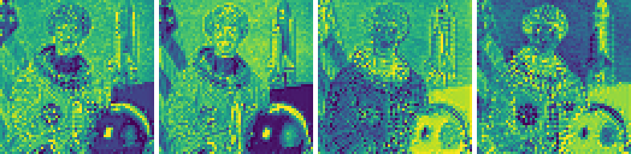
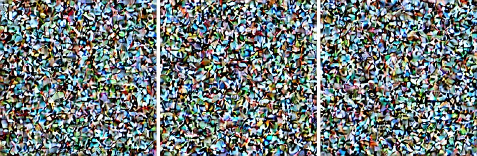

## From digits to paintings

Last week's models made 32 × 32 grey digits, and took their instructions as one of ten labels.

:::: {.columns}
::: {.column width="55%"}
:::{.incremental}
* Today's model takes a sentence: *"a lighthouse on a rocky cliff above the sea at sunset, oil painting"*.
* It makes a 512 × 512 colour image: 256 times as many pixels, each with three colours.
* It's **Stable Diffusion** (v1.5), and it is built from parts we have already met: a VAE, CLIP's text tower, a UNet and a noise scheduler.
:::
:::
::: {.column width="45%"}
{width="100%"}
:::
::::

::: aside
Generated by `stable-diffusion-v1-5`, 30 steps, on a laptop.
:::

# Diffusing in latent space

## The cost of pixels

A 512 × 512 colour image is 786,432 numbers. A pixel-space diffusion model would run its UNet over all of them, at every one of dozens of steps.

:::{.incremental}
* The cost of a convolution grows with the number of positions it visits: height × width.
* Self-attention is worse. It compares every position with every other, so its cost grows with the *square* of the number of positions.
* Double the width and the height, and there are 4 times as many positions, and 16 times as much attention.
:::

. . .

Most of those numbers are fine detail: the texture of brush strokes, the edge of a cloud. Do we need to diffuse those, step after step?

## Recall: an autoencoder's latent space

An autoencoder squeezes an image into a smaller latent and rebuilds it. Stable Diffusion's latent is a grid, not a flat vector like our MNIST autoencoder's.

```{=html}
<!-- generated by pics/lec11_svgs.py: l17-latents -->
<svg viewBox="0 0 1100 352" width="100%" xmlns="http://www.w3.org/2000/svg" font-family="IBM Plex Sans, sans-serif" role="img" aria-label="A flat latent vector versus a latent grid of 4 channels">
<defs></defs>
<text x="270" y="30" text-anchor="middle" font-size="18" font-weight="700" fill="#000">Our MNIST autoencoder</text>
<rect x="124" y="124" width="112" height="112" fill="#fff"/>
<rect x="148" y="152" width="4.2" height="4.2" fill="#b3b3b3"/>
<rect x="152" y="152" width="4.2" height="4.2" fill="#575757"/>
<rect x="156" y="152" width="4.2" height="4.2" fill="#767676"/>
<rect x="160" y="152" width="4.2" height="4.2" fill="#767676"/>
<rect x="164" y="152" width="4.2" height="4.2" fill="#d1d1d1"/>
<rect x="168" y="152" width="4.2" height="4.2" fill="#e0e0e0"/>
<rect x="148" y="156" width="4.2" height="4.2" fill="#393939"/>
<rect x="152" y="156" width="4.2" height="4.2" fill="#1a1a1a"/>
<rect x="156" y="156" width="4.2" height="4.2" fill="#1a1a1a"/>
<rect x="160" y="156" width="4.2" height="4.2" fill="#1a1a1a"/>
<rect x="164" y="156" width="4.2" height="4.2" fill="#1a1a1a"/>
<rect x="168" y="156" width="4.2" height="4.2" fill="#1a1a1a"/>
<rect x="172" y="156" width="4.2" height="4.2" fill="#484848"/>
<rect x="176" y="156" width="4.2" height="4.2" fill="#484848"/>
<rect x="180" y="156" width="4.2" height="4.2" fill="#484848"/>
<rect x="184" y="156" width="4.2" height="4.2" fill="#484848"/>
<rect x="188" y="156" width="4.2" height="4.2" fill="#484848"/>
<rect x="192" y="156" width="4.2" height="4.2" fill="#484848"/>
<rect x="196" y="156" width="4.2" height="4.2" fill="#484848"/>
<rect x="200" y="156" width="4.2" height="4.2" fill="#484848"/>
<rect x="204" y="156" width="4.2" height="4.2" fill="#666666"/>
<rect x="208" y="156" width="4.2" height="4.2" fill="#d1d1d1"/>
<rect x="148" y="160" width="4.2" height="4.2" fill="#c2c2c2"/>
<rect x="152" y="160" width="4.2" height="4.2" fill="#949494"/>
<rect x="156" y="160" width="4.2" height="4.2" fill="#c2c2c2"/>
<rect x="160" y="160" width="4.2" height="4.2" fill="#949494"/>
<rect x="164" y="160" width="4.2" height="4.2" fill="#666666"/>
<rect x="168" y="160" width="4.2" height="4.2" fill="#292929"/>
<rect x="172" y="160" width="4.2" height="4.2" fill="#1a1a1a"/>
<rect x="176" y="160" width="4.2" height="4.2" fill="#292929"/>
<rect x="180" y="160" width="4.2" height="4.2" fill="#1a1a1a"/>
<rect x="184" y="160" width="4.2" height="4.2" fill="#1a1a1a"/>
<rect x="188" y="160" width="4.2" height="4.2" fill="#1a1a1a"/>
<rect x="192" y="160" width="4.2" height="4.2" fill="#1a1a1a"/>
<rect x="196" y="160" width="4.2" height="4.2" fill="#292929"/>
<rect x="200" y="160" width="4.2" height="4.2" fill="#1a1a1a"/>
<rect x="204" y="160" width="4.2" height="4.2" fill="#1a1a1a"/>
<rect x="208" y="160" width="4.2" height="4.2" fill="#858585"/>
<rect x="168" y="164" width="4.2" height="4.2" fill="#f0f0f0"/>
<rect x="172" y="164" width="4.2" height="4.2" fill="#c2c2c2"/>
<rect x="180" y="164" width="4.2" height="4.2" fill="#c2c2c2"/>
<rect x="184" y="164" width="4.2" height="4.2" fill="#c2c2c2"/>
<rect x="188" y="164" width="4.2" height="4.2" fill="#c2c2c2"/>
<rect x="192" y="164" width="4.2" height="4.2" fill="#d1d1d1"/>
<rect x="196" y="164" width="4.2" height="4.2" fill="#f0f0f0"/>
<rect x="200" y="164" width="4.2" height="4.2" fill="#292929"/>
<rect x="204" y="164" width="4.2" height="4.2" fill="#1a1a1a"/>
<rect x="208" y="164" width="4.2" height="4.2" fill="#a3a3a3"/>
<rect x="196" y="168" width="4.2" height="4.2" fill="#b3b3b3"/>
<rect x="200" y="168" width="4.2" height="4.2" fill="#1a1a1a"/>
<rect x="204" y="168" width="4.2" height="4.2" fill="#393939"/>
<rect x="208" y="168" width="4.2" height="4.2" fill="#f0f0f0"/>
<rect x="192" y="172" width="4.2" height="4.2" fill="#f0f0f0"/>
<rect x="196" y="172" width="4.2" height="4.2" fill="#292929"/>
<rect x="200" y="172" width="4.2" height="4.2" fill="#1a1a1a"/>
<rect x="204" y="172" width="4.2" height="4.2" fill="#b3b3b3"/>
<rect x="192" y="176" width="4.2" height="4.2" fill="#858585"/>
<rect x="196" y="176" width="4.2" height="4.2" fill="#1a1a1a"/>
<rect x="200" y="176" width="4.2" height="4.2" fill="#292929"/>
<rect x="204" y="176" width="4.2" height="4.2" fill="#e0e0e0"/>
<rect x="188" y="180" width="4.2" height="4.2" fill="#d1d1d1"/>
<rect x="192" y="180" width="4.2" height="4.2" fill="#1a1a1a"/>
<rect x="196" y="180" width="4.2" height="4.2" fill="#1a1a1a"/>
<rect x="200" y="180" width="4.2" height="4.2" fill="#d1d1d1"/>
<rect x="188" y="184" width="4.2" height="4.2" fill="#858585"/>
<rect x="192" y="184" width="4.2" height="4.2" fill="#1a1a1a"/>
<rect x="196" y="184" width="4.2" height="4.2" fill="#575757"/>
<rect x="188" y="188" width="4.2" height="4.2" fill="#484848"/>
<rect x="192" y="188" width="4.2" height="4.2" fill="#1a1a1a"/>
<rect x="196" y="188" width="4.2" height="4.2" fill="#d1d1d1"/>
<rect x="184" y="192" width="4.2" height="4.2" fill="#949494"/>
<rect x="188" y="192" width="4.2" height="4.2" fill="#1a1a1a"/>
<rect x="192" y="192" width="4.2" height="4.2" fill="#575757"/>
<rect x="180" y="196" width="4.2" height="4.2" fill="#c2c2c2"/>
<rect x="184" y="196" width="4.2" height="4.2" fill="#1a1a1a"/>
<rect x="188" y="196" width="4.2" height="4.2" fill="#1a1a1a"/>
<rect x="192" y="196" width="4.2" height="4.2" fill="#d1d1d1"/>
<rect x="176" y="200" width="4.2" height="4.2" fill="#f0f0f0"/>
<rect x="180" y="200" width="4.2" height="4.2" fill="#393939"/>
<rect x="184" y="200" width="4.2" height="4.2" fill="#1a1a1a"/>
<rect x="188" y="200" width="4.2" height="4.2" fill="#666666"/>
<rect x="176" y="204" width="4.2" height="4.2" fill="#484848"/>
<rect x="180" y="204" width="4.2" height="4.2" fill="#1a1a1a"/>
<rect x="184" y="204" width="4.2" height="4.2" fill="#393939"/>
<rect x="188" y="204" width="4.2" height="4.2" fill="#e0e0e0"/>
<rect x="172" y="208" width="4.2" height="4.2" fill="#e0e0e0"/>
<rect x="176" y="208" width="4.2" height="4.2" fill="#1a1a1a"/>
<rect x="180" y="208" width="4.2" height="4.2" fill="#1a1a1a"/>
<rect x="184" y="208" width="4.2" height="4.2" fill="#c2c2c2"/>
<rect x="168" y="212" width="4.2" height="4.2" fill="#f0f0f0"/>
<rect x="172" y="212" width="4.2" height="4.2" fill="#292929"/>
<rect x="176" y="212" width="4.2" height="4.2" fill="#1a1a1a"/>
<rect x="180" y="212" width="4.2" height="4.2" fill="#949494"/>
<rect x="168" y="216" width="4.2" height="4.2" fill="#858585"/>
<rect x="172" y="216" width="4.2" height="4.2" fill="#1a1a1a"/>
<rect x="176" y="216" width="4.2" height="4.2" fill="#1a1a1a"/>
<rect x="180" y="216" width="4.2" height="4.2" fill="#d1d1d1"/>
<rect x="164" y="220" width="4.2" height="4.2" fill="#d1d1d1"/>
<rect x="168" y="220" width="4.2" height="4.2" fill="#1a1a1a"/>
<rect x="172" y="220" width="4.2" height="4.2" fill="#1a1a1a"/>
<rect x="176" y="220" width="4.2" height="4.2" fill="#1a1a1a"/>
<rect x="180" y="220" width="4.2" height="4.2" fill="#d1d1d1"/>
<rect x="164" y="224" width="4.2" height="4.2" fill="#949494"/>
<rect x="168" y="224" width="4.2" height="4.2" fill="#1a1a1a"/>
<rect x="172" y="224" width="4.2" height="4.2" fill="#1a1a1a"/>
<rect x="176" y="224" width="4.2" height="4.2" fill="#393939"/>
<rect x="180" y="224" width="4.2" height="4.2" fill="#e0e0e0"/>
<rect x="164" y="228" width="4.2" height="4.2" fill="#949494"/>
<rect x="168" y="228" width="4.2" height="4.2" fill="#1a1a1a"/>
<rect x="172" y="228" width="4.2" height="4.2" fill="#484848"/>
<rect x="176" y="228" width="4.2" height="4.2" fill="#f0f0f0"/>
<rect x="124" y="124" width="112" height="112" fill="none" stroke="#555" stroke-width="1"/>
<text x="180" y="262" text-anchor="middle" font-size="13" font-weight="500" fill="#000" font-family="SFMono-Regular, Menlo, Consolas, monospace">1×28×28</text>
<path d="M256 105 L386 132 L386 228 L256 255 Z" fill="#c0ffd4" stroke="#222" stroke-width="2.4" stroke-linejoin="round"/>
<text x="321" y="186" text-anchor="middle" font-size="16" font-weight="700" fill="#000">Encoder</text>
<g>
<rect x="402" y="132" width="14" height="6" fill="#eca285" stroke="#fff" stroke-width="0.6"/>
<rect x="402" y="138" width="14" height="6" fill="#e8906e" stroke="#fff" stroke-width="0.6"/>
<rect x="402" y="144" width="14" height="6" fill="#e88f6c" stroke="#fff" stroke-width="0.6"/>
<rect x="402" y="150" width="14" height="6" fill="#e37950" stroke="#fff" stroke-width="0.6"/>
<rect x="402" y="156" width="14" height="6" fill="#eca386" stroke="#fff" stroke-width="0.6"/>
<rect x="402" y="162" width="14" height="6" fill="#f5cebe" stroke="#fff" stroke-width="0.6"/>
<rect x="402" y="168" width="14" height="6" fill="#eda98f" stroke="#fff" stroke-width="0.6"/>
<rect x="402" y="174" width="14" height="6" fill="#e78d6a" stroke="#fff" stroke-width="0.6"/>
<rect x="402" y="180" width="14" height="6" fill="#e16f43" stroke="#fff" stroke-width="0.6"/>
<rect x="402" y="186" width="14" height="6" fill="#df6434" stroke="#fff" stroke-width="0.6"/>
<rect x="402" y="192" width="14" height="6" fill="#e68761" stroke="#fff" stroke-width="0.6"/>
<rect x="402" y="198" width="14" height="6" fill="#e78a66" stroke="#fff" stroke-width="0.6"/>
<rect x="402" y="204" width="14" height="6" fill="#e6855f" stroke="#fff" stroke-width="0.6"/>
<rect x="402" y="210" width="14" height="6" fill="#f0b9a3" stroke="#fff" stroke-width="0.6"/>
<rect x="402" y="216" width="14" height="6" fill="#f5d0c1" stroke="#fff" stroke-width="0.6"/>
<rect x="402" y="222" width="14" height="6" fill="#eca58a" stroke="#fff" stroke-width="0.6"/>
<rect x="402" y="132" width="14" height="96" fill="none" stroke="#222" stroke-width="1"/>
</g>
<text x="409" y="122" text-anchor="middle" font-size="16" font-weight="600" fill="#000" font-style="italic">z</text>
<text x="409" y="262" text-anchor="middle" font-size="13" font-weight="500" fill="#d9480f" font-family="SFMono-Regular, Menlo, Consolas, monospace">16</text>
<text x="270" y="322" text-anchor="middle" font-size="14" font-weight="500" fill="#444">a flat vector:</text>
<text x="270" y="340" text-anchor="middle" font-size="14" font-weight="500" fill="#444">no rows or columns left</text>
<g class="fragment" data-fragment-index="0">
<text x="830" y="30" text-anchor="middle" font-size="18" font-weight="700" fill="#000">Stable Diffusion's autoencoder</text>
<rect x="675" y="97" width="150" height="150" rx="0" fill="#c1d5eb" stroke="#444" stroke-width="1.2"/>
<rect x="667" y="105" width="150" height="150" rx="0" fill="#c1ddc8" stroke="#444" stroke-width="1.2"/>
<rect x="659" y="113" width="9.5" height="9.5" fill="#d6e8f7"/>
<rect x="668.4" y="113" width="9.5" height="9.5" fill="#d6e8f7"/>
<rect x="677.8" y="113" width="9.5" height="9.5" fill="#d6e8f7"/>
<rect x="687.1" y="113" width="9.5" height="9.5" fill="#d6e8f7"/>
<rect x="696.5" y="113" width="9.5" height="9.5" fill="#d6e8f7"/>
<rect x="705.9" y="113" width="9.5" height="9.5" fill="#d6e8f7"/>
<rect x="715.2" y="113" width="9.5" height="9.5" fill="#d6e8f7"/>
<rect x="724.6" y="113" width="9.5" height="9.5" fill="#d6e8f7"/>
<rect x="734" y="113" width="9.5" height="9.5" fill="#d6e8f7"/>
<rect x="743.4" y="113" width="9.5" height="9.5" fill="#d6e8f7"/>
<rect x="752.8" y="113" width="9.5" height="9.5" fill="#d6e8f7"/>
<rect x="762.1" y="113" width="9.5" height="9.5" fill="#d6e8f7"/>
<rect x="771.5" y="113" width="9.5" height="9.5" fill="#d6e8f7"/>
<rect x="780.9" y="113" width="9.5" height="9.5" fill="#d6e8f7"/>
<rect x="790.2" y="113" width="9.5" height="9.5" fill="#d6e8f7"/>
<rect x="799.6" y="113" width="9.5" height="9.5" fill="#d6e8f7"/>
<rect x="659" y="122.4" width="9.5" height="9.5" fill="#cde3f4"/>
<rect x="668.4" y="122.4" width="9.5" height="9.5" fill="#cde2f4"/>
<rect x="677.8" y="122.4" width="9.5" height="9.5" fill="#cde2f4"/>
<rect x="687.1" y="122.4" width="9.5" height="9.5" fill="#cce2f4"/>
<rect x="696.5" y="122.4" width="9.5" height="9.5" fill="#cce2f4"/>
<rect x="705.9" y="122.4" width="9.5" height="9.5" fill="#cce2f4"/>
<rect x="715.2" y="122.4" width="9.5" height="9.5" fill="#cce2f4"/>
<rect x="724.6" y="122.4" width="9.5" height="9.5" fill="#cde2f4"/>
<rect x="734" y="122.4" width="9.5" height="9.5" fill="#cde2f4"/>
<rect x="743.4" y="122.4" width="9.5" height="9.5" fill="#cde2f4"/>
<rect x="752.8" y="122.4" width="9.5" height="9.5" fill="#cde3f4"/>
<rect x="762.1" y="122.4" width="9.5" height="9.5" fill="#cee3f5"/>
<rect x="771.5" y="122.4" width="9.5" height="9.5" fill="#cee3f5"/>
<rect x="780.9" y="122.4" width="9.5" height="9.5" fill="#cfe3f5"/>
<rect x="790.2" y="122.4" width="9.5" height="9.5" fill="#cfe4f5"/>
<rect x="799.6" y="122.4" width="9.5" height="9.5" fill="#cfe4f5"/>
<rect x="659" y="131.8" width="9.5" height="9.5" fill="#c4ddf2"/>
<rect x="668.4" y="131.8" width="9.5" height="9.5" fill="#c4ddf2"/>
<rect x="677.8" y="131.8" width="9.5" height="9.5" fill="#c3dcf1"/>
<rect x="687.1" y="131.8" width="9.5" height="9.5" fill="#c3dcf1"/>
<rect x="696.5" y="131.8" width="9.5" height="9.5" fill="#c3dcf1"/>
<rect x="705.9" y="131.8" width="9.5" height="9.5" fill="#c3dcf1"/>
<rect x="715.2" y="131.8" width="9.5" height="9.5" fill="#c3dcf1"/>
<rect x="724.6" y="131.8" width="9.5" height="9.5" fill="#c3dcf1"/>
<rect x="734" y="131.8" width="9.5" height="9.5" fill="#c3dcf1"/>
<rect x="743.4" y="131.8" width="9.5" height="9.5" fill="#c4ddf2"/>
<rect x="752.8" y="131.8" width="9.5" height="9.5" fill="#c5ddf2"/>
<rect x="762.1" y="131.8" width="9.5" height="9.5" fill="#c5def2"/>
<rect x="771.5" y="131.8" width="9.5" height="9.5" fill="#c6def2"/>
<rect x="780.9" y="131.8" width="9.5" height="9.5" fill="#c7dff3"/>
<rect x="790.2" y="131.8" width="9.5" height="9.5" fill="#c8dff3"/>
<rect x="799.6" y="131.8" width="9.5" height="9.5" fill="#c9e0f3"/>
<rect x="659" y="141.1" width="9.5" height="9.5" fill="#bcd8ef"/>
<rect x="668.4" y="141.1" width="9.5" height="9.5" fill="#bbd7ef"/>
<rect x="677.8" y="141.1" width="9.5" height="9.5" fill="#bad6ef"/>
<rect x="687.1" y="141.1" width="9.5" height="9.5" fill="#b9d6ee"/>
<rect x="696.5" y="141.1" width="9.5" height="9.5" fill="#b9d6ee"/>
<rect x="705.9" y="141.1" width="9.5" height="9.5" fill="#b9d6ee"/>
<rect x="715.2" y="141.1" width="9.5" height="9.5" fill="#b9d6ee"/>
<rect x="724.6" y="141.1" width="9.5" height="9.5" fill="#bad6ee"/>
<rect x="734" y="141.1" width="9.5" height="9.5" fill="#bad7ef"/>
<rect x="743.4" y="141.1" width="9.5" height="9.5" fill="#bbd7ef"/>
<rect x="752.8" y="141.1" width="9.5" height="9.5" fill="#bcd8ef"/>
<rect x="762.1" y="141.1" width="9.5" height="9.5" fill="#f2a65a"/>
<rect x="771.5" y="141.1" width="9.5" height="9.5" fill="#f2a65a"/>
<rect x="780.9" y="141.1" width="9.5" height="9.5" fill="#c0daf0"/>
<rect x="790.2" y="141.1" width="9.5" height="9.5" fill="#c1dbf1"/>
<rect x="799.6" y="141.1" width="9.5" height="9.5" fill="#c2dcf1"/>
<rect x="659" y="150.5" width="9.5" height="9.5" fill="#b3d2ec"/>
<rect x="668.4" y="150.5" width="9.5" height="9.5" fill="#b2d1ec"/>
<rect x="677.8" y="150.5" width="9.5" height="9.5" fill="#b1d1ec"/>
<rect x="687.1" y="150.5" width="9.5" height="9.5" fill="#b0d0ec"/>
<rect x="696.5" y="150.5" width="9.5" height="9.5" fill="#afd0eb"/>
<rect x="705.9" y="150.5" width="9.5" height="9.5" fill="#afd0eb"/>
<rect x="715.2" y="150.5" width="9.5" height="9.5" fill="#afd0eb"/>
<rect x="724.6" y="150.5" width="9.5" height="9.5" fill="#b0d0ec"/>
<rect x="734" y="150.5" width="9.5" height="9.5" fill="#b1d1ec"/>
<rect x="743.4" y="150.5" width="9.5" height="9.5" fill="#b2d2ec"/>
<rect x="752.8" y="150.5" width="9.5" height="9.5" fill="#f2a65a"/>
<rect x="762.1" y="150.5" width="9.5" height="9.5" fill="#f2a65a"/>
<rect x="771.5" y="150.5" width="9.5" height="9.5" fill="#f2a65a"/>
<rect x="780.9" y="150.5" width="9.5" height="9.5" fill="#f2a65a"/>
<rect x="790.2" y="150.5" width="9.5" height="9.5" fill="#bad6ef"/>
<rect x="799.6" y="150.5" width="9.5" height="9.5" fill="#bcd8ef"/>
<rect x="659" y="159.9" width="9.5" height="9.5" fill="#aacdea"/>
<rect x="668.4" y="159.9" width="9.5" height="9.5" fill="#a9cce9"/>
<rect x="677.8" y="159.9" width="9.5" height="9.5" fill="#a7cbe9"/>
<rect x="687.1" y="159.9" width="9.5" height="9.5" fill="#a6cae9"/>
<rect x="696.5" y="159.9" width="9.5" height="9.5" fill="#a6cae8"/>
<rect x="705.9" y="159.9" width="9.5" height="9.5" fill="#a6cae8"/>
<rect x="715.2" y="159.9" width="9.5" height="9.5" fill="#a6cae9"/>
<rect x="724.6" y="159.9" width="9.5" height="9.5" fill="#a7cae9"/>
<rect x="734" y="159.9" width="9.5" height="9.5" fill="#a8cbe9"/>
<rect x="743.4" y="159.9" width="9.5" height="9.5" fill="#a9ccea"/>
<rect x="752.8" y="159.9" width="9.5" height="9.5" fill="#abcdea"/>
<rect x="762.1" y="159.9" width="9.5" height="9.5" fill="#f2a65a"/>
<rect x="771.5" y="159.9" width="9.5" height="9.5" fill="#f2a65a"/>
<rect x="780.9" y="159.9" width="9.5" height="9.5" fill="#b1d1ec"/>
<rect x="790.2" y="159.9" width="9.5" height="9.5" fill="#b3d2ec"/>
<rect x="799.6" y="159.9" width="9.5" height="9.5" fill="#b5d3ed"/>
<rect x="659" y="169.2" width="9.5" height="9.5" fill="#a1c7e7"/>
<rect x="668.4" y="169.2" width="9.5" height="9.5" fill="#9fc6e7"/>
<rect x="677.8" y="169.2" width="9.5" height="9.5" fill="#9ec5e6"/>
<rect x="687.1" y="169.2" width="9.5" height="9.5" fill="#9dc4e6"/>
<rect x="696.5" y="169.2" width="9.5" height="9.5" fill="#9cc4e6"/>
<rect x="705.9" y="169.2" width="9.5" height="9.5" fill="#9cc4e6"/>
<rect x="715.2" y="169.2" width="9.5" height="9.5" fill="#9cc4e6"/>
<rect x="724.6" y="169.2" width="9.5" height="9.5" fill="#9dc4e6"/>
<rect x="734" y="169.2" width="9.5" height="9.5" fill="#9ec5e6"/>
<rect x="743.4" y="169.2" width="9.5" height="9.5" fill="#a0c6e7"/>
<rect x="752.8" y="169.2" width="9.5" height="9.5" fill="#a2c8e7"/>
<rect x="762.1" y="169.2" width="9.5" height="9.5" fill="#a4c9e8"/>
<rect x="771.5" y="169.2" width="9.5" height="9.5" fill="#a7cbe9"/>
<rect x="780.9" y="169.2" width="9.5" height="9.5" fill="#a9ccea"/>
<rect x="790.2" y="169.2" width="9.5" height="9.5" fill="#acceea"/>
<rect x="799.6" y="169.2" width="9.5" height="9.5" fill="#aecfeb"/>
<rect x="659" y="178.6" width="9.5" height="9.5" fill="#99c2e5"/>
<rect x="668.4" y="178.6" width="9.5" height="9.5" fill="#96c0e4"/>
<rect x="677.8" y="178.6" width="9.5" height="9.5" fill="#94bfe3"/>
<rect x="687.1" y="178.6" width="9.5" height="9.5" fill="#93bee3"/>
<rect x="696.5" y="178.6" width="9.5" height="9.5" fill="#92bee3"/>
<rect x="705.9" y="178.6" width="9.5" height="9.5" fill="#92bee3"/>
<rect x="715.2" y="178.6" width="9.5" height="9.5" fill="#93bee3"/>
<rect x="724.6" y="178.6" width="9.5" height="9.5" fill="#94bee3"/>
<rect x="734" y="178.6" width="9.5" height="9.5" fill="#95bfe4"/>
<rect x="743.4" y="178.6" width="9.5" height="9.5" fill="#97c1e4"/>
<rect x="752.8" y="178.6" width="9.5" height="9.5" fill="#9ac2e5"/>
<rect x="762.1" y="178.6" width="9.5" height="9.5" fill="#9cc4e6"/>
<rect x="771.5" y="178.6" width="9.5" height="9.5" fill="#9fc6e7"/>
<rect x="780.9" y="178.6" width="9.5" height="9.5" fill="#a2c8e7"/>
<rect x="790.2" y="178.6" width="9.5" height="9.5" fill="#a5c9e8"/>
<rect x="799.6" y="178.6" width="9.5" height="9.5" fill="#a8cbe9"/>
<rect x="659" y="188" width="9.5" height="9.5" fill="#90bce2"/>
<rect x="668.4" y="188" width="9.5" height="9.5" fill="#8dbbe1"/>
<rect x="677.8" y="188" width="9.5" height="9.5" fill="#8bb9e1"/>
<rect x="687.1" y="188" width="9.5" height="9.5" fill="#8ab8e0"/>
<rect x="696.5" y="188" width="9.5" height="9.5" fill="#89b8e0"/>
<rect x="705.9" y="188" width="9.5" height="9.5" fill="#88b8e0"/>
<rect x="715.2" y="188" width="9.5" height="9.5" fill="#89b8e0"/>
<rect x="724.6" y="188" width="9.5" height="9.5" fill="#8ab9e0"/>
<rect x="734" y="188" width="9.5" height="9.5" fill="#8cbae1"/>
<rect x="743.4" y="188" width="9.5" height="9.5" fill="#8ebbe1"/>
<rect x="752.8" y="188" width="9.5" height="9.5" fill="#91bde2"/>
<rect x="762.1" y="188" width="9.5" height="9.5" fill="#94bfe3"/>
<rect x="771.5" y="188" width="9.5" height="9.5" fill="#97c1e4"/>
<rect x="780.9" y="188" width="9.5" height="9.5" fill="#9bc3e5"/>
<rect x="790.2" y="188" width="9.5" height="9.5" fill="#9ec5e6"/>
<rect x="799.6" y="188" width="9.5" height="9.5" fill="#a1c7e7"/>
<rect x="659" y="197.4" width="9.5" height="9.5" fill="#87b7df"/>
<rect x="668.4" y="197.4" width="9.5" height="9.5" fill="#a3c77d"/>
<rect x="677.8" y="197.4" width="9.5" height="9.5" fill="#a0c57b"/>
<rect x="687.1" y="197.4" width="9.5" height="9.5" fill="#9ec37a"/>
<rect x="696.5" y="197.4" width="9.5" height="9.5" fill="#9dc279"/>
<rect x="705.9" y="197.4" width="9.5" height="9.5" fill="#9dc279"/>
<rect x="715.2" y="197.4" width="9.5" height="9.5" fill="#9dc279"/>
<rect x="724.6" y="197.4" width="9.5" height="9.5" fill="#9fc47a"/>
<rect x="734" y="197.4" width="9.5" height="9.5" fill="#a1c57c"/>
<rect x="743.4" y="197.4" width="9.5" height="9.5" fill="#a4c87e"/>
<rect x="752.8" y="197.4" width="9.5" height="9.5" fill="#88b7e0"/>
<rect x="762.1" y="197.4" width="9.5" height="9.5" fill="#8cbae1"/>
<rect x="771.5" y="197.4" width="9.5" height="9.5" fill="#8fbce2"/>
<rect x="780.9" y="197.4" width="9.5" height="9.5" fill="#93bee3"/>
<rect x="790.2" y="197.4" width="9.5" height="9.5" fill="#97c1e4"/>
<rect x="799.6" y="197.4" width="9.5" height="9.5" fill="#9bc3e5"/>
<rect x="659" y="206.8" width="9.5" height="9.5" fill="#9ac076"/>
<rect x="668.4" y="206.8" width="9.5" height="9.5" fill="#97bd74"/>
<rect x="677.8" y="206.8" width="9.5" height="9.5" fill="#94bb72"/>
<rect x="687.1" y="206.8" width="9.5" height="9.5" fill="#93ba71"/>
<rect x="696.5" y="206.8" width="9.5" height="9.5" fill="#92b970"/>
<rect x="705.9" y="206.8" width="9.5" height="9.5" fill="#92b970"/>
<rect x="715.2" y="206.8" width="9.5" height="9.5" fill="#92b971"/>
<rect x="724.6" y="206.8" width="9.5" height="9.5" fill="#93ba71"/>
<rect x="734" y="206.8" width="9.5" height="9.5" fill="#95bb73"/>
<rect x="743.4" y="206.8" width="9.5" height="9.5" fill="#98be75"/>
<rect x="752.8" y="206.8" width="9.5" height="9.5" fill="#9cc178"/>
<rect x="762.1" y="206.8" width="9.5" height="9.5" fill="#a1c57c"/>
<rect x="771.5" y="206.8" width="9.5" height="9.5" fill="#88b7df"/>
<rect x="780.9" y="206.8" width="9.5" height="9.5" fill="#8cbae1"/>
<rect x="790.2" y="206.8" width="9.5" height="9.5" fill="#90bce2"/>
<rect x="799.6" y="206.8" width="9.5" height="9.5" fill="#94bfe3"/>
<rect x="659" y="216.1" width="9.5" height="9.5" fill="#8db56d"/>
<rect x="668.4" y="216.1" width="9.5" height="9.5" fill="#8bb36b"/>
<rect x="677.8" y="216.1" width="9.5" height="9.5" fill="#89b169"/>
<rect x="687.1" y="216.1" width="9.5" height="9.5" fill="#88b068"/>
<rect x="696.5" y="216.1" width="9.5" height="9.5" fill="#87af68"/>
<rect x="705.9" y="216.1" width="9.5" height="9.5" fill="#87af68"/>
<rect x="715.2" y="216.1" width="9.5" height="9.5" fill="#87b068"/>
<rect x="724.6" y="216.1" width="9.5" height="9.5" fill="#88b069"/>
<rect x="734" y="216.1" width="9.5" height="9.5" fill="#89b26a"/>
<rect x="743.4" y="216.1" width="9.5" height="9.5" fill="#8cb36b"/>
<rect x="752.8" y="216.1" width="9.5" height="9.5" fill="#8fb66e"/>
<rect x="762.1" y="216.1" width="9.5" height="9.5" fill="#93b971"/>
<rect x="771.5" y="216.1" width="9.5" height="9.5" fill="#99be75"/>
<rect x="780.9" y="216.1" width="9.5" height="9.5" fill="#a1c67c"/>
<rect x="790.2" y="216.1" width="9.5" height="9.5" fill="#89b8e0"/>
<rect x="799.6" y="216.1" width="9.5" height="9.5" fill="#8ebbe1"/>
<rect x="659" y="225.5" width="9.5" height="9.5" fill="#81aa63"/>
<rect x="668.4" y="225.5" width="9.5" height="9.5" fill="#7fa862"/>
<rect x="677.8" y="225.5" width="9.5" height="9.5" fill="#7da760"/>
<rect x="687.1" y="225.5" width="9.5" height="9.5" fill="#7ca760"/>
<rect x="696.5" y="225.5" width="9.5" height="9.5" fill="#7ca65f"/>
<rect x="705.9" y="225.5" width="9.5" height="9.5" fill="#7ca65f"/>
<rect x="715.2" y="225.5" width="9.5" height="9.5" fill="#7ca660"/>
<rect x="724.6" y="225.5" width="9.5" height="9.5" fill="#7da760"/>
<rect x="734" y="225.5" width="9.5" height="9.5" fill="#7ea861"/>
<rect x="743.4" y="225.5" width="9.5" height="9.5" fill="#7fa962"/>
<rect x="752.8" y="225.5" width="9.5" height="9.5" fill="#82ab64"/>
<rect x="762.1" y="225.5" width="9.5" height="9.5" fill="#85ae66"/>
<rect x="771.5" y="225.5" width="9.5" height="9.5" fill="#89b16a"/>
<rect x="780.9" y="225.5" width="9.5" height="9.5" fill="#90b76e"/>
<rect x="790.2" y="225.5" width="9.5" height="9.5" fill="#99bf76"/>
<rect x="799.6" y="225.5" width="9.5" height="9.5" fill="#87b7df"/>
<rect x="659" y="234.9" width="9.5" height="9.5" fill="#749f59"/>
<rect x="668.4" y="234.9" width="9.5" height="9.5" fill="#739e58"/>
<rect x="677.8" y="234.9" width="9.5" height="9.5" fill="#729e58"/>
<rect x="687.1" y="234.9" width="9.5" height="9.5" fill="#719d57"/>
<rect x="696.5" y="234.9" width="9.5" height="9.5" fill="#719d57"/>
<rect x="705.9" y="234.9" width="9.5" height="9.5" fill="#719d57"/>
<rect x="715.2" y="234.9" width="9.5" height="9.5" fill="#719d57"/>
<rect x="724.6" y="234.9" width="9.5" height="9.5" fill="#729d57"/>
<rect x="734" y="234.9" width="9.5" height="9.5" fill="#729e58"/>
<rect x="743.4" y="234.9" width="9.5" height="9.5" fill="#739f59"/>
<rect x="752.8" y="234.9" width="9.5" height="9.5" fill="#75a05a"/>
<rect x="762.1" y="234.9" width="9.5" height="9.5" fill="#77a25b"/>
<rect x="771.5" y="234.9" width="9.5" height="9.5" fill="#7aa45e"/>
<rect x="780.9" y="234.9" width="9.5" height="9.5" fill="#7ea861"/>
<rect x="790.2" y="234.9" width="9.5" height="9.5" fill="#84ad66"/>
<rect x="799.6" y="234.9" width="9.5" height="9.5" fill="#8fb66e"/>
<rect x="659" y="244.2" width="9.5" height="9.5" fill="#689550"/>
<rect x="668.4" y="244.2" width="9.5" height="9.5" fill="#67944f"/>
<rect x="677.8" y="244.2" width="9.5" height="9.5" fill="#66944f"/>
<rect x="687.1" y="244.2" width="9.5" height="9.5" fill="#66944f"/>
<rect x="696.5" y="244.2" width="9.5" height="9.5" fill="#66934e"/>
<rect x="705.9" y="244.2" width="9.5" height="9.5" fill="#66934e"/>
<rect x="715.2" y="244.2" width="9.5" height="9.5" fill="#66934f"/>
<rect x="724.6" y="244.2" width="9.5" height="9.5" fill="#66944f"/>
<rect x="734" y="244.2" width="9.5" height="9.5" fill="#67944f"/>
<rect x="743.4" y="244.2" width="9.5" height="9.5" fill="#67944f"/>
<rect x="752.8" y="244.2" width="9.5" height="9.5" fill="#689550"/>
<rect x="762.1" y="244.2" width="9.5" height="9.5" fill="#699651"/>
<rect x="771.5" y="244.2" width="9.5" height="9.5" fill="#6a9752"/>
<rect x="780.9" y="244.2" width="9.5" height="9.5" fill="#6d9953"/>
<rect x="790.2" y="244.2" width="9.5" height="9.5" fill="#709c56"/>
<rect x="799.6" y="244.2" width="9.5" height="9.5" fill="#75a05a"/>
<rect x="659" y="253.6" width="9.5" height="9.5" fill="#5b8a46"/>
<rect x="668.4" y="253.6" width="9.5" height="9.5" fill="#5b8a46"/>
<rect x="677.8" y="253.6" width="9.5" height="9.5" fill="#5b8a46"/>
<rect x="687.1" y="253.6" width="9.5" height="9.5" fill="#5b8a46"/>
<rect x="696.5" y="253.6" width="9.5" height="9.5" fill="#5b8a46"/>
<rect x="705.9" y="253.6" width="9.5" height="9.5" fill="#5b8a46"/>
<rect x="715.2" y="253.6" width="9.5" height="9.5" fill="#5b8a46"/>
<rect x="724.6" y="253.6" width="9.5" height="9.5" fill="#5b8a46"/>
<rect x="734" y="253.6" width="9.5" height="9.5" fill="#5b8a46"/>
<rect x="743.4" y="253.6" width="9.5" height="9.5" fill="#5b8a46"/>
<rect x="752.8" y="253.6" width="9.5" height="9.5" fill="#5b8a46"/>
<rect x="762.1" y="253.6" width="9.5" height="9.5" fill="#5b8a46"/>
<rect x="771.5" y="253.6" width="9.5" height="9.5" fill="#5b8a46"/>
<rect x="780.9" y="253.6" width="9.5" height="9.5" fill="#5b8a46"/>
<rect x="790.2" y="253.6" width="9.5" height="9.5" fill="#5b8a46"/>
<rect x="799.6" y="253.6" width="9.5" height="9.5" fill="#5b8a46"/>
<rect x="659" y="113" width="150" height="150" fill="none" stroke="#555" stroke-width="1"/>
<text x="742" y="289" text-anchor="middle" font-size="13" font-weight="500" fill="#000" font-family="SFMono-Regular, Menlo, Consolas, monospace">3×512×512</text>
<path d="M845 105 L955 163 L955 197 L845 255 Z" fill="#c0ffd4" stroke="#222" stroke-width="2.4" stroke-linejoin="round"/>
<text x="900" y="186" text-anchor="middle" font-size="16" font-weight="700" fill="#000">Encoder</text>
<g>
<rect x="983" y="164.6" width="4.7" height="4.7" fill="#ebb57b" stroke="#fff" stroke-width="0.6"/>
<rect x="987.7" y="164.6" width="4.7" height="4.7" fill="#f6dcc0" stroke="#fff" stroke-width="0.6"/>
<rect x="992.4" y="164.6" width="4.7" height="4.7" fill="#eaaf6f" stroke="#fff" stroke-width="0.6"/>
<rect x="997.1" y="164.6" width="4.7" height="4.7" fill="#efc191" stroke="#fff" stroke-width="0.6"/>
<rect x="983" y="169.3" width="4.7" height="4.7" fill="#edbb85" stroke="#fff" stroke-width="0.6"/>
<rect x="987.7" y="169.3" width="4.7" height="4.7" fill="#efc292" stroke="#fff" stroke-width="0.6"/>
<rect x="992.4" y="169.3" width="4.7" height="4.7" fill="#efc190" stroke="#fff" stroke-width="0.6"/>
<rect x="997.1" y="169.3" width="4.7" height="4.7" fill="#ebb57a" stroke="#fff" stroke-width="0.6"/>
<rect x="983" y="174" width="4.7" height="4.7" fill="#e9ad6d" stroke="#fff" stroke-width="0.6"/>
<rect x="987.7" y="174" width="4.7" height="4.7" fill="#ecb77f" stroke="#fff" stroke-width="0.6"/>
<rect x="992.4" y="174" width="4.7" height="4.7" fill="#e9ad6d" stroke="#fff" stroke-width="0.6"/>
<rect x="997.1" y="174" width="4.7" height="4.7" fill="#e18f37" stroke="#fff" stroke-width="0.6"/>
<rect x="983" y="178.7" width="4.7" height="4.7" fill="#eaae6e" stroke="#fff" stroke-width="0.6"/>
<rect x="987.7" y="178.7" width="4.7" height="4.7" fill="#e49a4a" stroke="#fff" stroke-width="0.6"/>
<rect x="992.4" y="178.7" width="4.7" height="4.7" fill="#e08a2f" stroke="#fff" stroke-width="0.6"/>
<rect x="997.1" y="178.7" width="4.7" height="4.7" fill="#ebb276" stroke="#fff" stroke-width="0.6"/>
<rect x="983" y="164.6" width="18.8" height="18.8" fill="none" stroke="#444" stroke-width="1"/>
</g>
<g>
<rect x="979" y="168.6" width="4.7" height="4.7" fill="#4f9d63" stroke="#fff" stroke-width="0.6"/>
<rect x="983.7" y="168.6" width="4.7" height="4.7" fill="#cce3d2" stroke="#fff" stroke-width="0.6"/>
<rect x="988.4" y="168.6" width="4.7" height="4.7" fill="#c6dfcd" stroke="#fff" stroke-width="0.6"/>
<rect x="993.1" y="168.6" width="4.7" height="4.7" fill="#7bb68a" stroke="#fff" stroke-width="0.6"/>
<rect x="979" y="173.3" width="4.7" height="4.7" fill="#bad9c2" stroke="#fff" stroke-width="0.6"/>
<rect x="983.7" y="173.3" width="4.7" height="4.7" fill="#84ba92" stroke="#fff" stroke-width="0.6"/>
<rect x="988.4" y="173.3" width="4.7" height="4.7" fill="#d0e5d6" stroke="#fff" stroke-width="0.6"/>
<rect x="993.1" y="173.3" width="4.7" height="4.7" fill="#c1ddc8" stroke="#fff" stroke-width="0.6"/>
<rect x="979" y="178" width="4.7" height="4.7" fill="#cce2d1" stroke="#fff" stroke-width="0.6"/>
<rect x="983.7" y="178" width="4.7" height="4.7" fill="#98c6a4" stroke="#fff" stroke-width="0.6"/>
<rect x="988.4" y="178" width="4.7" height="4.7" fill="#9ec9a9" stroke="#fff" stroke-width="0.6"/>
<rect x="993.1" y="178" width="4.7" height="4.7" fill="#8bbf99" stroke="#fff" stroke-width="0.6"/>
<rect x="979" y="182.7" width="4.7" height="4.7" fill="#74b284" stroke="#fff" stroke-width="0.6"/>
<rect x="983.7" y="182.7" width="4.7" height="4.7" fill="#6dae7e" stroke="#fff" stroke-width="0.6"/>
<rect x="988.4" y="182.7" width="4.7" height="4.7" fill="#a1cbac" stroke="#fff" stroke-width="0.6"/>
<rect x="993.1" y="182.7" width="4.7" height="4.7" fill="#6faf80" stroke="#fff" stroke-width="0.6"/>
<rect x="979" y="168.6" width="18.8" height="18.8" fill="none" stroke="#444" stroke-width="1"/>
</g>
<g>
<rect x="975" y="172.6" width="4.7" height="4.7" fill="#d8d2ef" stroke="#fff" stroke-width="0.6"/>
<rect x="979.7" y="172.6" width="4.7" height="4.7" fill="#8e80d0" stroke="#fff" stroke-width="0.6"/>
<rect x="984.4" y="172.6" width="4.7" height="4.7" fill="#ccc6ea" stroke="#fff" stroke-width="0.6"/>
<rect x="989.1" y="172.6" width="4.7" height="4.7" fill="#b5ace0" stroke="#fff" stroke-width="0.6"/>
<rect x="975" y="177.3" width="4.7" height="4.7" fill="#d0caeb" stroke="#fff" stroke-width="0.6"/>
<rect x="979.7" y="177.3" width="4.7" height="4.7" fill="#d4cfed" stroke="#fff" stroke-width="0.6"/>
<rect x="984.4" y="177.3" width="4.7" height="4.7" fill="#d7d2ee" stroke="#fff" stroke-width="0.6"/>
<rect x="989.1" y="177.3" width="4.7" height="4.7" fill="#c3bae6" stroke="#fff" stroke-width="0.6"/>
<rect x="975" y="182" width="4.7" height="4.7" fill="#bcb3e3" stroke="#fff" stroke-width="0.6"/>
<rect x="979.7" y="182" width="4.7" height="4.7" fill="#d9d4ef" stroke="#fff" stroke-width="0.6"/>
<rect x="984.4" y="182" width="4.7" height="4.7" fill="#b0a5de" stroke="#fff" stroke-width="0.6"/>
<rect x="989.1" y="182" width="4.7" height="4.7" fill="#9384d2" stroke="#fff" stroke-width="0.6"/>
<rect x="975" y="186.7" width="4.7" height="4.7" fill="#b3a8df" stroke="#fff" stroke-width="0.6"/>
<rect x="979.7" y="186.7" width="4.7" height="4.7" fill="#bdb4e3" stroke="#fff" stroke-width="0.6"/>
<rect x="984.4" y="186.7" width="4.7" height="4.7" fill="#9587d3" stroke="#fff" stroke-width="0.6"/>
<rect x="989.1" y="186.7" width="4.7" height="4.7" fill="#a498d9" stroke="#fff" stroke-width="0.6"/>
<rect x="975" y="172.6" width="18.8" height="18.8" fill="none" stroke="#444" stroke-width="1"/>
</g>
<g>
<rect x="971" y="176.6" width="4.7" height="4.7" fill="#f7dbdf" stroke="#fff" stroke-width="0.6"/>
<rect x="975.7" y="176.6" width="4.7" height="4.7" fill="#f0c0c7" stroke="#fff" stroke-width="0.6"/>
<rect x="980.4" y="176.6" width="4.7" height="4.7" fill="#eba8b1" stroke="#fff" stroke-width="0.6"/>
<rect x="985.1" y="176.6" width="4.7" height="4.7" fill="#eba8b1" stroke="#fff" stroke-width="0.6"/>
<rect x="971" y="181.3" width="4.7" height="4.7" fill="#edb3bb" stroke="#fff" stroke-width="0.6"/>
<rect x="975.7" y="181.3" width="4.7" height="4.7" fill="#e6939f" stroke="#fff" stroke-width="0.6"/>
<rect x="980.4" y="181.3" width="4.7" height="4.7" fill="#e6949f" stroke="#fff" stroke-width="0.6"/>
<rect x="985.1" y="181.3" width="4.7" height="4.7" fill="#e89ca7" stroke="#fff" stroke-width="0.6"/>
<rect x="971" y="186" width="4.7" height="4.7" fill="#eaa6b0" stroke="#fff" stroke-width="0.6"/>
<rect x="975.7" y="186" width="4.7" height="4.7" fill="#efb9c0" stroke="#fff" stroke-width="0.6"/>
<rect x="980.4" y="186" width="4.7" height="4.7" fill="#f8e2e5" stroke="#fff" stroke-width="0.6"/>
<rect x="985.1" y="186" width="4.7" height="4.7" fill="#e695a0" stroke="#fff" stroke-width="0.6"/>
<rect x="971" y="190.7" width="4.7" height="4.7" fill="#e5909c" stroke="#fff" stroke-width="0.6"/>
<rect x="975.7" y="190.7" width="4.7" height="4.7" fill="#e9a0aa" stroke="#fff" stroke-width="0.6"/>
<rect x="980.4" y="190.7" width="4.7" height="4.7" fill="#edb1b9" stroke="#fff" stroke-width="0.6"/>
<rect x="985.1" y="190.7" width="4.7" height="4.7" fill="#e799a4" stroke="#fff" stroke-width="0.6"/>
<rect x="971" y="176.6" width="18.8" height="18.8" fill="none" stroke="#444" stroke-width="1"/>
</g>
<text x="983" y="289" text-anchor="middle" font-size="13" font-weight="500" fill="#d9480f" font-family="SFMono-Regular, Menlo, Consolas, monospace">4×64×64</text>
<text x="830" y="322" text-anchor="middle" font-size="14" font-weight="500" fill="#444">far fewer numbers, but still a grid:</text>
<text x="830" y="340" text-anchor="middle" font-size="14" font-weight="500" fill="#444">the latent is image-shaped</text>
</g>
</svg>
```

## Stable Diffusion's autoencoder

:::{.incremental}
* A VAE, trained once on a large set of photos, then **frozen**. Diffusion training never changes it.
* The encoder (34M parameters) halves the width and height three times: 512 × 512 becomes 64 × 64. Each position keeps 4 channels.
* Its KL term has a very small weight, so it behaves much like a plain autoencoder: the latents are chosen to reconstruct well, not to fill $\mathcal{N}(0, I)$.
* Its latents are multiplied by a fixed `scaling_factor` (0.18215) so that they have a standard deviation of about 1, like the noise they will be mixed with.
:::

## Try it: a round trip

```{=html}
<script src="pics/lec17/demos-data.js" defer></script>
<script src="pics/lec17/demos.js" defer></script>
<div class="l17-demo" data-demo="vae">
  <div class="l17-row">
    <div class="l17-col"><span class="l17-lab">the photo, 512 × 512</span>
      <canvas data-role="full" class="l17-pix"></canvas></div>
    <div class="l17-col"><span class="l17-lab">close up: the photo</span>
      <canvas data-role="zin" class="l17-pix"></canvas></div>
    <div class="l17-col"><span class="l17-lab" style="color: #d9480f;">after encode and decode</span>
      <canvas data-role="zout" class="l17-pix"></canvas></div>
  </div>
  <div class="l17-ctl">
    <span>Close-up size:</span>
    <button data-win="144">144 px</button><button data-win="72" class="on">72 px</button><button data-win="36">36 px</button>
  </div>
</div>
```

::: aside
Click or drag on the photo to move the close-up. Photo: scikit-image `astronaut` (NASA, public domain). The latent in between is 4 × 64 × 64; the average pixel is off by 6 out of 255.
:::

## The latent is still image-shaped

The four channels of that latent, each 64 × 64:

{width="85%"}

:::{.incremental}
* Each position summarises an 8 × 8 patch of the photo. Neighbouring positions are neighbouring patches.
* So the UNet, convolutions and all, works on it just as it worked on pixels. Only the number of channels changes: 4 in and 4 out, not 3.
:::

## A latent is not an image

What if we skip diffusion, and just decode random latents $z \sim \mathcal{N}(0, I)$, as we did with our MNIST VAE?

{width="85%"}

. . .

The decoder only knows how to decode latents that look like real ones. With a KL term this weak, random noise is nothing like a real latent. Making a good latent is the diffusion model's job.

## Latent diffusion

:::{.incremental}
* **Training**: encode each training image once, then train the UNet exactly as before, on the 4 × 64 × 64 latents instead of the pixels.
* **Sampling**: start from 4 × 64 × 64 noise, denoise it step by step, and run the VAE's **decoder** once, at the very end.
* The noise, the schedule, the loss and the UNet's job are all unchanged. Only what they act on is different.
:::

. . .

```python
latents = vae.encode(images).latent_dist.sample() * vae.config.scaling_factor
noise = torch.randn_like(latents)
noisy_latents = scheduler.add_noise(latents, noise, t)     # then exactly as before
```

::: aside
Rombach *et al.*, *High-resolution image synthesis with latent diffusion models* (2022).
:::

## Try it: generating in latent space

```{=html}
<div class="l17-demo" data-demo="traj">
  <div class="l17-row">
    <div class="l17-col"><span class="l17-lab">the latent <span class="math inline">\(z_t\)</span>, 64 × 64</span>
      <canvas data-role="z" class="l17-pix l17-blocky"></canvas></div>
    <div class="l17-col"><span class="l17-lab"><span class="math inline">\(z_t\)</span>, decoded</span>
      <canvas data-role="xt" class="l17-pix"></canvas></div>
    <div class="l17-col"><span class="l17-lab" style="color: #d9480f;">the guess <span class="math inline">\(\hat z_0\)</span>, decoded</span>
      <canvas data-role="x0" class="l17-pix"></canvas></div>
  </div>
  <div class="l17-ctl">
    <input type="range" data-role="step" min="0" max="16" value="4" aria-label="sampling step">
    <span class="l17-out" data-role="tval" style="min-width: 13em;"></span>
    <button data-role="play">Play</button>
  </div>
</div>
```

::: aside
Left: three of the latent's four channels, shown as red, green and blue. Decoding is for our benefit only: the model itself decodes just once, at the end. Prompt: "a lighthouse on a rocky cliff above the sea at sunset, oil painting".
:::

# Conditioning on text

## From a label to a prompt

A class label picked one row of a lookup table. A prompt can be any sentence, so there is no table to look it up in.

:::{.incremental}
* We need a network that turns text into vectors that capture what it means.
* We have one already: CLIP's **text tower**. Stable Diffusion v1.5 uses the text tower of `clip-vit-large-patch14`, the very model from the CLIP lecture.
* It was trained to match images to their captions, so its vectors already carry visual meaning. It stays **frozen**: Stable Diffusion's training never changes it.
:::

## Not one vector, but 77

In the CLIP lecture, we summarised a caption as *one* vector: the final vector for `<|endoftext|>`, projected into the shared space.

:::{.incremental}
* Stable Diffusion takes the text tower's final vector for **every** token instead, before any projection.
* The prompt is always padded to the tower's limit of 77 tokens, so the result is always 77 × 768. Words beyond the limit are cut off.
* Different words can then do different jobs in different parts of the image.
:::

. . .

```python
ids = tokenizer(prompt, padding="max_length", max_length=77, return_tensors="pt").input_ids
text_embeddings = text_encoder(ids)[0]      # shape (1, 77, 768)
```

## How does the UNet use 77 vectors?

A class embedding was simply added to the time embedding: one vector, applied to the whole image.

. . .

That won't do for a prompt. "Lighthouse" matters on the cliff, "sunset" in the sky, and "oil painting" everywhere.

. . .

We want each *part of the image* to look up the *words* that are relevant to it. That is a soft dictionary lookup: attention.

## Cross-attention, again

In the encoder–decoder transformer, the decoder's queries attended to the encoder's keys and values. Here:

:::{.incremental}
* **Queries** come from the image: each of the $n$ positions of a UNet feature map, $Q = H W_Q$.
* **Keys** and **values** come from the prompt: the 77 token vectors $E$, with $K = E W_K$ and $V = E W_V$.
* Each position gets a blend of token values, $\operatorname{softmax}\!\big(QK^\top/\sqrt{d_k}\big)\,V$, which is added to its features.
:::

. . .

$Q$ is $n \times d_k$ and $K$ is $77 \times d_k$, so the attention weights are $n \times 77$: for each position, a probability over the tokens. At 64 × 64, $n = 4096$.

## Where it sits

:::{.incremental}
* Stable Diffusion's UNet has 16 cross-attention layers, at every resolution from 64 × 64 down to 8 × 8, on the way down and on the way up.
* Each one sits in a small transformer block: self-attention between image positions, then cross-attention to the prompt, then an MLP.
* The timestep still arrives as before: an embedding added in every ResNet block.
* The cross-attention layers are 44 million of the UNet's 860 million parameters.
:::

## Try it: where each word looks

```{=html}
<div class="l17-demo" data-demo="xattn">
  <div class="l17-row" style="align-items: center;">
    <canvas data-role="img" class="l17-pix"></canvas>
    <div class="l17-col" style="align-items: flex-start; gap: 12px; max-width: 430px;">
      <span class="l17-lab">Click a token:</span>
      <div data-role="words" class="l17-words"></div>
      <div data-role="share" style="min-height: 1.3em;"></div>
    </div>
  </div>
</div>
```

::: aside
The attention weights from each image position to the chosen token, averaged over the 8 heads, the five cross-attention layers that work at 16 × 16 and every step. Each token's map is stretched from its own lowest to highest value.
:::

## What the maps show

:::{.incremental}
* "lighthouse" looks at the lighthouse, and "sunset" at the sky. Each part of the image picks out the words that concern it.
* Most of the weight, 88% on average, goes to the start token. It is the same for every prompt, so it works as a "nothing in particular" option for positions that need no words at all.
* The maps are fuzzy: 16 × 16 positions, averaged over every step. Early on, the image is mostly noise and the layout isn't settled.
* Later in the module, we'll feed in an *image* as a prompt through these same cross-attention layers.
:::

# Classifier-free guidance

## The prompt can be under-used

Last week ended with a problem: a network can reduce its loss a lot while largely ignoring the condition.

:::{.incremental}
* At small $t$ the image already shows what it is, so the prompt adds little.
* Even at large $t$, the model only needs to match the prompt *on average*.
* So samples often follow the prompt only loosely. We'd like a dial that says "follow the prompt more closely".
:::

## Two predictions from one network {.slightly-smaller}

During training, the prompt is replaced by the empty prompt `""` for a random fraction of the examples. Stable Diffusion v1.5 drops 10%, according to its model card.

:::{.incremental}
* So the same network learns both a **conditional** prediction $\hat{\epsilon}_{\text{cond}}$, given the prompt, and an **unconditional** one $\hat{\epsilon}_{\text{uncond}}$, given `""`.
* The difference $\hat{\epsilon}_{\text{cond}} - \hat{\epsilon}_{\text{uncond}}$ is the push that the prompt gives.
* When sampling, we run the network twice per step, and **exaggerate** that push:
:::

. . .

$$\hat{\epsilon} = \hat{\epsilon}_{\text{uncond}} + s \,\big(\hat{\epsilon}_{\text{cond}} - \hat{\epsilon}_{\text{uncond}}\big)$$

. . .

$s$ is the **guidance scale**. At $s = 1$ it is just the conditional prediction. Above 1, we step further in the prompt's direction than the model itself would.

::: aside
Ho and Salimans, *Classifier-free diffusion guidance* (2022). "Classifier-free" because an earlier method needed a separate classifier to supply the push.
:::

## Try it: guidance on three rings

:::: {.columns}
::: {.column width="52%"}
```{=html}
<div class="l17-demo" data-demo="toy">
  <canvas data-role="plot"></canvas>
</div>
```
:::
::: {.column width="48%"}
::::: {.small-text}
Each ring is one class: the conditional guess uses one ring, the unconditional guess all three. The plot shows 200 samples per class, from the exact best guesses and the same starting noise.

```{=html}
<div class="l17-demo" data-demo-part="toy">
  <div class="l17-ctl" style="justify-content: flex-start;">
    <input type="range" data-role="s" min="1" max="7" step="0.5" value="1" aria-label="guidance scale" style="width: 260px;">
    <span class="l17-out" data-role="sval">s = 1.0</span>
  </div>
</div>
```

:::{.incremental}
* At $s = 1$, each class covers its own ring, overlaps included.
* As $s$ grows, the samples leave the overlaps and crowd onto the part of each ring that is *least* like the other two.
:::
:::::
:::
::::

::: aside
After figure 2 of Ho and Salimans (2022), which uses three Gaussians.
:::

## Try it: guidance in Stable Diffusion

```{=html}
<div class="l17-demo" data-demo="cfg">
  <div class="l17-row" style="align-items: center;">
    <canvas data-role="img" class="l17-pix"></canvas>
    <div class="l17-col" style="align-items: flex-start; gap: 14px;">
      <span class="l17-lab" style="color: #2c6fb7;">"a red bicycle leaning against a yellow wall"</span>
      <div><span class="l17-lab">Guidance scale:</span>
        <input type="range" data-role="s" min="0" max="6" step="1" value="0" aria-label="guidance scale" style="width: 220px; vertical-align: middle;">
        <span class="l17-out" data-role="sval">s = 1</span></div>
      <div><span class="l17-lab">Starting noise:</span>
        <button data-seed="0" class="on">A</button><button data-seed="1">B</button></div>
    </div>
  </div>
</div>
```

Watch the colours. As $s$ grows, red and yellow both come through more strongly. But with noise A, from about $s = 5$ they swap places: a red wall and a yellow bicycle. With noise B the bicycle stays red, and red spreads onto the wall. Guidance can only exaggerate what the text encoder captured, and CLIP is weak on which word goes with which.

::: aside
$s$ = 1, 1.5, 2, 3, 5, 7.5, 10. Each image uses the same starting noise at every scale, and 30 steps.
:::

## The trade-off

:::{.incremental}
* Higher $s$: closer to the prompt, with more contrast and saturated colour.
* But less variety, as on the rings. Pushed far enough, the image itself suffers. In the lab, you'll find out how.
* `diffusers` uses $s = 7.5$ by default for Stable Diffusion: `pipe(prompt, guidance_scale=7.5)`.
* It costs a second pass through the UNet at every step. In practice the two passes run together, as a batch of two.
:::

. . .

A **negative prompt** uses the same formula with a prompt such as `"blurry"` in place of `""`, so the image is pushed away from it.

# Putting it all together

## The Stable Diffusion pipeline

```{=html}
<!-- hand-written for lec17: l17-pipeline -->
<svg viewBox="0 0 1100 360" width="100%" xmlns="http://www.w3.org/2000/svg" font-family="IBM Plex Sans, sans-serif" role="img" aria-label="Stable Diffusion: the prompt goes through CLIP's text tower to 77 vectors; noise in latent space is denoised by the UNet, which reads the prompt by cross-attention, repeated for each step; the VAE decoder turns the final latent into an image">
<defs><marker id="l17p-k" viewBox="0 0 10 10" refX="9" refY="5" markerWidth="5" markerHeight="5" orient="auto"><path d="M0 0 L10 5 L0 10 z" fill="#222"/></marker><marker id="l17p-a" viewBox="0 0 10 10" refX="9" refY="5" markerWidth="5" markerHeight="5" orient="auto"><path d="M0 0 L10 5 L0 10 z" fill="#d9480f"/></marker></defs>
<!-- text path -->
<rect x="20" y="30" width="200" height="70" rx="7" fill="#fff" stroke="#2c6fb7" stroke-width="2.4"/>
<text x="120" y="60" text-anchor="middle" font-size="18" font-weight="600" fill="#2c6fb7" font-style="italic">"a lighthouse on</text>
<text x="120" y="84" text-anchor="middle" font-size="18" font-weight="600" fill="#2c6fb7" font-style="italic">a rocky cliff …"</text>
<path d="M224 65 L276 65" fill="none" stroke="#222" stroke-width="2.2" marker-end="url(#l17p-k)"/>
<rect x="280" y="30" width="200" height="70" rx="7" fill="#e3eefa" stroke="#222" stroke-width="2.4"/>
<text x="380" y="60" text-anchor="middle" font-size="19" font-weight="700" fill="#000">text encoder</text>
<text x="380" y="84" text-anchor="middle" font-size="16" font-weight="500" fill="#444">CLIP text tower, frozen</text>
<text x="380" y="122" text-anchor="middle" font-size="16" font-weight="500" fill="#444">123M · once</text>
<path d="M484 65 L620 65 L620 146" fill="none" stroke="#2c6fb7" stroke-width="2.4" marker-end="url(#l17p-k)"/>
<text x="552" y="54" text-anchor="middle" font-size="16" font-weight="500" fill="#2c6fb7" font-family="SFMono-Regular, Menlo, Consolas, monospace">77×768</text>
<!-- noise in -->
<rect x="280" y="180" width="200" height="70" rx="7" fill="#fff" stroke="#222" stroke-width="2.4"/>
<text x="380" y="210" text-anchor="middle" font-size="19" font-weight="700" fill="#000">pure noise</text>
<text x="380" y="234" text-anchor="middle" font-size="16" font-weight="500" fill="#000" font-family="SFMono-Regular, Menlo, Consolas, monospace">4×64×64</text>
<path d="M484 215 L536 215" fill="none" stroke="#222" stroke-width="2.2" marker-end="url(#l17p-k)"/>
<!-- unet -->
<rect x="540" y="150" width="160" height="130" rx="7" fill="#dcdcf0" stroke="#222" stroke-width="2.4"/>
<text x="620" y="200" text-anchor="middle" font-size="22" font-weight="700" fill="#000">UNet</text>
<text x="620" y="226" text-anchor="middle" font-size="16" font-weight="500" fill="#444">predicts noise,</text>
<text x="620" y="246" text-anchor="middle" font-size="16" font-weight="500" fill="#444">twice (guidance)</text>
<text x="620" y="302" text-anchor="middle" font-size="16" font-weight="500" fill="#444">860M · every step</text>
<!-- loop -->
<path d="M704 250 C760 250 760 330 620 330 C480 330 470 270 520 252" fill="none" stroke="#d9480f" stroke-width="2.4" stroke-dasharray="8 5" marker-end="url(#l17p-a)"/>
<text x="770" y="330" text-anchor="start" font-size="17" font-weight="700" fill="#d9480f">one step less noisy;</text>
<text x="770" y="350" text-anchor="start" font-size="17" font-weight="700" fill="#d9480f">repeat (scheduler)</text>
<!-- out -->
<path d="M704 190 L800 190" fill="none" stroke="#222" stroke-width="2.2" marker-end="url(#l17p-k)"/>
<text x="752" y="178" text-anchor="middle" font-size="14" font-weight="500" fill="#000" font-family="SFMono-Regular, Menlo, Consolas, monospace">4×64×64</text>
<path d="M804 160 L904 140 L904 240 L804 220 Z" fill="#fed7ff" stroke="#222" stroke-width="2.4" stroke-linejoin="round"/>
<text x="854" y="196" text-anchor="middle" font-size="17" font-weight="700" fill="#000">VAE</text>
<text x="854" y="216" text-anchor="middle" font-size="17" font-weight="700" fill="#000">decoder</text>
<text x="854" y="270" text-anchor="middle" font-size="16" font-weight="500" fill="#444">49M · once</text>
<path d="M908 190 L946 190" fill="none" stroke="#222" stroke-width="2.2" marker-end="url(#l17p-k)"/>
<image x="950" y="120" width="140" height="140" href="pics/lec17/traj-final.jpg"/>
<rect x="950" y="120" width="140" height="140" fill="none" stroke="#555" stroke-width="1"/>
<text x="1020" y="284" text-anchor="middle" font-size="14" font-weight="500" fill="#000" font-family="SFMono-Regular, Menlo, Consolas, monospace">3×512×512</text>
</svg>
```

::: aside
Parameter counts for `stable-diffusion-v1-5`. Only the UNet runs at every step, twice.
:::

## Fewer steps

Our DDPM sampler took 1,000 steps. Stable Diffusion's default scheduler, **PNDM**, takes 50, and works with fewer.

{width="100%"}

::: {.note-text}
4, 8, 15, 30 and 50 steps for "a bowl of ramen with chopsticks, photograph". Same starting noise, $s = 7.5$. Even 4 steps give a recognisable picture. More add detail, and the picture changes, because each setting takes a different path from the same noise.
:::

:::{.incremental}
* The UNet was trained on all 1,000 noise levels. A **scheduler** decides which of them to visit and how to step between them. For 30 steps, PNDM visits $t = 958, 925, \ldots, 34, 1$.
* Schedulers are interchangeable: the same trained UNet works with many of them.
:::

## In code

```python
pipe.scheduler.set_timesteps(30)                              # which t to visit
latents = torch.randn(1, 4, 64, 64) * pipe.scheduler.init_noise_sigma
embeddings = torch.cat([uncond_embeddings, text_embeddings])  # "" and the prompt

for t in pipe.scheduler.timesteps:
    latent_input = pipe.scheduler.scale_model_input(torch.cat([latents] * 2), t)
    noise_pred = pipe.unet(latent_input, t, encoder_hidden_states=embeddings).sample
    uncond, cond = noise_pred.chunk(2)                        # split the batch of two
    noise_pred = uncond + guidance_scale * (cond - uncond)
    latents = pipe.scheduler.step(noise_pred, t, latents).prev_sample

image = pipe.vae.decode(latents / pipe.vae.config.scaling_factor).sample
```

::: aside
`init_noise_sigma` and `scale_model_input` are there for schedulers that scale their inputs. For PNDM they change nothing.
:::

## How big?

| Part | Parameters | Runs |
|---|---:|---|
| Text encoder (CLIP text tower) | 123,060,480 | once per prompt |
| UNet | 859,520,964 | twice per step |
| VAE (encoder + decoder) | 83,653,863 | decoder once, at the end |

. . .

About 1.07 billion parameters in all. Stored as 16-bit floats (`torch.float16`), that is about 2.1 GB, half the size of 32-bit weights, and enough precision for generating.

## Summary

:::{.incremental}
* **Latent diffusion** runs the whole diffusion process on a VAE's small, image-shaped latent (4 × 64 × 64), and decodes to pixels once, at the end.
* The prompt becomes 77 vectors from CLIP's frozen **text tower**, one per token.
* The UNet reads them through **cross-attention**: queries from image positions, keys and values from tokens.
* **Classifier-free guidance** runs the UNet with and without the prompt, and exaggerates the difference by the guidance scale $s$: closer to the prompt, but less variety.
* A **scheduler** such as PNDM lets the same UNet generate in tens of steps rather than 1,000.
:::
