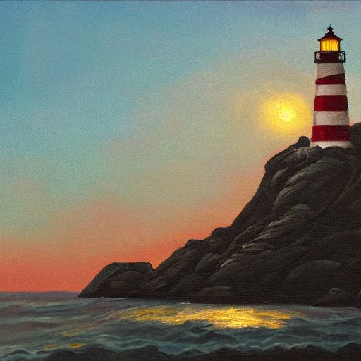
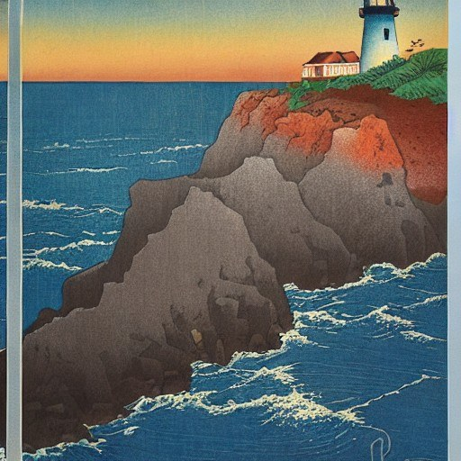

## Changing what a model makes

:::: {.columns}
::: {.column width="50%"}
{width="78%"}

::: {.note-text}
Stable Diffusion v1.5, as it comes
:::
:::
::: {.column width="50%"}
{width="78%"}

::: {.note-text}
The same model, trained further on 448 Japanese woodblock prints
:::
:::
::::

::: aside
Last lecture's prompt, *"a lighthouse on a rocky cliff above the sea at sunset, oil painting"*, with the same starting noise for both.
:::

# What gets trained

## Which part do we train?

Stable Diffusion is three separately trained networks. Fine-tuning almost always updates only one of them.

:::{.incremental}
* The **VAE** compresses any image to a latent and back, as last lecture's round trip of a photo showed. It has no reason to change.
* The **text encoder** learned language from 400 million captioned images. Retraining it on a few hundred captions would risk damaging that, for little gain.
* The **UNet** decides what a denoised image should look like. That is what we want to change, so it is the part we train.
:::

. . .

```python
vae.requires_grad_(False)            # frozen: no gradients, no optimiser state
text_encoder.requires_grad_(False)
unet.train()
```

::: aside
From `train_text_to_image.py`, the fine-tuning script that ships with `diffusers`.
:::

## More of the same training

Fine-tuning runs the training step from the diffusion lectures, unchanged. Only the starting point differs: the pretrained weights, not random ones.

```{=html}
<!-- hand-written for lec18: l18-step -->
<svg viewBox="0 0 1100 370" width="100%" xmlns="http://www.w3.org/2000/svg" font-family="IBM Plex Sans, sans-serif" role="img" aria-label="One training step: a print is encoded by the frozen VAE encoder to a latent, noise is added, the UNet predicts the noise from the noisy latent and the caption's vectors from the frozen text encoder, and the loss compares predicted and actual noise; gradients flow back into the UNet only">
<defs><marker id="l18s-k" viewBox="0 0 10 10" refX="9" refY="5" markerWidth="5" markerHeight="5" orient="auto"><path d="M0 0 L10 5 L0 10 z" fill="#222"/></marker><marker id="l18s-a" viewBox="0 0 10 10" refX="9" refY="5" markerWidth="5" markerHeight="5" orient="auto"><path d="M0 0 L10 5 L0 10 z" fill="#d9480f"/></marker></defs>
<!-- caption and text encoder -->
<rect x="20" y="24" width="300" height="62" rx="7" fill="#fff" stroke="#2c6fb7" stroke-width="2.4"/>
<text x="170" y="52" text-anchor="middle" font-size="17" font-weight="600" fill="#2c6fb7" font-style="italic">its caption, e.g. "a painting</text>
<text x="170" y="74" text-anchor="middle" font-size="17" font-weight="600" fill="#2c6fb7" font-style="italic">of a woman with an umbrella"</text>
<path d="M324 55 L366 55" fill="none" stroke="#222" stroke-width="2.2" marker-end="url(#l18s-k)"/>
<rect x="370" y="24" width="190" height="62" rx="7" fill="#ececec" stroke="#888" stroke-width="2.4"/>
<text x="465" y="52" text-anchor="middle" font-size="18" font-weight="700" fill="#555">text encoder</text>
<text x="465" y="74" text-anchor="middle" font-size="15" font-weight="600" fill="#777">frozen</text>
<path d="M564 55 L700 55 L700 146" fill="none" stroke="#2c6fb7" stroke-width="2.4" marker-end="url(#l18s-k)"/>
<text x="632" y="45" text-anchor="middle" font-size="15" font-weight="500" fill="#2c6fb7" font-family="SFMono-Regular, Menlo, Consolas, monospace">77×768</text>
<!-- image and VAE encoder -->
<image x="20" y="150" width="130" height="130" href="pics/lec18/train-example.jpg" preserveAspectRatio="xMidYMid slice"/>
<rect x="20" y="150" width="130" height="130" fill="none" stroke="#555" stroke-width="1"/>
<text x="85" y="304" text-anchor="middle" font-size="15" font-weight="600" fill="#000">a training print</text>
<path d="M154 215 L176 215" fill="none" stroke="#222" stroke-width="2.2" marker-end="url(#l18s-k)"/>
<path d="M180 160 L280 180 L280 250 L180 270 Z" fill="#ececec" stroke="#888" stroke-width="2.4" stroke-linejoin="round"/>
<text x="230" y="211" text-anchor="middle" font-size="16" font-weight="700" fill="#555">VAE</text>
<text x="230" y="231" text-anchor="middle" font-size="16" font-weight="700" fill="#555">encoder</text>
<text x="230" y="296" text-anchor="middle" font-size="15" font-weight="600" fill="#777">frozen</text>
<path d="M284 215 L306 215" fill="none" stroke="#222" stroke-width="2.2" marker-end="url(#l18s-k)"/>
<text x="340" y="211" text-anchor="middle" font-size="19" font-weight="700" fill="#000" font-style="italic">z₀</text>
<text x="340" y="234" text-anchor="middle" font-size="13" font-weight="500" fill="#444" font-family="SFMono-Regular, Menlo, Consolas, monospace">4×64×64</text>
<path d="M374 215 L408 215" fill="none" stroke="#222" stroke-width="2.2" marker-end="url(#l18s-k)"/>
<!-- noise -->
<circle cx="430" cy="215" r="18" fill="#fff" stroke="#222" stroke-width="2.2"/>
<text x="430" y="223" text-anchor="middle" font-size="24" font-weight="600" fill="#000">+</text>
<rect x="370" y="290" width="120" height="50" rx="7" fill="#fff" stroke="#222" stroke-width="2.2"/>
<text x="430" y="312" text-anchor="middle" font-size="16" font-weight="700" fill="#000">noise <tspan font-style="italic">ε</tspan></text>
<text x="430" y="331" text-anchor="middle" font-size="14" font-weight="500" fill="#444">random step <tspan font-style="italic">t</tspan></text>
<path d="M430 288 L430 237" fill="none" stroke="#222" stroke-width="2.2" marker-end="url(#l18s-k)"/>
<path d="M450 215 L616 215" fill="none" stroke="#222" stroke-width="2.2" marker-end="url(#l18s-k)"/>
<text x="530" y="205" text-anchor="middle" font-size="19" font-weight="700" fill="#000" font-style="italic">z<tspan font-size="14" dy="4">t</tspan></text>
<!-- unet -->
<rect x="620" y="150" width="160" height="130" rx="7" fill="#dcdcf0" stroke="#d9480f" stroke-width="3.4"/>
<text x="700" y="205" text-anchor="middle" font-size="22" font-weight="700" fill="#000">UNet</text>
<text x="700" y="230" text-anchor="middle" font-size="16" font-weight="700" fill="#d9480f">trained</text>
<path d="M784 215 L876 215" fill="none" stroke="#222" stroke-width="2.2" marker-end="url(#l18s-k)"/>
<text x="830" y="204" text-anchor="middle" font-size="19" font-weight="700" fill="#000" font-style="italic">ε̂</text>
<!-- loss -->
<rect x="880" y="180" width="190" height="70" rx="7" fill="#fff" stroke="#222" stroke-width="2.4"/>
<text x="975" y="210" text-anchor="middle" font-size="19" font-weight="700" fill="#000">loss</text>
<text x="975" y="234" text-anchor="middle" font-size="15" font-weight="500" fill="#444">compare <tspan font-style="italic">ε̂</tspan> with <tspan font-style="italic">ε</tspan></text>
<path d="M430 342 L430 356 L975 356 L975 254" fill="none" stroke="#222" stroke-width="2.2" marker-end="url(#l18s-k)"/>
<!-- gradients -->
<path d="M975 176 C975 110 820 104 745 146" fill="none" stroke="#d9480f" stroke-width="2.6" stroke-dasharray="8 5" marker-end="url(#l18s-a)"/>
<text x="905" y="112" text-anchor="middle" font-size="16" font-weight="700" fill="#d9480f">gradients: UNet only</text>
</svg>
```

. . .

The loss is the same mean squared error: $L = \lVert \epsilon - \hat{\epsilon}(z_t, t, \text{caption}) \rVert^2$. Only the UNet's weights are adjusted to reduce it.

## In code

```python
latents = vae.encode(batch["pixel_values"]).latent_dist.sample() * vae.config.scaling_factor
noise = torch.randn_like(latents)
timesteps = torch.randint(0, 1000, (bsz,))                            # bsz = batch size: one timestep per image
noisy_latents = noise_scheduler.add_noise(latents, noise, timesteps)

encoder_hidden_states = text_encoder(batch["input_ids"])[0]           # 77 vectors per caption
model_pred = unet(noisy_latents, timesteps, encoder_hidden_states).sample

loss = F.mse_loss(model_pred, noise)
loss.backward()                                                       # gradients for the UNet only
optimizer.step()
```

:::{.incremental}
* Line for line, this is the loop from the diffusion lectures, with the VAE and text encoder in front.
* The VAE encodes every training image again on every pass, so the script never stores latents. That costs some time, but keeps the data as ordinary images.
:::

::: aside
Trimmed from `train_text_to_image.py`. The real script wraps these lines in `accelerate`, which handles devices, precision and gradient accumulation.
:::

# The data

## Every image needs a caption

The UNet is always conditioned on text, so every training image needs a caption to go with it.

:::{.incremental}
* A fine-tuning dataset is a folder of images plus a file pairing each image with its caption. In the lab, you'll build one.
* Captions written by people: titles, descriptions, alt text written for screen readers.
* Captions written by a model: an image-to-text model such as **BLIP** looks at each image and describes it. That's quick, and it scales to any number of images.
:::

## Our dataset

```{=html}
<script src="pics/lec18/demos-data.js" defer></script>
<script src="pics/lec18/demos.js" defer></script>
<div class="l18-demo" data-demo="data">
  <div class="l18-grid" data-role="grid"></div>
</div>
```

::: aside
448 Japanese woodblock prints for training (40 more kept aside), 18th and 19th centuries. Cleveland Museum of Art Open Access, public domain (CC0). Captions by BLIP (`blip-image-captioning-large`). Hover over a print for its title and artist.
:::

## What the captions leave out

The captions describe *what* each print shows, but nothing about their artistic style, medium, etc.

:::{.incremental}
* The prints all have flat areas of colour, black outlines, and paper grain, not mentioned in the captions.
* So there is no word for the model to tie this look to. The cheapest way to reduce the loss is to make it the default for *every* caption.
* That is what full fine-tuning is for: moving the whole model's output towards a new style or domain.
:::


# Watching it learn

## Try it: the style arriving {.slightly-smaller}

```{=html}
<div class="l18-demo" data-demo="progress">
  <div class="l18-row">
    <div class="l18-col"><span class="l18-lab">step 0: as it comes</span>
      <canvas data-role="before" class="l18-pix"></canvas></div>
    <div class="l18-col"><span class="l18-lab" style="color: #d9480f;">after fine-tuning</span>
      <canvas data-role="after" class="l18-pix"></canvas></div>
    <div class="l18-col"><span class="l18-lab">closest training print</span>
      <canvas data-role="near" class="l18-pix"></canvas>
      <span class="l18-out" data-role="cos"></span></div>
  </div>
  <div class="l18-prompt" data-role="text"></div>
  <div class="l18-ctl">
    <input type="range" data-role="step" min="0" max="8" value="0" aria-label="training step">
    <span class="l18-out" data-role="tval" style="min-width: 14em;"></span>
  </div>
  <div class="l18-ctl" data-role="prompts"></div>
  <div class="l18-ctl">
    <span>Noise:</span><button data-seed="0" class="on">A</button><button data-seed="1">B</button>
    <span style="margin-left: 1em;">Weights:</span><button data-w="ema" class="on">averaged</button><button data-w="raw">raw</button>
  </div>
</div>
```

::: aside
Same prompt, same starting noise, 30 steps, $s = 7.5$, at every snapshot. "Closest training print" is by CLIP image similarity. "Averaged" and "raw" weights are explained later in this lecture.
:::

## What changes, and when {.slightly-smaller}

```{=html}
<div class="l18-demo" data-demo="strip" data-keys="kimono:1,bridge:1,ramen:0" data-stages="0,50,800,1600,6400" data-size="100"></div>
```

:::{.incremental}
* Prompts close to the training prints change first: the kimono is a print after 50 steps, under half an epoch.
* Scenes follow, by about 1,600 steps, though no prompt says "woodblock print".
* Photographs and subjects different from the prints (the ramen, the red bicycle) barely change.
:::

## The loss hardly moves {.slightly-smaller}

```{=html}
<div class="l18-demo" data-demo="loss">
  <div class="l18-row">
    <div class="l18-col"><span class="l18-lab">training loss, logged at each step</span>
      <canvas data-role="train"></canvas></div>
    <div class="l18-col"><span class="l18-lab">loss at fixed noise: <span style="color: #d9480f;">training prints</span> and <span style="color: #2c6fb7;">prints kept aside</span></span>
      <canvas data-role="eval"></canvas></div>
  </div>
</div>
```

:::{.incremental}
* Left: each step sees a random image, $t$ and noise, so the loss jumps around far more than it falls.
* Right: the same images, $t$ and noise at every snapshot. By step 6,400, the loss has fallen 5.6% on training prints and 2.2% on prints kept aside.
* Both still fall: the model is still learning about prints in general. But from about 3,000 steps it is also learning *these particular* prints.
:::

## Too much training: copying

```{=html}
<div class="l18-demo" data-demo="strip" data-keys="bridge:1" data-stages="0,800,3200,6400" data-print="1985.318.jpg" data-size="150"></div>
```

:::{.incremental}
* By 3,200 steps the bridge in the rain has become Hiroshige's *Sudden Shower over Shin-Ōhashi Bridge* (1857): the same bridge, the same slanting rain.
* That print is in the training set **twice**, as two different copies, and both have almost our prompt as their caption.
* Prompts that reuse training captions give images that are as similar to their nearest training print (CLIP similarity 0.92–0.94) as two different training prints typically are to each other (0.93).
* Repeated images are copied first. Check a dataset for duplicates before training on it.
:::

## Too much training: forgetting {.slightly-smaller}

```{=html}
<div class="l18-demo" data-demo="strip" data-keys="astronaut:0,cat:1" data-stages="0,800,1600,3200,6400" data-size="112"></div>
```

:::{.incremental}
* The astronaut prompt asks for a portrait photograph, and the cat was photographic at step 0. Both become prints: nothing in 448 prints rewards keeping the ability to make photographs.
* The loss on held-out prints cannot see this: they are prints too. As with perplexity in the lecture on evaluating language models, measuring damage needs data from *outside* the new domain: here, prompts the original model handled well.
* So where to stop is a trade-off. 
:::

# Averaging the weights

## An exponential moving average {.slightly-smaller}

With a batch of 4, each update follows a very noisy estimate of the gradient. So the weights never settle: they jitter around a good solution.

. . .

A solution is to keep a second copy $\bar{\theta}$ of the weights, and after every update move it a little towards the current weights $\theta$:

$$\bar{\theta} \leftarrow \beta\,\bar{\theta} + (1 - \beta)\,\theta$$

:::{.incremental}
* With $\beta$ close to 1, $\bar{\theta}$ averages over roughly the last $1/(1-\beta)$ updates, smoothing out the jitter.
* The **EMA** weights are only used for generating, never for training, so they need no gradients and no optimiser state: just one more copy, 3.4 GB.
* `diffusers` uses $\beta = (1+n)/(10+n)$ after $n$ updates, capped at 0.9999: an average over roughly the last ninth of training so far.
* In our run, the averaged weights had a slightly lower loss on held-out prints than the raw weights at every snapshot from step 200.
:::

## Try it: averaging a noisy descent

:::: {.columns}
::: {.column width="52%"}
```{=html}
<div class="l18-demo" data-demo="ema">
  <canvas data-role="plot"></canvas>
  <div class="l18-ctl">
    <span class="l18-out" data-role="bval"></span>
    <button data-b="0.9">0.9</button><button data-b="0.99" class="on">0.99</button><button data-b="0.999">0.999</button>
    <button data-role="again">run again</button>
  </div>
  <div data-role="dist" style="text-align: center; margin-top: 6px;"></div>
</div>
```
:::
::: {.column width="48%"}
::::: {.small-text}
Imagine we are training two weights, with this bowl-shaped loss and very noisy gradients. 1,500 steps of gradient descent are plotted, starting from the top left.

<span style="color: #666;">Grey</span>: the weights being trained. <span style="color: #d9480f;">Orange</span>: their exponential moving average.

:::{.incremental}
* The raw weights reach the bottom quickly, then wander around it.
* The average stays much closer to the bottom.
* But a long average lags behind: with $\beta = 0.999$ it is still catching up when training ends.
:::
:::::
:::
::::

<!-- ## Try it: the style arriving {.slightly-smaller}

```{=html}
<div class="l18-demo" data-demo="progress">
  <div class="l18-row">
    <div class="l18-col"><span class="l18-lab">step 0: as it comes</span>
      <canvas data-role="before" class="l18-pix"></canvas></div>
    <div class="l18-col"><span class="l18-lab" style="color: #d9480f;">after fine-tuning</span>
      <canvas data-role="after" class="l18-pix"></canvas></div>
    <div class="l18-col"><span class="l18-lab">closest training print</span>
      <canvas data-role="near" class="l18-pix"></canvas>
      <span class="l18-out" data-role="cos"></span></div>
  </div>
  <div class="l18-prompt" data-role="text"></div>
  <div class="l18-ctl">
    <input type="range" data-role="step" min="0" max="8" value="0" aria-label="training step">
    <span class="l18-out" data-role="tval" style="min-width: 14em;"></span>
  </div>
  <div class="l18-ctl" data-role="prompts"></div>
  <div class="l18-ctl">
    <span>Noise:</span><button data-seed="0" class="on">A</button><button data-seed="1">B</button>
    <span style="margin-left: 1em;">Weights:</span><button data-w="ema" class="on">averaged</button><button data-w="raw">raw</button>
  </div>
</div>
```

::: aside
Same prompt, same starting noise, 30 steps, $s = 7.5$, at every snapshot. "Closest training print" is by CLIP image similarity.
:::
-->

# Fitting it on a GPU

## Where the memory goes, again

Full fine-tuning with Adam needs 16 bytes for every trained parameter, as in the lecture on parameter-efficient fine-tuning:

:::: {.columns}
::: {.column width="42%"}
| UNet (860M) | GB |
|---|:---:|
| weights (32-bit) | 3.4 |
| gradients | 3.4 |
| Adam's two averages | 6.9 |
| **total** | **13.8** |
:::
::: {.column width="58%" .incremental}
* $860\text{M} \times 16 \text{ bytes} \approx 13.8\text{ GB}$, before any activations.
* The frozen text encoder and VAE need only their weights: $207\text{M} \times 2 \text{ bytes} \approx 0.4\text{ GB}$ in 16 bits; no gradients, no optimiser state.
* Activations grow with the batch size, and at 64 × 64 every self-attention layer compares 4,096 positions with 4,096 others.
:::
::::

## Four ways to save memory

:::{.incremental}
* **Mixed precision**: run the forward and backward passes in 16 bits, and store the frozen networks in 16 bits. Activations take half the space. The trained weights stay in 32 bits, so small updates aren't lost to rounding.
* **Gradient checkpointing**: keep only some activations, and recompute the rest during the backward pass. Less memory, but more computation: some of the forward pass runs twice.
* **8-bit Adam**: store Adam's two averages quantised to 8 bits, as we quantised weights. 8 bytes per parameter become 2: 6.9 GB becomes 1.7 GB.
* **A small batch, accumulated**: one image at a time, with gradients summed over several before each update, as in the lecture on fine-tuning for text generation.
:::

## Measuring the memory 

```{=html}
<div class="l18-demo" data-demo="memory">
  <canvas data-role="bar"></canvas>
  <div class="l18-legend" data-role="legend"></div>
  <div class="l18-ctl"><span>Batch size:</span><button data-bs="1" class="on">1</button><button data-bs="4">4</button></div>
</div>
```

::: aside
Peak memory over 10 training steps of the real UNet on a rented NVIDIA A100. Each bar is split into what was in memory at the optimiser step; "other" is the rest of the peak. Settings stack from the top: each adds one saving to the one above, except the last.
:::

## What the measurements show {.slightly-smaller}

:::{.incremental}
* The peak comes at the **optimiser step**. Weights, gradients and Adam's averages are all in memory at once, plus Adam's temporary working space. The activations have already been freed.
* So **8-bit Adam** is the big saving: from 17.8 GB to 9.3 GB.
* Mixed precision and checkpointing barely change the peak. Mixed precision saves *time*: 0.47 s per step rather than 0.67 s at batch 4. Checkpointing costs time: 0.49 s rather than 0.39 s at batch 1.
* With 8-bit Adam, batch 4 needs only 0.4 GB more than batch 1, and four images take 0.57 s rather than 0.50 s for one.
* EMA adds one more copy of the weights, 3.4 GB, as predicted. Keeping it in the CPU's memory instead saves that, but a step then takes 0.91 s rather than 0.59 s.
:::


<!-- ## A real attempt: 11.5 GiB

A Radeon 890M, a GPU built into the processor of some recent laptops, offers PyTorch 11.5 GiB, which is 12.4 GB. We tried every combination of the four savings above, plus EMA.

:::{.incremental}
* **Every one ran out of memory.**
* With ordinary Adam, it failed while creating Adam's averages. Weights, gradients and Adam alone need 13.8 GB.
* With 8-bit Adam, the fixed cost falls to $3.4 + 3.4 + 1.7 + 0.4 \approx 9\text{ GB}$. It failed in the middle of a step, with 11.0 GB already in use, asking for 512 MiB more.
* 512 MiB is exactly the size of one full self-attention matrix at 64 × 64, for 8 heads in 32-bit floats: $4096 \times 4096 \times 8 \times 4$ bytes.
:::

## Why the A100 needed less

On the A100, the same settings (mixed precision, checkpointing, 8-bit Adam) peaked at 9.3 GB in all.

:::{.incremental}
* There, PyTorch computes attention in tiles, without ever storing the whole $4096 \times 4096$ matrix. This is **flash attention**.
* On the 890M, it apparently had to store the whole matrix, for every head.
* So the memory a job needs depends on the software available for the GPU, not just on the model and the settings.
* Our lab GPUs have 8 GB, so even the A100's 9.3 GB would not fit.
::: -->


# Running the job

## A script, not a notebook cell

Diffusion fine-tuning is normally run with an example script, such as the one in `diffusers`, started from the command line:

```bash
accelerate launch train_text_to_image.py \
    --pretrained_model_name_or_path=stable-diffusion-v1-5/stable-diffusion-v1-5 \
    --train_data_dir=prints/ \
    ...
```

:::{.incremental}
* It can run for hours. A script started in `tmux` or with `nohup` carries on if the connection drops; a notebook kernel does not.
* It saves **checkpoints**: everything needed to resume, including the optimiser state and the EMA copy.
* `accelerate launch` reads the machine's set-up and handles the device, mixed precision and multiple GPUs, so the same script runs on one GPU or eight.
* The script's options switch on the savings from this lecture. In the lab, you'll go through a real command option by option.
:::

## How long does it take?

$$\text{steps per epoch} = \frac{\text{dataset size}}{\text{effective batch size}} = \frac{448}{4} = 112$$

:::{.incremental}
* Our run took 6,400 steps: about 57 epochs, or 25,600 images through the UNet, forward and backward.
* On a rented NVIDIA A100, at batch 4 with mixed precision, a step took about 0.3 s. All 6,400 steps took 36 minutes, including restarting from a checkpoint at each snapshot.
* Generating one image (30 steps) took 1&nbsp;s there, and 30 s on the Radeon 890M.
* A larger dataset needs proportionally more steps to see each image as often.
:::

## Full fine-tuning and lighter options

:::{.incremental}
* Every full fine-tune produces a complete new UNet: 860M parameters, 1.7 GB in 16 bits, for each style or domain.
* **LoRA**, from the lecture on parameter-efficient fine-tuning, works on the UNet just as on a language model: small trained adapters beside frozen weights, typically on the attention layers. The result is a file of a few megabytes.
* Full fine-tuning moves *everything* the model makes. Sometimes we only want to teach it one new subject, from a handful of photos. That is next lecture: **DreamBooth**.
:::

## Summary {.slightly-smaller}

:::{.incremental}
* **Fine-tuning** a diffusion model continues the same training on new image–caption pairs, starting from the pretrained weights.
* Usually only the **UNet** is trained. The VAE and the text encoder stay frozen.
* Whatever all the training images share, but the captions never mention, becomes the model's new default: first for prompts close to the training data, later for everything else.
* Train too long and the model copies repeated training images and forgets what it could do before. Watch prompts from *outside* the new domain.
* In this example, a full fine-tune of the UNet needed 13.8 GB for weights, gradients and Adam alone. **8-bit Adam** brings the peak down to about 9 GB; **mixed precision** saves time.
* An **exponential moving average** of the weights smooths out noisy updates, but requires us to store another copy of the weights.
* Long jobs run as scripts, with checkpoints to resume from.
:::
