## Teaching a model one subject

```{=html}
<div style="display: flex; gap: 12px; justify-content: center; margin-top: 20px;">
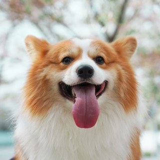
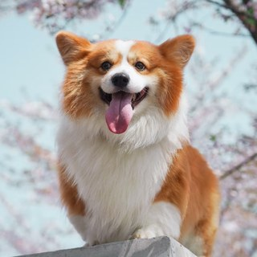
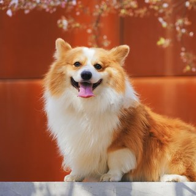
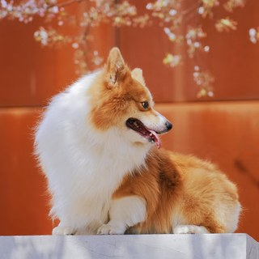
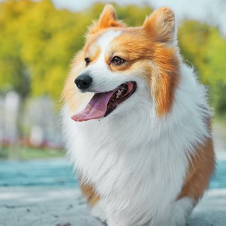
</div>
```

Five photos of one particular dog. Can we teach Stable Diffusion *this* dog, so that it can draw it anywhere: on a beach, in a hat, as a watercolour?

::: aside
Photos: the DreamBooth dataset (Ruiz *et al.*, 2023), from Unsplash, by Alvan Nee.
:::

## A different goal from last lecture

Last lecture's full fine-tuning moved *everything* the model makes towards 448 prints. Here we want almost the opposite.

:::{.incremental}
* **Narrow**: one subject, not a style or a domain.
* **Few images**: three to five photos, not hundreds.
* **Everything else unchanged**: a dog that isn't ours should still look like any dog, and a cat like a cat.
:::

. . .

**DreamBooth** (Ruiz *et al.*, 2023) does this by giving the subject a name of its own.

# A name for the subject

## The instance prompt

Every photo of the subject gets the same caption: the **instance prompt**.

<p class="larger-text" style="text-align: center; margin: 0.8em 0;">*"a photo of* **sks** *dog"*</p>

:::{.incremental}
* **sks** is the identifier: a word that will come to mean *this* dog.
* **dog** is the class: the model already knows a lot about dogs, so it only has to learn how this one differs.
* After training, the identifier works in any prompt: *"a watercolour painting of sks dog"*.
:::

## Choosing the identifier {.slightly-smaller}

Why not use a real word, or a random string of letters?

| candidate | tokens | why (not) |
|---|---|---|
| `corgi` | `corgi` | already means *a* corgi, not ours |
| `xjq` | `x` `j` `q` | three common pieces, each with its own meaning |
| `zwx` | `z` `wx` | two pieces |
| `sks` | `sks` | one token, rarely seen in training |

:::{.incremental}
* The DreamBooth paper looks for a token that is *rare*: one the model has seen little, so it carries little meaning to unlearn.
* `sks` is a single token, number 48,136 of 49,408 in Stable Diffusion's tokeniser. The tokeniser's vocabulary is in the order its pieces were merged, most frequent first, so a token near the end was among the least frequent.
:::

::: aside
Tokens from Stable Diffusion v1.5's CLIP tokeniser.
:::

## Rare is not empty

What does the original model make of `sks` on its own?

```{=html}
<div class="note-text" style="display: flex; gap: 24px; justify-content: center; align-items: flex-start; margin-top: 10px;">
<figure style="margin: 0; text-align: center;">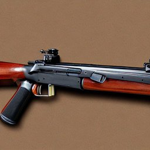<figcaption><i>"a photo of sks"</i></figcaption></figure>
<figure style="margin: 0; text-align: center;">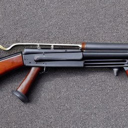<figcaption><i>"a photo of sks"</i>, other noise</figcaption></figure>
<figure style="margin: 0; text-align: center;">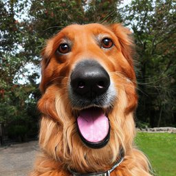<figcaption><i>"a photo of sks dog"</i></figcaption></figure>
</div>
```

:::{.incremental}
* Rifles: the SKS is a Soviet rifle, and enough captioned photos of it were in the training data for the token to mean something.
* Rare means the token carries *little* meaning, not none. Here the class word wins: *"sks dog"* is just a dog, though not ours.
* Training on five photos has to override what little `sks` meant. A token with a strong meaning, like `corgi`, would be harder to move.
:::

::: {.note-text}
Stable Diffusion v1.5, 30 steps, guidance scale 7.5. All images in this lecture are from our own run, described at the end.
:::


# Training on five photos

## The same training step

Each step is last lecture's step, unchanged: encode a photo, add noise at a random step $t$, and train the UNet to predict that noise, conditioned on the caption.

:::{.incremental}
* The only differences are the data: five photos, all with the same caption.
* With one image per step, the model sees each photo every five steps: 1,000 steps shows it each photo 200 times.
* That is ideal for learning the dog, and also ideal for **overfitting**.
:::

## What training alone does {.slightly-smaller}

Our run after 400 steps on the five photos, *without* the fix on the next slide. Same prompts, same starting noise:

```{=html}
<div class="note-text" style="display: grid; grid-template-columns: auto repeat(3, 175px); gap: 8px 14px; justify-content: center; align-items: center; margin-top: 8px;">
<span></span><span style="text-align: center; font-style: italic;">"a photo of sks dog"</span><span style="text-align: center; font-style: italic;">"a photo of a dog"</span><span style="text-align: center; font-style: italic;">"a photo of a cat"</span>
<span style="font-weight: 600; text-align: right;">before training</span>

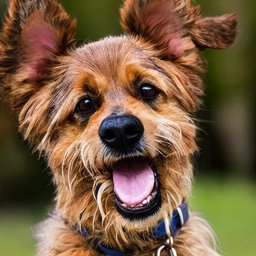
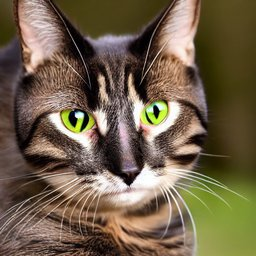
<span style="font-weight: 600; text-align: right; color: #d9480f;">after 400 steps</span>
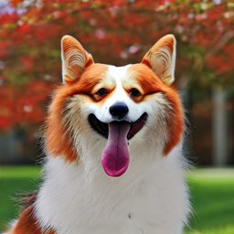
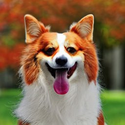
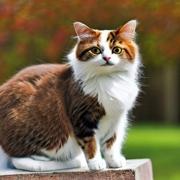
</div>
```

:::{.incremental}
* *"sks dog"* is now our dog. But so is *"a dog"*: the model has learnt that *every* dog looks like this one.
* Even the cat has taken on the dog's orange and white. The DreamBooth paper calls this **language drift**: the class word loses its old, broad meaning.
:::


## Prior preservation

The fix: keep training on the class as well, with images the model made itself *before* training began.

```{=html}
<!-- hand-written for lec19: l19-prior -->
<svg viewBox="0 0 1100 400" width="100%" xmlns="http://www.w3.org/2000/svg" font-family="IBM Plex Sans, sans-serif" role="img" aria-label="Prior preservation: a photo of the subject with the caption 'a photo of sks dog', and an image generated beforehand by the frozen original model with the caption 'a photo of a dog', both go through the same trained UNet; each gives a loss, and the two losses are added">
<defs><marker id="l19p-k" viewBox="0 0 10 10" refX="9" refY="5" markerWidth="5" markerHeight="5" orient="auto"><path d="M0 0 L10 5 L0 10 z" fill="#222"/></marker><marker id="l19p-a" viewBox="0 0 10 10" refX="9" refY="5" markerWidth="5" markerHeight="5" orient="auto"><path d="M0 0 L10 5 L0 10 z" fill="#d9480f"/></marker></defs>
<!-- top row: the subject -->
<image x="200" y="22" width="120" height="120" href="pics/lec19/subject-2.jpg" preserveAspectRatio="xMidYMid slice"/>
<rect x="200" y="22" width="120" height="120" fill="none" stroke="#555" stroke-width="1"/>
<text x="260" y="162" text-anchor="middle" font-size="15" font-weight="600" fill="#000">one of the 5 photos</text>
<text x="80" y="76" text-anchor="middle" font-size="16" font-weight="700" fill="#000">the subject</text>
<text x="80" y="98" text-anchor="middle" font-size="14" font-weight="500" fill="#444">every step</text>
<path d="M324 82 L356 82" fill="none" stroke="#222" stroke-width="2.2" marker-end="url(#l19p-k)"/>
<rect x="360" y="56" width="180" height="52" rx="7" fill="#fff" stroke="#2c6fb7" stroke-width="2.4"/>
<text x="450" y="88" text-anchor="middle" font-size="17" font-weight="600" fill="#2c6fb7" font-style="italic">"a photo of sks dog"</text>
<path d="M544 82 L606 82 L606 136" fill="none" stroke="#222" stroke-width="2.2" marker-end="url(#l19p-k)"/>
<!-- bottom row: the class -->
<rect x="20" y="248" width="150" height="76" rx="7" fill="#ececec" stroke="#888" stroke-width="2.4"/>
<text x="95" y="278" text-anchor="middle" font-size="16" font-weight="700" fill="#555">original model</text>
<text x="95" y="300" text-anchor="middle" font-size="14" font-weight="600" fill="#777">frozen, run once</text>
<text x="95" y="318" text-anchor="middle" font-size="14" font-weight="600" fill="#777">before training</text>
<path d="M174 286 L196 286" fill="none" stroke="#222" stroke-width="2.2" marker-end="url(#l19p-k)"/>
<image x="200" y="226" width="120" height="120" href="pics/lec19/class-0.jpg" preserveAspectRatio="xMidYMid slice"/>
<rect x="200" y="226" width="120" height="120" fill="none" stroke="#555" stroke-width="1"/>
<text x="260" y="366" text-anchor="middle" font-size="15" font-weight="600" fill="#000">one of 200 class images</text>
<path d="M324 286 L356 286" fill="none" stroke="#222" stroke-width="2.2" marker-end="url(#l19p-k)"/>
<rect x="360" y="260" width="180" height="52" rx="7" fill="#fff" stroke="#2c6fb7" stroke-width="2.4"/>
<text x="450" y="292" text-anchor="middle" font-size="17" font-weight="600" fill="#2c6fb7" font-style="italic">"a photo of a dog"</text>
<path d="M544 286 L606 286 L606 232" fill="none" stroke="#222" stroke-width="2.2" marker-end="url(#l19p-k)"/>
<!-- the UNet, shared -->
<rect x="560" y="140" width="160" height="88" rx="7" fill="#dcdcf0" stroke="#d9480f" stroke-width="3.4"/>
<text x="640" y="178" text-anchor="middle" font-size="22" font-weight="700" fill="#000">UNet</text>
<text x="640" y="204" text-anchor="middle" font-size="16" font-weight="700" fill="#d9480f">being trained</text>
<!-- the two losses -->
<path d="M724 166 L780 166 L780 82 L806 82" fill="none" stroke="#222" stroke-width="2.2" marker-end="url(#l19p-k)"/>
<path d="M724 202 L780 202 L780 286 L806 286" fill="none" stroke="#222" stroke-width="2.2" marker-end="url(#l19p-k)"/>
<rect x="810" y="52" width="150" height="60" rx="7" fill="#fff" stroke="#222" stroke-width="2.4"/>
<text x="885" y="78" text-anchor="middle" font-size="17" font-weight="700" fill="#000">loss on</text>
<text x="885" y="100" text-anchor="middle" font-size="17" font-weight="700" fill="#000">the subject</text>
<rect x="810" y="256" width="150" height="60" rx="7" fill="#fff" stroke="#222" stroke-width="2.4"/>
<text x="885" y="282" text-anchor="middle" font-size="17" font-weight="700" fill="#000">loss on</text>
<text x="885" y="304" text-anchor="middle" font-size="17" font-weight="700" fill="#000">the class</text>
<path d="M964 82 L1030 82 L1030 160" fill="none" stroke="#222" stroke-width="2.2" marker-end="url(#l19p-k)"/>
<path d="M964 286 L1030 286 L1030 208" fill="none" stroke="#222" stroke-width="2.2" marker-end="url(#l19p-k)"/>
<circle cx="1030" cy="184" r="22" fill="#fff" stroke="#222" stroke-width="2.2"/>
<text x="1030" y="193" text-anchor="middle" font-size="26" font-weight="600" fill="#000">+</text>
<!-- gradients -->
<path d="M1006 184 C940 184 880 184 724 184" fill="none" stroke="#d9480f" stroke-width="2.6" stroke-dasharray="8 5" marker-end="url(#l19p-a)"/>
<text x="880" y="174" text-anchor="middle" font-size="15" font-weight="700" fill="#d9480f">gradients</text>
</svg>
```

::: aside
Each image is encoded by the VAE and noised exactly as last lecture; those steps are left out here.
:::

## The loss with prior preservation {.slightly-smaller}

Each step trains on one photo of the subject *and* one class image, and adds the two losses:

$$L_\text{subject} = \lVert \epsilon - \hat{\epsilon}(z_t, t, c_\text{subject}) \rVert^2 \qquad L_\text{class} = \lVert \epsilon' - \hat{\epsilon}(z'_{t'}, t', c_\text{class}) \rVert^2$$

$$L = L_\text{subject} + \lambda\, L_\text{class}$$

:::{.incremental}
* $c_\text{subject}$ is *"a photo of sks dog"*; $c_\text{class}$ is *"a photo of a dog"*.
* $z'_{t'}$ is a class image, noised at its own random step $t'$ with its own noise $\epsilon'$.
* The class images came from the original model, so the second term rewards the UNet for still making the dogs it made before. The model supervises itself.
* The paper uses $\lambda = 1$ and about 1,000 class images, though it notes that fewer will do. We used 200.
:::

## In code

```python
if args.with_prior_preservation:
    # the batch is [subject image, class image]: split it in two
    model_pred, model_pred_prior = torch.chunk(model_pred, 2, dim=0)
    target, target_prior = torch.chunk(target, 2, dim=0)

    loss = F.mse_loss(model_pred.float(), target.float(), reduction="mean")
    prior_loss = F.mse_loss(model_pred_prior.float(), target_prior.float(), reduction="mean")
    loss = loss + args.prior_loss_weight * prior_loss   # λ, 1 by default
```

:::{.incremental}
* Everything before this is last lecture's step, with twice the batch: the subject image and the class image go through the UNet together.
* So each step does twice the UNet's work, and needs activation memory for two images. We'll see what that cost in our run.
:::

::: aside
From `train_dreambooth_lora.py`, the DreamBooth script that ships with `diffusers`.
:::

## Try it: with and without prior preservation {.slightly-smaller}

```{=html}
<script src="pics/lec19/demos-data.js" defer></script>
<script src="pics/lec19_22_demos.js" defer></script>
<div class="dm-demo" data-demo="db">
  <div class="dm-row">
    <div class="dm-col"><span class="dm-lab" style="color: #2c6fb7;">with prior preservation</span>
      <span class="dm-out" data-role="prior-sim"></span></div>
    <div class="dm-col"><span class="dm-lab" style="color: #d9480f;">without</span>
      <span class="dm-out" data-role="noprior-sim"></span></div>
  </div>
  <div class="dm-prompt" data-role="text"></div>
  <div class="dm-ctl">
    <input type="range" data-role="step" aria-label="training step">
    <span class="dm-out" data-role="sval" style="min-width: 13em;"></span>
  </div>
  <div class="dm-ctl" data-role="prompts"></div>
  <div class="dm-ctl"><span>Noise:</span><span data-role="seeds" style="display: contents;"></span></div>
</div>
```

::: aside
Both runs: the same five photos, LoRA, learning rate $10^{-4}$, the same starting noise for every sample (30 steps, $s = 7.5$). "Similarity to the subject" is explained on the next slide.
:::

## Measuring with DINO

How close is an image to *our* dog? We need an image embedding that tells one dog from another.

:::{.incremental}
* CLIP's image embeddings were trained to match captions, and a caption says *"a dog"*, not which one. So all dogs are close.
* **DINO** (Caron *et al.*, 2021) is a vision transformer trained without labels, to give the same embedding to different crops of the same photo. It learns what makes *this* image's object distinct.
* The DreamBooth paper scores a generated image by its average cosine similarity, in DINO's embedding, to the real photos.
:::

. . .

| average cosine similarity | DINO | CLIP |
|---|---|---|
| the five photos of our dog, with each other | 0.84 | 0.94 |
| 60 class images (other dogs), with the five photos | 0.30 | 0.76 |

::: {.note-text}
DINO ViT-S/16 (its class token) and CLIP ViT-L/14 image embeddings, measured on our images.
:::

## What the run showed {.slightly-smaller}

:::: {.columns}

::: {.column width="56%"}
```{=html}
<div class="dm-demo" data-demo="dbcurve">
  <div class="dm-row"><canvas data-role="chart" role="img" aria-label="DINO similarity to the subject photos against training step, for prompts with sks and for 'a photo of a dog', with and without prior preservation"></canvas></div>
  <div class="dm-legend" style="margin-top: 6px; flex-direction: column; align-items: flex-start; gap: 3px; padding-left: 60px;">
    <span style="--c: #2c6fb7;">prompts with <i>sks</i>, with prior preservation</span>
    <span style="--c: #d9480f;">prompts with <i>sks</i>, without</span>
    <span style="--c: #2c6fb7; --s: dashed;"><i>"a photo of a dog"</i>, with prior preservation</span>
    <span style="--c: #d9480f; --s: dashed;"><i>"a photo of a dog"</i>, without</span>
  </div>
</div>
```
:::

::: {.column .small-text style="width: 44%;"}
:::{.incremental}
* Both runs learn the dog. Without prior preservation it happens faster: the *sks* prompts reach 0.72 by step 200, against 0.69 by step 800 with it.
* Without it, *"a photo of a dog"* reaches 0.84 by step 400: as close to our dog as the five photos are to each other. With it, other dogs stay near 0.3, like the class images.
* After about 800 steps both runs decline, and the images become oversaturated: overfitting. Prior preservation protects the class, not the subject. You still choose when to stop.
:::
:::

::::

::: aside
Each point averages DINO similarity over 10 images: five *sks* prompts with two noises, or *"a photo of a dog"* with 10 noises.
:::

## Training with LoRA

The DreamBooth paper trains the whole UNet. We trained **LoRA** adapters instead, as in the lecture on parameter-efficient fine-tuning.

:::{.incremental}
* Rank 8 adapters on the UNet's attention layers, and on the text encoder's: 2.2 million trained parameters, against the UNet's 860 million.
* The saved result is an 8.8 MB file, loaded on top of the unchanged Stable Diffusion.
* Training the text encoder too lets the word `sks` itself change meaning, not only how the UNet responds to it.
* Everything else (the instance prompt, the class images, the loss) is the same as for full DreamBooth.
:::

## What it cost

Measured on an NVIDIA A100 limited to 8 GB of its memory: 512 × 512 images, batch size 1, mixed precision, gradient checkpointing.

|  | with prior preservation | without |
|---|---|---|
| GPU memory while training | 4.3 GB | 3.7 GB |
| time per step | 0.38 s | 0.37 s |
| 1,600 steps | 10 minutes | 10 minutes |

:::{.incremental}
* Before training, the class images cost 1.1 s each to generate: about 4 minutes for 200.
* The second image in each step added 0.6 GB, but only 3% to the time: at batch size 1, this GPU had spare capacity. A smaller GPU could take nearer twice as long.
* Both runs briefly reached 5.2 GB at the very end, after training, when the script loads a whole pipeline to test the saved adapters.
:::


## Two ways to fine-tune

|                | Full fine-tuning (last lecture) | DreamBooth |
|----------------|------------------|------------|
| Goal | a new style or domain | one new subject |
| Data | hundreds of captioned images | 3–5 photos, one caption |
| What changes | everything the model makes | the meaning of one identifier |
| Guarding the rest | watch prompts from outside the domain | prior preservation: train on the model's own class images |
