## A new image from an old one

```{=html}
<div style="display: flex; gap: 18px; justify-content: center; align-items: center; margin-top: 16px;">
<figure style="margin: 0; text-align: center;">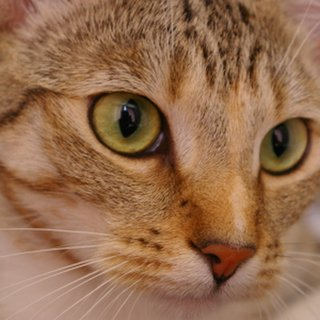<figcaption class="note-text">a photo</figcaption></figure>
<span class="larger-text">→</span>
<figure style="margin: 0; text-align: center;">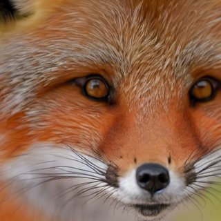<figcaption class="note-text"><i>"a photo of a red fox, close-up"</i></figcaption></figure>
<figure style="margin: 0 0 0 30px; text-align: center;">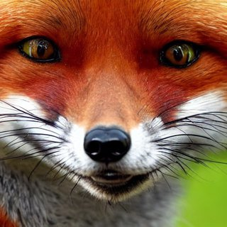<figcaption class="note-text">the same prompt, from text alone</figcaption></figure>
</div>
```

. . .

The same Stable Diffusion, with no extra training. The fox has the cat's pose and framing, because the sampling loop started from the cat instead of from pure noise.

::: aside
Photo: scikit-image sample data (CC0). All the images in this lecture are from Stable Diffusion v1.5 or its inpainting model: 30 steps, guidance scale 7.5.
:::


# Starting from an image

## Starting part-way

Every image so far started from pure noise, at $t = T$. But the forward process can take *any* image to any step $t$ in one go:

$$z_t = \sqrt{\bar\alpha_t}\; z_0 + \sqrt{1 - \bar\alpha_t}\; \epsilon$$

:::{.incremental}
* So encode a real image to its latent $z_0$, noise it to some step part-way, and start the ordinary sampling loop *there*, with a new prompt.
* Large $t$: little of the image is left, and the model has many steps in which to follow the prompt.
* Small $t$: most of the image is left, and there are few steps in which to change it.
* This is **image-to-image** generation. Nothing about the model changes, only where the loop starts.
:::

## Where the loop starts

```{=html}
<!-- hand-written for lec20: l20-timeline -->
<svg viewBox="0 0 1100 330" width="100%" xmlns="http://www.w3.org/2000/svg" font-family="IBM Plex Sans, sans-serif" role="img" aria-label="A timeline of 30 sampling steps from pure noise on the left to an image on the right. Text-to-image runs all 30 steps. Image-to-image with strength 0.6 adds noise to the encoded image and joins the timeline 60 per cent of the way back from the image, running the last 18 steps.">
<defs><marker id="l20t-k" viewBox="0 0 10 10" refX="9" refY="5" markerWidth="5" markerHeight="5" orient="auto"><path d="M0 0 L10 5 L0 10 z" fill="#222"/></marker><marker id="l20t-a" viewBox="0 0 10 10" refX="9" refY="5" markerWidth="5" markerHeight="5" orient="auto"><path d="M0 0 L10 5 L0 10 z" fill="#d9480f"/></marker><marker id="l20t-b" viewBox="0 0 10 10" refX="9" refY="5" markerWidth="5" markerHeight="5" orient="auto"><path d="M0 0 L10 5 L0 10 z" fill="#2c6fb7"/></marker></defs>
<!-- axis -->
<text x="150" y="30" text-anchor="middle" font-size="16" font-weight="700" fill="#000">pure noise</text>
<text x="150" y="50" text-anchor="middle" font-size="15" font-weight="500" fill="#444" font-style="italic">t = T</text>
<text x="960" y="30" text-anchor="middle" font-size="16" font-weight="700" fill="#000">image</text>
<text x="960" y="50" text-anchor="middle" font-size="15" font-weight="500" fill="#444" font-style="italic">t = 0</text>
<g stroke="#999" stroke-width="1.5">
<line x1="150" y1="62" x2="150" y2="250"/><line x1="960" y1="62" x2="960" y2="250"/>
</g>
<!-- 30 step ticks -->
<g fill="#bbb">
<rect x="150" y="80" width="2" height="10"/><rect x="177" y="80" width="2" height="10"/><rect x="204" y="80" width="2" height="10"/><rect x="231" y="80" width="2" height="10"/><rect x="258" y="80" width="2" height="10"/><rect x="285" y="80" width="2" height="10"/><rect x="312" y="80" width="2" height="10"/><rect x="339" y="80" width="2" height="10"/><rect x="366" y="80" width="2" height="10"/><rect x="393" y="80" width="2" height="10"/><rect x="420" y="80" width="2" height="10"/><rect x="447" y="80" width="2" height="10"/><rect x="474" y="80" width="2" height="10"/><rect x="501" y="80" width="2" height="10"/><rect x="528" y="80" width="2" height="10"/><rect x="555" y="80" width="2" height="10"/><rect x="582" y="80" width="2" height="10"/><rect x="609" y="80" width="2" height="10"/><rect x="636" y="80" width="2" height="10"/><rect x="663" y="80" width="2" height="10"/><rect x="690" y="80" width="2" height="10"/><rect x="717" y="80" width="2" height="10"/><rect x="744" y="80" width="2" height="10"/><rect x="771" y="80" width="2" height="10"/><rect x="798" y="80" width="2" height="10"/><rect x="825" y="80" width="2" height="10"/><rect x="852" y="80" width="2" height="10"/><rect x="879" y="80" width="2" height="10"/><rect x="906" y="80" width="2" height="10"/><rect x="933" y="80" width="2" height="10"/>
</g>
<text x="555" y="74" text-anchor="middle" font-size="14" font-weight="500" fill="#666">30 sampling steps</text>
<!-- text to image -->
<text x="20" y="128" font-size="16" font-weight="700" fill="#2c6fb7">text to image</text>
<path d="M150 120 L952 120" fill="none" stroke="#2c6fb7" stroke-width="7" marker-end="url(#l20t-b)"/>
<text x="555" y="150" text-anchor="middle" font-size="15" font-weight="500" fill="#2c6fb7">all 30 steps, from random noise</text>
<!-- image to image -->
<text x="20" y="208" font-size="16" font-weight="700" fill="#d9480f">image to image</text>
<text x="20" y="228" font-size="15" font-weight="500" fill="#d9480f">strength 0.6</text>
<path d="M474 200 L952 200" fill="none" stroke="#d9480f" stroke-width="7" marker-end="url(#l20t-a)"/>
<circle cx="474" cy="200" r="8" fill="#d9480f"/>
<text x="713" y="230" text-anchor="middle" font-size="15" font-weight="500" fill="#d9480f">the last 18 steps, with the new prompt</text>
<!-- the image and its noising -->
<image x="1000" y="230" width="90" height="90" href="pics/lec20/sketch.jpg" preserveAspectRatio="xMidYMid slice"/>
<rect x="1000" y="230" width="90" height="90" fill="none" stroke="#555" stroke-width="1"/>
<path d="M996 290 C800 300 520 300 478 214" fill="none" stroke="#222" stroke-width="2.2" stroke-dasharray="7 5" marker-end="url(#l20t-k)"/>
<text x="720" y="318" text-anchor="middle" font-size="15" font-weight="600" fill="#000">encode to <tspan font-style="italic">z</tspan>₀, then add noise for 60% of the steps</text>
</svg>
```

:::{.incremental}
* **`strength`**, between 0 and 1, says how far back to start: with 30 steps and strength 0.6, run the last $0.6 \times 30 = 18$.
* Strength 1 starts at the first step, which is almost pure noise. Strength 0 would run no steps at all, and return the image unchanged.
:::

## How much of the image is left {.slightly-smaller}

The 30 sampling steps are spread over the 1,000 training steps, so each strength starts at a definite $t$:

| strength | 0.2 | 0.4 | 0.6 | 0.8 | 1 |
|---|---|---|---|---|---|
| steps run | 6 | 12 | 18 | 24 | 30 |
| first step, $t$ | 199 | 397 | 595 | 793 | 958 |
| $\sqrt{\bar\alpha_t}$ | 0.87 | 0.66 | 0.41 | 0.20 | 0.09 |

:::{.incremental}
* $\sqrt{\bar\alpha_t}$ is how much of $z_0$ is left in $z_t$. The number of steps grows in proportion to the strength, but the image fades faster: at strength 0.6, less than half of it is left.
* At strength 1 the loop starts at the same step as text-to-image, $t = 958$, but from $\sqrt{\bar\alpha_{958}}\, z_0$ plus noise rather than from pure noise. So 9% of the image is still there: enough to keep its largest shapes and colours.
:::

::: aside
$\bar\alpha_t$ from Stable Diffusion's noise schedule; starting steps from `diffusers`' image-to-image pipeline.
:::

## Try it: strength {.slightly-smaller}

```{=html}
<script src="pics/lec20/demos-data.js" defer></script>
<script src="pics/lec19_22_demos.js" defer></script>
<div class="dm-demo" data-demo="i2i" style="--w: 205px;">
  <div class="dm-row">
    <div class="dm-col"><span class="dm-lab">the image</span></div>
    <div class="dm-col"><span class="dm-lab">where the loop starts</span></div>
    <div class="dm-col"><span class="dm-lab" style="color: #d9480f;">the result</span></div>
    <div class="dm-col"><span class="dm-lab" style="color: #2c6fb7;">from text alone</span></div>
  </div>
  <div class="dm-prompt" data-role="text"></div>
  <div class="dm-ctl">
    <input type="range" data-role="strength" aria-label="strength">
    <span class="dm-out" data-role="sval"></span>
  </div>
  <div class="dm-ctl dm-out"><span data-role="info"></span> · image left: <span class="math inline">\(\sqrt{\bar\alpha_t}\)</span> = <span data-role="left"></span></div>
  <div class="dm-ctl"><span data-role="sources" style="display: contents;"></span>
    <span style="margin-left: 1em;">Noise:</span><span data-role="seeds" style="display: contents;"></span></div>
</div>
```

::: aside
*Where the loop starts* is the noised latent at the starting step, decoded by the VAE. *From text alone* uses the same prompt and the same noise, from pure noise.
:::

## The trade-off

:::{.incremental}
* Low strength: few steps, starting from an image that is mostly still there. The result stays faithful, and the prompt has little effect.
* High strength: many steps, from an image mostly lost. The result follows the prompt, and keeps only the layout and colours.
* For the cat, strengths from about 0.6 to 0.8 give a fox in the cat's pose.
* The sketch never becomes a photograph. Where enough of it is left to keep the cottage, the flat colours survive too; by the time they are gone, so is the layout. Image-to-image can't add something the starting image gives no hint of.
:::


# Inpainting

## Changing only part of an image

Sometimes we want to change one region and keep the rest exactly. A **mask** marks the region to regenerate.

```{=html}
<div class="note-text" style="display: flex; gap: 28px; justify-content: center; align-items: flex-start; margin-top: 16px;">
<figure style="margin: 0; text-align: center;"><figcaption>the image</figcaption></figure>
<figure style="margin: 0; text-align: center;">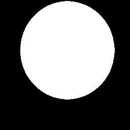<figcaption>the mask: white is regenerated</figcaption></figure>
</div>
```

::: aside
Photo: scikit-image sample data (CC0).
:::

. . .

Image-to-image changes everything a little. How do we change the masked region freely and leave the rest alone?

## Method 1: put the rest back at every step

Run image-to-image as before, but after *every* step, overwrite the latent outside the mask with the original image, noised to match:

$$z_{t-1} \leftarrow m \odot z_{t-1} + (1 - m) \odot \left(\sqrt{\bar\alpha_{t-1}}\; z_0 + \sqrt{1 - \bar\alpha_{t-1}}\; \epsilon\right)$$

:::{.incremental}
* $m$ is the mask, shrunk to the latent's 64 × 64: 1 inside the region, 0 outside.
* Outside, the latent is always exactly the original at the right noise level. Inside, the model denoises freely.
* It works with any model, unchanged. But the model is never *told* which region is being kept: it only sees a noisy latent, and must make the inside agree with the outside as best it can.
:::

::: aside
$\odot$ is element-wise multiplication: each entry of the latent is multiplied by the mask value at the same position, with the same mask for all 4 channels.
:::

## Method 1, step by step

```{=html}
<div style="display: flex; gap: 6px; justify-content: center; margin-top: 14px;">
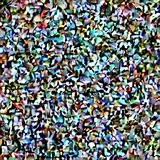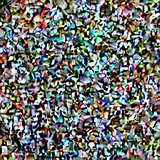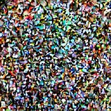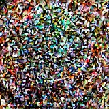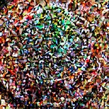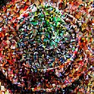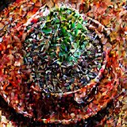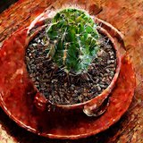
</div>
<p class="note-text" style="text-align: center; margin-top: 4px;">the latent after steps 3, 6, 9, … 30, decoded &nbsp;·&nbsp; <i>"a small potted cactus on a saucer, wooden table"</i>, strength 1</p>
```

:::{.incremental}
* Outside the mask, each frame is the photo, noised to that step's level: the saucer and table come back as the noise falls.
* Inside, the model's own image forms: a cactus in a pot, where the cup was.
* The two halves only have to agree at the end. Until then the model sees a noisy latent in which nothing marks the edge of the mask.
:::


## Method 2: a model that sees the mask

```{=html}
<!-- hand-written for lec20: l20-channels -->
<svg viewBox="0 0 1100 300" width="100%" xmlns="http://www.w3.org/2000/svg" font-family="IBM Plex Sans, sans-serif" role="img" aria-label="The inpainting UNet's input: the noisy latent (4 channels), the mask (1 channel) and the encoded masked image (4 channels) are stacked into 9 channels of 64 by 64; the UNet predicts the noise, 4 channels.">
<defs><marker id="l20c-k" viewBox="0 0 10 10" refX="9" refY="5" markerWidth="5" markerHeight="5" orient="auto"><path d="M0 0 L10 5 L0 10 z" fill="#222"/></marker></defs>
<!-- noisy latent -->
<g><rect x="60" y="40" width="110" height="110" fill="#c9c9c9" stroke="#555"/><rect x="52" y="48" width="110" height="110" fill="#bdbdbd" stroke="#555"/><rect x="44" y="56" width="110" height="110" fill="#b0b0b0" stroke="#555"/><rect x="36" y="64" width="110" height="110" fill="#a5a5a5" stroke="#555"/></g>
<text x="100" y="204" text-anchor="middle" font-size="16" font-weight="700" fill="#000">noisy latent <tspan font-style="italic">z</tspan><tspan font-size="12" dy="4" font-style="italic">t</tspan></text>
<text x="100" y="226" text-anchor="middle" font-size="14" font-weight="500" fill="#444">4 channels</text>
<!-- mask -->
<image x="268" y="64" width="110" height="110" href="pics/lec20/mask.png" preserveAspectRatio="none"/>
<rect x="268" y="64" width="110" height="110" fill="none" stroke="#555"/>
<text x="323" y="204" text-anchor="middle" font-size="16" font-weight="700" fill="#000">the mask</text>
<text x="323" y="226" text-anchor="middle" font-size="14" font-weight="500" fill="#444">1 channel</text>
<!-- masked image -->
<g><rect x="524" y="40" width="110" height="110" fill="#c9c9c9" stroke="#555"/><rect x="516" y="48" width="110" height="110" fill="#bdbdbd" stroke="#555"/><rect x="508" y="56" width="110" height="110" fill="#b0b0b0" stroke="#555"/></g>
<image x="500" y="64" width="110" height="110" href="pics/lec20/masked.jpg" preserveAspectRatio="none"/>
<rect x="500" y="64" width="110" height="110" fill="none" stroke="#555"/>
<text x="560" y="204" text-anchor="middle" font-size="16" font-weight="700" fill="#000">the masked image, encoded</text>
<text x="560" y="226" text-anchor="middle" font-size="14" font-weight="500" fill="#444">4 channels</text>
<!-- plus signs -->
<text x="212" y="130" text-anchor="middle" font-size="30" font-weight="600" fill="#000">+</text>
<text x="438" y="130" text-anchor="middle" font-size="30" font-weight="600" fill="#000">+</text>
<!-- arrow to unet -->
<path d="M660 118 L760 118" fill="none" stroke="#222" stroke-width="2.2" marker-end="url(#l20c-k)"/>
<text x="710" y="106" text-anchor="middle" font-size="14" font-weight="600" fill="#000" font-family="SFMono-Regular, Menlo, Consolas, monospace">9×64×64</text>
<rect x="764" y="74" width="150" height="88" rx="7" fill="#dcdcf0" stroke="#222" stroke-width="2.4"/>
<text x="839" y="112" text-anchor="middle" font-size="21" font-weight="700" fill="#000">UNet</text>
<text x="839" y="138" text-anchor="middle" font-size="14" font-weight="600" fill="#444">+ prompt</text>
<path d="M918 118 L1000 118" fill="none" stroke="#222" stroke-width="2.2" marker-end="url(#l20c-k)"/>
<text x="1040" y="124" text-anchor="middle" font-size="21" font-weight="700" fill="#000" font-style="italic">ε̂</text>
<text x="1040" y="146" text-anchor="middle" font-size="14" font-weight="500" fill="#444">4 channels</text>
</svg>
```

:::{.incremental}
* The Stable Diffusion inpainting model is the ordinary UNet with 5 extra input channels: the mask, shrunk to 64 × 64, and the image with the region greyed out, encoded by the VAE.
* The new channels' weights started at zero, so at first the model ignored them and behaved exactly like ordinary Stable Diffusion. Training taught it to use them.
* Now the model *knows* what it must keep, and can make the inside fit it.
:::

## Training the inpainting model {.slightly-smaller}

The ordinary training step, with two extra inputs: the mask $m$, and the masked image's latent $z_\text{masked}$.

$$L = \lVert \epsilon - \hat{\epsilon}(z_t, m, z_\text{masked}, t, c) \rVert^2$$

:::{.incremental}
* Take an image and its caption $c$, and draw a random mask. Encode the image to $z_0$ and noise it to a random step $t$, as always. Encode the masked image too.
* The target is the noise on the *whole* latent. Outside the mask, the answer is in the inputs. Inside, the model must supply something that fits the rest of the image and the caption.
* A quarter of the masks cover the whole image, so the model can still generate from text alone. One caption in ten is dropped, as usual for classifier-free guidance.
:::

::: aside
From the `stable-diffusion-inpainting` model card: 440,000 steps on 512 × 512 LAION-Aesthetics images, starting from Stable Diffusion v1.2.
:::

## Method 2, step by step {.slightly-smaller}

```{=html}
<div style="display: flex; gap: 6px; justify-content: center; margin-top: 14px;">
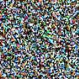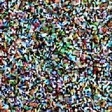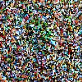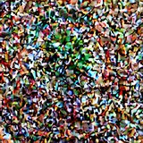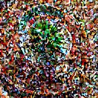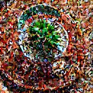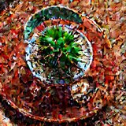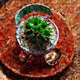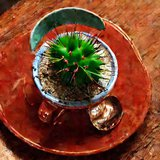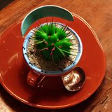
</div>
<p class="note-text" style="text-align: center; margin-top: 4px;">the latent after steps 3, 6, 9, … 30, decoded &nbsp;·&nbsp; the same prompt, mask and starting noise as method 1, strength 1</p>
```

:::{.incremental}
* Before the loop: shrink the mask and encode the masked image, once. Start from pure noise, or below strength 1 from the noised image, as in image-to-image.
* At every step: stack the 9 channels, predict the noise (twice, for guidance), and take an ordinary scheduler step. Nothing is put back, so outside the mask the frames are as noisy as inside.
* The model redraws the saucer and table from the masked image, together with the cactus. The result is very close to the photo outside the mask, but not its exact pixels. To keep those, paste the original back outside the mask at the end.
:::

## Try it: the two methods {.slightly-smaller}

```{=html}
<div class="dm-demo" data-demo="inpaint" style="--w: 255px;">
  <div class="dm-row">
    <div class="dm-col"><span class="dm-lab">the photo; the mask is pale</span></div>
    <div class="dm-col"><span class="dm-lab" style="color: #2c6fb7;">method 1: put the rest back</span></div>
    <div class="dm-col"><span class="dm-lab" style="color: #d9480f;">method 2: the inpainting model</span></div>
  </div>
  <div class="dm-prompt" data-role="text"></div>
  <div class="dm-ctl"><span>Mask:</span><span data-role="masks" style="display: contents;"></span>
    <span style="margin-left: 1em;">Strength:</span><span data-role="strengths" style="display: contents;"></span>
    <span style="margin-left: 1em;">Noise:</span><span data-role="seeds" style="display: contents;"></span></div>
</div>
```

:::{.incremental}
* Look at the edge of the mask. Method 1 often leaves a seam: a ring, or a piece of the old cup. Method 2's results fit their surroundings better, though not always.
* At strength 0.75, both often keep the coffee: the mask sets *where* the image may change, the strength how *much*.
:::

## Summary {.slightly-smaller}

| | what changes | which model |
|---|---|---|
| Image-to-image | the whole image, as much as the strength allows | any |
| Inpainting, method 1 | the mask only: the rest is put back after every step | any |
| Inpainting, method 2 | the mask only: the model is shown what to keep | one trained for inpainting |

:::{.incremental}
* All three run the ordinary sampling loop. Only the starting point, and what happens between steps, are new.
* None needs any training by you: the inpainting model is downloaded like any other.
:::
