## Changing one thing

Generating *an* image from a prompt is the easy part. Editing is harder: change one thing about an image, and keep everything else.

:::{.incremental}
* Rewriting the prompt usually changes everything: a different prompt is a different path from the noise.
* This lecture: four ways to make a targeted change, each intervening at a different point.
* **Prompt weighting** changes the text vectors. **Semantic guidance** changes the noise prediction at each step. **Inversion** recovers the noise behind a real photo, so that either can edit it. **Instruction-based editing** trains a model for the job.
:::

# Weighting the prompt

## Turning one word up or down {.slightly-smaller}

Libraries such as `compel` accept a weight on part of a prompt: *"a cottage in a forest, (snowy)1.5, warm light in the windows"*.

:::{.incremental}
* Nothing changes in the model or the sampling loop. Only the 77 text vectors the UNet attends to change.
* `compel` moves each vector away from (or towards) the vector for the empty prompt at the same position:
:::

. . .

$$z_i' = z_{\varnothing,i} + w_i\,\big(z_i - z_{\varnothing,i}\big)$$

:::{.incremental}
* $z_i$ is the text encoder's vector at position $i$, $z_{\varnothing,i}$ the empty prompt's, and $w_i$ the weight of the word there. Weight 1 changes nothing.
* For weights below 1, `compel` instead blends towards a version of the prompt with the word masked out.
* Because the text encoder is a transformer, the word's meaning is spread over *every* later position, not just its own. Weighting one position is only a partial dial.
:::

## Try it: weighting a word {.slightly-smaller}

```{=html}
<script src="pics/lec21/demos-data.js" defer></script>
<script src="pics/lec19_22_demos.js" defer></script>
<div class="dm-demo" data-demo="weight" style="--w: 290px;">
  <div class="dm-row">
    <div class="dm-col"><span class="dm-lab">weight 1: the plain prompt</span></div>
    <div class="dm-col"><span class="dm-lab" style="color: #d9480f;" data-role="wval"></span></div>
  </div>
  <div class="dm-prompt" data-role="text"></div>
  <div class="dm-ctl"><input type="range" data-role="w" aria-label="weight"></div>
  <div class="dm-ctl"><span data-role="prompts" style="display: contents;"></span>
    <span style="margin-left: 1em;">Noise:</span><span data-role="seeds" style="display: contents;"></span></div>
</div>
```

::: aside
Weights applied with `compel`; Stable Diffusion v1.5, 30 steps, guidance scale 7.5, the same starting noise at every weight. All images in this lecture are from our own runs.
:::

## What the weights did

:::{.incremental}
* *red* behaves like a dial: with noise A, the car is yellow at 0 (no colour asked for), orange at 0.5, and red from 0.8 up.
* *snowy* does not: with noise B, the picture jumps from a cottage to the view through a window between weights 0.5 and 0.8. The word changes everything after it in the prompt, so the whole scene can change.
* At weight 2 both images break down, and the cottage becomes a field of snowflakes.
* For this prompt, each text vector is about 28 long, but its difference from the empty prompt's is about 38. At weight 2, each weighted vector moves 38 further: further than its own length, and far from anything the UNet saw in training.
:::


# Semantic guidance

## Recall: guidance

From the Stable Diffusion lecture: each step predicts the noise twice, with and without the prompt, and exaggerates the difference:

$$\hat{\epsilon} = \hat{\epsilon}_{\text{uncond}} + s \,\big(\hat{\epsilon}_{\text{cond}} - \hat{\epsilon}_{\text{uncond}}\big)$$

. . .

The difference $\hat{\epsilon}_{\text{cond}} - \hat{\epsilon}_{\text{uncond}}$ is a direction: the way the prompt pushes the image, at this step, from this point.

. . .

Any *other* text gives another direction. What if we added one more?

## Semantic guidance (SEGA) {.slightly-smaller}

Predict the noise a third time, with an **edit prompt** such as *"autumn, orange leaves"*, and add a push in its direction:

$$\hat{\epsilon} = \hat{\epsilon}_{\text{uncond}} + s \,\big(\hat{\epsilon}_{\text{cond}} - \hat{\epsilon}_{\text{uncond}}\big) + s_e\, \mu \odot \big(\hat{\epsilon}_{\text{edit}} - \hat{\epsilon}_{\text{uncond}}\big)$$

:::{.incremental}
* $s_e$ is the **edit guidance scale**. Subtracting the term instead pushes *away* from the concept: fewer cars, no hat.
* $\mu$ is a mask of 0s and 1s, recomputed at each step: it keeps only the elements where the edit's push is largest. A threshold of 0.95 keeps the top 5% in each channel, so at each step the edit acts only where it matters most.
* The edit is held back for the first few steps (the **warm-up**), so that the layout settles before the edit starts.
* Nothing is trained: the direction is computed afresh at every step, from the model's own predictions. Each edit costs one more UNet call per step.
:::

::: {.note-text}
Brack *et al.*, *SEGA: Instructing text-to-image models using semantic guidance* (2023). The full method also adds momentum, carrying part of each step's edit over to the next.
:::

## Steering, again?

In the sparse-autoencoder lecture we steered a language model by adding a direction to its activations. SEGA also adds a direction, but a different kind.

:::{.incremental}
* The sparse-autoencoder feature was **learned**, once, and the same vector was added at every position and every step.
* SEGA's direction is **computed**, at every step, from the noise the model predicts with and without the edit prompt. It changes as the image forms.
* Both rely on the same observation: concepts correspond to directions in the model's internal spaces, and moving along one changes that concept and little else.
:::

## Try it: semantic guidance {.slightly-smaller}

```{=html}
<div class="dm-demo" data-demo="sega" style="--w: 255px;">
  <div class="dm-row">
    <div class="dm-col"><span class="dm-lab">no edit</span></div>
    <div class="dm-col"><span class="dm-lab" style="color: #d9480f;">with the edit</span></div>
    <div class="dm-col"><span class="dm-lab">where the edit acted</span><span data-role="mapnote"></span></div>
  </div>
  <div class="dm-prompt" data-role="text"></div>
  <div class="dm-ctl"><input type="range" data-role="g" aria-label="edit guidance scale"><span class="dm-out" data-role="gval" style="min-width: 22em;"></span></div>
  <div class="dm-ctl"><span data-role="edits" style="display: contents;"></span>
    <span style="margin-left: 1em;">Noise:</span><span data-role="seeds" style="display: contents;"></span></div>
</div>
```

::: aside
50 steps, guidance scale 7.5, warm-up 10 steps, threshold 0.95, with the momentum of the full method. *Where the edit acted*: the size of the edit term, averaged over the steps after the warm-up, with the strongest 0.5% shown fully orange. Momentum carries each step's edit into later steps, so over the whole run about half the latent gets some push, mostly weak.
:::

## Try it: the threshold {.slightly-smaller}

```{=html}
<div class="dm-demo" data-demo="segath" style="--w: 255px;">
  <div class="dm-row">
    <div class="dm-col"><span class="dm-lab">no edit</span></div>
    <div class="dm-col"><span class="dm-lab" style="color: #d9480f;">+ "autumn, orange leaves"</span></div>
    <div class="dm-col"><span class="dm-lab">where the edit acted</span></div>
  </div>
  <div class="dm-ctl"><input type="range" data-role="th" aria-label="edit threshold"><span class="dm-out" data-role="thval" style="min-width: 14em;"></span></div>
</div>
```

:::{.incremental}
* The edit lands mostly on the trees and the verges, and leaves most of the road and the cars alone. Nothing told it where the trees are.
* A lower threshold lets the edit act everywhere: more trees turn, and more of the picture changes.
* Edits can be combined, and subtracted. On noise A, *− cars* clears the kerb and keeps the houses and trees; noise B drew no cars, so there it has nothing to remove.
:::


# Editing a real photo

## A real photo has no noise

Weighting and SEGA both change how an image is generated from a *known* starting noise. A real photo was never generated, so there is no noise to start from.

:::{.incremental}
* Image-to-image adds *random* noise, and then the result is a different image.
* What we want is the reverse of generation: the noise that the sampler would turn into *this* photo.
* Then we can rerun the sampler from that noise, adding an edit along the way. This is **inversion**.
:::

## Which noise?

```{=html}
<div class="note-text" style="display: flex; gap: 16px; justify-content: center; align-items: flex-start; margin-top: 10px;">
<figure style="margin: 0; text-align: center;">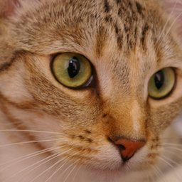<figcaption>the photo</figcaption></figure>
<figure style="margin: 0 0 0 26px; text-align: center;">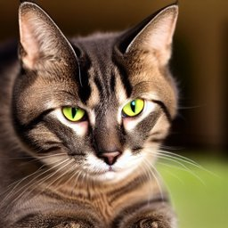<figcaption>random noise A</figcaption></figure>
<figure style="margin: 0; text-align: center;">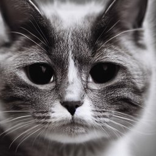<figcaption>random noise B</figcaption></figure>
<figure style="margin: 0 0 0 26px; text-align: center;">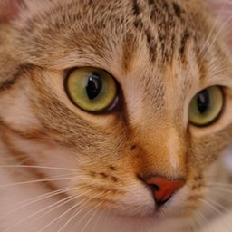<figcaption style="color: #d9480f; font-weight: 600;">the photo's own noise</figcaption></figure>
</div>
```

The last three run the same sampler on *"a photo of a cat"*, for 50 steps. Only the starting noise differs. The last noise was found from the photo, by running the sampler backwards (next slide).


## A sampler that can run backwards

`scheduler.step` guesses the clean latent, then moves part of the way towards it. **DDIM** does this with no fresh randomness:

$$\hat z_0 = \frac{z_t - \sqrt{1 - \bar\alpha_t}\;\hat\epsilon}{\sqrt{\bar\alpha_t}} \qquad\qquad z_{t-1} = \sqrt{\bar\alpha_{t-1}}\;\hat z_0 + \sqrt{1 - \bar\alpha_{t-1}}\;\hat\epsilon$$

:::{.incremental}
* It re-noises its guess with the noise it *predicted*, not with new noise. So the same starting noise always gives the same image.
* Run the same formula with $t$ increasing, and it takes an image towards noise: **DDIM inversion**.
* It is only approximate. Going backwards, the model has to predict the noise at $z_t$ before it has $z_t$, so it uses the prediction at the previous point instead.
:::

## How well it works

```{=html}
<div class="note-text" style="display: flex; gap: 14px; justify-content: center; align-items: flex-start; margin-top: 10px;">
<figure style="margin: 0; text-align: center;"><figcaption>the photo</figcaption></figure>
<figure style="margin: 0 0 0 20px; text-align: center;">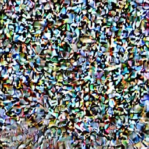<figcaption>its inverted noise, decoded</figcaption></figure>
<figure style="margin: 0 0 0 20px; text-align: center;"><figcaption>regenerated, <i>s</i> = 1</figcaption></figure>
<figure style="margin: 0; text-align: center;">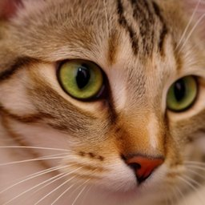<figcaption><i>s</i> = 3</figcaption></figure>
<figure style="margin: 0; text-align: center;">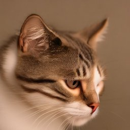<figcaption><i>s</i> = 7.5</figcaption></figure>
</div>
```

:::{.incremental}
* The inverted noise looks like any other noise: its numbers have mean 0.01 and standard deviation 0.98, as random noise would. Yet it turns back into this cat.
* We inverted without guidance, so regenerating at $s = 1$ follows the same path back. Stronger guidance changes every step's prediction, and at the usual $s = 7.5$ we get a different cat.
* That is a problem for editing, because edits like SEGA's are pushes *added to* guidance.
:::

## Exact inversion

The fix is to stop hoping the path runs backwards, and *record* what it would take to come back.

:::{.incremental}
* **Edit-friendly inversion** (Huberman-Spiegelglas *et al.*, 2024) noises the photo to every step independently, and at each step stores the extra noise the sampler needs to land exactly on the next, less noisy latent. Regenerating with those stored noises gives back the photo exactly.
* **LEDITS++** (Brack *et al.*, 2024) uses inversion of this kind, then edits with SEGA-style guidance, masked to where the edit concept is.
:::

## Editing the real photo

```{=html}
<div class="note-text" style="display: flex; gap: 12px; justify-content: center; align-items: flex-start; margin-top: 14px;">
<figure style="margin: 0; text-align: center;">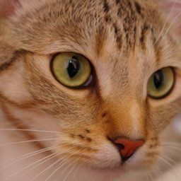<figcaption>no edit</figcaption></figure>
<figure style="margin: 0; text-align: center;">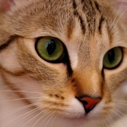<figcaption>+ "sleeping cat, closed eyes"</figcaption></figure>
<figure style="margin: 0; text-align: center;">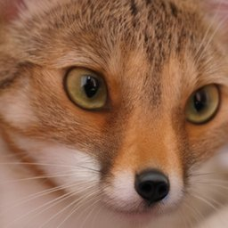<figcaption>+ "a fox"</figcaption></figure>
<figure style="margin: 0; text-align: center;">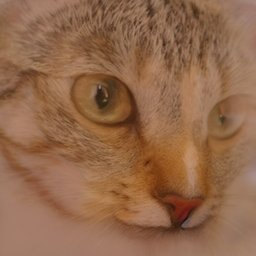<figcaption>+ "watercolour painting"</figcaption></figure>
<figure style="margin: 0; text-align: center;">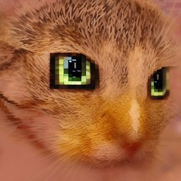<figcaption>+ "pixel art"</figcaption></figure>
</div>
```

LEDITS++ on the cat photo, threshold 0.75, edit scale 5 (15 for *pixel art*). With no edit, the photo comes back almost exactly.

:::{.incremental}
* The fox keeps the cat's pose, framing and lighting: only what the edit concerns has changed.
* Not every edit takes: *"sleeping"* barely touches the eyes, and *pixel art* needed three times the scale of the others.
* As with SEGA, the edit scale and threshold have to be tuned photo by photo.
:::


# Instruction-based editing

## Training a model to edit {.slightly-smaller}

Everything so far repurposes a model trained to *generate*. **InstructPix2Pix** (Brooks *et al.*, 2023) is trained to *edit*: given an image and an instruction such as *"make it a snowy winter night"*, it returns the edited image.

:::{.incremental}
* It needs training examples of (image, instruction, edited image). There was no such dataset, so the authors made one.
* They wrote 700 examples by hand: a caption, an instruction, the edited caption. A language model (GPT-3), fine-tuned on these, then wrote 454,445 more.
* For each caption pair, Stable Diffusion generated a before and after image, using a technique (Prompt-to-Prompt) that keeps both images as alike as possible apart from the edit. CLIP similarity filtered out failures.
* None of the training images are real photos, but the model works on them.
:::

## Two kinds of conditioning

The UNet is Stable Diffusion's, with 4 extra input channels: the input image's latent, stacked beside the noisy one, like the inpainting model's.

. . .

Guidance now has two scales: one for the image and one for the instruction.

$$\hat\epsilon = \hat\epsilon(\varnothing, \varnothing) + s_I\,\big(\hat\epsilon(I, \varnothing) - \hat\epsilon(\varnothing, \varnothing)\big) + s_T\,\big(\hat\epsilon(I, T) - \hat\epsilon(I, \varnothing)\big)$$

:::{.incremental}
* $\hat\epsilon(I, T)$ is the prediction given the image $I$ and the instruction $T$; $\varnothing$ means left out. Training left each out 5% of the time, so the model can make all three predictions.
* $s_I$ pulls towards the input image; $s_T$ pulls towards following the instruction. The paper suggests $s_I$ from 1 to 1.5 and $s_T$ from 5 to 10, tuned per image.
:::

## Try it: InstructPix2Pix {.slightly-smaller}

```{=html}
<div class="dm-demo" data-demo="p2p" style="--w: 290px;">
  <div class="dm-row">
    <div class="dm-col"><span class="dm-lab">the input image</span></div>
    <div class="dm-col"><span class="dm-lab" style="color: #d9480f;">the edit</span></div>
  </div>
  <div class="dm-prompt" data-role="text"></div>
  <div class="dm-ctl"><input type="range" data-role="si" aria-label="image guidance scale"><span class="dm-out" data-role="sival"></span>
    <input type="range" data-role="st" aria-label="text guidance scale" style="margin-left: 1.5em;"><span class="dm-out" data-role="stval"></span></div>
  <div class="dm-ctl" data-role="tasks"></div>
</div>
```

::: aside
`timbrooks/instruct-pix2pix`, 20 steps, the same noise throughout. Its UNet has 8 input channels: 4 for the noisy latent, 4 for the input image's.
:::

## What the grid shows

:::{.incremental}
* The two scales pull against each other. For the cat, a bronze statue needs $s_I$ of 1.5 or less and $s_T$ of 10 or more; at $s_I = 3$ the photo comes back almost unchanged.
* The rocket becomes a night scene, but no snow falls: half the instruction is followed.
* *"Make it a photograph"* gives a grey, vignetted photograph *of the drawing*. That is a fair reading of the words: instructions are as ambiguous as prompts.
* No setting suits every image. In practice you try a small grid, as here, and pick.
:::

## Choosing a tool

| to… | use | changes |
|---|---|---|
| strengthen or weaken part of a prompt | prompt weighting | the text vectors |
| add or remove a concept while generating | semantic guidance | each step's noise prediction |
| edit a real photo, keeping it otherwise exact | inversion + guidance (LEDITS++) | the noise, then each step |
| describe an edit in words | InstructPix2Pix | a model trained to edit |

. . .

Only the last needs a different model. The others work with any Stable Diffusion checkpoint, including your own fine-tuned ones.

## Summary

:::{.incremental}
* Weighting changes the text vectors, so it can change the whole image. Semantic guidance acts at each step, and its threshold keeps it to where the concept matters.
* A real photo first needs its noise. Running DDIM backwards finds it approximately; recording each step finds it exactly.
* InstructPix2Pix learns editing from 450,000 synthetic examples, and takes two guidance scales, one for the image and one for the instruction.
:::
