## What words can't say

A prompt is good at *what* should be in an image. It is clumsy at saying exactly *how* it should look, or exactly *where* things should go.

:::{.incremental}
* "In the style of this particular print" or "with this exact pose" takes a paragraph, and still misses.
* Both are easy to *show*, as an image.
* This lecture: two ways to add an image to the conditioning. **IP-Adapter** adds an image prompt, alongside the text. **ControlNet** adds a map of structure: edges, depth or a pose.
:::

# Prompting with an image

## Recall: cross-attention

From the Stable Diffusion lecture: at 16 places in the UNet, the $n$ positions of the feature map attend to the prompt's 77 token vectors $c_t$:

$$Q = X W_Q \qquad K = c_t W_K \qquad V = c_t W_V$$

$$\text{Attention}(Q,K,V) = \text{softmax}\!\big(QK^\top/\sqrt{d_k}\big)\,V$$

:::{.incremental}
* The queries come from the image being denoised; the keys and values from the text.
* To condition on an image instead, we need image vectors to attend to: a sequence of tokens, like the text's.
* The CLIP lecture gives us an encoder that puts images and text into a shared space. Could we just put a CLIP image embedding where the text vectors go?
:::

## Image tokens

**IP-Adapter** (Ye *et al.*, 2023) turns a reference image into 4 tokens:

:::{.incremental}
* A CLIP image encoder (OpenCLIP ViT-H/14, 632M parameters, frozen) gives one 1,024-dimensional vector for the whole image.
* A small trained projection, a linear layer and a layer norm, turns it into 4 tokens of 768 numbers: the same size as the text's tokens.
* But these tokens were never in the text encoder's space, and the UNet's $W_K$ and $W_V$ were trained only on text. So IP-Adapter doesn't put them where the text goes.
:::

## Decoupled cross-attention

```{=html}
<!-- hand-written for lec22: l22-ipadapter -->
<svg viewBox="0 0 1100 360" width="100%" xmlns="http://www.w3.org/2000/svg" font-family="IBM Plex Sans, sans-serif" role="img" aria-label="Decoupled cross-attention: the same queries from the UNet's feature map attend separately to the text tokens, through the original frozen key and value weights, and to the 4 image tokens, through new trained key and value weights. The image attention's output is scaled by lambda and added to the text attention's output.">
<defs><marker id="l22i-k" viewBox="0 0 10 10" refX="9" refY="5" markerWidth="5" markerHeight="5" orient="auto"><path d="M0 0 L10 5 L0 10 z" fill="#222"/></marker></defs>
<!-- queries -->
<rect x="20" y="146" width="170" height="68" rx="7" fill="#fff" stroke="#222" stroke-width="2.4"/>
<text x="105" y="174" text-anchor="middle" font-size="16" font-weight="700" fill="#000">UNet feature map</text>
<text x="105" y="198" text-anchor="middle" font-size="15" font-weight="500" fill="#444"><tspan font-style="italic">n</tspan> positions</text>
<path d="M194 180 L236 180" fill="none" stroke="#222" stroke-width="2.2" marker-end="url(#l22i-k)"/>
<text x="262" y="186" text-anchor="middle" font-size="20" font-weight="700" fill="#000" font-style="italic">Q</text>
<path d="M280 172 L330 92" fill="none" stroke="#222" stroke-width="2.2" marker-end="url(#l22i-k)"/>
<path d="M280 188 L330 268" fill="none" stroke="#222" stroke-width="2.2" marker-end="url(#l22i-k)"/>
<!-- text branch -->
<rect x="336" y="56" width="200" height="72" rx="7" fill="#ececec" stroke="#888" stroke-width="2.4"/>
<text x="436" y="86" text-anchor="middle" font-size="17" font-weight="700" fill="#555">attention to text</text>
<text x="436" y="110" text-anchor="middle" font-size="15" font-weight="600" fill="#777"><tspan font-style="italic">W</tspan><tspan font-size="11" dy="4">K</tspan><tspan dy="-4">, </tspan><tspan font-style="italic">W</tspan><tspan font-size="11" dy="4">V</tspan><tspan dy="-4"> frozen</tspan></text>
<rect x="336" y="4" width="200" height="34" rx="6" fill="#fff" stroke="#2c6fb7" stroke-width="2.2"/>
<text x="436" y="27" text-anchor="middle" font-size="15" font-weight="600" fill="#2c6fb7">77 text tokens</text>
<path d="M436 40 L436 52" fill="none" stroke="#222" stroke-width="2.2" marker-end="url(#l22i-k)"/>
<!-- image branch -->
<rect x="336" y="232" width="200" height="72" rx="7" fill="#fbe3d6" stroke="#d9480f" stroke-width="3"/>
<text x="436" y="262" text-anchor="middle" font-size="17" font-weight="700" fill="#000">attention to image</text>
<text x="436" y="286" text-anchor="middle" font-size="15" font-weight="700" fill="#d9480f">new <tspan font-style="italic">W′</tspan><tspan font-size="11" dy="4">K</tspan><tspan dy="-4">, </tspan><tspan font-style="italic">W′</tspan><tspan font-size="11" dy="4">V</tspan><tspan dy="-4"> trained</tspan></text>
<rect x="336" y="322" width="200" height="34" rx="6" fill="#fff" stroke="#d9480f" stroke-width="2.2"/>
<text x="436" y="345" text-anchor="middle" font-size="15" font-weight="600" fill="#d9480f">4 image tokens</text>
<path d="M436 320 L436 308" fill="none" stroke="#222" stroke-width="2.2" marker-end="url(#l22i-k)"/>
<!-- reference image and encoder -->
<image x="820" y="250" width="100" height="100" href="pics/lec22/hiroshige.jpg" preserveAspectRatio="xMidYMid slice"/>
<rect x="820" y="250" width="100" height="100" fill="none" stroke="#555" stroke-width="1"/>
<path d="M816 300 L760 300" fill="none" stroke="#222" stroke-width="2.2" marker-end="url(#l22i-k)"/>
<rect x="590" y="272" width="166" height="56" rx="7" fill="#ececec" stroke="#888" stroke-width="2.2"/>
<text x="673" y="296" text-anchor="middle" font-size="15" font-weight="700" fill="#555">CLIP image encoder</text>
<text x="673" y="316" text-anchor="middle" font-size="14" font-weight="600" fill="#d9480f">+ trained projection</text>
<path d="M590 318 L556 336 L540 339" fill="none" stroke="#222" stroke-width="2.2" marker-end="url(#l22i-k)"/>
<!-- combine -->
<path d="M540 92 L780 92 L780 158" fill="none" stroke="#222" stroke-width="2.2" marker-end="url(#l22i-k)"/>
<path d="M540 268 L700 268 L700 202 L756 182" fill="none" stroke="#222" stroke-width="2.2" marker-end="url(#l22i-k)"/>
<rect x="676" y="212" width="48" height="30" rx="5" fill="#fff" stroke="#d9480f" stroke-width="2"/>
<text x="700" y="234" text-anchor="middle" font-size="18" font-weight="700" fill="#d9480f" font-style="italic">× λ</text>
<circle cx="780" cy="180" r="20" fill="#fff" stroke="#222" stroke-width="2.2"/>
<text x="780" y="189" text-anchor="middle" font-size="24" font-weight="600" fill="#000">+</text>
<path d="M802 180 L866 180" fill="none" stroke="#222" stroke-width="2.2" marker-end="url(#l22i-k)"/>
<text x="930" y="186" text-anchor="middle" font-size="16" font-weight="700" fill="#000">to the next layer</text>
</svg>
```

$$\operatorname{softmax}\!\big(QK^\top/\sqrt{d_k}\big)\,V \;+\; \lambda\,\operatorname{softmax}\!\big(QK'^\top/\sqrt{d_k}\big)\,V'$$

::: {.small-text}
$K' = c_i W'_K$ and $V' = c_i W'_V$, where $c_i$ is the 4 image tokens. The same $Q$ attends to both.
:::

## What is trained

:::{.incremental}
* Only the new $W'_K$ and $W'_V$ in each of the 16 cross-attention layers (19.2M parameters, started as copies of $W_K$ and $W_V$) and the projection (3.2M): about 22M in all, against the UNet's 860M.
* Trained once, on about 10 million image–text pairs: the image prompt is the training image itself, so the adapter learns to reproduce what an image's embedding describes.
* At $\lambda = 0$ the model is exactly the original. $\lambda$ is the `scale` you set: a dial between the text and the image.
* The same adapter works with any fine-tuned model built on the same UNet, since that UNet is untouched.
:::

::: aside
Parameter counts measured on `ip-adapter_sd15`; training details from Ye *et al.*, *IP-Adapter* (2023).
:::

## Try it: an image prompt {.slightly-smaller}

```{=html}
<script src="pics/lec22/demos-data.js" defer></script>
<script src="pics/lec19_22_demos.js" defer></script>
<div class="dm-demo" data-demo="ip" style="--w: 255px;">
  <div class="dm-row">
    <div class="dm-col"><span class="dm-lab">the image prompt</span></div>
    <div class="dm-col"><span class="dm-lab" style="color: #d9480f;">text + image prompt</span></div>
    <div class="dm-col"><span class="dm-lab" style="color: #2c6fb7;">the style in words instead</span><span class="dm-prompt" data-role="wtext" style="margin: 0;"></span></div>
  </div>
  <div class="dm-prompt" data-role="text"></div>
  <div class="dm-ctl"><input type="range" data-role="scale" aria-label="IP-Adapter scale"><span class="dm-out" data-role="sval"></span></div>
  <div class="dm-ctl"><span data-role="prompts" style="display: contents;"></span>
    <span style="margin-left: 1em;">Image prompt:</span><span data-role="refs" style="display: contents;"></span></div>
</div>
```

::: aside
`ip-adapter_sd15` on Stable Diffusion v1.5, 30 steps, guidance scale 7.5, the same noise throughout. Image prompts: Hiroshige, *Sudden Shower over Shin-Ōhashi Bridge* (1857), and van Gogh, *The Large Plane Trees* (1889); Cleveland Museum of Art, CC0.
:::

## Style, or content?

:::{.incremental}
* At $\lambda = 0.2$, the reference's colours and textures start to arrive, and the bicycle or cat stays.
* By 0.4 to 0.6, we get the reference's *scene*: the bridge, the river, the plane trees. The bicycle or cat shrinks into a corner, or disappears.
* The CLIP image embedding describes everything in the image, its content as well as its style, and the adapter can't tell which one you meant.
* Here, naming the style in words did better. Later methods such as InstantStyle (Wang *et al.*, 2024) send the image tokens only into the UNet blocks that mostly carry style.
:::

## No text at all

```{=html}
<div class="note-text" style="display: flex; gap: 12px; justify-content: center; align-items: flex-start; margin-top: 10px;">
<figure style="margin: 0; text-align: center;">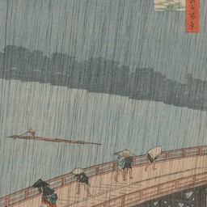<figcaption>image prompt</figcaption></figure>
<figure style="margin: 0; text-align: center;">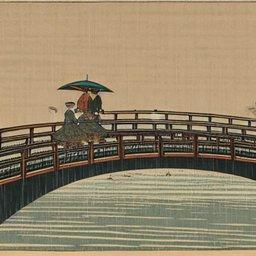<figcaption>variation</figcaption></figure>
<figure style="margin: 0 30px 0 0; text-align: center;">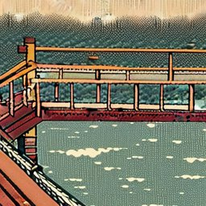<figcaption>variation</figcaption></figure>
<figure style="margin: 0; text-align: center;">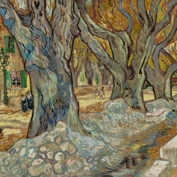<figcaption>image prompt</figcaption></figure>
<figure style="margin: 0; text-align: center;">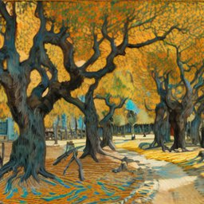<figcaption>variation</figcaption></figure>
</div>
```

:::{.incremental}
* With an empty text prompt and $\lambda = 1$, the image prompt alone gives *variations* on the reference: new pictures with its subject, composition and style.
* So the four image tokens carry a great deal: enough to rebuild the gist of a picture, though not its details.
:::


# Controlling structure

## A map of where things go

An image prompt says what an image is *like*. **ControlNet** (Zhang *et al.*, 2023) conditions on *structure*: a map of exactly where things are.

```{=html}
<div class="note-text" style="display: flex; gap: 12px; justify-content: center; align-items: flex-start; margin-top: 8px;">
<figure style="margin: 0; text-align: center;">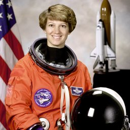<figcaption>a photo</figcaption></figure>
<figure style="margin: 0 0 0 26px; text-align: center;">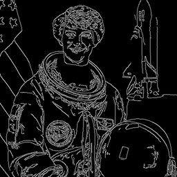<figcaption>edges (Canny)</figcaption></figure>
<figure style="margin: 0; text-align: center;">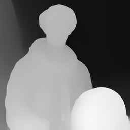<figcaption>depth (estimated by DPT)</figcaption></figure>
<figure style="margin: 0; text-align: center;">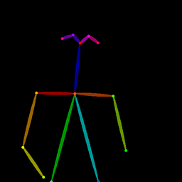<figcaption>pose (OpenPose)</figcaption></figure>
</div>
```

:::{.incremental}
* The maps come from the photo by ordinary image processing (edges) or by other models (depth, pose).
* A ControlNet is trained for one kind of map, on pairs of (map, image) made the same way from real photos.
* The text prompt still decides what the things *are*.
:::

## The architecture

```{=html}
<!-- hand-written for lec22: l22-controlnet -->
<svg viewBox="0 0 1100 400" width="100%" xmlns="http://www.w3.org/2000/svg" font-family="IBM Plex Sans, sans-serif" role="img" aria-label="ControlNet: on the left, the original UNet, frozen: encoder blocks going down, a middle block, decoder blocks going up, joined by skip connections. On the right, a trainable copy of the encoder and middle blocks takes the noisy latent plus the control map, passed through a zero convolution. Each copied block's output passes through another zero convolution and is added to the matching skip connection of the frozen UNet.">
<defs><marker id="l22c-k" viewBox="0 0 10 10" refX="9" refY="5" markerWidth="5" markerHeight="5" orient="auto"><path d="M0 0 L10 5 L0 10 z" fill="#222"/></marker><marker id="l22c-a" viewBox="0 0 10 10" refX="9" refY="5" markerWidth="5" markerHeight="5" orient="auto"><path d="M0 0 L10 5 L0 10 z" fill="#d9480f"/></marker></defs>
<text x="230" y="24" text-anchor="middle" font-size="17" font-weight="700" fill="#555">the UNet, frozen</text>
<text x="780" y="24" text-anchor="middle" font-size="17" font-weight="700" fill="#d9480f">a trainable copy of its encoder</text>
<!-- frozen encoder -->
<rect x="40" y="60" width="140" height="50" rx="6" fill="#ececec" stroke="#888" stroke-width="2.2"/><text x="110" y="91" text-anchor="middle" font-size="15" font-weight="700" fill="#555">encoder 64×64</text>
<rect x="60" y="150" width="120" height="50" rx="6" fill="#ececec" stroke="#888" stroke-width="2.2"/><text x="120" y="181" text-anchor="middle" font-size="15" font-weight="700" fill="#555">encoder 32×32</text>
<rect x="80" y="240" width="100" height="50" rx="6" fill="#ececec" stroke="#888" stroke-width="2.2"/><text x="130" y="271" text-anchor="middle" font-size="15" font-weight="700" fill="#555">… 8×8</text>
<rect x="160" y="330" width="140" height="50" rx="6" fill="#ececec" stroke="#888" stroke-width="2.2"/><text x="230" y="361" text-anchor="middle" font-size="15" font-weight="700" fill="#555">middle</text>
<!-- frozen decoder -->
<rect x="280" y="60" width="140" height="50" rx="6" fill="#ececec" stroke="#888" stroke-width="2.2"/><text x="350" y="91" text-anchor="middle" font-size="15" font-weight="700" fill="#555">decoder 64×64</text>
<rect x="280" y="150" width="120" height="50" rx="6" fill="#ececec" stroke="#888" stroke-width="2.2"/><text x="340" y="181" text-anchor="middle" font-size="15" font-weight="700" fill="#555">decoder 32×32</text>
<rect x="280" y="240" width="100" height="50" rx="6" fill="#ececec" stroke="#888" stroke-width="2.2"/><text x="330" y="271" text-anchor="middle" font-size="15" font-weight="700" fill="#555">… 8×8</text>
<g fill="none" stroke="#222" stroke-width="2.2">
<path d="M110 114 L110 146" marker-end="url(#l22c-k)"/><path d="M120 204 L120 236" marker-end="url(#l22c-k)"/><path d="M130 294 L170 326" marker-end="url(#l22c-k)"/>
<path d="M290 326 L330 294" marker-end="url(#l22c-k)"/><path d="M340 236 L340 204" marker-end="url(#l22c-k)"/><path d="M350 146 L350 114" marker-end="url(#l22c-k)"/>
</g>
<!-- skip connections -->
<g fill="none" stroke="#888" stroke-width="2" stroke-dasharray="5 4">
<path d="M184 85 L276 85" marker-end="url(#l22c-k)"/><path d="M184 175 L276 175" marker-end="url(#l22c-k)"/><path d="M184 265 L276 265" marker-end="url(#l22c-k)"/>
</g>
<circle cx="236" cy="85" r="11" fill="#fff" stroke="#d9480f" stroke-width="2.2"/><text x="236" y="91" text-anchor="middle" font-size="16" font-weight="700" fill="#d9480f">+</text>
<circle cx="236" cy="175" r="11" fill="#fff" stroke="#d9480f" stroke-width="2.2"/><text x="236" y="181" text-anchor="middle" font-size="16" font-weight="700" fill="#d9480f">+</text>
<circle cx="236" cy="265" r="11" fill="#fff" stroke="#d9480f" stroke-width="2.2"/><text x="236" y="271" text-anchor="middle" font-size="16" font-weight="700" fill="#d9480f">+</text>
<circle cx="316" cy="355" r="11" fill="#fff" stroke="#d9480f" stroke-width="2.2"/><text x="316" y="361" text-anchor="middle" font-size="16" font-weight="700" fill="#d9480f">+</text>
<!-- trainable copy -->
<rect x="700" y="60" width="140" height="50" rx="6" fill="#fbe3d6" stroke="#d9480f" stroke-width="2.6"/><text x="770" y="91" text-anchor="middle" font-size="15" font-weight="700" fill="#000">encoder 64×64</text>
<rect x="700" y="150" width="120" height="50" rx="6" fill="#fbe3d6" stroke="#d9480f" stroke-width="2.6"/><text x="760" y="181" text-anchor="middle" font-size="15" font-weight="700" fill="#000">encoder 32×32</text>
<rect x="700" y="240" width="100" height="50" rx="6" fill="#fbe3d6" stroke="#d9480f" stroke-width="2.6"/><text x="750" y="271" text-anchor="middle" font-size="15" font-weight="700" fill="#000">… 8×8</text>
<rect x="680" y="330" width="140" height="50" rx="6" fill="#fbe3d6" stroke="#d9480f" stroke-width="2.6"/><text x="750" y="361" text-anchor="middle" font-size="15" font-weight="700" fill="#000">middle</text>
<g fill="none" stroke="#222" stroke-width="2.2">
<path d="M770 114 L770 146" marker-end="url(#l22c-k)"/><path d="M760 204 L760 236" marker-end="url(#l22c-k)"/><path d="M750 294 L750 326" marker-end="url(#l22c-k)"/>
</g>
<!-- zero convs from the copy into the skips, routed through the gaps between levels -->
<g font-size="13" font-weight="700" fill="#d9480f" text-anchor="middle">
<rect x="520" y="115" width="76" height="26" rx="5" fill="#fff" stroke="#d9480f" stroke-width="2"/><text x="558" y="133">zero conv</text>
<rect x="520" y="205" width="76" height="26" rx="5" fill="#fff" stroke="#d9480f" stroke-width="2"/><text x="558" y="223">zero conv</text>
<rect x="520" y="295" width="76" height="26" rx="5" fill="#fff" stroke="#d9480f" stroke-width="2"/><text x="558" y="313">zero conv</text>
<rect x="520" y="342" width="76" height="26" rx="5" fill="#fff" stroke="#d9480f" stroke-width="2"/><text x="558" y="360">zero conv</text>
</g>
<g fill="none" stroke="#d9480f" stroke-width="2.2">
<path d="M696 85 L650 85 L650 128 L600 128"/><path d="M516 128 L236 128 L236 101" marker-end="url(#l22c-a)"/>
<path d="M696 175 L650 175 L650 218 L600 218"/><path d="M516 218 L236 218 L236 191" marker-end="url(#l22c-a)"/>
<path d="M696 265 L650 265 L650 308 L600 308"/><path d="M516 308 L236 308 L236 281" marker-end="url(#l22c-a)"/>
<path d="M676 355 L600 355"/><path d="M516 355 L330 355" marker-end="url(#l22c-a)"/>
</g>
<!-- inputs to the copy -->
<rect x="880" y="40" width="200" height="34" rx="6" fill="#fff" stroke="#222" stroke-width="2"/>
<text x="980" y="63" text-anchor="middle" font-size="15" font-weight="600" fill="#000">noisy latent, prompt</text>
<image x="930" y="110" width="100" height="100" href="pics/lec22/depth.png" preserveAspectRatio="xMidYMid slice"/>
<rect x="930" y="110" width="100" height="100" fill="none" stroke="#555" stroke-width="1"/>
<text x="922" y="160" text-anchor="end" font-size="15" font-weight="600" fill="#000">control</text><text x="922" y="180" text-anchor="end" font-size="15" font-weight="600" fill="#000">map</text>
<rect x="890" y="244" width="180" height="26" rx="5" fill="#fff" stroke="#d9480f" stroke-width="2"/>
<text x="980" y="262" text-anchor="middle" font-size="13" font-weight="700" fill="#d9480f">small encoder + zero conv</text>
<g fill="none" stroke="#222" stroke-width="2.2">
<path d="M880 57 L862 57 L862 72 L844 72" marker-end="url(#l22c-k)"/>
<path d="M980 212 L980 242"/>
<path d="M890 257 L862 257 L862 98 L844 98" marker-end="url(#l22c-k)"/>
</g>
</svg>
```

::: aside
Simplified: Stable Diffusion's encoder has 12 blocks at four sizes, so there are 13 zero convolutions into the frozen UNet, one per skip connection and one into the middle.
:::

## Zero convolutions {.slightly-smaller}

The copy's outputs are added into the frozen UNet through **zero convolutions**: 1 × 1 convolutions whose weights and biases start at exactly 0.

:::{.incremental}
* So at the start of training the ControlNet adds nothing, and the model behaves exactly as before. Training can only *add* control, gradually, without first wrecking the model.
* The copy starts from the UNet's own encoder weights, so it already knows how to read images. It only has to learn to read the map.
* The original UNet is frozen, so its 860M parameters need no gradients or optimiser state. The paper reports that training costs only about 23% more memory and 34% more time per step than ordinary fine-tuning.
* The copy is big: 361M parameters for each kind of map.
:::

::: aside
Zhang, Rao and Agrawala, *Adding conditional control to text-to-image diffusion models* (2023). Parameter count measured on `control_v11p_sd15_canny`.
:::

## The conditioning scale

In `diffusers`, `controlnet_conditioning_scale` multiplies all 13 of the ControlNet's outputs before they are added in.

:::{.incremental}
* At 0 the ControlNet does nothing: plain text-to-image.
* At 1 its outputs are added as trained. Above 1, the map is enforced more strictly than in training.
* The pipeline applies the ControlNet to both of guidance's predictions, with and without the prompt, so the map shapes every image the prompt pushes away from as well as the one it pushes towards.
:::

## Try it: ControlNet {.slightly-smaller}

```{=html}
<div class="dm-demo" data-demo="cn" style="--w: 290px;">
  <div class="dm-row">
    <div class="dm-col"><span class="dm-lab">the control map</span></div>
    <div class="dm-col"><span class="dm-lab" style="color: #d9480f;">the result</span></div>
  </div>
  <div class="dm-prompt" data-role="text"></div>
  <div class="dm-ctl"><input type="range" data-role="scale" aria-label="conditioning scale"><span class="dm-out" data-role="sval" style="min-width: 12em;"></span></div>
  <div class="dm-ctl" data-role="maps"></div>
</div>
```

::: aside
A different ControlNet for each kind of map (the `control_v11` models), on Stable Diffusion v1.5: 30 steps, guidance scale 7.5, the same noise throughout. At scale 0 all three give the same image.
:::

## How much the map decides {.slightly-smaller}

```{=html}
<div class="note-text" style="display: grid; grid-template-columns: auto repeat(3, 165px); gap: 6px 12px; justify-content: center; align-items: center; margin-top: 4px;">
<span></span><span style="text-align: center; font-weight: 600;">edges</span><span style="text-align: center; font-weight: 600;">depth</span><span style="text-align: center; font-weight: 600;">pose</span>
<span style="text-align: right; font-style: italic;">"a photograph of<br>a robot in a workshop"</span>
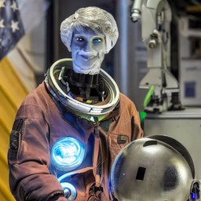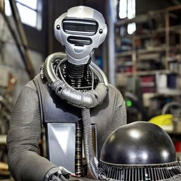
<span style="text-align: right; font-style: italic;">no prompt at all</span>
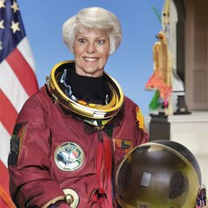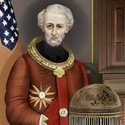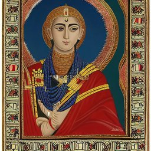
</div>
```

:::{.incremental}
* The edge map holds so much that, with no prompt, it rebuilds something close to the original photo; even the robot keeps the astronaut's face.
* The pose map holds only a skeleton, so the prompt (or, with none, the model) decides everything else.
* Choose the map for how much you want to fix: edges for the outline, depth for the layout, pose for only the figure.
:::


# Everything at once

## Where each signal enters

The text, the image prompt and the control map each enter the UNet in a different place, so they can be used together.

:::{.incremental}
* The **text** enters through cross-attention: *what* the image shows.
* The **image prompt** enters through its own cross-attention, scaled by $\lambda$: what it looks *like*.
* The **control map** enters through the skip connections, scaled by the conditioning scale: *where* things go.
:::

## All three together {.slightly-smaller}

```{=html}
<div class="note-text" style="display: grid; grid-template-columns: repeat(4, 165px); gap: 6px 12px; justify-content: center; align-items: center; margin-top: 4px;">
<span style="text-align: center; font-weight: 600;">depth map + image prompt</span><span style="text-align: center; font-weight: 600;"><i>λ</i> = 0</span><span style="text-align: center; font-weight: 600;"><i>λ</i> = 0.5</span><span style="text-align: center; font-weight: 600;"><i>λ</i> = 0.7</span>
<div style="display: flex; gap: 4px;"></div>
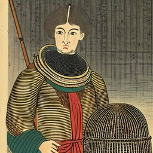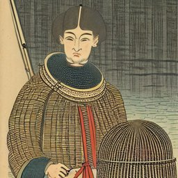
<div style="display: flex; gap: 4px;"></div>
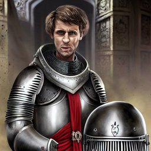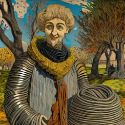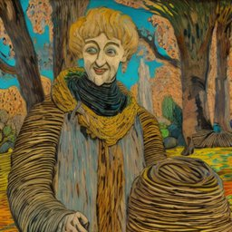
</div>
```

:::{.incremental}
* The prompt is *"a knight in armour"*; the depth map fixes the pose (conditioning scale 0.8); the image prompt sets the look.
* The depth map holds the figure in place at every $\lambda$. As $\lambda$ grows, the armour gives way to the reference's textures, and van Gogh's trees grow behind the figure: content leaks in again.
:::

## Summary

:::{.incremental}
* **IP-Adapter** adds an image prompt: 4 tokens from a CLIP image embedding, read by new cross-attention weights (22M trained parameters), scaled by $\lambda$. It carries content as well as style.
* **ControlNet** adds a map of structure: a trainable copy of the UNet's encoder, joined through zero convolutions. The more detailed the map, the less is left to the prompt.
* Both leave the UNet frozen, so they combine with each other, and with fine-tuned models such as lecture 19's DreamBooth LoRA.
:::


::: aside
If a pixel-wise metric like MSE or SSIM won't capture "did this look good", it's because it only checks *exact* pixel agreement with a reference: it can't tell a plausible variation from a bad one. FID and CLIP score exist as distributional and prompt-alignment alternatives respectively. The mechanics are self-contained in the optional evaluating-image-generation notebook, so we won't dwell on them here.
:::
